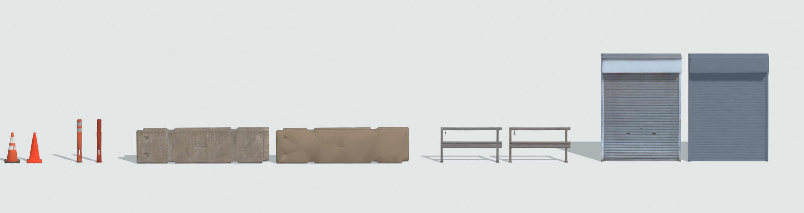
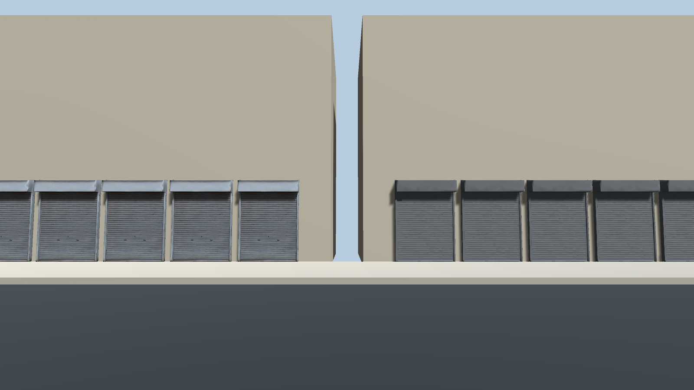
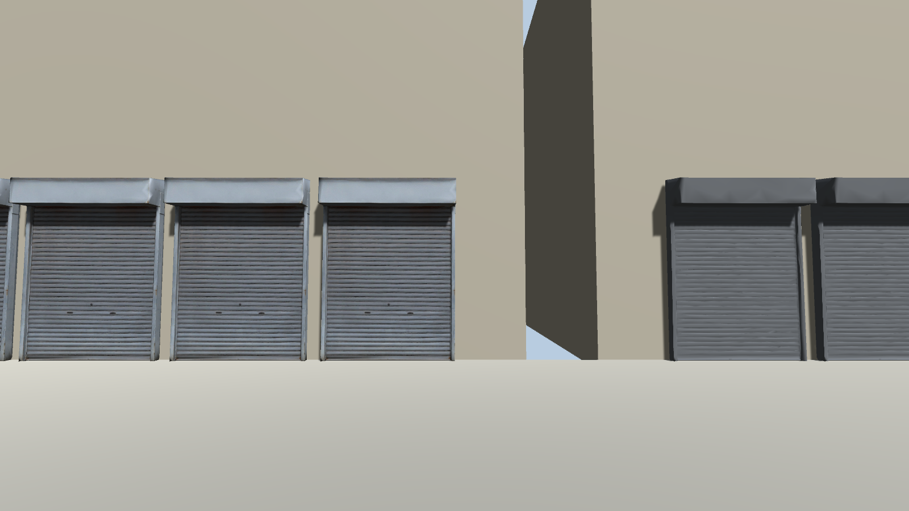
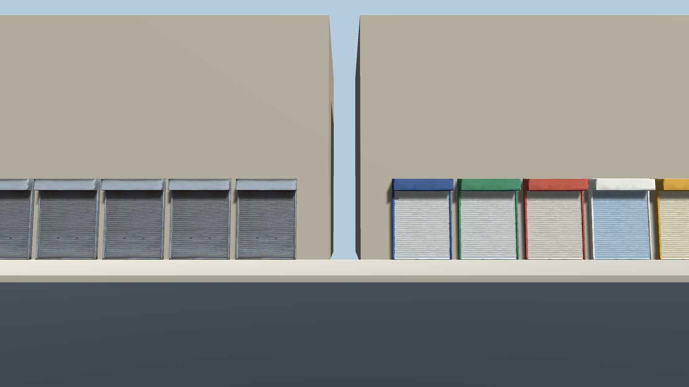
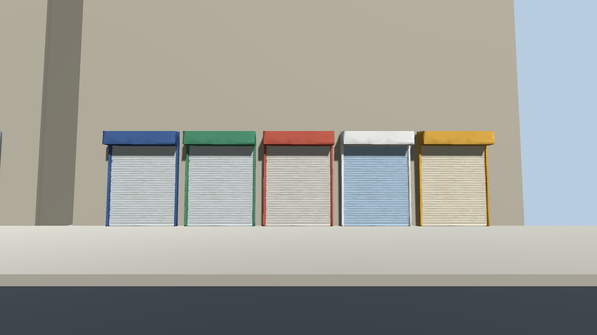
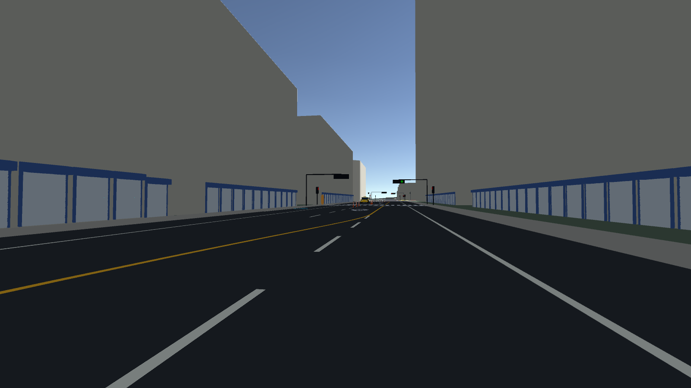
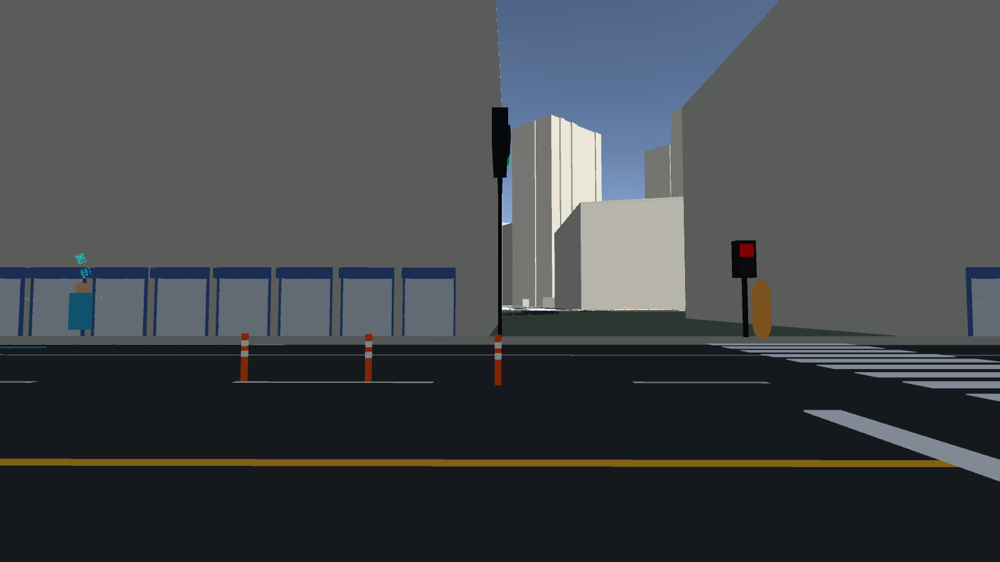
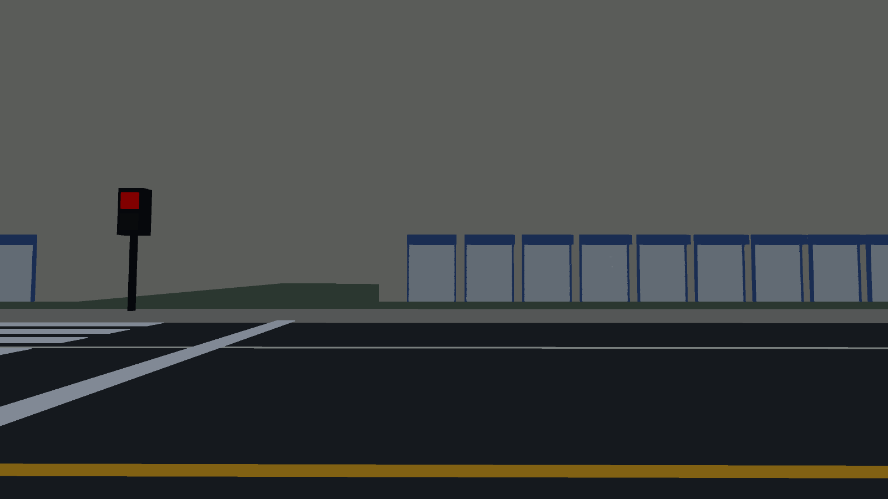
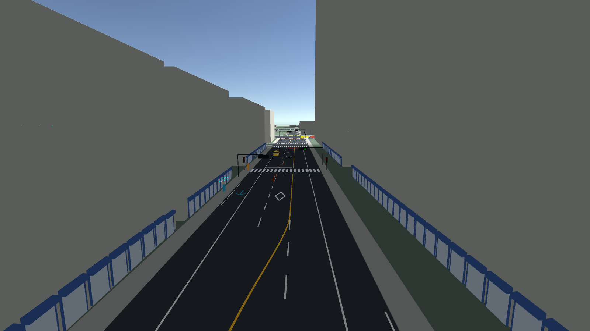

# Megascans 시험 소품 (2026-11-27)

Fab의 Quixel Megascans 무료 3D 모델 중 도로 소품 5개를 시험용으로 받았다. 게임에는 아직 넣지 않았다.
목적은 실사 스캔 소품을 카툰 목표 아트(`docs/proposals/art-conversion-guide.md`)에 맞춰 단색 재질로 바꿔 쓸 수 있는지 보는 것이다.

## Git에 올리지 않는 이유

이 저장소는 GitHub 공개 저장소다. Fab 표준 라이선스(EULA 5a)는 콘텐츠 원본을 **함께 개발하는 협업자에게 비공개 저장소로만** 공유하도록 허용한다.
일반 배포는 게임에 통합된 형태로만 허용된다(4c, 최종 사용자가 추출할 수 없게).
따라서 이 폴더의 FBX·텍스처·ZIP은 `.gitignore`로 제외하고, 이 README와 비교 렌더 `trial-render.png`만 커밋한다.
렌더 이미지는 EULA 4b("콘텐츠를 사용하여 생성된 이미지")에 해당한다. 다른 PC에서는 아래 목록 주소에서 Fab 로그인 후 다시 받는다.

## 받은 파일

모두 FBX **Low** 품질 ZIP이다(1K 텍스처: BaseColor·Normal·Roughness·AO, 셔터는 Gloss·Specular·Cavity·Bump 추가). 판매자는 Quixel Megascans이고, 라이선스는 Fab EULA(fab_eula v1, 최종 업데이트 2024-10-01) 표준 라이선스다(개인·기업 등급 모두 0원). 2026-11-27에 사용자 Fab 계정으로 EULA에 동의한 뒤 받았다.

| 폴더 | Fab 상품 | 실제 크기(m) | 면 수 | ZIP 바이트 | ZIP SHA256 |
|---|---|---|---|---|---|
| `traffic_cone_uhcgdgufa` | [Traffic Cone](https://www.fab.com/listings/df4cf621-d2b3-4981-a788-1fb9573f5bfa) | 0.36×0.36×0.69 | 364 | 1,847,453 | `b0ddf1c69e44a7aacd118ba57748f1df23b4e4a5ed576644d27d77e27b477767` |
| `traffic_delineator_post_vjxscee` | [Traffic Delineator Post](https://www.fab.com/listings/aa334de8-3fed-4c7d-96f6-1b21eb9048df) | 0.16×0.16×1.01 | 552 | 1,202,697 | `31071bfac17e6cc056e98fc73633a68f8558efa6cf5a0e25697e84e9a1ab9324` |
| `concrete_barrier_sefw3` | [Concrete Barrier](https://www.fab.com/listings/eca5150b-88fe-4b2c-b542-09e87c3e0ce0) | 3.04×0.46×0.79 | 882 | 1,683,749 | `5ece276b1e5a7c3e2e122402071bb174f1009f676034c852987448d96c403b2c` |
| `modular_metal_guardrail_kit_wkglfajdw` | [Modular Metal Guardrail Kit](https://www.fab.com/listings/852cdc90-eaf4-4701-8169-3a95b79886a9) | 1.42×0.16×0.80 | 4,072 | 1,907,373 | `c76924ffd92fbc2645060745fefccdd0d2b1341e5049355ef52bdfb5942bcfe8` |
| `urban_japanese_street_shutter_metal_modular_02_xfcrfdhsc` | [Urban Japanese Street Shutter Metal Modular 02](https://www.fab.com/listings/40111f38-590b-403a-9c96-70aee1a844c2) | 1.84×0.41×2.51 | 3,163 | 6,263,211 | `b8ffc0ae86e510bbf8b082c7d86c63befb4a0fd313845f6168fdd9af086e131b` |

원본 ZIP은 `_downloads/`에 있고, 각 폴더는 그 ZIP을 그대로 푼 것이다. 같은 상품에 Mid(약 2.7천~1.3만 면), High(약 1.1만~2.5만 면), Raw(100만~300만 면) 파일도 있지만 받지 않았다.

## 비교 렌더

물건마다 왼쪽은 스캔 텍스처, 오른쪽은 BaseColor 대표색 하나만 칠한 단색이다. 다음 명령으로 다시 만든다(Blender 5.2에서 확인).

    blender -b --factory-startup -P tools/art/render_megascans_trial.py -- art-source/megascans-trial art-source/megascans-trial/trial-render.png

## 시험 결과

| 소품 | 단색 전환 | 판단 |
|---|---|---|
| 상가 셔터 | 형태만으로 셔터로 읽힘 | **가장 쓸 만함.** 저층 상가 1층 정면 모듈 후보 |
| 라바콘 | 형태는 좋지만 흰 반사띠가 사라짐 | 쓰려면 2색(주황+흰 띠) 분리가 필요 |
| 시선유도봉 | 라바콘과 같음. 반사띠가 사라짐 | 2색 분리 필요. 1천 면 미만이라 가벼움 |
| 콘크리트 방호벽 | 스캔 표면의 울퉁불퉁함이 단색에서 더 드러나고 색이 누렇게 뜸 | 카툰용으로는 직접 만든 단순 상자가 나음 |
| 금속 가드레일 키트 | 한국 도로의 W형 가드레일이 아니라 난간 모양 | 도로용 부적합 |

공통: Low 품질도 1천 면 안팎이라 소품으로 가볍다. 단색 하나로는 반사띠·표지 같은 정보가 사라지므로, 쓰려면 Blender에서 영역별 재질을 나누는 작업이 필요하다. Unity 기본 렌더 파이프라인에 넣을 때는 Specular setup에 Gloss를 쓰거나, Roughness를 뒤집어 Smoothness로 바꿔야 한다. Unity 시험은 상가 셔터만 했다(아래).

## Unity 시험: 상가 셔터 (2026-11-27, 2026-11-28 취소)

> 2026-11-28 사용자 결정으로 셔터 적용은 취소했다. `MegascansShutterTrial.cs`·`ShopShutterTrial.cs`와 로컬 `Assets/ArtTrial/` 사본을 지웠다. 아래 기록과 비교 이미지는 경과로만 남긴다. 다음 후보는 [적용 후보 문서](../../docs/proposals/2026-11-28-fab-megascans-application-candidates.md)에 있다.

셔터를 Unity 2022.3 기본 렌더 파이프라인에 넣고, 게임 건물 색(0.70, 0.67, 0.60)의 상자 건물 두 채 1층에 5개씩 붙여 찍었다. 왼쪽 건물은 스캔 텍스처, 오른쪽 건물은 단색이다.

- 원본은 Git에서 제외되는 `unity/EungyeTaxi/Assets/ArtTrial/MegascansShutter/`에 복사했다. Resources 밖이라 배포 빌드에 들어가지 않는다.
- 시험 코드는 `unity/EungyeTaxi/Assets/Editor/MegascansShutterTrial.cs`다. 저장하지 않는 빈 씬을 만들어 찍으므로 `FirstDrive.unity`는 건드리지 않는다.
- 스캔 재질은 `Standard (Specular setup)`을 쓴다. Specular RGB와 Gloss(알파)를 한 PNG로 합치고, Normal·AO 맵을 넣었다. 단색 재질은 BaseColor 평균색(0.36, 0.37, 0.39)에 게임 건물과 같은 광택 0.12를 준 `Standard`다.
- 크기는 1.84×2.51×0.41 m로 단위 변환 없이 맞았다. FBX 앞면이 +Z라 180° 돌렸다.

판독:
- **스캔 텍스처판**: 회색 상자 건물에 붙여도 상가 1층 셔터로 바로 읽힌다. 다만 건물 벽은 단색이라 셔터만 실사로 도드라진다.
- **단색판**: 셔터 골은 메시 형상만으로도 보인다. 다만 평균색이 어두워 슬레이트 판처럼 보인다. 카툰 톤으로 쓰려면 더 밝은 색과 셔터함·몸체 2색 분리가 필요하다.
- 셔터 하나가 3,163면이다. 상가 한 줄에 수십 개를 놓으면 면 수가 빠르게 늘어나므로, 실제 배치 때는 LOD나 합치기가 필요하다.

다시 찍기(다른 Unity가 이 프로젝트를 열고 있지 않을 때):

    Unity.exe -batchmode -quit -projectPath unity/EungyeTaxi -executeMethod MegascansShutterTrial.Run -logFile artifacts/logs/shutter-trial.log

### 카툰 색 다듬기

텍스처 없이 셔터를 두 부분으로 나눠 칠했다. 몸체(셔터 판)는 밝은 색, 테두리(위쪽 셔터함과 양옆 레일)는 진한 포인트색이다. 오른쪽 건물에 5가지 조합을 나란히 놓고, 왼쪽 건물에는 비교용 스캔판을 두었다.

| 순서 | 이름 | 몸체 | 테두리 |
|---|---|---|---|
| 1 | navy | 연회색 (0.76, 0.78, 0.78) | 남색 (0.20, 0.33, 0.55) |
| 2 | green | 연회색 (0.76, 0.78, 0.78) | 초록 (0.24, 0.52, 0.38) |
| 3 | brick | 웜 그레이 (0.79, 0.77, 0.73) | 벽돌색 (0.74, 0.31, 0.24) |
| 4 | skyblue | 하늘색 (0.62, 0.72, 0.80) | 흰색 (0.93, 0.93, 0.91) |
| 5 | mustard | 크림 (0.84, 0.80, 0.70) | 겨자색 (0.86, 0.64, 0.22) |

- 나누는 방법: 셔터 높이 상단 16%를 셔터함, 폭 양끝 각 5.5%를 레일로 보고, 삼각형 세 꼭짓점이 모두 그 영역에 있을 때만 테두리로 칠한다. 처음에는 삼각형 중심점으로 나눴는데, 셔터 판 끝 삼각형이 섞여 레일 경계가 톱니처럼 보였다. 꼭짓점 기준으로 바꾼 뒤 깔끔해졌다(셔터 하나 3,170개 삼각형 중 테두리 652개).
- 결과: 단색 한 가지일 때의 어두운 슬레이트 느낌이 사라지고, 회색 상자 건물에서도 가게마다 다른 상가 1층으로 읽힌다. 셔터 판의 골은 메시 형상만으로 충분히 보인다.
- 남은 아쉬움: 스캔 메시라 셔터함 표면에 미세한 주름 음영이 남는다. 더 깔끔한 카툰 톤이 필요하면 셔터함만 단순 상자로 바꾸는 것이 낫다.

    Unity.exe -batchmode -quit -projectPath unity/EungyeTaxi -executeMethod MegascansShutterTrial.RunCartoon -logFile artifacts/logs/shutter-cartoon.log

### 은계 지도 상가에 붙이기 (남색)

J6480~J7204 상가 앞길(x 587~708, z≈255)의 1층 정면에 남색 셔터를 붙여 실제 게임 화면으로 찍었다. 길 북쪽은 18 m 상가 건물 3동(3339·3340·3342), 남쪽은 호반써밋 플레이스 주상복합(3332·3333) 저층부다.

- 붙이는 규칙: 건물 중심이 x 575~720, z 200~305에 있는 지도 원본(NGII) 건물만 대상이다. 외곽선 변 중 3.15 m 이상이고, 바깥쪽이 24 m 안의 가장 가까운 도로를 향하는 변에 2.15 m 간격으로 붙인다. 셔터 위치가 x 587~708 밖이면 붙이지 않는다. 남쪽 주상복합의 북쪽 벽은 길이가 115 m라 상가 구간 밖까지 이어지기 때문이다. 결과는 5동 131개다. 충돌체는 없다.
- 게임 식당 같은 시설 건물(`restaurant`)은 정면을 막지 않도록 제외했다.
- 평소에는 꺼져 있다. 실행 인자 `-shopShutters`를 줄 때만 붙는다. `-shopShutterTrial`은 붙인 뒤 화면 5장을 `artifacts/shop-shutter/`에 찍고 종료한다(`-shopShutterTest`를 함께 주면 시험 모드라 저장 파일을 건드리지 않는다).
- 셔터 프리팹은 `MegascansShutterTrial.BakeNavy`가 `Assets/ArtTrial/Resources/MegascansShutter/`에 굽는다. 시험 빌드 때만 `Resources`로 두고, 끝나면 `Resources~`로 바꿔 Unity가 무시하게 했다. 다른 세션의 배포 빌드에 섞이지 않게 하려는 것이다. 다시 빌드하려면 이름을 `Resources`로 돌린 뒤 `PrototypeBuild.BuildHybridTrial -trialOutput ../../artifacts/shop-shutter-trial/EungyeTaxi.exe`를 실행하고 다시 `Resources~`로 바꾼다.
- 시험 실행본: `artifacts/shop-shutter-trial/EungyeTaxi.exe -shopShutters`(Git 제외, 이 PC에만 있음).

판독:
- 남색 셔터함과 레일이 회색 건물에서 잘 보여, 길 양쪽이 "셔터 내린 상가 거리"로 읽힌다.
- 게임 조명에서는 길 쪽 건물 정면이 그늘이라 셔터 판이 보랏빛 회색으로 보이고, 멀리서는 골이 거의 안 보인다. 시험 씬보다 몸체가 어둡게 보인다.
- 셔터가 빈틈없이 이어져 한 줄로 길게 보인다. 실제 상가처럼 보이려면 셔터 사이에 기둥·유리문·간판을 섞어야 한다.

## 게임에 넣게 되면

- Unity `Assets/` 아래 파일도 공개 저장소에 올라가므로, 원본 FBX·텍스처를 그대로 넣으면 위 공유 제한에 걸린다. 넣기 전에 저장소 공개 범위를 정하거나, 원본 대신 직접 다시 만든 메시를 쓸지 결정해야 한다.
- 배포 실행 폴더(`builds/EungyeTaxi/`)에 빌드된 형태로 들어가는 것은 4c 범위다.
- 개인 등급은 최근 12개월 디지털 콘텐츠 매출 10만 달러 미만일 때만 해당한다(EULA 2a). 기업 등급도 0원이다.
- 지도 편집기처럼 제3자가 콘텐츠를 다른 프로젝트로 내보낼 수 있는 도구에는 넣지 않는다(EULA 6b iii).
