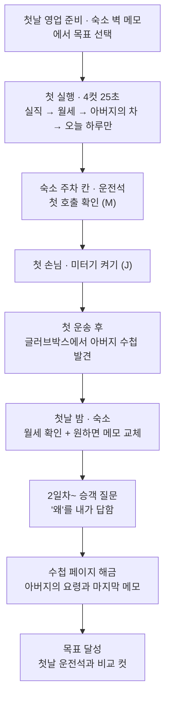
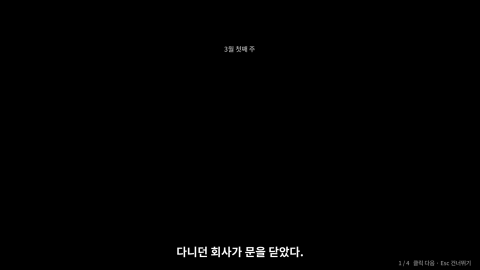
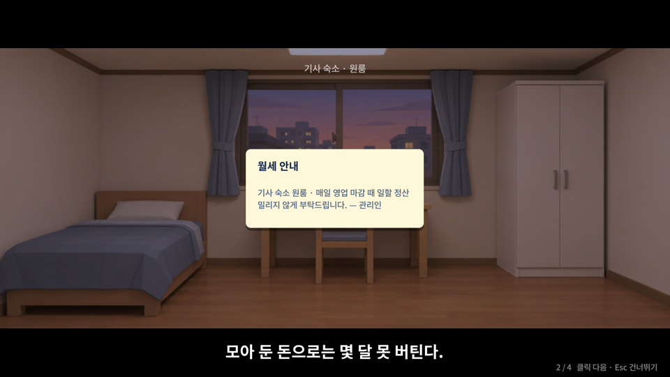
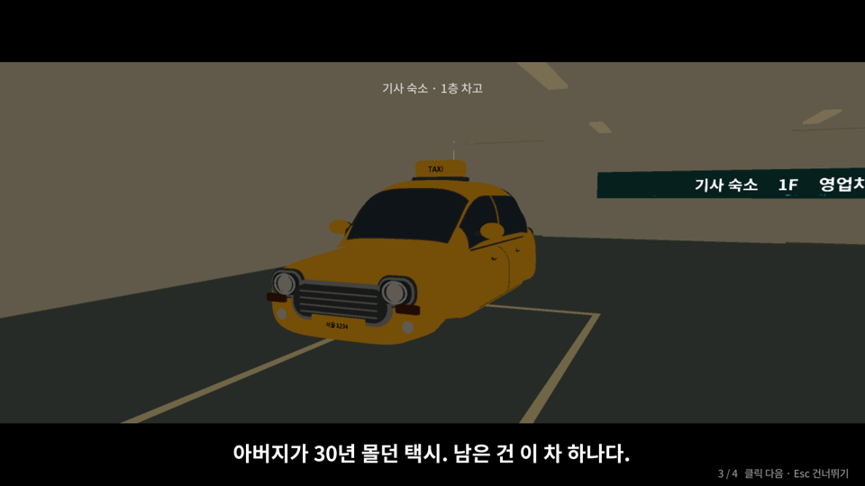
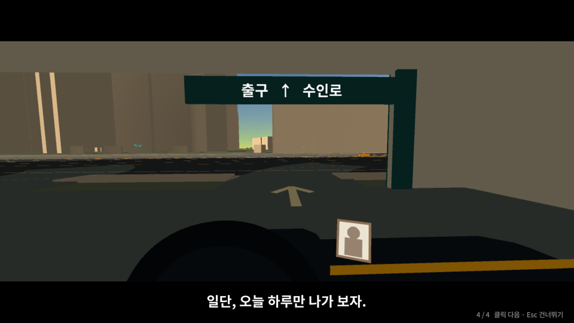
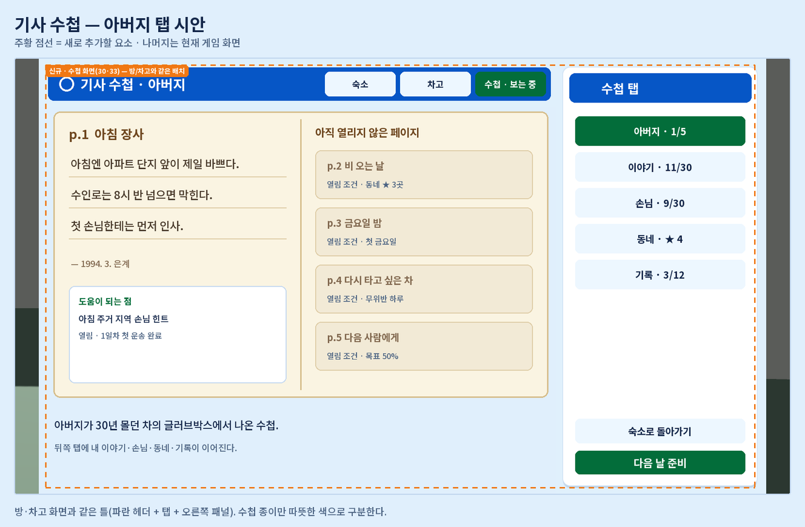
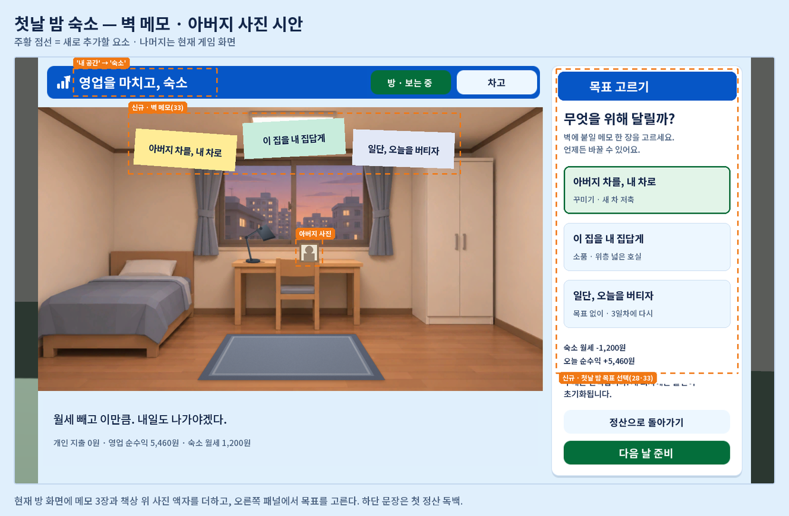
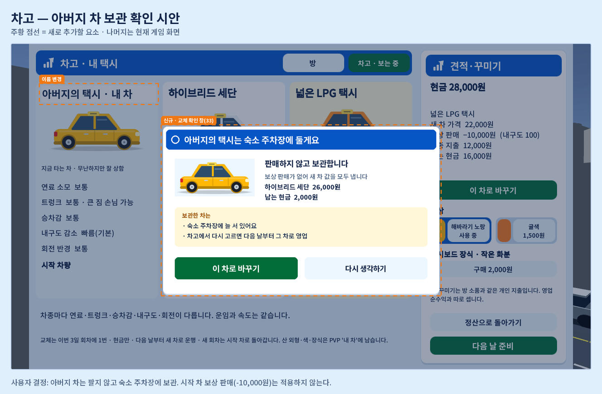
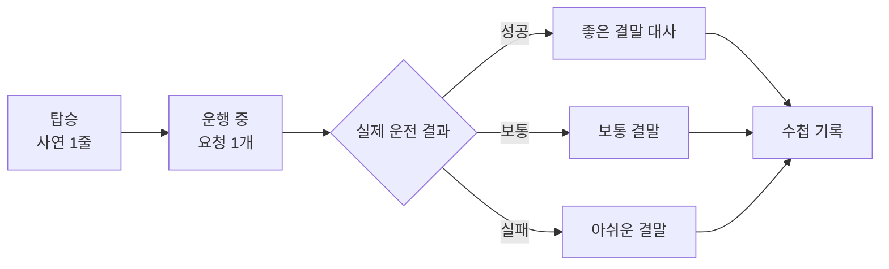
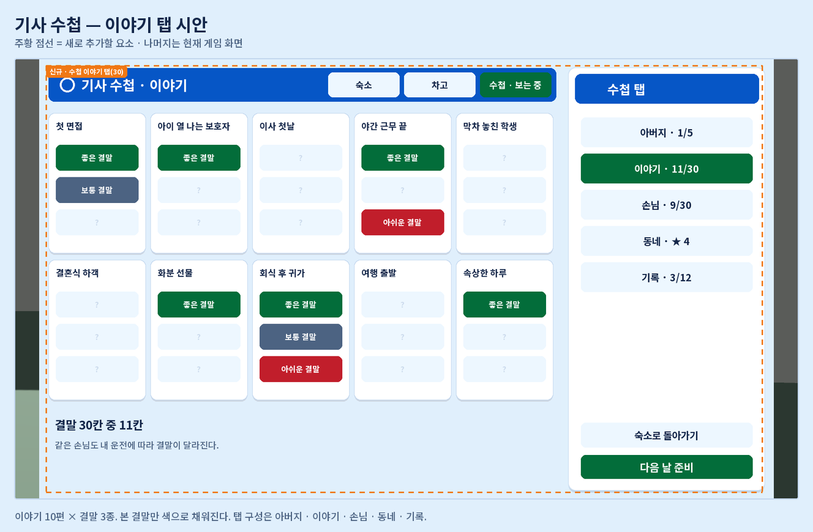

# 게임 개요·배경·손님 이야기

**통합 문서 · 2026-11-23 정리.** 게임의 전체 경험, 아버지의 택시로 시작하는 배경, 완결형 손님 이야기·기사 수첩, 학생 재회를 한 문서에서 본다. 아래 각 장의 "구 NN"은 합치기 전 문서 번호이며, 본문 속 "기획 NN" 표기도 이 번호를 가리킨다. 날짜가 있는 결정과 검증 기록은 그 시점의 기록으로 읽는다. [기획 목록](README.md)

| 장 | 합친 문서 | 다루는 내용 |
|---|---|---|
| [1. 택시 시뮬레이션 — 게임 개요](#s00) | 구 00 | 플레이어 경험, 하루 흐름, 현재 기능 요약 |
| [2. 배경 이야기 보여주기 — 어떻게·왜·무엇을 위해](#s33) | 구 33 | 아버지의 택시, 인트로·수첩·벽 메모·차량 보관 |
| [3. 완결형 손님 이야기와 기사 수첩](#s30) | 구 30 | 완결형 손님 이야기 10편과 기사 수첩 |
| [4. 막차 놓친 학생과 다시 만나는 날](#s35) | 구 35 | 막차 놓친 학생과 이틀 뒤 재회 |

## 1. 택시 시뮬레이션 — 게임 개요 (구 00)

### 플레이어에게 주는 경험

경기 악화로 직장을 잃은 운전자가 개인택시로 생계를 이어간다. 플레이어는 손님을 태우는 일뿐 아니라 **어떤 호출을 받을지, 어떻게 운전할지, 언제 식사·휴식·차량 관리를 할지** 결정한다. 좋은 운전, 승객의 만족, 남기는 돈은 서로 연결되지만 하나의 점수로 합치지 않는다.

은계 r50 싱글에서 주인공은 아버지가 남긴 개인택시를 몬다. 첫날 덕성프라자 숙소에서 목표를 정하고 출차한다. 영업을 마치고 돌아오면 월세와 남은 돈을 확인하고, 방을 꾸미거나 다음 차를 위해 저축한다. 3일 도입이 끝나도 같은 차와 돈으로 계속 영업할 수 있다. [배경 이야기](#s33) · [숙소](07-home-room-and-vehicles.md#s34) · [연속 경력](06-day-and-career.md#s28)

### 기본 플레이 흐름

`영업 준비 → 호출 탐색·빈차 이동 → 승차 → 운전·승객 응대 → 하차·운임 확인 → 다음 운송 또는 생활시설 → 하루 마감·회고`

| 플레이 축 | 플레이어의 선택 | 그 선택이 만드는 경험 | 상세 규칙 |
|---|---|---|---|
| 운전 | 신호·보행자·차로·정체를 보고 진행/정지/우회 | 안전과 효율을 실제 행동으로 판단 | [주행·교통](01-driving-and-traffic.md#s01) |
| 승객 | 호출을 고르고 요청에 응답·이행 | 같은 길에서도 다른 기대와 응대 | [승객·운임](02-passengers-and-fares.md#s02) |
| 생활 | 주유·식사·수면·세차의 시점 선택 | 오늘 수익과 영업 가능한 상태 사이의 균형 | [생활·경제](04-life-vehicle-economy.md#s03) |
| 하루 | 계속 영업하거나 거점에서 마감 | 무리한 연장과 적절한 휴식의 결과 비교 | [캠페인·기록](06-day-and-career.md#s04) |
| 정보 | 지도·길안내·상태·결과 읽기 | 실패 원인과 다음 행동을 이해 | [화면·안내](05-interface-and-navigation.md#s05) |

### 콘텐츠의 역할 분담

| 콘텐츠 | 역할 | 혼동하지 않을 것 |
|---|---|---|
| 지역·승하차 장소 | 손님을 찾고 태우고 내려 주는 공간 | 실제 시설 영업 정보나 현실의 정차 허가를 보장하지 않음 |
| 일반 교통·보행자 | 운전 판단의 맥락과 위험 단서 | 모든 행인이 승객이거나 모든 차가 같은 상황용 연출은 아님 |
| 대표 운송 코스 | 신호·회전·정체 등 짧은 판단 장면을 만나는 구성 | 모든 코스 강제 완주가 캠페인 통과 조건은 아님 |
| 승객 요청·특성 | 운송마다 다른 응대와 주행 목표 | 요청 선택 버튼만 누르면 보상을 주는 구조가 아님 |
| 생활시설 | 운전자·차량 상태를 비용과 시간으로 관리 | 시설 방문 자체가 자동 결제·자동 마감은 아님 |
| 기록·연습 | 행동의 이유와 결과를 이해하고 다시 시도 | 연습이 본 영업의 돈·시간·평가를 바꾸지 않음 |

### 현재 Proto의 경계

| 포함 | 제공 범위 |
|---|---|
| 영업 공간 | 은계 기반 도로·게임용 승하차 장소·생활시설 |
| 운송 | 호출·길가 승객·다양한 요청·취객·만족도·운임 |
| 운영 | 지역 상대 수요·공차 성과·막힌 승하차 공간의 해소 대기 |
| 생활 | 연료·포만감·피로·청결·현금·미납 |
| 반복 | 3일 도입 후 연속 영업 선택, 저장 불러오기·일별 결과 비교·상황 연습. 하루 기본 20분, 출차 전 10/20/30/60분 선택 |
| 개인 생활 | 방 조명·러그, 정산 후 차고에서 전액 현금으로 새 차 한 대 구매, 아버지 차 보관과 다음 날 운행차 선택, 영업·개인 지출 분리 |

운전 중 미터기·창문·온도를 조작한다. 하루 조건에 따라 비와 수요가 달라지고, 저녁에 만난 학생과 이틀 뒤 다시 만날 수 있다. 은계김밥·카페를 들르거나 공업사에서 사고 수리와 부품 구매·장착을 한다. 막힌 승하차 공간은 검증한 대체 쌍을 안내하고, 대안이 없으면 기다린다. [하루 조건](06-day-and-career.md#s29) · [학생 재회](#s35) · [동네 가게와 부품](04-life-vehicle-economy.md#s36) · [시설 위치](04-life-vehicle-economy.md#sfac)

**다음 기획**은 한 번 출차해서 달리는 20분 안의 재미다. 고속 조향, 팁과 미터기, 호출판 변주와 선택형 미션, 신호 대기 활용은 [08 재미 보강](08-fun-improvements.md)에서 검토한다. 이사·보험·세금·대출은 별도 후속 주제다.

PVP는 [별도 모드](pvp/README.md)로 제공하며 싱글의 3일/저장 규칙을 적용하지 않는다. 현재 기능의 구현과 사람 장시간 수용은 [기획 목록](README.md)·[개발 체크리스트](../prototype-development-checklist.md)에서 구분한다.

### 기획 문서의 원칙

각 규칙은 담당 문서 한 곳에서만 정의한다. 다른 문서는 해당 규칙이 만드는 경험과 연결만 설명한다. 수치는 플레이 밸런스 값이며 현실의 법적 벌점·의학 기준·수익 보장이 아니다. 개발 방법·시험 결과·배포 내역은 이 폴더의 기획 내용에 넣지 않는다.

## 2. 배경 이야기 보여주기 — 어떻게·왜·무엇을 위해 (구 33)

**상태: P4 인트로·아버지 수첩·벽 메모·차량 보관 구현(2026-11-19).** P5의 비·금요일 카드와 P6의 동네 별 해금 조건을 연결했다. [검증과 재현](../work-history/2026-11-19-father-story-p4.md). 사용자 설정: **실직 후 남은 것은 돌아가신 아버지가 남긴 개인택시 하나, 그 차로 생계를 이어간다.** 면허 경로 제외·차내 조작 추가([32](05-interface-and-navigation.md#s32)), 숙소 거점 하나([34](07-home-room-and-vehicles.md#s34)). 원 시놉시스 [10](archive/10-restarting-driver-synopsis.md)의 "중고 택시 구입"은 이 문서의 아버지 설정으로 대체한다.

### 1. 세 질문의 답

| 질문 | 답 (설정) | 플레이어가 아는 방법 |
|---|---|---|
| **어떻게** 개인택시를 몰게 됐나 | 회사 경영 악화로 실직. 남은 건 **돌아가신 아버지의 개인택시** 하나 | 4컷 인트로 + 글러브박스의 **아버지 운행 수첩** + 운전석의 아버지 사진 |
| **왜** 이 일을 하나 | 당장의 **생계**. 그리고 아버지가 30년 달린 길을 내가 이어 달려 보기 | 생계는 정산(월세·연료)으로 체감, 마음은 승객 질문에 **내가 답하며** 드러남 |
| **무엇을 위해** 하나 | 생계를 넘어 내가 고르는 것: **아버지 차를 내 차로**, 또는 **숙소를 내 집으로** | 첫 출발 전 숙소 벽 메모 → [28](06-day-and-career.md#s28) 목표 카드 |

- 현실의 개인택시 면허 상속·양수 자격과 절차는 생략한다. 게임 안에서 절차를 안내하지 않는다.
- 아버지는 **사진·수첩으로만** 존재한다. 회상 장면·대화 없음(반복 인물 제외 원칙 유지).

### 2. 원칙

| 할 것 | 하지 않을 것 |
|---|---|
| 플레이 중 조각으로 드러냄 | 30초 넘는 강제 인트로, 설명문 페이지 |
| 물건(차·사진·수첩)으로 보여줌 | 슬픔을 강요하는 연출·매일 회상 |
| "왜"는 플레이어가 답함 | 정답 동기·효도 평가 |
| 생계 압박은 정산 숫자로 담담하게 | 빚 독촉·퇴거 위협으로 영업 강요 |

### 3. 드러나는 순서

### 4. 첫 실행 인트로 (2026-11-19 개정 · 게임 장면 4컷)

첫 구현은 시안을 잘라 만든 임시 그림 3장을 흰 카드 안에 띄웠다. 그림이 흐리고, 컷1은 회사가 아니라 숙소 방이었고, 컷3은 실제 출발 장소(실내 차고)와 달랐다. "오늘부터, 내 핸들로."는 첫날의 불안과 어울리지 않았다. 아래로 바꿨다.

| 컷 | 화면 | 위 작은 글 | 자막 | 길이 |
|---|---|---|---|---|
| 1 | 검은 화면 | 3월 첫째 주 | "다니던 회사가 문을 닫았다." | 6초 |
| 2 | 어두운 숙소 원룸 + 문 아래 월세 안내 쪽지 | 기사 숙소 · 원룸 | "모아 둔 돈으로는 몇 달 못 버틴다." | 6초 |
| 3 | 실내 차고의 아버지 택시, 카메라가 천천히 다가감(게임 장면 실시간) | 기사 숙소 · 1층 차고 | "아버지가 30년 몰던 택시. 남은 건 이 차 하나다." | 7초 |
| 4 | 운전석, 대시보드의 아버지 사진에서 앞유리로 시선 이동(실시간) | — | "일단, 오늘 하루만 나가 보자." | 6초 |

- 화면 전체 + 위아래 검은 띠(2.39:1), 컷마다 페이드, 자막은 한 글자씩. 클릭 = 다음 컷, Esc = 전체 건너뛰기, 오른쪽 아래 `n / 4` 표시.
- 차고 칸 운전석에서 영업을 시작한다. **빈차등 자동 점등 → M 첫 호출 → 첫 손님 미터기 안내**([32 §3](05-interface-and-navigation.md#s32)).
- 이야기 흐름: 첫날 "일단 오늘 하루만"(불안) → 목표 달성 "오늘부터, 다시 내 핸들로."(자립).
- 첫 인트로가 끝나는 순간의 운전석을 경력 저장 옆 `<저장 이름>-first-drive.png`로 남겨, 목표 달성 비교 화면의 "첫날 운전석"으로 쓴다(이전 경력은 "기록 없음" 표시).
| 1 | 2 | 3 | 4 |
|---|---|---|---|
|  |  |  |  |

- 별도 아트 제작 없이 동작한다. 컷2 쪽지와 컷3·4 카메라 경로는 코드(`IntroCutscene`, `DrivingCamera.RenderIntroShot`)에서 조정한다.
- 메뉴 다시 보기는 지금 타는 차를 기준으로 컷3·4를 그린다.

### 5. 아버지의 운행 수첩

[30 기사 수첩](#s30)의 **첫 탭.** 아버지 메모 뒤에 내 기록이 이어진다.

| 페이지 | 해금 | 내용(예) | 게임 효과 |
|---|---|---|---|
| 1 아침 장사 | 1일차 첫 운송 후 | "아침엔 아파트 단지 앞이 제일 바쁘다." | 아침 주거 지역 힌트 |
| 2 비 오는 날 | 비 카드 마감 또는 동네 ★ 3곳 | "비 오는 날엔 우산 싸맬 봉투를 챙겨." | 우산 승객 팁 |
| 3 금요일 밤 | 첫 금요일 카드 | "금요일 밤 손님은 말이 많다. 들어주면 된다." | 음주·수다 승객 팁 |
| 4 다시 타고 싶은 차 | 무위반 하루 | "빨리 가는 것보다 다시 타고 싶은 차." | 독백 연결 |
| 5 다음 사람에게 | 목표 50% | "이 차 오래 탔다. 누가 몰든 자기 길을 찾길." | 이야기 마무리 |

메모 날짜는 아버지의 운행 기간(예: 1994~2024)으로 표시. 마지막 페이지만 플레이어를 향한 말처럼 읽히되 직접 부르지 않는다.

### 6. 왜 — 승객이 묻고 내가 답한다

수다 유형 승객이 하루 최대 1회 묻는다. 효과 공통(S+1), **정답 없음.** 답은 저장되어 독백 톤에 반영된다.

| 승객 질문 | A | B | C |
|---|---|---|---|
| "원래 이 일 하셨어요?" | "회사 다니다 얼마 전에 시작했어요." | "아버지가 하시던 일이에요." | (웃으며 넘김) |
| "힘들지 않으세요?" | "먹고살아야죠." | "아직 서툴러요." | "손님 덕에 버텨요." |
| "차가 오래됐네요?" | "아버지 차예요. 아직 잘 달려요." | "곧 바꾸려고요." | "정들었어요." |

### 7. 첫 출발 전 숙소에서 목표 고르기

첫날 준비에서 **목표 고르기** 또는 **내 목표 → 숙소 벽 메모 열기**를 누른다. 메모 한 장을 붙이면 준비 화면으로 돌아온다. **영업 시작**을 눌러 인트로와 첫 운행을 시작한다. 이후 영업 준비나 정산 후 숙소에서 메모를 바꿀 수 있다. 정산에는 월세 일할분이 보인다. [숙소 생계 비용](07-home-room-and-vehicles.md#s34).

| 메모 | 연결 목표([28](06-day-and-career.md#s28)) | 이후 표현 |
|---|---|---|
| "아버지 차를, 내 차로" | 아버지 차 꾸미기 → 원하면 새 차로 교체 | 차고에 후보·꾸미기 |
| "이 집을 내 집답게" | 숙소 꾸미기 → 같은 건물 넓은 호실 | 방 소품·창밖 전망 |
| "일단, 오늘을 버티자" | 목표 없음(생계 유지) | 3일차에 다시 묻기, 불이익 없음 |

**아버지 차 교체 시 (사용자 결정 2026-11-19): 판매하지 않고 숙소 주차장에 보관한다.**

| 항목 | 처리 |
|---|---|
| 보상 판매 | 아버지 차에는 적용하지 않음 → 새 차 가격 전액 지불 |
| 보관 위치 | 숙소 주차장(34)에 상시 주차된 모습으로 보임 |
| 다시 타기 | 차고에서 고르면 다음 날부터 그 차로 영업(추가 비용 없음) |
| 보관 비용 | 없음 |
| 연출 | 교체 직후 수첩 독백 1줄: "아버지 차는 집 앞에 세워 두었다." |

#### 독백 (핵심 순간 1줄)

| 순간 | 예 |
|---|---|
| 첫 정산 | "월세 빼고 이만큼. 내일도 나가야겠다." |
| 첫 구매 | "아버지 차에 처음으로 내 것을 달았다." |
| 목표 50% | "이 길이 조금 익숙해졌다." |
| 목표 달성 | 첫날 저장한 운전석과 오늘 운전석을 나란히. "오늘부터, 다시 내 핸들로." |

### 8. 구현 범위

| 영역 | 작업 | 파일(현재) |
|---|---|---|
| 인트로 | 게임 장면 4컷·다음/건너뛰기·다시 보기·첫날 운전석 저장 | `IntroCutscene.cs`, `DrivingCamera.cs`, `BusinessProgress.cs` |
| 첫 조작 | 첫 호출·미터기 안내 | 차내 조작과 함께 `CockpitUI.cs` |
| 사진 | 대시보드 액자 오브젝트 | `CockpitPresentation.cs` |
| 수첩 | 아버지 페이지 해금 | 30의 신규 `LogbookHUD.cs` |
| 질문 대화 | 질문 풀·답 저장 | `PassengerBehavior.cs`, 콘텐츠 프로필 `backstory.*` |
| 목표 메모 | 숙소 벽 메모 선택 | `PersonalRoomHUD.cs`, 28 목표 상태 |
| 아버지 차 보관 | 시작 차 보상 판매 제외, 보유 차 목록·운행 차 선택, 숙소 주차장 배치 | `VehicleCatalog.Quote`, `VehicleGarageHUD.cs`, 캠페인 저장 |
| 문구 | 시작 차 이름 "중고 택시" → "아버지의 택시" | `VehicleCatalog.cs` Starter |

### 9. 검증

| 질문 | 통과 기준 |
|---|---|
| 주인공을 설명할 수 있는가 | 1일차 후 "왜 택시를 해요?"에 실직·아버지 차·생계 중 하나 언급 |
| 인트로가 지루하지 않은가 | 첫 운송까지 시간 증가 ≤30초 |
| 목표를 기억하는가 | 3일차에 자기 목표를 말함 |

## 3. 완결형 손님 이야기와 기사 수첩 (구 30)

**상태: P6 손님 이야기 10편 및 기사 수첩 5탭 구현(2026-11-19).** [검증과 재현](../work-history/2026-11-19-passenger-stories-p6.md). 동기 보강 3순위. 반복 인물 제외 원칙 유지([10](archive/10-restarting-driver-synopsis.md)).

후속 기획에서는 막차 놓친 학생 한 명에게 재회 장면을 추가한다. [장면과 선택 분기](#s35).

### 1. 목표

> 한 운송 = **짧은 이야기 한 편.** 결말은 내 운전이 정한다. 본 이야기는 수첩에 남는다.

### 2. 이야기 구조

판정은 기존 요청 판정(OnTime·Comfort·SafeStop 등)을 그대로 쓴다. **새 시스템 없이 기존 프리셋+요청 재조합**으로 만든다.

### 3. 1차 이야기 10편

| # | 이야기 | 기반 프리셋 | 요청·판정 | 좋은 결말 | 아쉬운 결말 |
|---|---|---|---|---|---|
| 1 | 첫 면접 | 면접을 앞둔 손님 | OnTime | "잘 될 것 같아요" | 말없이 뛰어감 |
| 2 | 아이 열 나는 보호자 | 급함+승차감 | Comfort+OnTime | 병원 앞 감사 인사 | "조금만 조심하시지…" |
| 3 | 이사 첫날 | 짐+수다 | 짐 적재·LargeRoad | 동네 질문에 답해줘서 고마움 | 짐 거절 시 다른 택시 |
| 4 | 야간 근무 끝 | 야간근무 손님 | Quiet | 깨어나며 "푹 잤네요" | 흔들림에 깸 |
| 5 | 막차 놓친 학생 | 급함 | Eta·요금 부족 선택(**신규 선택지**) | 다음에 꼭 갚겠다는 쪽지 | — |
| 6 | 결혼식 가는 하객 | 음식(축하 떡)+급함 | OnTime | 떡 한 조각 | 옷 구김 걱정 |
| 7 | 화분 선물 | 화분 경유 손님 | ViaStop+보호 | 꽃집 들러 완성된 선물 | 흙 쏟아짐 |
| 8 | 회식 후 귀가 | 모임 마친 수다 손님 | 수다 듣기·안전 운행 | 집 앞에서 꾸벅 인사 | 구토 사건 |
| 9 | 여행 출발 | 여행 가방 손님 | 짐+OnTime | "다녀오겠습니다!" | 가방 거절 |
| 10 | 속상한 하루 | Empathy 요청 | 듣기/조용한 배려 | "얘기하니 낫네요" | — |

- 등장 빈도: 하루 2~3편, 나머지는 기존 일반 승객.
- 조건 카드([29](06-day-and-career.md#s29))와 연결: 회식은 금요일, 이사·짐은 상가 행사 카드에서 비중↑. 결혼식·여행은 2차 주말 카드 추가 시 연결.

### 4. 기사 수첩

첫 운송 후 수첩을 발견하면 은계 싱글 운전 화면에 **기사 수첩** 버튼이 열린다. 1인칭과 3인칭 모두 운전 점수는 카드 첫 줄에 세 자리까지 표시하고, 수첩 버튼은 아래 줄의 점수 게이지 오른쪽에 둔다. 열람 중 영업과 물리는 일시정지하며 닫기 또는 Esc로 주행을 재개한다. 숙소와 준비 메뉴에서도 열람할 수 있다.

| 탭 | 내용 | 수집 단위 |
|---|---|---|
| 이야기 | 10편 × 결말 3종 | 결말별 칸 (30칸) |
| 손님 | 프리셋 30종 | 처음 태우면 열림 |
| 동네 | 12개 영업 지점 | 운송 횟수 → 숙련도 별 1~3 |
| 기록 | 첫 비 오는 날 운송, 무위반 하루, 최장 운송 등 | 업적 12개 |

은계 수첩에는 첫 방문 전부터 도로명과 구간을 표시한다. 일반 손님 일부는 탑승 시 창문 개폐 또는 목표 온도를 부탁한다. 운전자가 요청 상태를 만들면 한 번만 만족도 2점을 반영하고 경력에 저장한다.

#### 동네 숙련도 (평점·레벨 아님)

| 별 | 조건(해당 지점 출발·도착 합) | 열리는 것 |
|---|---|---|
| ★ | 3회 | 주변 지도 |
| ★★ | 10회 | 주변 대기 명당 표시 |
| ★★★ | 25회 | 시간대별 수요 힌트 1줄 |

첫 탭은 아버지의 운행 수첩([33](#s33)).

### 5. 표현 원칙

| 할 것 | 하지 않을 것 |
|---|---|
| 대사 2~4줄, 결말 1줄 | 긴 대화 트리 |
| 결말이 운전 결과로 갈림 | 선택지만으로 결말 결정 |
| 같은 이야기도 다른 결말을 다시 볼 이유 | 같은 인물 재등장·호감도 |

### 6. 구현 범위

| 영역 | 작업 | 파일(현재) |
|---|---|---|
| 데이터 | 이야기 정의(프리셋·요청·결말 대사) | 콘텐츠 프로필 `story.*` |
| 배정 | 하루 2~3편 배정, 조건 카드 가중 | `PassengerJobs.cs` |
| 결말 | 요청 판정 결과 → 하차 대사 | `PassengerBehavior.cs`, `PassengerRequest.cs` |
| 수첩 | 저장·UI | 신규 `LogbookHUD.cs`, 캠페인 저장 |

### 7. 검증

| 질문 | 통과 기준 |
|---|---|
| 기억에 남는 손님을 말하는가 | 플레이 후 "어떤 손님 기억나요?"에 이야기 손님 언급 |
| 결말이 운전으로 갈리는가 | 이야기별 성공/실패 결말 자동 회귀 |
| 수첩을 다시 여는가 | 영업 3일 중 수첩 열람 2회 이상 |

## 4. 막차 놓친 학생과 다시 만나는 날 (구 35)

은계 싱글의 막차 놓친 학생(`last-train`)은 첫 만남 이틀 뒤 다시 탈 수 있다. 첫날 정산을 닫을 때 플레이어가 “모레 그 학생을 다시 태워야지”라고 떠올리는 것이 목표다. [장면 시안](student-reunion-preview.html) · [게임 구현과 검증](../work-history/2026-11-20-student-reunion-player.md)

### 첫날에 남기는 약속

첫 운송의 숙소 근거리 호출과 여유 기한을 유지한다. 첫날 학생은 저녁 시간대의 첫 번째 배정 가능한 이야기 호출에서 만난다. 일찍 퇴근하면 다음 영업일 저녁에도 기회가 있다. 그때부터 이틀 뒤가 약속일이다. 첫 승차 때부터 막차를 놓쳤다는 대사가 아침에 나오지 않게 한다.

기존 요금 부족 응대와 하차 결과를 먼저 보여준다. 정차 상태에서 학생이 “모레도 실습 끝나면 이 시간이에요. 여기서 다시 타도 돼요?”라고 묻는다. **‘그때 여기로 올게요’**를 고르면 수첩에 실제 승차지 이름과 시간대를 쓴다. **‘지나가다 만나면 태워 줄게요’**를 고르면 일반 호출에서 우연히 다시 만날 수 있다. 영수증을 그냥 닫아도 운송은 끝난다. 첫 운송이 취소되어 학생이 목적지에 도착하지 않았으면 약속을 제시하지 않는다.

### 재회 장면 큐시트

첫 만남이 1일차라면 3일차에 재회한다. 약속 시각은 첫 만남의 승차 시각을 기준으로 앞뒤 게임 시간 30분. 약속일 아침 수첩에 장소와 시간대를 다시 보여준다. 시간대에 운행 중인 손님을 내려 주면 남은 시간에 학생 호출을 볼 수 있다. 학생은 처음 탔던 승차지에서 기다린다.

| 순간 | 화면·소리 | 대사와 입력 |
|---|---|---|
| 호출 도착 | 기존 호출 목록에 실제 승차지와 ‘실습 끝난 학생’을 표시한다. 주변의 일반 호출도 그대로 고를 수 있다. | 학생 호출을 수락하고 승차 칸까지 직접 운전한다. |
| 정차하고 승차 F | 운전석 시점을 유지한다. 문 닫는 소리가 끝날 때까지 대사를 한 박자 비운다. 라디오 방송 자막은 손님 대사에 양보한다. | 약속 재회면 “기사님! 오늘은 안 뛰었어요. 오실 줄 알았거든요.” 늦게 우연히 만났다면 “어, 그날 기사님이시죠? 또 뵙네요.” |
| 출발 | 첫 자막 뒤 한 호흡을 두고 두 번째 자막. 출발 입력은 처음부터 받는다. | “오늘 처음으로 혼자 실습을 끝냈어요. 집에 가는 동안만 좀 조용히 가도 돼요?” |
| 차내 반응 | 기존 차량 소음과 운전석을 유지한다. 라디오가 켜져 있으면 기존 끄기 안내를 표시한다. 이미 꺼져 있으면 그대로 반응한다. | 조용해지면 “고맙습니다.” 한 줄. 그대로 운전해도 정상 하차한다. |
| 목적지에서 F | 도착 후 영수증에 후일담 한 줄. 운임은 실제 운송 결과를 따른다. | 첫 만남의 쪽지를 받았다면 “그때 적어 드렸죠? 다음엔 꼭 인사드린다고.” 다른 결말이면 “다음에 길에서 보면 제가 먼저 인사할게요.” |

약속을 놓치면 수첩에 ‘시간이 지나감’을 남긴다. 이후 일반 학생 호출 한 번에서 우연 재회 대사를 쓴다. 중간 저장에는 첫 만남 일차·승차지·시간·첫 결말·약속 응답·재회 진행 단계를 둔다. 호출 취소만으로 재회를 소비하지 않고, 승차 뒤 재실행하면 읽은 인사와 하차 보상이 반복되지 않게 한다. 기존 경력은 새로 만난 학생부터 시작한다.

### 퇴근 전 마지막 한 콜 (후속 기획)

빈 차로 마감을 앞둔 날, 이용 가능한 실제 후보 중 숙소 쪽으로 향하는 짧은 호출과 반대 방향의 높은 운임 호출을 함께 보여준다. 기존 호출 카드에 예상 운임과 **하차지 → 덕성프라자 복귀 거리**를 표시한다. 거리는 주행 가능한 차로 기준이다. 한 건만 가능하면 그 한 건만 제시하고 즉시 귀가도 가능하다. 단골 약속이 잡힌 날에도 일반 호출을 고를 수 있다.

### 실행본 인수 기준

싱글에서 17시 이후 배정 가능한 첫 학생 운송을 마치면 하차 영수증에 약속 선택이 나타난다. 수첩 첫 탭에서 약속 시각과 장소를 확인한다. 재회 승차 때에는 문이 닫히고 잠시 뒤 첫 만남의 초상과 인사가 뜬다. 학생의 두 번째 대사 뒤 R로 그 운송 동안 은계 FM 방송 자막을 끌 수 있다. 방송 자막 설정이 꺼져 있으면 자동으로 조용한 차 안에 반응한다.

- 1일차 첫 만남 → 저장·재실행 → 3일차 같은 승차지에서 수락·승차 → 첫 결말에 맞는 하차 대사와 영수증 1건.
- 약속 없이 재회, 약속을 놓친 뒤 재회, 재회 호출 취소 후 재배정, 라디오가 이미 꺼진 차에서도 진행.
- 호출 수락부터 하차까지 운전 조작이 유지되고 운전 중 팝업 응답을 강제하지 않는다.
- 플레이테스트에서 첫날 마감 직후 다음에 하고 싶은 일을 자유 응답으로 묻고, 학생이나 약속을 먼저 언급했는지 기록한다.
