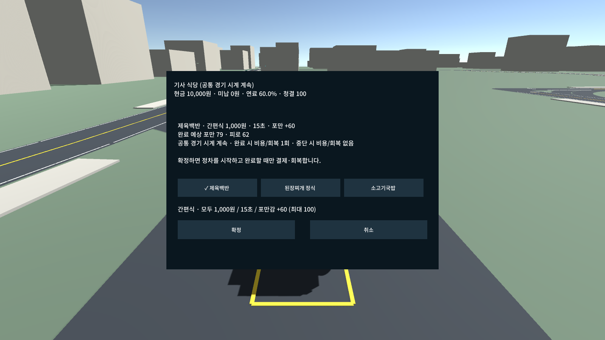
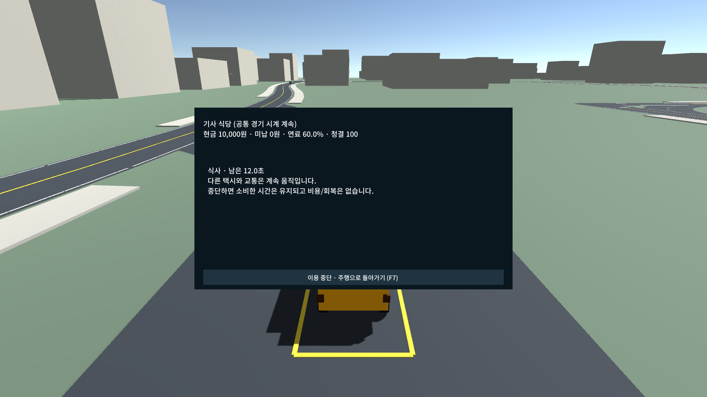
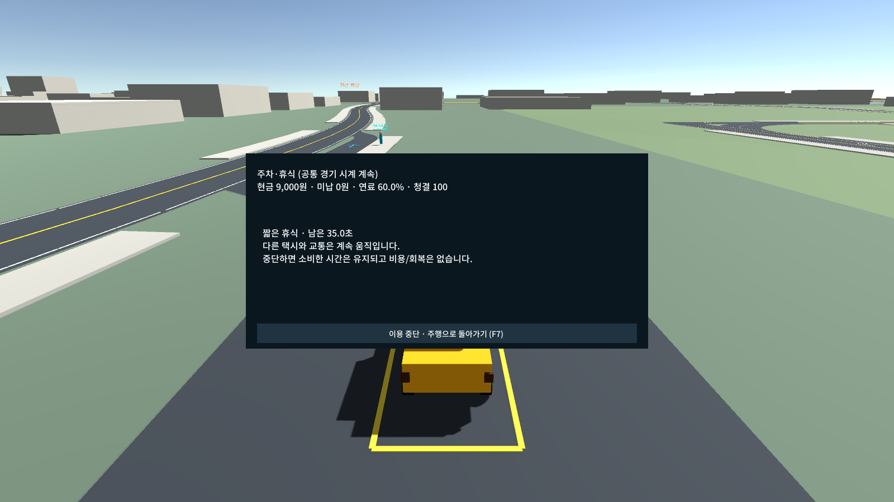
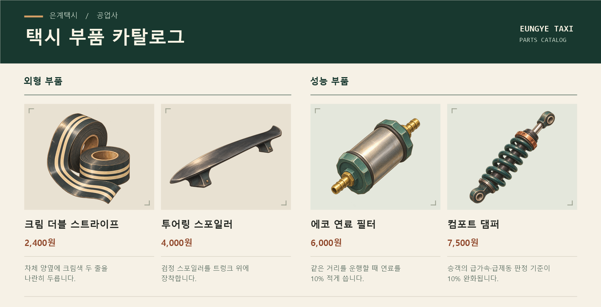
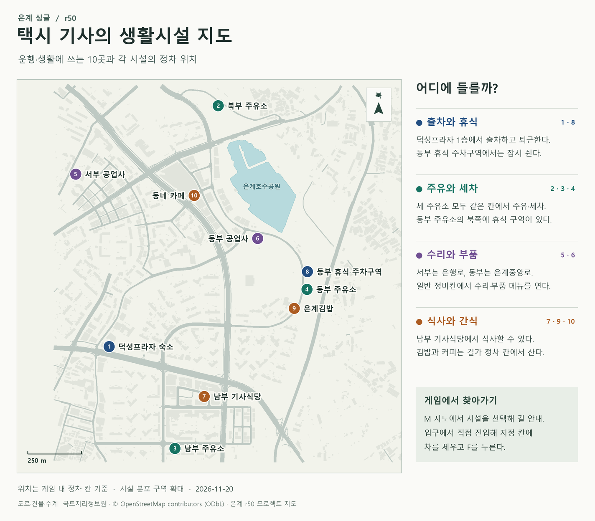

# 생활·차량·시설·영업 경제

**통합 문서 · 2026-11-23 정리.** 피로·포만, 연료·청결·내구도, 사고와 공업사, 동네 가게와 부품, 은계 시설 위치, 운임·물가 점검을 담당한다. 아래 각 장의 "구 NN"은 합치기 전 문서 번호이며, 본문 속 "기획 NN" 표기도 이 번호를 가리킨다. 날짜가 있는 결정과 검증 기록은 그 시점의 기록으로 읽는다. [기획 목록](README.md)

| 장 | 합친 문서 | 다루는 내용 |
|---|---|---|
| [1. 생활·차량 상태·영업 경제](#s03) | 구 03 | 피로·포만·연료·청결·내구도·회계 |
| [2. 사고 처리·자동차 공업사](#s08) | 구 08 | 사고 등급·처리비·공업사 수리·견인 |
| [3. 은계 생활시설과 택시 부품점](#s36) | 구 36 | 김밥·카페·공업사 부품 |
| [4. 은계 싱글 생활시설 위치](#sfac) | 은계 시설 위치 | 은계 r50 생활시설 10곳 위치, 2026-11-26 파출소·응급실 추가 |
| [5. 은계 싱글에서 택시 한 번을 몰면 무엇을 살 수 있나](#seco) | 2026-11-20 운임·물가 점검 | 시흥 요율·물가 대비 운임 점검 |

## 1. 생활·차량 상태·영업 경제 (구 03)

2026년 11월 시흥 중형택시 요율과 경기 식비·LPG 가격으로 은계 첫 영업의 구매력을 점검했다. 호출판 아홉 건의 제시액, 한 건의 실수령과 식사 후 남는 돈은 [운임·생활물가 비교](#seco)에서 확인한다.

은계 싱글 r50의 시설 위치·찾아가는 법은 [시설 위치도](#sfac), 김밥·커피와 공업사 부품은 [기획 36](#s36)에서 본다.

사고 대상·등급·처리비·처리시간·운전 점수·운송 중단은 [08 사고·공업사](#s08)가 담당한다. 이 문서는 별도 차량 손상·수리/견인·생활 서비스·회계를 담당한다. 과거 고정 사고비나 주유소 정비 규칙을 현재 공업사 이용과 혼동하지 않는다.

### 모드별 적용 범위

본문의 포만감·피로·식사·수면·졸음 표는 기존 싱글 캠페인 기준이다. 현재 PVP도 기존 컨디션 시스템을 재사용하지만, 날짜 전환·마감·저장까지 같은 규칙이라는 뜻은 아니다. **PVP 개선 기획은 문서 하단의 [PVP 모드 전용 항목](#pvp-driver-condition)에서 별도로 관리한다.** 하단의 실제 적용 수치는 PVP에만 적용하며 캠페인 규칙과 구분한다. 내구도/연료/청결의 기존 구현은 이번 문서 정리로 변경하지 않는다.

| 구분 | 현재 상태 | 이 문서의 역할 |
|---|---|---|
| 싱글 캠페인 | 기존 생활·경제 규칙 구현 | 기존 본문을 유지 |
| 현재 PVP | 기존 컨디션/시설 + PVP 피로1.25배·15초 식사·45초 휴식 | 하단 실제 적용 규칙 참조 |
| PVP 컨디션 개선 | 실제 적용, 장기 수익·운전 체감 밸런스 미검증 | 아래 전용 항목을 단일 기준으로 사용 |

### 충돌 내구도와 수리

2026-10-29 사용자 승인에 따라 구현·자동 검증을 완료했다. **Proto는 수리비·시간 중심, 내구도0에서 운행 불가**를 적용한다. 아래 강도 구간·손실·비용·시간은 승인된 초기 시험값이며 이 문서를 단일 기준으로 삼는다. Player 기능·5프로세스 재시작·실제 화면 검증을 완료했으며 배포 결과는 작업 기록을 따른다. 사람의20분/3일 체감 검증은 남아 있다. 실제 명령 결과와 남은 검증은 [작업 기록](../work-history/2026-10-29-vehicle-durability-repair.md), [P15 체크리스트](../prototype-development-checklist.md#p15-충돌-내구도수리견인)를 따른다.

| 검토 방식 | 장단점 | 결정 |
|---|---|---|
| 수리비·시간 손실,0에서 운행 불가 | 판단이 명확하고 기존 조작감 유지 | 사용자 선택 |
| 손상에 따라 조향·제동·가속 저하 | 차량 상태 체감은 크지만 사고 악순환·튜닝 범위 확대 | Proto 제외 |
| 강한 충돌마다 즉시 운송 종료 | 강한 긴장감, 운송 단절이 잦음 | 제외. 실제 내구도0일 때만 중단 |

#### 충돌 강도와 손상

내구도 D는 새 캠페인100, 하한0이다. 청결·연료와 독립이며 날짜 변경/세차/주유/기술적 위치 복구로 회복하지 않는다. 명시적 손상 저장 버전 `damageVersion`으로 구형 저장을 구분한다. 손상 정보가 없는 기존 저장은100에서 시작하고 이미 기록된 충돌을 소급 청구하지 않는다. 새 형식의 실제 D0은 구형 기본값으로 오인해 회복하지 않는다.

충격 지표 v는 **충돌 직전 접촉점 상대속도의 접촉면 수직 접근 성분(m/s)**이다. 계기판 속도나 접선 방향 미끄러짐 속도를 그대로 손상으로 쓰지 않는다. 접촉 법선 부호를 접근 방향으로 정규화하며 멀어지는 성분은0, 유효 접촉 여러 개는 최댓값을 사용한다. 충돌 impulse를 속도 손상과 합산하지 않는다. 이는 게임용 지표이며 현실 파손·과실 추정이 아니다.

| v 구간 | 표현 | 사건당 내구도 감소 | 수리 시 해당 손상 원가 예시 |
|---|---|---:|---:|
| 0 이상1.5 미만 | 약한 접촉 | 0 | 0원 |
| 1.5 이상3 미만 | 가벼운 충돌 | 2 | 400원 |
| 3 이상6 미만 | 보통 충돌 | 6 | 1,200원 |
| 6 이상10 미만 | 강한 충돌 | 15 | 3,000원 |
| 10 이상15 미만 | 큰 충돌 | 30 | 6,000원 |
| 15 이상 | 매우 큰 충돌 | 50 | 10,000원 |

손상 적용량은 남은 D를 넘지 않는다. 유효 사고의 운송 중단은 D가 남아 있어도 [사고 규칙](#s08)을 따른다. D0이면 아래 운행 불가 처리도 적용한다. 위 수치는 실제 Unity 차량/정적 벽/움직이는 차의 정면·측면·후방 접촉으로 조정해야 한다.

| 조건 | 판정·보호 |
|---|---|
| 지면·도로 접촉 | 정상 지지면은 제외. 차량·장애물 식별과 접촉면을 함께 사용해 오르막/경계석을 모두 사고로 간주하지 않음 |
| 연속 접촉 | 최초 접촉부터 접촉이0.8초 연속 끊길 때까지 한 사건. 상대 여러 collider와 연쇄 접촉도 한 사건으로 묶음 |
| 사건 중 더 강한 충격 | 사건 최댓값 구간의 손상만 유지, 이미 차감한 양을 제외한 증가분만 적용. 프레임마다 차감하지 않음 |
| 벽을 계속 밀기 | 같은 사건의 손상을 누적하지 않음. 떨어졌다 다시 충돌하면 새 사건 |
| 정차 중 추돌당함 | 물리적 손상은 가능하나 충돌 자체로 법규/과실을 확정하지 않음. Proto는 과실 보험 없이 실수리비 부담임을 안내 |
| 사고 과실 구분 (2026-11-24, 은계 싱글) | 차량 접촉의 과실을 내 과실/쌍방/상대 과실로 가린다. 정차 중 받히거나 뒤에서 받히면 상대 과실이고 내구도·처리비·감점이 없으며 운행을 계속한다. 쌍방은 처리비·감점 절반이고 돌발 차량이 들어온 뒤에 쓰인다. 현실 과실 비율과 보험은 여전히 범위 밖이다. 위 "정차 중 추돌당함" 줄의 실수리비 부담은 PvP와 과실 구분을 끈 경우에만 남는다. 설정 `accident.fault.*`. [구현·검증](../work-history/2026-11-24-accident-fault.md) |
| AI·맵 오류·텔레포트 | 명시적인 기술 복구/배치 유예 구간의 접촉은 손상 제외. 움직이는 AI라는 이유만으로 모든 충돌 면제는 아님 |
| 점수·운임 | 내구도 손실 자체에 추가 M/운임 비율 감액을 붙이지 않음. 별도 사고 처리비·운전 점수와 운송 중단은08의 사건1회 규칙 |

#### 상태·수리·영업 복귀

| D·상황 | 운전/운송 | 안내·플레이 선택 |
|---|---|---|
| 51~100 | 정상 조작·호출 가능 | 손상 발생 때 감소량과 남은 내구도 표시 |
| 21~50 | 성능 동일·운송 가능 | 노란 수리 권장, 가까운 지원 시설 안내 |
| 1~20 | 성능 동일·운송 가능 | 붉은 위험 안내. 수리 전 추가 충돌로 운행 불가 가능 |
| 0 | 새 구동 입력과 호출/승차 차단, 제동·관성 정지 처리 | 즉시 운행 불가 상태 저장. 첫 유효 도착 전 운송이면 원인 안내 후0원 취소1회. 도착 확정 뒤에는 확정 운임 보존·안전 하차, 완료 운임 불변 |
| 견인 | 정지 확인 후 지원 시설의 검증된 빈 공간으로 이동 | 도로에서 갑자기 이동하지 않음. 끼임/공중 등 정지 불가5초 후에는 페이드 안전 복구, 벌점 추가 없음 |
| 복귀 지점 | 공업사 부지 안의 검증된 견인 전용 정비 공간. 구 저장의 유료 주유소 예약은 완료까지 호환 | 이동 전 물리 점유 검사·예약. 모두 점유 중이면 이동/시간/비용 없이 대기하며 다시 시도 가능 |
| 정비 이용 | 공업사 정차 메뉴에서 수리 선택, 탑승객 없는 상태. 주유소 신규 수리와 분리 | 전량 복구만 제공. 부족금 미납 허용, D100이면 구매 불가 |
| 수리 완료 | D100 회복 | 청결·구토 잠금·연료·졸음은 유지. 다른 승차 차단 사유가 없어야 새 호출 가능 |

| 비용·시간 | 시험값 | 회계·예외 |
|---|---|---|
| 수리 | 복구1점당200원, 소요10+복구점수×0.5게임초 | D70→100:6,000원/25초. D0→100:20,000원/60초. 확인 시 한 번에 비용·시간·상태 확정 |
| 견인 | 3,000원·30게임초 | D0에서만 제공, 수리 별도. D0 견인+전량 수리 합계23,000원/90초 |
| 잔액 부족 | 현금 우선·부족분 미납 | 자금0이어도 견인·수리 가능. 미납은 기존 장부/상환 정책, 비용을 결제와 중복 집계하지 않음 |
| 서비스 경과 | 영업 시계·포만감·통상 피로 경과, 엔진 꺼짐으로 공회전 연료0 | 수리/견인은 수면 아님. 청결 평상시 소모는 기존 시설 서비스 제외 규칙 유지 |
| 마감·기간 종료 | 서비스 경과로 예정시간/최종 마감 경계를 넘겨도 단일 서비스 정산 완료 후 기존 마감 흐름 | 수리만으로 새 영업 시작·날짜 초기화 금지. 미수리 D는 다음 날 유지 |

견인 중 안전한 하차를 지원하는 것으로 표현하고 보행자 이동 AI·구급차는 추가하지 않는다. 첫 유효 도착 뒤 하역이 남은 상태에서 D0이면 먼저 정비 공간으로 견인한 뒤 하역을 마치며 확정 운임을 보존한다. 졸음 강제 귀가와 동시 발생하면 승객 취소는 한 번, D0 견인을 먼저 마친 뒤 휴식/당일 정산으로 연결하고 차량은 정비 공간에 둔다.

D0 차량이 정비 공간 밖에 있으면 오늘 영업 종료도 견인 복구를 기다린다. 정비 공간에 도착한 뒤에는 수리를 다음 날로 미룰 수 있다. D0 이어하기/다음 날은 운행보다 정비를 먼저 안내하며, 이미 전용 정비 공간이면 견인 재청구 없이 수리를 선택한다. 날짜 변경·정산·졸음 귀가로 정비 공간의 차량을 일반 출발 위치에 옮기지 않는다. 이 동시 발생 경계는 최종 통합 검증 진행 항목이다.

수리·견인은 기존 식사·세차처럼 확인 시 단일 처리하는 서비스다. 별도 진행 프레임/중간 단계는 없으며, 비용·경과시간·차량 상태·위치를 함께 체크포인트로 저장한다. 충돌 사건의 기차감량·접촉 이탈 시간·배치 유예와 정비 공간도 저장해 재시작으로 무료 복구·이중 청구·중복 취소가 나지 않게 한다.

유료 정비 공간 예약은 수리 완료까지 유지한다. 활성 운송뿐 아니라 정산·준비 화면과 점유 복원 대기 중 저장에도 같은 예약을 적용한다. 이미 지불한 공간이 잠시 점유됐으면 비용/시간 없이 대기 후 복원하고, 복원 대기 중 출발·재시작해도 견인비를 재청구하지 않는다.

외형 파손·부품별 손상·성능 저하·과실비율·보험·확장 대인 처리·예약 연계는 [후속 사고 기획](../future-design/accidents-and-repairs.md)에 남긴다.

### 생활 선택의 의미

손님을 더 태우는 것과 영업 가능한 상태를 유지하는 것 사이에서 선택한다. 연료·배고픔·피로·청결은 단순한 감점 게이지가 아니라 **어디로 이동하고 언제 돈과 시간을 쓸지** 결정하게 하는 요소다.

| 상태 | 새 캠페인 | 경과·소모 | 주요 영향 |
|---|---:|---|---|
| 현금 | 10,000원 | 운임 입금·실제 결제 | 시작 자금은 수익 아님 |
| 연료 | 60% | 이동1km당4%p + 엔진 켜진 영업1분당0.1%p | 부족하면 주유·지원 선택 |
| 포만감 | 80/100 | 영업·수면1분당 -5 | 공복일수록 깨어 있는 동안 피로가 빨리 증가 |
| 피로 | 10/100 | 기본 +4/분, 포만감10~25미만 +6/분,10미만 +8/분 | 70부터 휴식 권장,100부터 졸음 노출 누적 |
| 청결 | 100/100 | 활성 영업120초당 -1, 실제 하차 시 추가 변화 | 다음 승객의 시작 만족도·거부에 영향 |

공복 배율은 중첩하지 않는다. 포만감0만으로 강제 하차·점수/운임 감점은 없다. 정차 중에도 활성 영업이면 컨디션이 흐르며, 메뉴·일시정지로는 자동 회복되지 않는다.

### 생활시설과 비용

| 시설·행동 | 비용 | 소비 시간·회복 | 이용 조건·영업 영향 |
|---|---:|---|---|
| 주유소 주유 | 실제 보충1%p당40원, 원 단위 올림 | +10%p 선택마다10초, 연료 상한·공회전 반영 | 현금 부족이면 불가, 반복 구매 가능 |
| 지원 주유소 세차·실내 청소 | 2,000원 | 30초, 청결100 | 주유와 독립 선택, 부족금 미납 가능 |
| 식당 식사 | 3,000원 | 50초 경과 후 포만감 +70, 상한100 | 경과 중 일반 컨디션 반영, 부족금 미납 |
| 주차장/휴식 구역 수면 | 무료 | 100초, 피로 -40·졸음 해제 | 수면 중 포만감 감소, 피로 증가·연료 소모 없음. 영업 종료 시각을 넘겨도 수면 시작 피로에서 최대 40 회복 |
| 휴식·오늘 영업 종료 | 하루 주차500원, 수면 무료 | 정상 수면 후 당일 정산 | 하루 주차비 한 번, 탑승 중은 하차 선행 |
| 연료 고갈 지원 | 연료800원+지원1,000원 | 20% 보충·30초 | 필수 지원 부족금 미납, 탑승 중에는 같은 운송·기한 유지 |

식당의 그림 카드를 눌러 음식을 선택한 뒤 식사하기로 확정한다. F7 현장 화면은 식당·주유소·세차장·공업사·휴식 구역·야외 주차장·숙소 주차장에 맞는 배경을 표시한다. [승인 시안](../ui/2026-11-20-facilities/README.md).

식당의 제육백반·된장찌개 정식·소고기국밥은 가격·시간·회복량이 같은 선택이다. 음식별 차별 효과를 암시하지 않는다. 현재 주유소3곳은 모두 세차를 지원하되 안내는 주유 전용/주유+세차를 구분할 수 있게 한다.

### 시설 방문과 호출의 관계

| 상태·행동 | 결과 | 제한 |
|---|---|---|
| 시설 입구 도착 | 내부 정차 위치까지 직접 이동 | 입구·도로변에서 서비스를 바로 쓰지 않음 |
| 빈차·지정 위치/방향·정차 후 F7 | 현재 시설 서비스만 선택 | 다른 시설 목록은 지도에서 찾음 |
| 확인/취소 | 확인 후 시간·비용·회복 적용, 취소는 변화 없음 | 메뉴를 열었다고 결제되지 않음 |
| 호출 수락 후 승차 전 주유/세차 | 호출 유지, 서비스 시간만큼 픽업 기한도 소비 | 만료되면 기존 호출 만료 처리, 이용 뒤 픽업 안내로 복귀 |
| 승차 전 식사/수면 | 미탑승 호출 취소 후 이용 | 탑승 중 생활서비스 불가 |
| 식당/수면/세차 | 엔진 정지 | 서비스 중 주행·공회전 연료를 중복 소비하지 않음 |
| 연료 고갈·빈차 | 호출 취소·지원 위치 복귀 | 예정 시간 경과만으로 자동 마감하지 않음 |
| 초과 영업 중 시설 이용 | 정상 이용 가능 | 남은 예정 시간보다 서비스 시간이 길어도 일괄 거절하지 않음 |

지도는 시설 입구까지 안내하고 내부 진입·주차·서비스 확정은 플레이어가 한다. 주차장·동부 휴식 구역은 수면/마감, 식당은 식사만 제공한다. 하차 후 상태에 따라 생활 목적지를 추천하되 추천만으로 경로·결제·마감을 강제하지 않는다.

### 피로100과 졸음

피로100이 되는 순간 모든 운송을 중단하지는 않는다. **피로100 상태로 활성 영업한 시간**에 따라 위험이 커진다. 이동·정차·빈차·탑승 공통이며 지도·메뉴·일시정지·결과·연습 중에는 누적하지 않는다.

| 단계 | 연출·행동 결과 | 운송·영업에 미치는 영향 |
|---|---|---|
| 최초5활성초 | 짧은 위험 안내 후 사라짐 | 이후 택시 위 Zzzz로 졸음 표시 |
| 누적30/50/70/90/110초 | 빠르게 어두워지고 눈을 감았다 다시 열림. 깊게 감긴 동안 가속·조향이 잠시 반응하지 않음 | 회당1.2→4초, 감김 강도55→87%. 눈을 뜨면 조작 복귀, 재개방은 피로 회복 아님. 조향은 직전 각도 유지·가속 중단, 브레이크는 사용 가능 |
| 누적120초 | 최종적으로 서서히 감기는 단계 시작 | 자동 감속·안전 정차 후 탑승객 중도 하차/운송 취소, 미탑승 호출 취소·신규 승차 차단 |
| 안전 취소 정산 | 운임·보너스0, 실패/취소 한 번 | 자동 정차·취소 자체에 요청/M/운전 점수 추가 감점 없음 |
| 누적180초 | 완전히 보이지 않고 운전 입력 차단·자동 정차 | ‘졸음 운전으로 위험합니다. 오늘 영업을 종료합니다.’ 표시 |
| 정차 후 귀가 확정 | 기존 휴식 거점 복귀,100초·피로 -20 | 당일 마감·정산. 같은 날 재영업 불가, 정상 마감 수면 -40 추가 적용 없음 |
| 완전 상실 전 정상 수면 | 일반 수면 회복 | 졸음 해제 후 계속 영업 가능 |

완전 상실 뒤 일반 수면으로 긴급 귀가의 적은 회복량/당일 마감을 우회하지 않는다. 귀가는 움직이는 중 순간 이동하는 기능이 아니다. 최초 예정 영업시간 경계에서 피로를100으로 만드는 정책은 [하루 흐름](06-day-and-career.md#하루와-캠페인)에 둔다.

### 청결과 세차

승객의 음식 섭취·흘림·오염 짐으로도 청결이 변한다. 발생 조건·선택·추가 감소량은 [승객 상태 사건](02-passengers-and-fares.md#상태-영향형-후보의-사건-설계)에서 정의한다. 이 사건은 실제 발생/하차 때 한 번 적용하며 구토 전용 잠금을 설정하지 않는다. 같은 운송의 재개는 중복 적용하지 않고, 다른 운송은 같은 손님/변주여도 별도 사건이다.

| 조건·행동 | 상태 결과 | 다음 승객·영업 영향 |
|---|---|---|
| 일반 실제 하차 | 청결 -2 | 다음 승차 상태에 반영 |
| 취객 구토 발생 | 즉시 청결=min(현재,10) | 감소량 알림과 세차 전 호출 잠금, 하차 시 구토 감액 중복 적용 없음 |
| 평상시 활성 영업 경과 |120초당 -1, 하한0 | 시설 이용 경과·메뉴 제외, 하차 변화와 별도 |
| 청결80 이상·잠금 없음 | 승차 S0에 +3 | M·요구치를 바꾸지 않고 한 번만 가산 |
| 청결30~79·잠금 없음 | 승차 가능 | 청결 가산 없음 |
| 청결30미만 | 첫 수락은 경고 후 가능, 승차 시 거부 | 거부된 호출 종료, 첫 거부 뒤 호출 잠금 |
| 구토 후 미청소 | 첫 거부 전부터 호출 수락 차단 | 길가 F는 거부 대사로 이유 설명, 운송/요금·점수 감점 없음 |
| 세차 완료 | 청결100·미청소/거부 잠금 해제 | 주유만 하거나 다음 날이 된 것으로 해제되지 않음 |

손님 사건(멀미·젖은 우산·부스러기·흘림·흙·비 오는 날 승차)으로 청결이 내려가면 운행 알림 카드 "청결도 −N · 이유 · 지금 N"을 띄운다(2026-11-26 [피드백 6차](../work-history/2026-11-26-play-feedback-round6.md)). 현재 탑승객은 청결 저하만으로 중도 하차시키거나 운임을 별도로 깎지 않는다. 청결 소모의 남은 시간은 이어하기/다음 날에도 유지되며, 세차가 이를 초기화한다. 구토·기상 사건 자체는 [취객 운송](02-passengers-and-fares.md#취객-특성과-하차)에서 정의한다.

### 지역 수요와 공차 성과

| 영업 경과 | 우세 지역 | 상대 비중 |
|---|---|---|
| 0~300초 미만 | 주거 | 해당 지역3, 나머지1 |
| 300~900초 미만 | 업무 | 해당 지역3, 나머지1 |
| 900~1,200초 미만 | 상업 | 해당 지역3, 나머지1 |
| 1,200초 이후·초과 영업 | 전 지역 | 모두1 |

이는 게임용 상대 수요다. 수요를 따라 이동해도 손님·수입을 보장하지 않고 할증을 만들지 않는다. 이미 수락한 호출은 단계가 바뀌어도 유지한다. 안전하고 접근 가능한 장소를 수요 비중보다 우선한다.

위 표는 현재 예정20분 싱글의 고정 단계다. 초과 영업 표기는 `PassengerDemandPolicy.Phase/Weight`의 현행 동작에 맞게 정정했으며 코드 변경이 아니다. 날짜별 구성 변화는 [12 성장 단계](archive/12-career-growth-stages.md)의 신규 제안으로 구분한다.

| 관찰 지표 | 의미 | 선택에 주는 정보 |
|---|---|---|
| 공차 거리 | 픽업·시설 왕복을 포함한 미탑승 이동 | 손님을 찾느라 얼마나 이동했는가 |
| 탑승 거리 | 승객을 태운 뒤 이동 | 실제 유상 운송과 빈차 이동의 비중 |
| 미탑승 이동/대기·서비스 시간 | 이미 소비한 영업시간의 분류 | 대기·생활·운전의 시간 배분 |
| 실제 수입·비용·순수익 | 장부의 결과 | 이동량 자체가 수익은 아님 |

집계 때문에 돈·시간·연료를 추가로 차감하지 않는다. 메뉴·연습·순간 이동은 허위 이동 성과로 세지 않는다.

### 현금·미납·순수익

| 항목 | 계산·의미 | 보호 원칙 |
|---|---|---|
| 현금 | 시작 자금+실제 입금−실제 결제 | 예상 운임은 입금 아님 |
| 미납 | 필요한 서비스 비용 중 아직 결제하지 못한 금액 | 미납 허용 서비스와 현금 필수 주유 구분 |
| 하루 순수익 | 해당 날짜 운임−발생 비용(미납 포함) | 이전 날짜 미납을 다시 비용으로 세지 않음 |
| 누적 순수익 | 현금−시작 자금−미납+누적 개인 구매액 | 미납 결제는 현금/미납 함께 감소, 비용 중복 차감 없음 |
| 적자 | 유효한 영업 결과 | 수익·운전 점수 합산 종합 순위나 고정 목표 실패로 바꾸지 않음 |

선택형 미션 추가금(2026-11-23, 은계 싱글)도 별도 장부 항목 `mission:<운송 id>`(종류 `mission`)로 한 번만 입금되고 하루 수입에 포함된다. 팁(2026-11-23)은 운임과 별도 장부 항목 `tip:<운송 id>`(종류 `tip`)로 입금된다. 하루 수입과 순수익에는 포함하고, 같은 운송의 두 번째 입금은 장부가 거절한다. PvP 순수익 점수도 `tip:<운송 id>`로 한 번만 더한다. 규칙은 [02 팁·연속 기록](02-passengers-and-fares.md#tips-streak)을 따른다.

개인 구매는 실제 현금을 쓰되 영업 비용·영업 순수익에서 제외한다. 소유/구매/저장의 상세 규칙과 가격은 [13 작은 방·첫 구매](07-home-room-and-vehicles.md#s13)에만 둔다.

충돌 수리비·견인비는 별도 발생 비용과 미납으로 집계한다. 보험·세금·카드 대금·대출은 현재 생활비 체계에 포함하지 않는다.

### P1·P2 예측·시설 혼잡·봇 운영

| 상황 | 플레이어에게 표시/적용 | 비용·시간 원칙 |
|---|---|---|
| 호출 선택·현재 운송 계산 | 기존 ETA/이동거리로 도착 예상 연료·포만·피로, 마감/경기 종료 경고. 선택/시설 비교에 활용하며 운송 중 상시 HUD 카드는 후속 UI 지시로 숨김 | 기존 모델의 복사본 계산. 조회로 돈/시간/상태 변경 없음, 경로 정보 부족은 예측 불가 |
| 시설 대안 | 시설별 접근/출차 이동, 현재 대기, 실제 서비스 견적·소요시간 비교와 명시적 길안내 | 가장 가까운 시설 강제 선택/자동 결제 없음 |
| 공유 시설 진입 | 실제 진입 대기열, 선행 차량 서비스/출차 후 다음 차량 입장 | 승인 전 결제/서비스 시간 시작 없음. 도로를 지나는 차량은 자동 등록하지 않음 |
| 취소·이탈·복원 | 명시적 취소 후 자동 재등록 금지, 다시 선택/이탈 후 재진입. 종료/견인 등 점유 해제 | 대기 중 저장은 미결제를 유지하고 복원 후 실제 물리 진입 재검사 |
| 봇 식사·서비스 | 잔여 경기시간·이동/사용시간·손익으로 방문당 한 작업 계획 | 플레이어와 같은 비용·시간·회복량. 긴급 연료/내구도/청결/피로가 남으면 새 승객 호출 금지 |

피로를 이유로 운임을 직접 추가 삭감하는 새 정책이나 봇 무료 회복은 넣지 않는다. 예측값은 저장하지 않고 원본 상태에서 재계산하며 화면 갱신은1초 캐시를 사용한다.

### PVP 모드 전용 — 피로·포만감 개선 기획

수정일: 2026-11-02. **사용자 승인으로 PVP 실제 적용: 피로1.25배·간편식1,000원/15초/+60·무료휴식45초/−40.** 운임 감액 없이 기존 졸음·공복 피로 가속을 활용한다. [실제 구현/검증/배포](../work-history/2026-11-02-pvp-condition-implementation.md)를 따른다. 20분은 비교 시나리오로, 경기 시간 확정값이 아니다. 기존 캠페인 규칙은 본문을 유지한다.

#### 사용자 지정 방향과 변경 사항

| 항목 | 이번 기획의 기준 |
|---|---|
| 운임 | 피로·공복 수치만으로 운임/정산금을 깎지 않는다. 이전 피로60/80 운임 감액 후보는 폐기 |
| 실제 운송 결과 | 기존 승객 만족도·법규·도착/취소 결과를 그대로 사용. 피로를 별도 벌금/운전 점수 감점으로 중복 계산하지 않음 |
| 집중력 저하 | 기존 눈감김·시야 제한·깊은 눈감김 중 일시 입력 불응을 활용. 새로운 무작위 조향 흔들림/강제 사고는 추가하지 않음 |
| 포만감 | 공복에서 피로 증가가 빨라지는 기존 연결 활용. 이전 승차 준비+3/+5초 후보도 채택하지 않음 |
| 역할 | 식사는 피로 가속 예방, 휴식은 누적 피로와 졸음 회복. 식사로 이미 쌓인 피로를 즉시 지우지 않음 |
| 운영 목표 | 단거리 여러 건과 장거리 사이에 회복 시점/동선 선택.20분마다 식사와 휴식을 둘 다 의무화하지 않음 |

#### 기존 싱글·변경 전 PVP 기준과 20분의 문제

코드 근거: `DriverCondition.Advance/Meal/Sleep`, `Drowsiness`, `BusinessProgress`, `PvpSimulationBotServices.NeededService`. 시작 포만80/피로10, 포만은 분당5 감소. 피로는 포만25 초과에서 분당4,10~25에서6,10 미만에서8 증가하며100이 상한이다. 아래는 회복 없는 연속 운행 계산이다.

| 경과 | 포만 | 피로 | 의미 |
|---|---:|---:|---|
| 5분 | 55 | 30 | 앞선 운송에 집중할 시간 |
| 10분 | 30 | 50 | 식사/휴식 동선을 미리 고려 |
| 11분 | 25 | 54 | 공복 피로 가속 시작 |
| 14분 | 10 | 72 | 이후 피로 증가가 더 빨라짐 |
| 16분 | 0 | 88 | 긴 운송을 수락하면 졸음 진입 가능 |
| 17분30초 | 0 | 100 | 졸음 노출 누적 시작 |
| 약18분 | 0 | 100 | 노출30초부터 눈감김이 발생하기 시작 |
| 약19분30초 | 0 | 100 | 노출120초의 승차 제한/안전 정차 후 취소 조건 |

졸음은 실제 활성 시간·상태에 따라 달라지며 위 시각은 단순 계산이다. 현행 식사3,000원/50초, 수면무료/100초는20분 경기에서 우회까지 합치면 큰 부담이다. 중반에 위험을 예측할 안내가 부족하고, 무조건 소모를 빠르게 하면 시설 방문을 강요할 수 있다.

#### PVP 적용값 — 피로 증가와 회복 선택

| 요소 | PVP 적용값 | 역할/제약 |
|---|---|---|
| 초기 상태/자연 소모 | 포만80/피로10·포만 분당−5 유지, PVP 피로 증가만 싱글의1.25배(분당5/7.5/10) | 사용자 후속 의견으로 휴식 필요성 강화. 캠페인4/6/8 유지, ledger별 PVP runtime profile로 분리 |
| 간편식 | 1,000원·15게임초·포만+60, 상한100 | 현금1,000원 필요·PVP 식사 미납 없음. 유료지만 짧게 정차. 식사15초 동안 일반 컨디션 경과 후 회복. 피로 직접 회복/졸음 해제 없음 |
| 짧은 휴식 | 무료·45게임초·피로−40, 하한0·기존 졸음 노출 해제 | 휴식 중 자연 피로 증가는 멈추고 포만 감소는 계속. 이미 위험한 상태에서는 식사보다 확실한 대처 |
| 이용 장소 | 기존 식사/휴식 시설과 안전 정차 상호작용 재사용 | 주요 운송 동선에서 과도한 우회가 없는 접근 확보. 도로 위 즉시 회복/순간이동 없음 |
| 승객 | 초기 시험은 승객이 없는 안전 정차에서 이용 | 기존 취소·하차를 우회하는 회복 금지. 탑승 중 경고는 다음 안전한 운송/회복 선택 안내 |
| 경기 시간 | 식사/휴식/우회 동안 공통 경기 시계 계속 진행 | 지불자/이용 차량만 정차, 다른 사람·봇은 계속 경쟁 |

이전 휴식20~30초 후보에서45초로 정하고 실제 적용했다. 식사15초 대비 무료 휴식의 시간 부담을 구분한다. 장기 수익/운전감각 밸런스 검증은 별도다. 식사 종류별 다른 능력 버프는 이번 범위에 넣지 않는다.

#### 졸음·집중력 단계와 PVP 처리

| 상태 | 기존 효과 활용/안내 | 선택 |
|---|---|---|
| 피로70 이상 | 상태계에 휴식 권장, 예상 운송 종료 시 피로/졸음 도달 여부 표시(PVP 안내) | 지금 회복할지, 가까운 한 건을 먼저 할지 판단 |
| 피로100, 노출0~30초 | 기존 졸음 경고·노출 누적 | 이미 피로가 높으면 식사 대신 휴식 안내 |
| 노출30~120초 미만 | 기존 반복 눈감김·시야 감소, 깊은 감김 중 일시 가속/조향 불응, 제동 가능 | 자동으로 운임을 깎지 않음. 실제 운전에 따른 결과만 적용 |
| 노출120초 이상 | 기존 신규 승차 제한·안전 정차 후 진행 운송 취소 처리 활용 | 취소는1회, 별도 피로 벌금 없음. 도착 확정된 운임은 기존 보호 정책 적용 |
| 노출180초/완전 상실 | 기존 암전·입력 차단·안전 정차 활용 | PVP는 개인 차량의 기존 긴급100초/−20 회복으로 연결. 캠페인 하루 마감이나 전체 경기 종료로 연결하지 않음 |

회복 전 장거리 운송을 끝낼 수 있는지 알려 주어 예상 가능한 위험으로 만든다. 기존 눈감김 곡선·지속시간을 우선 재사용하며 새 확률 판정은 넣지 않는다. 완전 졸음의 장시간 실제 플레이 체감은 별도 검증 대상이다.

#### 20분 사례 계산 — 피로 가속 후의 선택

2026-11-02 사용자 후속 의견: PVP 피로가 더 빨리 쌓여 휴식할 필요가 생겨야 한다. 실제 적용은 **피로 증가율만1.25배**, 포만 소모/초기값은 유지다. 포만25 초과는 피로분당5,10~25는7.5,10미만은10이다. 싱글/위 변경 전 사례는4/6/8이며 PVP만5/7.5/10을 사용한다. 단순한 경기 길이별 비례 가속이 아니라20분 사례를 위한 분리된 규칙으로 비교한다.

가정: 우회0초, 시작 포만80/피로10, 총1200초에 서비스 시간 포함. 식사는10분에 시작해15초 후 포만+60, 휴식은12분에 시작해45초 후 피로−40. 식사 중 자연 피로 증가, 휴식 중 피로 증가 중지/포만 감소 유지. **계산 결과이며 실제 플레이·수익 수용이 아니다.**

| 선택 | 정차 시간/비용 | 20분 포만 | 20분 피로 | 졸음 예상 |
|---|---|---:|---:|---|
| 무회복 | 0초/0원 | 0 | 100 | 약15분15초 피로100,15분45초 눈감김 시작,17분15초 운송 중단 조건 |
| 10분에 식사 | 15초/1,000원 | 40 | 100 | 약18분 피로100·18분30초 눈감김. 식사만으로20분의 졸음을 완전히 예방하지 못함 |
| 12분에 휴식 | 45초/0원 | 0 | 100 | 약19분49초에100.30초 노출 전 경기가 끝나지만 허기 때문에 여유가 적음 |
| 식사+휴식 | 60초/1,000원 | 40 | 66.25 |20분 동안 졸음 진입 없이 더 넉넉한 회복 여유 |

휴식을14분에 시작한 경우 종료 직전에 피로100에 도달하는 계산이며, 그 전에 끝낼 짧은 운송만 남으면 식사를 생략하는 선택도 가능하다. 반대로 후반까지 이어질 장거리 운송 때문에 늦게 시설에 들르기 어렵다면 중반 식사와 이른 휴식을 묶는 동선이 유효한지 비교한다. 둘 다 항상 구매해야 한다는 뜻은 아니다.

목표는 **회복을 건너뛰면 경기 후반의 졸음 위험을 감수하게 하는 것**이다. 일정 시각에 휴식 버튼을 강제로 누르게 하거나 피로 숫자만으로 운임을 깎지 않는다. 피로70 경고·종료 상태 예측을 제공해 아직 회복할 시간이 있을 때 선택하게 한다. 현재 봇은 기존 졸음 취소·긴급 회복 흐름도 있으므로 정체와 졸음 정차를 구분해 기록해야 한다. 봇은 기존 피로55 고정 방문 대신 동일 상태 예측·우회·다음 운송·남은 시간으로 판단한다. 장기 장거리 체감은 계속 검증한다.

#### 식사·휴식의 손익과 시설 배치

| 상황 | 의미 있는 선택 | 검증할 부분 |
|---|---|---|
| 8~12분, 포만 하락·피로는 아직 낮음 | 동선에 가까운 간편식으로 공복 가속 예방 | 1,000원을 내고 절약한 정차 시간이 추가 운송/호출 확보에 실제 도움 되는지 |
| 피로가 이미 높거나 눈감김 발생 | 더 오래 정차해도 휴식으로 즉시 피로/졸음 회복 | 식사만으로 급성 피로를 해결하는 것처럼 잘못 안내하지 않는지 |
| 고액 장거리 수락 직전 | 예상 종료 상태를 보고 회복 후 수락 또는 짧은 운송 선택 | 휴식 전후의 실제 완주 가능성·시간 부족을 비교 |
| 식당이 멀고 휴식 시설이 가까움 | 무료 휴식을 선택할 수 있음 | 음식이 항상 정답이 되지 않도록 실제 우회 포함 |
| 종료가 가까움 | 지금 상태로 끝낼 수 있으면 계속 운송 | 봇도 무의미한 회복을 하지 않는지 |

동일 우회라면 식사는 휴식보다30초 빠르지만1,000원이 든다. 단순 환산의 경계는 초당 약33.3원이나,30초를 아껴도 추가 운송을 완료하지 못하면 수입이 늘지 않는다. 음식점 우회가30초 더 길면 시간 이점도 사라진다. 따라서 이 계산만으로 균형이 맞았다고 판단하지 않는다. 주요 거점 근처 시설 접근 시간, 호출 확보 경쟁, 남은 운송 횟수까지 측정한다. 항상 무료 휴식이 우세하면 식사 비용/접근/시간을 조정하고, 항상 식사가 우세하면 휴식의 회복 여유가 실제 선택 가치가 있는지 확인한다.

#### UI·봇·경기 경계

| 항목 | PVP 기획 |
|---|---|
| 계기판 | 기존 포만/피로 게이지 유지. 현재 피로 증가 속도와 공복 가속 사유를 표시 |
| 호출 | 예상 운송 시간에 따른 종료 피로/졸음 위험을 표시. 운임에 컨디션 감액 항목 없음 |
| 시설 | 실제 가격·정차 시간·도착 예상 상태·회복 후 상태를 확인 후 선택 |
| 봇 | 같은 소모/비용/정차/회복 규칙. 피로55 고정 방문 대신 예상 종료 상태·우회·남은 시간으로 판단. 식사 선택 추가 |
| 지도/일시정지 | PVP 지도에서 공통 경기와 컨디션이 흐르는 기존 원칙 유지. 검사/오프라인 일시정지와 멀티 경기의 처리 구분 |
| 경기 종료/취소 | 적용: 서비스 완료 시 비용/회복1회 확정, 중단·종료 전에 완료되지 않으면 효과/청구 없음. 정차로 소비한 경기 시간은 복구하지 않음. 정확히 경기 끝과 같은 tick의 완료는 취소. 안전 이탈/탑승/닫기 취소와 물리 catch-up 경계 검사 포함 |
| 캠페인/저장 | PVP용 조정은 모드 설정/경기 상태로 분리했다. 캠페인 수치·날짜/저장 규칙에 전파하지 않음 |

#### 적용/검증과 남은 수용

- 적용: 운임 감액 없음, 기존 졸음·공복 피로 가속 활용, PVP피로1.25배, 간편식1,000원/15초/+60, 무료휴식45초/−40·졸음해제. 기존 싱글·저장 규칙 유지.
- 시설: 기존 PVP주차장4/12의 포장·진출입을 공유하는 식당2곳. F7에서 식사/휴식을 선택하고 완료 전까지 다른 차량/경기는 계속된다. 현재 잔액이 부족하면 무료휴식을 선택할 수 있다.
- 검증: 모델/서비스 취소·중복·종료·물리 catch-up/봇 판단/도시시설·통합모드 계약과 기존 캠페인28클래스 통과. 실제 Player에서15/45초·비용/효과·타드라이버/NPC진행·취소·미완료 종료, 싱글 저장/복원·원본4파일 보존을 확인했다. 초기 시설 배치fixture는 실제 운송 주행과 구분한다.
- 추가검사:4대전원운송은교차로정체로봇1미완료(exit1). 봇식사왕복도진단후보미확보로미검증. 모델판단·도시접근·사람서비스검사통과와구분한다.
- 남은 수용:20분 전체 수익/운전 체감,10/15/20/30분·장단거리 균형, 다른PC·실제원격4인. 계산/자동 검사를 사람 장시간 수용으로 표시하지 않는다. 상세 실제 결과/현재 실행본은 작업 이력을 따른다.

#### 실제 PVP 시설 화면

시설 초기 배치·상태 fixture에서 API로 실행한 화면이며 사람 직접 운전 검증은 아니다. 경기와 다른 택시/NPC가 진행되는 동안 해당 차량만 정차한다.

<!-- 이전 외부 링크 호환 -->

### 2026-11-07 날씨 승차 오염

[비 프로토18](06-day-and-career.md#s18)를 따른다. 성공 승차마다 추가 청결 감소(기본2)를 한 번 기록하며 승차 직전 청결 보너스 평가 후 적용한다. 현재 승객의 운송/만족도 시작값을 취소하거나 재계산하지 않는다. 기존 시간·하차 오염/세차는 유지한다.

### 2026-11-10 차종 특성·차량 교체 (기획22 구현)

[기획22](07-home-room-and-vehicles.md#s22) §5·§11. 싱글 3일 캠페인에서 바뀌는 값은 아래 다섯 가지뿐이다. 운임·최고 속도·가속은 같다. 시작 차의 값은 모두 기존 동작과 같다(계수 1).

| 값 | 기존 시스템 | 시작 중고 택시 | 하이브리드 세단 | 넓은 LPG 택시 |
|---|---|---|---|---|
| 연료 소모 | 계정 연료 소모(거리·공회전) | 1.0 | 0.65 | 0.95 |
| 트렁크 | 짐 많은 승객·흙 묻은 짐 승객 배정 | 가능 | **불가**(호출 후보에서 제외) | 가능 |
| 승차감 | 급가감속 판정(부드럽게 요청 포함) | 1.0 | 1.0 | 1.08(판정 기준 완화) |
| 내구도 감소 | 충돌 강도 단계(내구도 손실) | 1.0 | 0.75 | 0.8 |
| 회전 반경 | 최대 바퀴 조향각 | 1.0 | 1.0 | 0.86(반경 큼) |

- 차량 구매·색·대시보드 장식은 방 소품과 같은 `personal-purchase` 개인 지출이다. 현재 숙소 경력에서는 아버지 차를 보관하고 새 차 가격 전액을 낸다. 옛 교체 규칙의 보상 판매액은 당시 내구도를 반영했다. [차량 구매 기록](07-home-room-and-vehicles.md#s22) · [현재 차고](07-home-room-and-vehicles.md#s34)
- 새 차는 내구도 100·청결 100으로 시작한다. 공업사 수리비·사고 처리비·보행자 사고 손상 규칙은 바꾸지 않았다(충돌 강도 단계만 차종 계수 적용).
- PvP에는 차종 특성을 적용하지 않는다(모두 시작 차 = PvP 표준).

## 2. 사고 처리·자동차 공업사 (구 08)

현재 기준: **2026-11-06 승인·구현**. 파일명의 proposal은 기존 링크 호환을 위해 유지한다. 사람/차량/시설 사고 처리와 공업사는 현재 기능이며 보험·과실·구급차·외형/부품별 손상은 후속이다. 게임 비용·등급은 실제 상해/법적 책임 판정이 아니다.

### 사고 대상과 등급

| 대상 | 등급 | 처리비 | 처리시간 | 운전 점수 감소 | 강제 공업사 이동 |
|---|---|---:|---:|---:|---|
| 보행자·대기 승객 | 경미 | 3,000원 | 45초 | 10 | 없음 |
| 보행자·대기 승객 | 중간 | 8,000원 | 120초 | 25 | 없음 |
| 보행자·대기 승객 | 중대 | 15,000원 | 240초 | 40 | 포함 |
| 차량·시설 | 경미 | 1,000원 | 15초 | 3 | 없음 |
| 차량·시설 | 중간 | 3,000원 | 45초 | 8 | 없음 |
| 차량·시설 | 중대 | 6,000원 | 90초 | 15 | 포함 |

호스트/싱글 권한이 사건당 한 번 선택한다. 경미/중간/중대 초기 비중은 사람60/30/10%, 차량·시설70/25/5%다. 저장·재접속으로 재추첨하지 않는다. 비용·시간·점수·손상·처리 플래그를 사건 ID에 연결한다.

신규 사람 사고의 차량 손상은 등급별 **0~2 / 0~5 / 0~10점**이다. 한 번 선택하고 안전 정차 정산 때 실제 감소량을 적용·저장한다. 동시 벽/차량 물리 손상은 별도이며 내구도는0 아래로 내려가지 않는다. 차량·시설 물리 손상표와 유료 수리/일반 고장 견인 가격은 [03](#추가-기획-충돌-내구도와-수리)에만 둔다.

### 접촉 판정과 중복 보호

일반 보행자·대기 승객은 같은 사고 체계를 사용한다. 사람 접촉은 차체와 몸통 거리≤0.32m, 택시 속도≥1.5m/s를 기준으로 직전~현재 이동 구간을 검사한다. 전진/후진에 적용하며 정차한 택시에 사람이 접근한 경우·이미 탑승한 사람·비활성/기술복구 유예는 제외한다. 차량/시설은 기존 유효 물리 충돌 기준을 사용하고 지면·임계 미만 접촉을 사고로 만들지 않는다.

모든 접촉이0.8초 연속 끊기기 전까지 한 사건이다. 여러 collider/연쇄 접촉의 처리비·시간·감점을 매 프레임 더하지 않는다. 정산 전 사람 접촉이 추가되면 선택 등급을 유지하고 사람 사고 기준으로 갱신한다. 기존 감점기와 이중 청구하지 않는다. 게임 사고 운전 점수 감점, 승객 M, 내구도는 각각 다른 결과이며 손상을 추가 운임 비율 감액으로 계산하지 않는다.

### 발생부터 복귀까지

1. 사건을 확정·저장하고 새 호출/수락/승차·서비스/H를 차단한다. 미탑승 호출은 해제한다.
2. 가속/조향을 잠그고 제동으로 안전 정차한다. 끼임/공중 등5초 내 정차 불가에는 검증된 빈 안전 위치로 기술복구한다. 움직이는 중 확인 버튼을 요구하지 않는다.
3. 첫 유효 도착 전 운송은0원 취소1회다. 차량·시설 사고도 D>0이라고 운송을 계속하지 않는다. 도착 확정 뒤 하역/기상 대기라면 확정 운임을 보호해 안전 하차로 정리한다. 다른 기사가 예약한 피해 승객은 중립 취소하며 그 기사에 사고비/감점을 전가하지 않는다.
4. 선택된 처리비를 현금 우선·부족금 미납으로 한 번 기록한다. 결과에는 대상/등급·실수령·처리비·시간·운전 점수·실제 손상과 다음 행동을 보여 준다.
5. 경미/중간은 처리 완료 뒤 재개하되 D0이면 고장 견인/수리가 선행한다. 중대는 빈 공업사 견인칸으로 강제 이동 후 재개/수리한다.

중대 강제 이동은 위 사고비/시간에 포함되므로 일반 고장 견인비/시간을 더 청구하지 않는다. 내구도는 자동 회복하지 않는다. 빈 칸이 없으면 잠금 대기하고 중복 청구 없이 재시도한다. 피로·연료·청결/구토 잠금 등 다른 제한은 그대로 유지한다.

사람은 놀람/정지·페이드 안전 복원으로 표현하며 유혈/신체 손상은 없다. 예상 운임을 현금에서 빼지 않고 실제 운송 결과로 표시한다.

### 모드별 시간·상태 경과

| 모드 | 사고 처리 | 다른 상태/차량 |
|---|---|---|
| 싱글 | 안전 정차 뒤 확인 시 선택한 처리시간을 한 번 경과·저장 | 결과 메뉴의 실제 체류는 추가 소비 없음, 기존 자연 피로/포만 경과 반영 |
| PVP | 호스트 정차 시각부터 선택한 시간 동안 해당 차량 잠금 | 공통 경기·다른 차는 계속. 경기 종료 전 미완료여도 발생 사고비는 유지 |

추가 충격 피로는0이고 처리시간의 통상 컨디션만 적용한다. 엔진 정지로 공회전 연료0, 서비스 중 자연 청결 감소는 제외한다. 사고를 처리했다고 휴식/세차/수리 효과를 주지 않는다. 졸음/D0 동시는 사고 완료→필요한 복귀/정비→기존 졸음/마감 순서로 단일 취소를 보장한다.

### 공업사 시설

은계2곳·A2 PVP2곳의 게임용 공업사를 제공한다. 작은 건물/간판·지도 렌치 핀·도로 밖 진입/정차/출차·일반 수리칸/견인칸/대기칸으로 구분한다. 실내 보행·정비 미니게임은 없다. 구체 배치와 접근 검증은 [구현 이력](../work-history/2026-11-05-accident-workshop-implementation.md)을 따른다.

빈차·정차 위치/방향을 만족하면 현장 메뉴에서 가격·시간·회복량·미납을 확인하고 전량 수리한다. 원격 수리/자력 이동 가능한 차량의 무료 견인은 없다. 수리·견인 견적과 조건은03에서 관리한다.

일반칸/견인칸은 중복 예약하지 않는다. 예약할 빈 칸이 없으면 청구 없이 기다리거나 다른 시설을 고른다. 이미 지불한 견인 예약은 복원/다음 날에도 수리까지 유지한다. 봇도 같은 비용·시간·칸을 사용한다. 수리 후 무응답 점유는 같은 부지의 검증된 빈 출차 공간만 복구 후보로 쓰며 빈 곳이 없으면 강제 이동하지 않는다.

새 이용은 **주유소=주유/세차, 공업사=수리/견인**이다. 구 저장의 유료 주유소 정비 예약은 수리 완료까지 호환해 재견인/재청구하지 않는다. 공업사 접근 검증이 없는 지도는 기존 지원 시설 fallback을 보존한다.

수리 권장은 생활거점/공업사 레드닷으로 안내하고 고장/견인은 별도 결과를 유지한다. 상세 UI는 [05](05-interface-and-navigation.md#승하차사고생활-안내)를 따른다.

### 저장·호환·검증

사건 ID·대상/등급·정산/운송 취소·손상 적용 여부·남은 시간·복귀/시설 예약을 함께 저장/복제한다. 구 진행 사고는 저장 당시 비용/시간을 유지하며 새 점수/손상을 소급하지 않는다. 재시작/재접속/수리 후 사건 재생으로 비용·시간·운임·감점·손상을 반복하지 않는다. PVP는 캠페인 저장에 쓰지 않으며 호스트만 확정한다. [현재 LAN 계약](pvp/30-native-lan.md)을 따른다.

구현 검증은 [사고 등급](../work-history/2026-11-06-accident-severity-ui.md)·[보행자 손상](../work-history/2026-11-06-pedestrian-durability.md)에 남긴다. 자동 모델·위치 제어·물리 접촉·실제 화면·사람20분/3일을 구분한다. 다른PC/LAN 장시간·반복 사고 난도·미납 탈출 체감은 남은 수용이며 새 기획 정리가 통과 증거가 되지 않는다.

11/05의 고정3,000원/45초·차량 충돌 운송 유지 규칙은 [이전 문서 보존본](../design-history/content-design/2026-11-06-cleanup/08-accident-and-workshop-proposal.md)에서만 읽는다. 현재 일반 사고 기준으로 재사용하지 않는다.

<!-- 이전 문서의 외부 링크 호환. 현재 내용은 위 담당 항목/보존본 참조. -->

## 3. 은계 생활시설과 택시 부품점 (구 36)

**플레이 목표**는 다음 운행을 준비하는 기사에게 두 가지 지출 시점을 주는 것이다. 허기와 피로는 길가에서 바로 관리하고, 반복 운행으로 번 돈은 공업사에서 오래 쓸 부품에 투자한다. 아래 지점과 가격은 은계 싱글 게임 안의 설정이다.

### 영업 중 짧게 들르는 두 곳

| 가게 | 정차 위치 | 메뉴 | 비용·소요 시간 | 즉시 효과 |
|---|---|---|---|---|
| 은계김밥 | EG-GAME-03 정차 포켓 | 야채김밥 한 줄 | 1,500원 · 20초 | 포만 +35 |
| 호수카페 | EG-GAME-06 정차 포켓 | 아메리카노 한 잔 | 1,200원 · 15초 | 피로 −12 |

M 지도에서 **생활시설 비교 → 간식·커피**를 열고 원하는 가게로 길 안내를 받는다. 빈차로 지정 칸에 정차한 뒤 F로 주문한다. 승객이 기다리는 칸에서는 F가 승차를 우선하므로 F7로 가게를 연다. 주문 화면에서 가격·소요 시간·효과를 함께 확인한다.

**가게 전용 포켓과 이름(2026-11-24).** 직접 플레이에서 승객 승하차와 가게 이용이 같은 포켓에서 겹친다는 피드백이 있었다. 은계김밥(EG-GAME-03)과 카페(EG-GAME-06) 포켓은 가게 전용으로 바꿨다. 이 두 포켓에는 길가 승객이 서지 않고, 호출·연속 배차·목적지 변경의 승차지와 하차지로도 쓰지 않는다. 카페 이름은 "동네 카페"에서 "호수카페"로 바꿨고, 지도 표지는 메뉴 이름 대신 가게 이름을 쓴다. 은계 남부 기사식당은 주차 칸 옆 "은계 밥집" 건물의 주차 칸 쪽 벽에 은계김밥과 같은 점포 전면(진열창·유리문·간판·차양·진입로)을 붙이고 간판은 "은계 기사식당"으로 한다.

**가게 외형(2026-11-23).** 보도 위 포장 매대 대신 정차 포켓 뒤 건물의 1층 점포로 그린다. 진열창·유리 출입문·간판·차양·출입 계단을 두고, 포켓의 대기 지점에서 출입문까지 포장된 진입로를 잇는다. 대기 지점 뒤 16m 안에 도로를 향한 일반 건물 벽(유치원·학교 등 공공·교육 시설 제외)이 있으면 그 벽에 점포를 붙인다. 없으면 보도 뒤 빈 땅에 2층 상가 건물(9×8m)을 새로 세운다. 동네 카페는 시흥센트럴돔그랑트리캐슬 저층부 벽에 붙고, 은계김밥은 옆 건물이 유치원이라 새 상가 건물에 들어간다. 정차 칸·주문 조건·가격은 바꾸지 않았다.

### 공업사 부품 판매대

공업사까지 운전해 정차하고 부품을 고른다. 구매는 보유권을 얻는 거래이고, 장착은 어느 차량에 효과를 적용할지 정하는 행동이다. 각 상품을 한 번 사면 같은 경력에서 다시 사용할 수 있다. 여러 대를 운영할 때는 같은 부품을 한 대에만 장착한다.

| 부품 | 가격 | 장착 효과 | 디자인에서 읽혀야 하는 특징 |
|---|---:|---|---|
| 크림 더블 스트라이프 | 2,400원 | 차체의 평행한 두 줄로 내 택시를 구분한다. | 크림색 도색 두 줄과 그 사이 차체색 |
| 투어링 스포일러 | 4,000원 | 뒤쪽에 날개와 받침이 달려 후방 주행 화면에서 실루엣이 달라진다. | 낮은 날개, 양쪽 받침, 트렁크와의 간격 |
| 에코 연료 필터 | 6,000원 | 주행거리에 비례하는 연료 소모 ×0.90 | 필터 본체와 주름진 여과재 |
| 컴포트 댐퍼 | 7,500원 | 급가속·급감속에 대한 승객의 허용 범위 ×1.10 | 코일 스프링과 그 안의 댐퍼 |

필터를 장착하고 같은 차로 같은 거리를 달리면 거리 때문에 10단위 소모하던 연료가 9단위로 줄어든다. 댐퍼는 승객이 느끼는 급격한 속도 변화에 적용한다. 예컨대 기존 한계가 5인 항목은 5.5까지 허용한다. 법규 감점, 충돌 피해, 차량 최고속도는 이 계산에 포함되지 않는다. 두 외관 상품에는 성능 보너스를 붙이지 않아 외형 취향과 주행 성향을 따로 고를 수 있다.

### 저장과 검수 기준

- 잔액이 가격에 못 미치면 돈과 보유 상태를 유지한다. 이미 산 부품의 장착·해제로 구매 금액을 다시 청구하지 않는다.
- 다른 차량으로 바꾸고 저장을 다시 열었을 때 각 차량의 장착 상태를 복원한다. 부품 데이터가 없는 기존 경력은 빈 보관함으로 시작한다.
- 전후 비교는 같은 차종·거리·운전 입력을 사용한다. 외관은 장착·해제 때 실제 차량에서 확인한다. PvP 성능은 공통 차량 규칙을 따른다.

## 4. 은계 싱글 생활시설 위치 (은계 시설 위치)

2026-11-20 배포본인 은계 r50에서 새 싱글 경력으로 영업하면 **M 지도에 생활시설 10곳**이 표시된다. 서부·동부 공업사는 차량을 수리하고 부품을 사는 곳이다. 차량 구매는 숙소의 차고 메뉴에서 처리한다. 2026-11-26에 분실물·응급 손님용 장소 2곳(아래 11·12, 그림에는 없음)이 더해졌다.

### M 지도에서 찾아가기

빈차일 때 **M → 주요 시설**을 켜고 핀을 선택한 뒤 **시설 길안내 시작**을 누른다. 여러 곳을 비교하려면 지도 옆의 **생활시설 · 이동·대기·견적 비교**에서 주유·식사·수면·세차·수리·부품·간식·커피를 고른다. 내비가 입구로 안내하면 지정 칸에 직접 진입해 방향을 맞추고 정차한 뒤 **F**를 누른다. 승객을 태운 동안에는 시설을 조회할 수 있고 하차 후 길 안내를 시작한다.

| 그림 | 지도에 표시되는 시설 | 어디에서 찾나 | 정차 칸 (x, z) m | 여기서 하는 일 |
|---:|---|---|---:|---|
| 1 | 덕성프라자 숙소 | 남서쪽 수인로 인근, 덕성프라자 남측 출입구 안 1층 | (257, 538) | 첫날·다음 날 출차, 귀가·퇴근. 수면도 가능 |
| 2 | 은계북부 주유소 | 지도 북단, 호수 북쪽 은계중앙1길 | (764, 1657) | 주유·세차 |
| 3 | 은계남부 주유소 | 지도 남단, 한양수자인더클래스아파트 인근 은계남로 | (562, 65) | 주유·세차 |
| 4 | 은계동부 주유소 | 은계중앙로, 동부 휴식 주차구역 바로 남쪽 | (1176, 804) | 주유·세차 |
| 5 | 은계 서부 공업사 | 북서쪽 은행로, 시흥시청소년수련관 인근 | (101, 1339) | 일반 정비칸에서 수리·부품 구매와 장착. 견인칸·대기칸 별도 |
| 6 | 은계 동부 공업사 | 은계호수공원 남쪽의 은계중앙로 | (947, 1041) | 서부 공업사와 같은 서비스 |
| 7 | 은계 남부 식당 입구 | 남쪽 은계번영길, 시티파크 인근 | (699, 306) | 식당 앞 칸에 세우고 3종 식사 중 하나 선택 |
| 8 | 은계 동부 휴식 주차구역 | 은계중앙로, 동부 주유소에서 북쪽으로 지도상 약 83m | (1178, 887) | 운행 중 수면. 영업을 마치려면 숙소로 귀가 |
| 9 | 은계김밥 | 은계중앙로, 공립단설은계유치원 인근의 EG-GAME-03 포켓 | (1117, 715) | 야채김밥 한 줄, 1,500원·20초·포만 +35 |
| 10 | 호수카페 | 호수 서쪽 우평라비엔 인근, EG-GAME-06 포켓 | (652, 1240) | 아메리카노, 1,200원·15초·피로 −12 |
| 11 | 은행파출소 (2026-11-26 추가) | 북서쪽 은행로 148, 실제 파출소 | 장소 (394, 1141) | 분실물 맡기기. 앞 도로에 정차. 지도·미니맵 방패 아이콘과 앞 표지, 분실물이 있으면 생활거점 칸에 알림 점 |
| 12 | 은계 응급의료센터 (2026-11-26 추가, 게임 전용) | 은계 남부, 은계중앙로 남쪽 반대편 정차 칸 동쪽 건물 | 장소 (524, 388) | 응급 손님 하차. 실제 의료시설이 아니며 실제 가장 가까운 응급실(신천연합병원)은 지도 서쪽 밖이다 |

좌표는 차량을 세우는 칸의 게임 평면 위치를 1m로 반올림한 값이다. 지도 위쪽으로 z, 오른쪽으로 x가 증가한다. 건물명은 게임 지도에서 주변을 알아보는 참고점이다. 승하차 지점과 호수공원 같은 지명은 별도로 표시될 수 있다.

**현장에서 헷갈리기 쉬운 곳.** 세차는 주유소 세 곳 모두에서 가능하다. 공업사 한 곳당 일반 정비 1칸·견인 전용 2칸·대기 1칸이 있다. 동부 휴식 구역과 덕성프라자는 역할이 다르다. 퇴근 판정은 덕성프라자 실내 지정 칸이다. 김밥과 커피는 수락한 호출이 없는 빈차로 해당 방향 포켓에서 주문한다. 두 포켓은 가게 전용이라 승객이 서지 않는다(2026-11-24). [숙소 출입](07-home-room-and-vehicles.md#s34) · [식사·부품 메뉴와 가격](#s36)

### 위치 근거와 재확인

- 정식 r50 입력의 바이트 전체가 배포 실행 폴더의 `EungyeTaxi_Data/resources.assets`에 포함됨을 대조했다. 위치도는 이 입력의 활성 도로·건물·수계 형상과 정차 칸을 같은 축척으로 그렸다. [정식 프로젝트 지도](../../config/maps/project/eungye.project.json)
- 숙소는 건물 `37612022:B0010000:7014`의 실내 영업차 칸이다. 지도 원본의 예전 `service:parking` 위치를 숙소 핀으로 쓰면 건물 밖을 가리킨다. 북·남·동 주유소는 `north / south / east` 주유 칸, 식당은 `service:restaurant`, 휴식 구역은 `service:rest-east`의 서비스 지점이다. [M 지도 핀 구성](../../unity/EungyeTaxi/Assets/Scripts/MapDestinationUI.cs) · [숙소 주차 칸 계산](../../unity/EungyeTaxi/Assets/Scripts/HomeGarage.cs) · [주유 칸 계산](../../unity/EungyeTaxi/Assets/Scripts/FuelStationLayout.cs)
- 공업사는 실행할 때 도로 형상에서 정비칸을 생성한다. r50 배포 실행 로그에서 서부 `workshop:eungye:0` 은행로 120m 지점, 동부 `workshop:eungye:1` 은계중앙로 50m 지점의 정비칸 좌표를 읽었다. 김밥·카페는 지정 승하차 포켓의 오른쪽 정차 칸 중심을 썼다. [공업사 배치](../../unity/EungyeTaxi/Assets/Scripts/WorkshopLayout.cs) · [간식·커피 정차 규칙](../../unity/EungyeTaxi/Assets/Scripts/RefreshmentShops.cs) · [포켓 원본](../../config/maps/eungye-passenger-stops.json)
- 현재 배포본을 `-batchmode -nographics -facilityArtCheck -refreshmentCheck`로 실행해 임시 경력에서 간식·커피 안내, 현장 주문·결제와 저장 복원을 포함한 위치 제어 검사 36건을 통과했다. 로그의 완료 표시는 `REFRESHMENT_PLAYER_OK checks=36`이며 종료 코드는 0이다. 10곳을 모두 방문하는 수동 주행과 판매점 후보 진출입은 미검증이다.

## 5. 은계 싱글에서 택시 한 번을 몰면 무엇을 살 수 있나 (2026-11-20 운임·물가 점검)

**2026년 11월 20일 · 은계 r50 · 새 경력 기본 설정.** 첫 영업에서 관찰한 세 호출판의 아홉 건은 모두 시흥 중형택시 기본거리 안이었다. 제시액은 5,500~8,400원으로 원활한 주간 주행 기준보다 15~75% 높았다. 경기 평균에 비해 게임의 김밥은 60%, 기사식당 한 끼는 약 66% 싸다. 그래도 식사와 고정비를 낸 뒤 차를 살 돈이 얼마나 남는지는 20분 동안 몇 건을 마치는지에 달려 있다.

### 같은 거리를 태웠을 때

시흥의 중형 표준형은 1.6km까지 4,800원, 초과 131m당 100원, 저속 시간요금은 30초당 100원이다. 심야 23시~다음 날 4시에는 30% 할증이 적용된다. 게임의 기본 영업시간은 화면 시각 08~20시다. 아래는 낮에 시내를 원활하게 달린 경우로, 거리는 승객을 태운 구간만 센다. [경기도교통정보센터 요율표·계산 예시](https://gits.gg.go.kr/web/newboard/5567.do?idx=189653336&mode=view) · [경기도청 택시요금 공표 목록, 2026-10-30 게시](https://www.gg.go.kr/opendata/openDataBoard.do?boardIdx=RUB) · [영업시간](06-day-and-career.md#s04)

| 승객 탑승 구간 | 게임 제시액 | 시흥 주간 거리 기준 | 게임과의 차이 |
|---|---:|---:|---:|
| 250m 가정 | 4,000원 | 4,800원 | −17% |
| 복귀 중 호출판의 619m / 669m / 704m | 5,500 / 5,700 / 5,900원 | 각각 4,800원 | +15~23% |
| 이번 첫 호출판의 691m / 694m | 각각 5,800원 | 각각 4,800원 | +21% |
| 같은 호출판의 821m | 6,300원 | 4,800원 | +31% |
| 1km 가정 | 7,000원 | 4,800원 | +46% |
| 첫 하차 후 호출판의 1,023m 두 건 / 1,341m 한 건 | 7,100원 / 8,400원 | 각각 4,800원 | +48% / +75% |
| 1.6km 가정 | 9,400원 | 4,800원 | +96% |
| 5km 가정 | 23,000원 | 약 7,400원 | 약 +211% |

게임은 **3,000원 + 약정 경로 25m마다 100원(부분 구간 올림)**을 제시한다. 그래서 아주 짧은 운행은 시흥보다 싸고, 시흥 기본거리 이후 게임의 추가 거리 단가는 약 5.24배다. 5km는 기울기를 비교할 가정 거리다. 경기도 공식 예시처럼 5km 도중 5분을 신호 대기하면 현실 예상액은 약 8,400원이 된다. 게임의 약정액은 같은 목적지에서 기다리거나 우회해도 오르지 않는다. [호출 생성과 경로 변경](../../unity/EungyeTaxi/Assets/Scripts/PassengerJobs.cs) · [경기도 공식 5km 사례](https://gits.gg.go.kr/web/newboard/5567.do?idx=189653336&mode=view)

**살아 있는 미터기 검토(2026-11-24).** 미터 운임(거리+저속 시간)과 성과금을 분리한 [설계안과 첫 호출판 9건 비교표](../work-history/2026-11-24-living-meter-design.md)가 있다. 설정 툴 `meter.enabled`(기본 0)로만 켤 수 있고, 기본 경제는 약정 방식 그대로다.

**제시액과 기사 실수령은 다르다.** 기본 프로필에서 승차 당시 운전 점수는 약정에 0.9~1.1배로 적용된다. 요구 만족도를 채우면 보너스가 붙고, 미달하면 만족도 비율에 따라 감액된다. 도착 기한을 넘기거나 최종 만족도가 0이면 수령액은 0원이다. 수동 미터를 켜지 않으면 지급액도 절반으로 줄어든다. 이번 694m 운행은 미터를 켰고, 요구 만족도 60에 실제 55로 제시 5,800원에서 5,310원을 받았다. 현실 운임을 따르는 시험에서는 미터 운임과 게임 성과금을 영수증의 별도 항목으로 두면, 대기한 시간과 안전하게 운전한 보상을 각각 읽을 수 있다. [운임과 보너스](02-passengers-and-fares.md#운임과-보너스) · [지급 계산](../../unity/EungyeTaxi/Assets/Scripts/PassengerRequest.cs) · [미터 규칙](../../unity/EungyeTaxi/Assets/Scripts/CabinControlsState.cs)

### 식사와 운행 원가

| 항목 | 게임 | 현실 비교값 | 해석 |
|---|---:|---:|---|
| 야채김밥 한 줄 | 1,500원 | 경기 김밥 평균 3,786원 | 60.4% 저렴 |
| 기사식당 한 끼 | 3,000원 | 경기 김치찌개백반 8,841원 | 비슷한 백반 한 끼와 비교하면 66.1% 저렴 |
| 아메리카노 | 1,200원 | 시흥은계중앙점 따뜻한 잔 1,700원, 아이스 2,000원 | 한 매장의 일반 주문가보다 29~40% 저렴 |
| 거리 연료비 | 시작차 160원/km, 넓은 LPG 택시 152원/km | LPG 택시 도심 약 142원/km | 게임 LPG 차량의 거리분은 비교값보다 약 7% 높음 |

외식비는 2026년 10월 경기 평균 잠정치다. 게임 식당은 제육백반·된장찌개 정식·소고기국밥을 같은 값에 판다. 커피는 은계 매장 한 곳의 조회 메뉴이며 가격 적용월은 표시되지 않는다. [한국소비자원 참가격 지역별 외식비](https://www.price.go.kr/tprice/portal/servicepriceinfo/dineoutprice/dineOutPriceList.do) · [시흥은계중앙점 주문 메뉴](https://app.passorder.co.kr/normal/9f0b528e-41e6-4c6c-9325-047067a81a9f/menus) · [게임 가게와 회복량](#s36)

실차 연료비는 11월 19일 경기 자동차부탄 소매 평균 1,180.91원/L를 쏘나타 택시 LPG 2.0 공인 도심연비 8.3km/L로 나눈 추정치다. 기사별 보조금·실주행 연비에 따라 달라진다. 게임에서는 공차와 유상 거리 모두 연료를 쓰며, 엔진 가동 시간분이 시작차 4원/분, LPG 차 3.8원/분 더 든다. 지갑에서는 주유할 때 빠져나간다. [한국석유공사 오피넷 지역별 자동차부탄](https://www.opinet.co.kr/user/dopvsavsel/dopVsAreaselSelect.do) · [현대자동차 쏘나타 택시 제원](https://www.hyundai.com/contents/repn-car/catalog/sonata-taxi-catalog.pdf) · [게임 연료 계산·회계](../../unity/EungyeTaxi/Assets/Scripts/CampaignAccount.cs)

**운임의 구매력**은 1km 제시액에서 가장 쉽게 보인다. 게임에서는 7,000원으로 김밥 4.67줄, 시흥 기본요금 4,800원으로 경기 평균 김밥 1.27줄을 살 수 있다. 첫 호출판의 낮은 제시액 5,800원을 쓰더라도 게임에서는 3.87줄이다. 모두 영업비 차감 전 구매력이다.

### 첫 영업 뒤에 남는 돈

숙소가 있는 새 경력은 현금 10,000원과 연료 60%로 시작한다. 하루 마감 때 주차 500원과 월세 일할 최대 1,500원을 낸다. 월세는 주차비를 낸 뒤 남은 현금 한도다. 아래 모의 장부는 현금이 충분하고 사고·수리·개인 구매가 없는 날이다. [시작 설정](../../unity/EungyeTaxi/Assets/Scripts/PrototypeState.cs) · [월세 기본 프로필](../../unity/EungyeTaxi/Assets/Resources/Content/default-profile.json) · [마감 회계](../../unity/EungyeTaxi/Assets/Scripts/CampaignAccount.cs)

**이번 r50 자동 물리 주행의 장부**는 운송 1건 5,310원 − 주차 500원 − 월세 1,500원 = 순수익 3,310원, 마감 현금 13,310원이었다. 픽업과 숙소 복귀를 포함해 2.588km를 달렸다. 식사·주유는 각각 0회, 남은 연료는 48.74%였다. 기본 20분 설정에서 한 건을 마친 후 조기 귀가해 영업 시계 642.04초에 정산했다.

주거비와 차 값도 게임에서 크게 줄인 항목이다. 은계의 비교 사례로 LH 시흥은계2단지 16.82㎡는 2025년 7월 공고에서 소득 있는 청년의 기본 보증금 2,845만 9천원, 월 125,690원이었다. 월세만 30일로 나누면 약 4,190원이다. 자격·보증금이 정해진 공공임대 사례로, 2026년 덕성프라자의 임대 시세는 확인하지 않았다. 차량은 2025 쏘나타 택시 모빌리티 신차 가격표가 2,595만원이다. 게임에서는 월세가 하루 수입의 얼마를 차지하는지, 22,000원짜리 LPG 차량을 사려면 며칠을 저축해야 하는지를 각각 조정 기준으로 삼을 수 있다. [LH 시흥시 공고](https://www.myhome.go.kr/hws/portal/sch/selectRsdtRcritNtcDetailView.do?pblancId=18668) · [LH 정정 공고문 4쪽](https://apply.lh.or.kr/lhapply/lhFile.do?fileid=63236897) · [현대자동차 영업용 가격표](https://www.hyundai.com/contents/repn-car/catalog/sonata-taxi-25-price.pdf)

| 하루 조건 | 계산 | 장부에 남는 하루 손익 |
|---|---|---:|
| 이번 첫 운송 수령액 + 게임 식사·주유 | 5,310 − 2,000 − 3,000 − 400 | −90원 |
| 이전 첫 운송 높은 수령 사례 + 같은 식사·주유 | 6,540 − 2,000 − 3,000 − 400 | +1,140원 |
| 시흥 기본요금 2건 + 현실 가격 한 끼, 게임 고정비 | 2 × 4,800 − 8,841 − 2,000 | −1,241원, 주유 전 |
| 시흥 기본요금 3건 + 같은 한 끼와 고정비 | 3 × 4,800 − 8,841 − 2,000 | +3,559원, 주유 전 |

첫 두 줄의 수령액은 이번 r50과 이전 r47 자동 물리 주행에서 각각 관측했다. 3,000원 식사와 연료 10단위 구입 400원은 그 수입에 적용한 사례다. 나머지 두 줄은 현실 가격을 그대로 쓸 때 20분 게임의 손익분기점을 보기 위한 계산이다. 현실 기사의 하루 소득 추정에는 쓸 수 없다. [r47의 6,540원 주행](../work-history/2026-11-19-first-fare-and-settlement.md) · [이번 r50 주행과 재현 조건](../work-history/2026-11-20-eungye-economy-review.md)

### 조정 우선순위

1. **시흥 요율로 단거리 호출판부터 비교한다.** 첫 세 콜은 현실에서 모두 기본요금권이다. 유상 거리의 높은 단가를 낮출 때, 픽업 공차·신호 대기까지 포함한 한 건 소요시간과 20분당 완료 건수를 함께 본다. 현실 운임으로 줄어드는 수입을 보완할 필요가 있으면 영수증에 별도로 보이는 성과금을 먼저 시험한다.
2. **식비는 운송 수와 함께 맞춘다.** 기본요금 2건으로 한 끼와 게임 고정비를 내면 주유 전부터 적자다. 새 경력에서 기본 20분씩 3일 운행하며 완료·지각·0원 건수, 공차/유상 거리, 식사/주유 횟수, 마감 현금·미납과 순수익 중앙값을 기록한다. 한 건만 마친 초보도 김밥과 주차비를 감당하는지, 보통 영업에서 식사 후 차량 저축이 쌓이는지가 가격 결정 기준이다.
3. **연료는 현 수준을 먼저 유지하고 차·부품은 회수 거리로 본다.** 넓은 LPG 차량은 22,000원, 하이브리드는 26,000원에 전액 구매한다. 시작금에서 필요한 추가 저축은 각각 12,000원과 16,000원이다. 반면 6,000원 에코 필터는 시작차에서 16원/km만 절약해 375km를 달려야 회수된다. 초반 절약 부품이라면 목표 영업일 동안 관측한 거리 × 16원으로 시험가격을 정하는 편이 맞다. [차량 구매](07-home-room-and-vehicles.md#s22) · [필터 가격과 효과](#s36)
