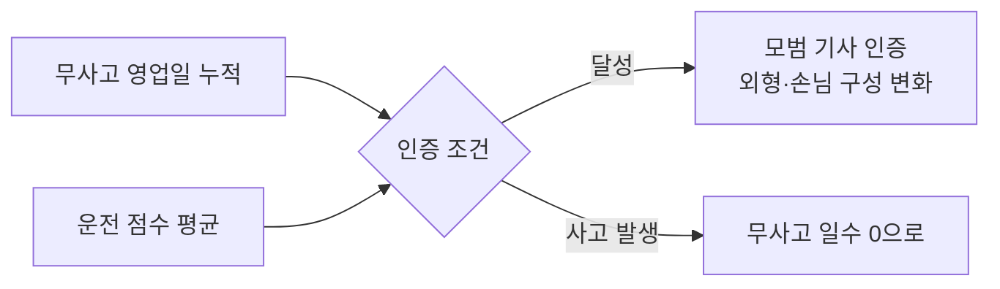

# 화면·조작·길안내

**통합 문서 · 2026-11-23 정리.** HUD, 지도, 길안내, 차내 장치 조작과 보류·제외 결정을 담당한다. 아래 각 장의 "구 NN"은 합치기 전 문서 번호이며, 본문 속 "기획 NN" 표기도 이 번호를 가리킨다. 날짜가 있는 결정과 검증 기록은 그 시점의 기록으로 읽는다. [기획 목록](README.md)

| 장 | 합친 문서 | 다루는 내용 |
|---|---|---|
| [1. 화면·조작·길안내](#s05) | 구 05 | HUD·지도·길안내·1인칭 운전석 |
| [2. 보류 시스템 재검토 — 개인택시 면허 · 차내 장치 조작](#s32) | 구 32 | 차내 장치 조작, 면허 경로 제외·평점 보류 |

## 1. 화면·조작·길안내 (구 05)

은계 r50 지도에 표시하는 생활시설 10곳과 현장 조작은 [시설 위치 안내](04-life-vehicle-economy.md#sfac)에서 찾는다.

정리 기준: 2026-11-07. 싱글/A2 PVP는 밝은 연청색 주행 HUD와 대화/모달 카드·채움 아이콘을 공유한다. 이 문서는 정보의 위치·표현·입력만 정한다. 비용/점수/요청 효과는 담당 규칙을 참조한다. [기존 공통 UI 방향](../ui/2026-11-06-full-ui-direction.md)과 [원본 컨셉 2차 HUD 적용](../work-history/2026-11-07-driving-hud-concept-v2.md)을 구분한다.

택시 외형은 Blender 원본에서 가져온 공유 Body/Wheel prefab을 사용한다. 도장·곡면 유리·램프·휠 디테일을 개선했고 1인칭/UI 배치와 조작 수치는 유지한다. [모델/검증](../work-history/2026-11-07-taxi-blender-quality.md).

### 1인칭 운전석 (2026-11-07 승인 반영)

1인칭은 낮은 디지털 속도·기어·방향지시 표시, 오른쪽 하단 승객 카드, 왼쪽 하단 운전점수·메뉴를 사용한다. 상단 길안내는 높이를 줄이며 도착 정차·다음 회전·신호 형식/출처를 유지한다. 룸미러는 길안내 아래, 사이드미러는 하단 카드 위에 놓는다. TIP와 영업 알림은 승객 카드와 분리한다. 3인칭 기존 반원 계기판·기능은 유지한다. 둥근 노란 차체·유리·범퍼·등·휠은 시각물만 교체하며 충돌·질량·조향/제동 수치는 보존한다.

### 정보의 우선순위

승객 행동 전용 팝업은 깨우기·적재/보호/하역·음식 정리·짐 재고정·경유 대기와 통합된 젖은 우산 감싸기·멀미 휴식을 표시한다. 접기는 진행을 취소하지 않으며 승객 카드에서 다시 연다. 일반 대사/선택 후 답변은 카드에 유지하고, 새 상황 선택·지도·설정이 행동 안내보다 우선한다. 숫자1~n 및 기존 F를 유지한다. [승인 설계](../superpowers/specs/2026-11-07-passenger-actions-design.md).

도로·신호·보행자 판단이 우선이다. 일반 TIP이나 대사가 주요 경고와 승하차 행동을 가리지 않는다.

| 영역 | 정보 | 표현 |
|---|---|---|
| 왼쪽 위 | 지역·시각·날짜/영업시간·잔액/순수익·5종 상태 | 밝은 패널과 숫자/게이지, 내구도 우측 수리 아이콘 |
| 상단 중앙 | 현재/다음 길안내·신호 | 실제 신호 형식/출처와 복귀 안내 유지. 빈차 대기창과 수동 경로 선택 숨김 |
| 하단 중앙 | 큰 속도·기어/수동 또는 보조·방향지시등 | 반원 계기판, 속도0~140km/h에 맞춘 반원 채움, 후진 절댓값/R 표시 |
| 오른쪽 위 | 주변 미니맵·지도(M), 아래 승차/도착 장소·기한·예상 운임 | 도로·내 차·목표 중심, 잔액과 운임 구분 |
| 왼쪽 아래 | 큰 승객 초상·말풍선·현재 만족도/요구치 | 같은 운송의 초상 유지, 긴 취객/세차 안내는 말풍선 스크롤 |
| 오른쪽 아래 | 별도 운전 점수·기록 (F8)·생활거점·도움말 (F1)·퇴근 | 실제 장부와 동일, 기존 기능/비활성·레드닷 조건 유지 |
| 대화 | 승객 초상·말풍선·기사 선택지/효과 | 한 번에 하나. 요청/정산은 같은 운송의 초상 |
| TIP | 상황 설명·시설 추천·서비스 오류·공간 점유/대체 제안 | 숨김/다시 열기·스크롤, 별도 중앙 중복창 없음 |

운송 카드는 픽업 중 **승차 장소**, 탑승 후 **도착지**로 구분하고 실제 남은 제한 시간을 표시한다. 초기 목적지 없는 주행에는 임의 경로를 만들지 않는다. 교통 상황은 자연스럽게 관찰하며 승하차의 선행 조건으로 안내하지 않는다.

### 시작·이어하기·준비 화면

모드 선택은 싱글/PVP/게임 종료와 짧은 설명·초상으로 표현한다. 싱글 최초에는 영업 시작, 이어갈 상태가 있으면 계속하기/처음부터 시작을 제공한다. 초기화는 확인하며 복원 실패 시 이유와 원본 보존/복구 안내를 보여 준다.

2일차부터 전날 실제 비용과 현금/연료/포만/피로 증감을 확인한다. 없는 과거 기록은 만들지 않는다. 준비 화면에 고정 이용 가격표·중복 조작법을 늘어놓지 않는다. 정산에서 내 공간을 선택할 수 있으며 개인 구매의 흐름은 [13](07-home-room-and-vehicles.md#s13)을 따른다.

### 기본 입력과 운전 보조

| 입력 | 기능 | 조건 |
|---|---|---|
| WASD/방향키·패드 | 가감속·조향 | 기본 수동, 반대 페달로 정지 후 계속 누르면 정차 유지. 놓고 다시 눌러 반대 기어 |
| Space | 긴급 제동 | 개인 일반 브레이크 설정과 분리 |
| C / B | 1·3인칭 / 누르는 동안 뒤보기 | 3인칭에서는 좌·우·후진 보조 영상 숨김. 1인칭은 좌·우·룸미러와 후진 보조 영상 표시 |
| Q/E·비상등 | 방향지시·승하차 안전 표시 | 실제 점멸 상태를 배지/화살표에 반영 |
| H | 조향 보조 전환 | 차로 유지·변경·회전, 가감속·정지·양보는 직접 |
| F | 승차·경유 정차·하차·깨우기 | 현재 운송 단계와 정차 위치·방향 조건 |
| M | 지도/호출 보기 | 지도 클릭 좌표와 실제 화면 배율 일치 |
| F1 | 도움말 열기/닫기 | 주행 HUD의 `도움말 (F1)` 버튼과 같은 패널 |
| F7 | 생활시설 메뉴/탐색 | 현장 서비스는 지정 위치에서만 |
| F8 | 운송/운전 기록 | 현재 점수 요약과 상세 사건을 연결 |
| 숫자1~n(키패드 포함) 또는 마우스 | 승객 답변 | 운행 중에도 선택 가능. 실제 작업만 안전 정차 필요 |
| F5 / F6 | 출구 정체 / 우회전 상황·연습 | 본 영업의 돈/시간/기록과 분리 |

도움말은 F1 또는 버튼으로 열고 닫는다. 운전 설정5항목의 범위/기본값은 [01](01-driving-and-traffic.md#개인-운전-설정)에서 관리한다. 재시작은 단축키 없이 메뉴의 확인 절차를 따른다.

### 지도와 길안내

| 선택·표시 | 동작 | 경계 |
|---|---|---|
| 호출 목록/핀 | (2026-11-23 은계 싱글) 성격 표시·픽업 거리·예상 소요·도착 기한·하차지 수요 추가, 목적지 미공개 호출은 탑승 전 하차지 숨김. 출발·도착·예상 운임, 클릭 시 해당 장소 포커스·경로 미리보기 | 선택/수락 분리, 시설을 봐도 주변 호출 유지 |
| 승하차/경유 핀 | 정차 위치·방향 식별 | 승차 접근과 승객 운송을 구분 |
| 경로 | 내 차→승차 파란 실선, 승차→하차 분홍 점선 | 실제 활성 경로와 호출 미리보기 구분 |
| 교통 표시 | 필터를 켜면 경로 혼잡색과 교통 정보를 표시 | 원활/중간/정체는 계산 결과, 실시간 교통 API가 아님 |
| 시설 | 아이콘 선택 즉시 정보/접근 경로, 명시적 길안내 | 호출을 숨기거나 자동 수락/결제하지 않음 |
| 시설 입구/출구 | 도로 경로와 내부 수동 진입/출차 구분 | 벽·인도를 가로지르는 안내 금지 |
| 확대/축소 | 지도 안 오른쪽 아래 버튼·스크롤, 미니맵 +/- | 내 위치·필터·호출 포커스 보존 |
| 내 위치 | 이중 원·방향·라벨·열기 강조, 화면 밖은 가장자리 방향 | 지도 안 버튼으로 복귀 |
| 위치 정보 | 상단 버튼→지역·좌표·방향·인근 교차로 팝업과 복사 | 검은 배경만 표시하지 않음 |
| 필터 | 시설/교통/법규 아이콘, 도로 상황·법규 기본 OFF | 표시만 바꾸며 실제 평가/내비는 유지 |

밝은 지도는 기존 건물·수변·녹지·보도·도로 폭을 구분한다. 노란 내 차, 승차/도착 핀을 강조한다. 없는 도로나 시설을 그림으로 추가하지 않는다. OSM/ODbL·자료 출처 상세는 도움말에서 확인한다. 미니맵은 북쪽 고정·차량 중심이며 재사용 레이어를 최대10Hz로 갱신한다.

싱글 지도/일시정지는 영업을 멈추지만 PVP 지도는 자기 차를 제동하고 공통 경기/다른 차량은 계속된다. 세부 시간 규칙은 [04](06-day-and-career.md#s04)·[PVP](pvp/README.md)를 따른다.

### 내비게이션과 경로 이탈

주 안내는 큰 방향 화살표·회전까지 거리·진출 도로명, 작은 다음 회전과 잔여 거리/분 단위 예상 시간이다. 유턴·차로 변경을 구별하며 다음 구간은 ‘이후’로 표시한다. 빠른 길은 시간/교통 비용, 짧은 길은 거리 기준이다. 실제 차로 방향·회전 제한·연결을 공유하고 없는 경로/도로명을 만들지 않는다.

재탐색 중 유효 경로가 없으면 마지막 경로를 흐리게 남기고 재탐색 중임을 표시한다. 이 과거 선은 보조 운전·거리/ETA 계산에 쓰지 않으며 목표 변경/취소/완료 시 지운다.

시설 미리보기는 운송 목표를 덮어쓰지 않는다. 서비스 완료 후 시설 안내를 해제하고 수락한 승차/탑승 운송 안내를 복원한다. 도착 예상 상태는 호출/시설 비교에서 사용하며 운송 중 별도 상시 HUD 카드는 숨긴다.

### 신호와 도로 위 표지의 실제 표현

현재 접근 방향 신호를 내비 안에서 보여 준다. 계산 가능한 경우 다음 등화 그림/잔여 초를 표시하고 확정할 수 없으면 중립/시간 미정이다. 과거의 ‘녹색까지 예상’ 문장은 상시 표시하지 않는다. 호스트/권한 시계의 상태를 읽으며 표시 때문에 신호를 바꾸지 않는다.

3구/4구는 좌회전 허용 여부로 추정하지 않는다. 도로에 생성된 해당 접근 방향의 신호기와 같은 형식을 표시한다. 작성 신호의 `type=3구/4구`가 명시되면 월드와 내비가 공유하고, 기존 미지정 신호의4구는 유지한다. 꺼진 좌회전 렌즈를 가진4구와3구를 구분한다. 명시 형식과 외형 확인/자료 URL이 함께 있는 작성 시설만 `현장 확인`, 그 외는 `게임 배치`, 방향/형식을 찾을 수 없거나 상충하면 `형식 미확인`이다. 실제 도로의3구 위치를 새로 조사해 배치한 것은 아니다.

정지선·횡단보도·차량/보행 신호를 우선한다. 신호 교차로에 큰 ‘횡단보도’ 글자판을 자동 추가하지 않는다. 실제 허용된 비보호 접근만 신호 위 작은 청색판·흰 화살표/‘비보호’를 사용하고 뒷면은 회색이다. 유턴은 해당 접근의 조건을 짧고 읽기 쉽게 표시한다. 확인되지 않은 방향까지 허용을 넓히지 않는다.

일반 은계 영업의 실제 비보호 근거·PS05~07 처리와 연습의 구분은 [01의 접근별 근거 정책](01-driving-and-traffic.md#실제-근거가-확인된-접근-방향만-비보호-허용)을 따른다. 노면/신호/표시와 내비·일반 차량·평가는 같은 도로 정보를 사용한다.

### 승객 대화창

[07 대화 스크립트](02-passengers-and-fares.md#s07)의 흰 카드·초상·파란 말풍선과 키가 보이는 선택 버튼을 공유한다. 승객/기사 말, 행동, 효과를 나눈다. 움직여도 답변은 클릭할 수 있으나 실제 적재/정리·재고정·용무는 안전 정차에서만 진행한다. 지도/결과/다른 선택창·도착 잠금 중 입력과 같은 프레임 중복 응답을 막는다.

효과는 즉시/운행 중/하차 판정·조건부 오염을 구별한다. 실제 값이0이면 효과 없음으로 표시한다. 숫자는 [02의 효과 표시](02-passengers-and-fares.md#대화-선택의-실제-효과-표시)와 활성 프로필을 읽고 별도 UI 상수를 만들지 않는다.

승인된 [1차 HUD/대화 시안](../work-history/2026-11-06-hud-dialogue-preview.md)의 답변/효과 구분을 유지하고 [원본 기반 2차](../work-history/2026-11-07-driving-hud-concept-v2.md)에서 초상을 확대하고 남색 제목을 적용한다. 성공/실패 종료 원문과 수치는 초록/붉은 배지로 보여 준다. 대화창은 중앙 속도계 위에 놓고 긴 대사/다중 선택은 화면 높이48%/최대420논리px 안에서 스크롤한다. 비활성 응답과 클릭/단축키 조건은 그대로다.

### 승하차·사고·생활 안내

| 상황 | 표현 |
|---|---|
| 승차/하차 접근 | 현장 정차 칸·방향 강조, 현재 F 행동·감속/위치 조건. 실제 F 상호작용은 유지 |
| 적재/하역·용무·기상 대기 | 일반 하차와 다른 대기 행동/잔여시간 |
| 내구도50 이하 | 생활거점/공업사 레드닷·상태계 안내, 열람만으로 해제하지 않고 수리 후 해제 |
| 내구도0·사고 | 고장/견인·사고 결과와 다음 복귀 행동. 중앙 공업사 비교 버튼을 상시 두지 않음 |
| 시설 선택 | 서비스 비용/시간/상태·미납 견적을 사전 표시, 확인/취소 분리 |
| 정산의 시설 찾기 | 생활거점 메뉴만 열기. 자동 길안내/결제 없음, 마감·종료·고장 전환 보호 |

주유/식사/수면/세차·수리의 조건은 [03](04-life-vehicle-economy.md#s03), 사고 결과/복귀는 [08](04-life-vehicle-economy.md#s08)이 소유한다. 구 유료 정비 예약은 호환하며 재견인/재청구하지 않는다.

### 알림·결과·가독성

운전 점수·승객 만족도 변화는 **원인 ; 실제 증감치**의 짧은 알림으로 즉시 보여 준다. 두 점수를 합치지 않고 HUD·알림·정산이 같은 장부를 읽는다. 기존 사건 복원/패킷으로 과거 알림을 새로 지급하지 않는다. 연료/졸음/운행 불가 경고는 일반 수다보다 우선한다.

운송 결과는 **최초 예상 운임 / 운임 조정 / 최종 실수령** 3줄과 만족도 요구치·최종값·영향 원인이다. 하단은 원인/증감치만 짧게 표시하고 상세는 F8로 보낸다. 완료 팝업은 다음 행동을 알리고 불필요한 반복 알림을 남기지 않는다.

모든 팝업은 불투명 본문·명확한 닫기/확정, 긴 한글은 줄바꿈/스크롤을 사용한다. 주요 HUD는 최소 글자 크기와 화면 확대를 적용하고 긴 도로명은 말줄임/툴팁으로 처리한다. 도움말/TIP/운송 안내/상태계의 겹침을 피한다. 화면 배율이 바뀌어도 지도 좌표/클릭과 핀/경로가 맞아야 한다.

실제 해상도/DPI·장시간 사람 가독성과 입력 수용은 자동 GUI 검사와 구분한다. 검증 결과·실행 파일은 [최신 이력](../work-history/LATEST.md)을 따른다.

<!-- 이전 문서의 외부 링크 호환. 현재 내용은 위 담당 항목/보존본 참조. -->

### 2026-11-07 사용성 후속

PVP4인 현황은 좌측 상태계 아래4행으로 상시 표시하고 대화와 분리한다. 빈차 호출 버튼은 좌측 아래 승객 카드에서 지도의 호출 목록을 연다. 생활거점은 자동으로 열지 않으며 연료/포만25 이하·피로75 이상(주차장/수면)·내구도50 이하(공업사)에 레드닷을 표시한다. 상태가 회복되면 해제되며 열람만으로 없애지 않는다.

일시정지 설정에 앞차 안전 추종을 두고 모드 선택도 메뉴 내부에 둔다. 퇴근 거절 사유는 우측 운송 카드 아래에 표시한다. PVP 피로/비용 상시 안내는 제거하고 방 생성의 접이식 규칙 설정으로 이동한다. 기본값은 유지하며 호스트가 피로배율·식사/휴식 비용·시간을 지정하고 LANv14가 이를 검증/동기화한다.

[구현·검증·남은 디자인](../work-history/2026-11-07-hud-usability-followup.md). 수동 짧은길/빠른길 선택은 숨기며 작성된 승객 요청/길찾기 알고리즘은 보존한다.

2026-11-12 사용자 조정: 새 호출 승차/하차 제한 시간은 기존 계산(거리·시간 성향·대기·콘텐츠 조정)의80%다. 기존 저장의 확정된 운송 시간은 유지한다. [검증](../work-history/2026-11-12-junction-route-timing.md).

## 2. 보류 시스템 재검토 — 개인택시 면허 · 차내 장치 조작 (구 32)

**은계 싱글 차내 조작 · 2026-11-20 개정.** [변경과 검증](../work-history/2026-11-20-cabin-logbook-steering.md).

| 항목 | 결정 |
|---|---|
| 개인택시 면허 경로(기획23·축소안 모두) | **제외.** 시작부터 개인택시로 바로 영업(기획10 유지). 아래 §2는 기록용 |
| 차내 장치 조작 | 미터기·운전석 창문·희망 온도를 조작한다. 지붕 표시등은 영업 상태를 따른다. |
| 배경 이야기 표현 | [33 배경 이야기 보여주기](00-game-overview.md#s33) |

### 1. 한눈에

| 항목 | 현재 | 왜 다시 보나 | 권장 |
|---|---|---|---|
| 개인택시 면허 경로 | [기획23](archive/23-license-career-path.md) 보류 | 운전 점수·무사고가 장기 목표와 직접 연결되는 유일한 안. 한국 택시만의 특징 | **28 계속 영업에 "세 번째 목표"로 축소 도입** 검토 |
| 차내 장치 조작 | 운임·창문·온도 조작 | 온도 요청을 받은 뒤 기사가 직접 설정한다 | §3 적용 |

### 2. 개인택시 면허 — 축소안

기획23 전체(법인택시 시작·사납금)는 시작 설정을 바꾸므로 보류 유지. 대신 **현재 시놉시스(중고 개인택시로 시작)를 유지**하고, 장기 목표로 "면허 등급"만 얹는다.

| 비교 | 기획23 원안 | 축소안 |
|---|---|---|
| 시작 | 법인택시 회사 취업 | 그대로 중고 개인택시 |
| 정산 | 사납금 추가 | 변경 없음 |
| 목표 | 면허 양수 | **모범 기사 인증**(무사고·무위반 기록) |
| 보상 | 내 택시 | 모범 택시 외형·장거리 손님 비중↑ |
| 영향 범위 | 저장·경제·시작 서사 전부 | 28 목표 카드 1종 추가 |

| 조건(초안) | 값 |
|---|---|
| 무사고 연속 영업일 | 10일 |
| 최근 10일 운전 점수 평균 | 기준 이상(콘텐츠 툴 편집) |
| 실패 시 | 무사고 일수만 초기화, 돈·소유 유지 |

### 3. 은계 싱글 차량 조작

| 장치 | 운전 화면 | 동작 |
|---|---|---|
| 미터기 | J | 첫 3일은 자동 보조를 선택할 수 있다. 수동일 때 승하차에 맞춰 켜고 끈다. |
| 운전석 창문 | K 또는 창문 버튼 | 내림과 올림. 열면 환기되어 실내 온도가 바깥 기온의 영향을 받는다. |
| 온도 | [ 낮춤 · ] 높임, 화면의 − / + | 18~28°C에서 1°C씩 조정한다. 기본은 22°C. 현재 실내 온도와 설정 온도의 차이에 따라 난방·냉방·유지를 표시한다. |
| 빈차등 | 자동 | 첫날 출차 때 자동으로 호출을 받는다. 지붕 표시등 앞뒤에는 항상 TAXI를 표시한다. |

차내 온도에 민감한 손님은 응대 이후 실제 실내 온도가 따뜻한지 시원한지와 유지 시간에 따라 만족도가 달라진다. 창문은 독립 조작이다. 현 버전은 외기를 22°C로 근사한다.

### 4. 결정 기록

| 질문 | 선택지 | 결정(2026-11-19) |
|---|---|---|
| 면허 경로 | A 보류 유지 · B 축소안 · C 기획23 원안 | **제외** |
| 차내 조작 | A 보류 유지 · B 3종 1차안 · C 음악 포함 4종 | **B 3종 추가** |
| 시점 | 28~31 사람 플레이 후 / 28과 동시 | 미정 |

### 5. 검증(채택 시)

| 질문 | 통과 기준 |
|---|---|
| 인증이 안전 운전 동기가 되는가 | 인증 목표 선택자의 위반 수 감소 |
| 조작이 귀찮지 않은가 | 미터기 누락률, "귀찮다" 응답 |
