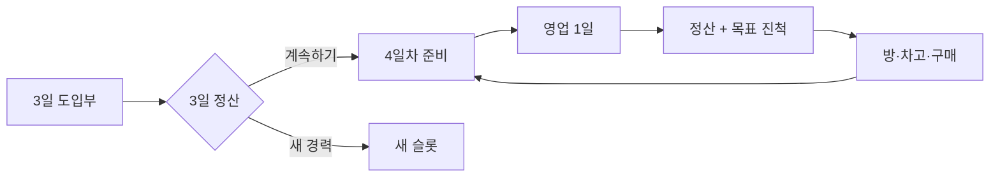
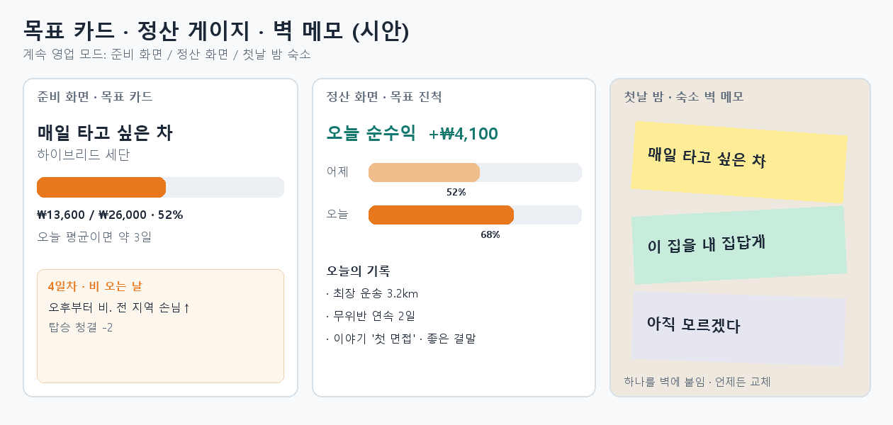
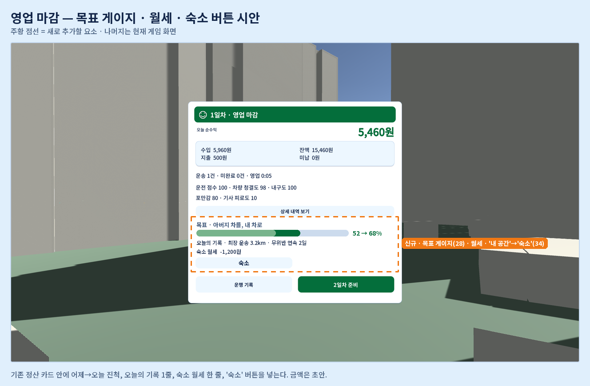
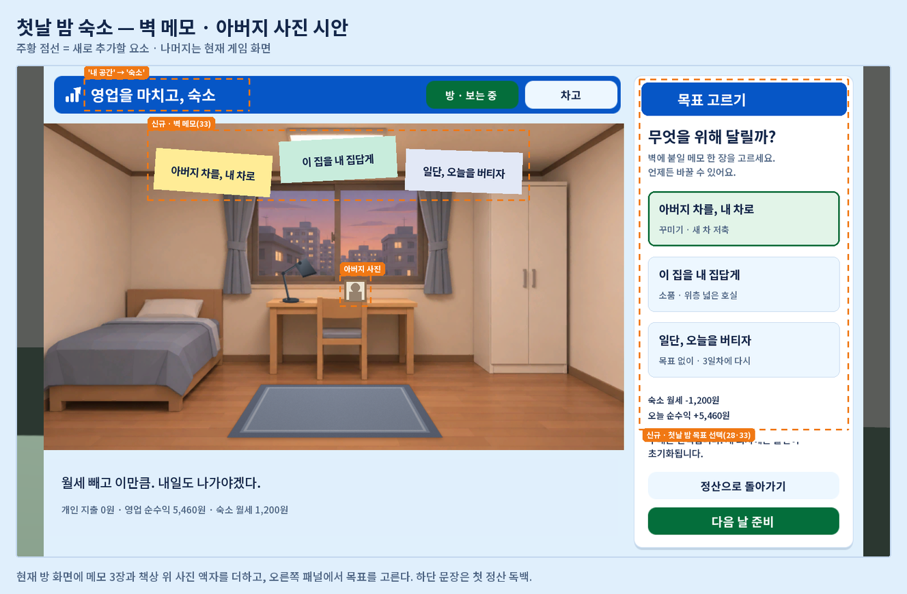
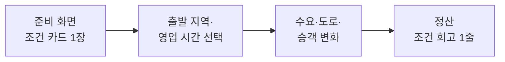
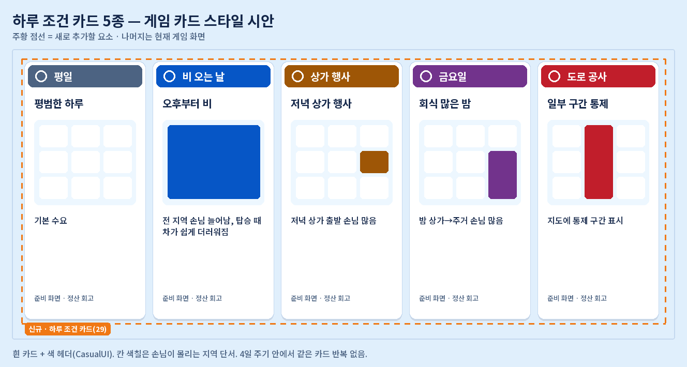
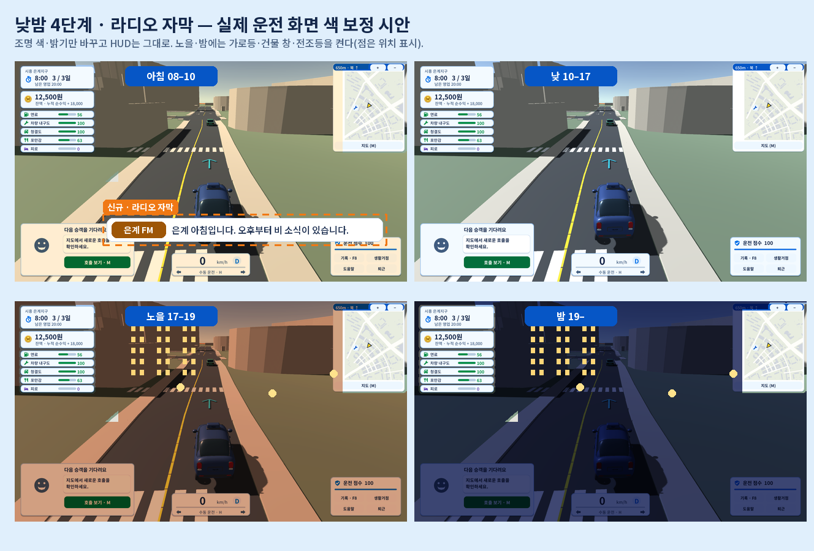

# 하루·경력·날씨·시간대

**통합 문서 · 2026-11-23 정리.** 하루 영업과 정산, 3일 도입 뒤 계속 영업, 하루 조건 카드, 비 운행, 낮밤 조명과 은계 FM을 담당한다. 아래 각 장의 "구 NN"은 합치기 전 문서 번호이며, 본문 속 "기획 NN" 표기도 이 번호를 가리킨다. 날짜가 있는 결정과 검증 기록은 그 시점의 기록으로 읽는다. [기획 목록](README.md)

| 장 | 합친 문서 | 다루는 내용 |
|---|---|---|
| [1. 캠페인·하루 결과·회고](#s04) | 구 04 | 하루 마감·3일 결과·이어하기 |
| [2. 계속 영업 모드와 장기 목표](#s28) | 구 28 | 3일 뒤 계속 영업·벽 메모 목표 |
| [3. 오늘의 은계 — 하루 조건 카드](#s29) | 구 29 | 하루 조건 카드 |
| [4. 비 운행 프로토타입](#s18) | 구 18 | 비 운행·차량 상태 |
| [5. 낮밤 조명과 라디오 자막](#s31) | 구 31 | 시간대 조명·은계 FM |

## 1. 캠페인·하루 결과·회고 (구 04)

### 하루와 캠페인

| 단계·조건 | 플레이어 선택 | 결과 |
|---|---|---|
| 새 경력 | 싱글 → 처음부터 하기 → 준비 → 숙소 벽 메모 → 준비 화면의 영업 시작 | 기존 슬롯을 보존한 채 새 슬롯에 3일 도입을 시작한다. 첫 인트로 뒤 덕성프라자 주차 칸에서 출차한다 |
| 하루 영업 | 호출·생활·경로 자유 선택 | 기본 20분, 출차 전 10/20/30/60분 선택. 필수 운송 건수·고정 수익 목표 없음 |
| 예정 시간 첫 경계 | 계속 운전하거나 휴식 거점으로 이동 | 피로100·초과 영업, 자동 정산 없음 |
| 정상 마감 | 빈차로 덕성프라자 숙소 주차 칸에 정차 후 F | 마감 휴식 뒤 그날 수입·비용·상태를 한 번 정산. 동부 휴식 구역은 낮 동안의 휴식 거점 |
| 탑승 중 마감 시도 | 목적지 하차 후 거점 이동 | 자발적 마감으로 승객을 도중 삭제하지 않음 |
| 졸음 강제 마감 | 정차 후 귀가 휴식 확정 | [졸음 정책](04-life-vehicle-economy.md#피로100과-졸음)에 따라 당일 종료 |
| 날짜1~2 정산 | 선택적으로 내 공간 이용 후 다음 날 선택 | 현금·미납·연료·포만감·청결·운전 점수 이월, 야간 피로 -60 |
| 3일차 정산 | 도입 결과 확인 후 4일차 영업 준비 또는 회차 마무리 | 4일차로 가면 같은 슬롯의 차량·소지금·목표와 기사 수첩을 이어 간다 |

정산 후 방 꾸미기는 선택이다. 조명·러그·차량·구매 부품은 개인 지출이며 영업 순수익과 구분해 기록한다. 같은 경력의 소유·배치 상태는 4일차 이후에도 이어진다. [작은 방](07-home-room-and-vehicles.md#s13) · [연속 경력](#s28) · [동네 가게와 부품](04-life-vehicle-economy.md#s36)

수면 후 이미 예정 시간을 넘었다는 이유만으로 피로를 다시100으로 만들지 않는다. 마감 수면의 비용·회복량은 [생활시설](04-life-vehicle-economy.md#생활시설과-비용)에서 정의한다.

### 시간의 구분

| 시간·상태 | 흐르는 것 | 흐르지 않는 것 |
|---|---|---|
| 운전·신호 대기·빈차 정차 | 영업·승객 기한·컨디션 | 대기했다고 자동 시간 면제 없음 |
| 지도·시설 메뉴·일시정지·결과·복습 | 메뉴 밖 실제 체류시간은 별도 | 영업/운송·컨디션·졸음 정지 |
| 서비스 확정 | 서비스가 정한 시간만큼 영업 경과 | 메뉴를 오래 열어 둔 시간을 비용으로 추가하지 않음 |
| 운송 뒤 생활 목적지 추천 | 영업 시계 지속 | 안내만으로 결제·마감·순간 이동 없음 |
| 다음 날 야간 회복 | 날짜 전환의 피로 회복 | 다음 날 영업 예산 미소비 |

하루는 08:00~20:00에 대응한다. 기본 20분 설정에서는 영업 1초가 가상 시간 36초에 해당하며, 영업 길이를 바꾸면 환산 비율이 바뀐다. 승객 기한·서비스 소요는 플레이 초로 표시한다. [낮밤 조명과 은계 FM](#s31)

### 결과와 플레이 회고

| 결과 화면 | 알려 주는 것 | 플레이어가 비교할 것 |
|---|---|---|
| 운송 완료 | 최초 예상·운임 조정·실수령, 최종 만족도·주요 원인 | 왜 이번 운임이 달라졌는가 |
| 승객 상세 | 요청·응답·실제 이행·도착·청결·주행의 영향 | 어떤 행동을 바꿀 수 있는가 |
| 법규 사건 카드 | 당시 신호·사람/차량·행동·판정 이유 | 관찰 사실과 추정·보류를 구분 |
| 하루 결과 | 수입·비용/미납·순수익·운송 수·실제 영업시간·생활·공차/탑승 성과 | 더 오래 일한 것이 실제로 유리했는가 |
| 캠페인 결과 | 일별/누적 결과·종료 상태 | 같은 설정의 회차 간 자신의 판단 변화 |

점수 상승이 과거 위반 기록을 삭제하지는 않는다. 운전 점수·승객 만족도·순수익을 합산해 하나의 사람 등급을 만들지 않는다. 기회가 없었거나 사실을 확인할 수 없는 장면은 평가 없음/보류로 설명한다.

### 연습과 재도전

| 연습 | 플레이 흐름 | 영업과의 경계 |
|---|---|---|
| 우회전 | 신호·보행 조건 확인→실제 운전→이번 시도 피드백 | 원래 돈·시간·기록 유지 |
| 출구 정체 | 대기/우회/진입 판단 비교→실제 행동→결과 | 일반 영업의 출구 계획 팝업과 다름 |
| 사건 복습 | 기록에서 같은 조건 다시 운전 | 이전 사건을 지우거나 보상을 다시 받지 않음 |
| 재시도 | 같은 조건 또는 지원하는 다른 조건 선택 | 완료하지 않아도 본 영업으로 돌아갈 수 있음 |

### 이어하기와 재시작 경험

운송·위치·남은 시간·요청·차량/운전자 상태·점유/보행 상황을 이어서 시작한다. 불러온 직후에는 멈춘 상태에서 확인하고 계속 운전한다. 저장을 다시 읽었다고 손님 특성·요청·만족도·소모 상태를 유리하게 다시 뽑지 않는다.

새 캠페인은 명시적으로 확인한다. 이어갈 수 없는 자료는 이유를 알리고 기존 진행을 보존하며, 조용히 새 영업으로 덮어쓰지 않는다. 파일 형식·버전·기록 장치는 기획이 아니라 별도 개발 자료에서 다룬다.

**후속 기획**은 하루 안의 운송을 더 다양하게 만드는 쪽이다. 팁, 호출판 변주, 선택형 미션은 [08 재미 보강](08-fun-improvements.md)에서 검토한다.

## 2. 계속 영업 모드와 장기 목표 (구 28)

**상태: P2 구현·자동 검증(2026-11-19).** 3일 완료 후 같은 저장으로 계속 영업, 새 경력과 슬롯 선택, 준비 목표 카드·정산 진척을 적용했다. 벽 메모는 첫 출발 전에 고를 수 있다. 실제 호실 이전·달성 연출은 후속이다. [검증과 재현](../work-history/2026-11-19-continuous-career-p2.md).

### 1. 목표

> 3일이 끝나도 **내 돈·차·방이 남고**, "하루만 더" 할 이유가 화면에 보인다.

### 2. 현재 vs 변경

| 항목 | 현재 | 변경 |
|---|---|---|
| 회차 | 3일 완료 → 새 회차는 차·방·소유 초기화 | 3일 = **도입부**, 완료 후 같은 저장으로 **4일차~ 무한 진행** |
| 소유 | 회차마다 리셋 | 현금·차량·색/장식·방 소품 유지 |
| 목표 | 3일 순이익 | 장기 목표 1개 선택 + 다음 구매 게이지 |
| 새로 시작 | 타이틀 → 싱글 → 처음부터 하기 | 기존 경력을 보존하고 별도 슬롯에서 시작 |
| 이어 하기 | 타이틀 → 싱글 → 불러오기 | 최근 저장 순으로 목록을 표시하고 선택한 경력을 복원 |
| 운전 중 | 일시정지 → 불러오기 / 처음부터 다시하기 | 현재 슬롯의 마지막 저장도 다시 불러올 수 있음 |
| 3일 체험 | 기본 | 그대로 유지(첫 플레이·비교 기준) |

### 3. 흐름

### 4. 장기 목표 (하나 선택, 언제든 변경)

| 목표 | 도달 조건 | 달성 연출 | 비고 |
|---|---|---|---|
| 아버지 차를, 내 차로 | 아버지 차 꾸미기, 원하면 새 차 구매 | 새 운전석 첫 출근 컷 | 아버지 차는 **판매 없이 숙소 주차장 보관**(보상 판매 없음 → 새 차 전액). 차종 추가는 후속 |
| 이 집을 내 집답게 | 숙소 꾸미기 + 같은 건물 넓은 호실로 옮기기 | 소품 옮기기 + 창밖 전망 변화 | 거점은 하나로 고정([34](07-home-room-and-vehicles.md#s34)), 다른 동네 이사 없음 |

개인택시 면허 목표는 제외(2026-11-19 사용자 결정, [32](05-interface-and-navigation.md#s32)). 처음부터 개인택시로 영업한다. 첫 출발 전 숙소에서 고른 "무엇을 위해"([33](00-game-overview.md#s33))가 기본 목표가 된다.

하나만 달성해도 "재출발 성취"로 인정한다(기획10 원칙 유지). 달성 후에도 영업은 계속된다.

### 5. 화면에 보일 것

| 위치 | 표시 | 예 |
|---|---|---|
| 준비 화면 | 목표 카드 1장 | `하이브리드 세단까지 ₩12,400 · 오늘 평균이면 약 3일` |
| 정산 화면 | 목표 게이지 변화 | `+₩4,100 → 52% → 68%` |
| 정산 화면 | 오늘의 기록 1줄 | 최장 운송, 무위반 연속일 등 ([30](00-game-overview.md#s30) 수첩과 연동) |
| 방 | 지금까지 산 것 | 소품·차 사진이 늘어나는 벽 |

"며칠" 예상은 최근 3일 순이익 중앙값으로 계산하고, 확정 약속처럼 표기하지 않는다(`약`).

### 6. 경제 원칙

| 원칙 | 내용 |
|---|---|
| 기준 단위 | `R` = 하루 순수익 중앙값(기획12) |
| 다음 구매 간격 | 1.5~3R마다 무언가 살 수 있게 배치 |
| 큰 목표 | 차 교체 8~12R, 넓은 호실 15~20R |
| 금지 | 가격만 올려 반복 시간 늘리기, 일일 고정비로 강제 영업 |
| 기존 값 | 하이브리드 ₩26,000 · LPG ₩22,000 · 색 ₩1,500 · 장식 ₩2,000 · 조명 ₩5,000 · 러그 ₩8,000 (모두 `ContentTuning`) |

### 7. 구현 범위

| 영역 | 작업 | 파일(현재) |
|---|---|---|
| 저장 | `settings.days` 고정값 대신 무기한 일차, 새 경력 슬롯 | `BusinessProgress.cs`, `CampaignSaveLocation.cs` |
| 완료 처리 | 3일 완료 = 도입 종료 표시, 잠금(`finalized`) 해제 | `BusinessProgress.ResetCampaign`, `RoomAvailable` |
| 장부 | 일차 무제한 누적, 최근 N일 요약 | `EconomyLedger.cs` |
| UI | 목표 카드·게이지 | `OneDayHUD.cs`, `DayPreparationPresentation.cs` |
| 이관 | 기존 3일 저장 → 4일차 이어가기 가능 | 저장 버전 4 |

### 8. 검증

| 질문 | 통과 기준 |
|---|---|
| 3일 후 계속할 이유를 말하는가 | 사람 플레이 3명 중 2명 이상 "목표/다음 구매" 언급 |
| 산 물건을 다음 날 쓰는가 | 구매 다음 영업에서 사용·확인 |
| 기존 저장 보존 | r14~ 저장 이관 검사 통과, 3일 체험 저장 별도 유지 |

## 3. 오늘의 은계 — 하루 조건 카드 (구 29)

**상태: P5 하루 조건 카드 구현(2026-11-19).** [검증과 재현](../work-history/2026-11-19-daily-conditions-p5.md). 동기 보강 2순위. [기획12](archive/12-career-growth-stages.md)의 날짜별 조건 후속.

### 1. 목표

> 매일 아침 **어제와 다른 판단**을 하게 만든다. 벌칙이 아니라 정보다.

### 2. 구조

현재 수요: 아침 주거→업무, 낮 업무→상업, 저녁 상업→주거 지역이 각 3배 비중(`PassengerDemandPolicy`). 조건 카드는 이 위에 **지역·시간대 가중치와 승객 구성을 덧씌운다.**

### 3. 조건 카드 (1차 4종 + 평일)

| 카드 | 단서 문구 | 수요 변화 | 도로·차량 | 승객 구성 | 플레이어 판단 |
|---|---|---|---|---|---|
| 평일 | 평범한 하루 | 기본 | 기본 | 기본 | 기준일 |
| 🌧 비 오는 날 | 오후부터 비 | 전 지역 ×1.3 | 비 연출·탑승 청결 −2(기존 `RainPolicy`) | 젖은 우산↑ | 많이 뛸지, 세차비 감수할지 |
| 🛍 상가 행사 | 저녁 상가 행사 | 저녁 상업 출발 ×2 | 상업 주변 교통량↑ | 짐·음식↑ | 저녁에 상가 대기할지 |
| 🍻 금요일 | 회식 많은 밤 | 저녁·초과영업 상업→주거 ×2 | 기본 | 음주·수면↑ | 늦게까지 일할지, 피로 관리 |
| 🚧 도로 공사 | 계수로 일부 통제 | 기본 | 지정 구간 차로 감소·우회 | 급한 승객↑ | 길을 아는 사람이 이득 |

- 2차 후보: 시험일(아침 단거리↑), 장날, 명절 전날(장거리·짐↑).
- 순서: 4일 주기 안에 같은 카드 반복 없음. 시드 고정(재시작해도 같은 날 같은 카드).

### 4. 화면

| 시점 | 표시 |
|---|---|
| 준비 | 카드 1장(아이콘·단서 1줄·추천 아님) + 수요 지도에 강조 지역 |
| 영업 중 | 상단 작은 아이콘, 라디오 자막([31](#s31))으로 1회 상기 |
| 정산 | `비 오는 날 · 운송 9건(평소 7) · 세차 ₩800` |

정답 경로·예상 수입을 직접 알려주지 않는다.

### 5. 설계 원칙

| 할 것 | 하지 않을 것 |
|---|---|
| 최선의 행동이 날마다 달라지게 | 매일 무작위 벌금·고장 |
| 기존 시스템(비·공사 구간·승객 특성) 재사용 | 조건마다 새 관리 수치 |
| 운임 할증 없이 수요·구성으로 차이 | 할증으로 단순 이득 |

### 6. 구현 범위

| 영역 | 작업 | 파일(현재) |
|---|---|---|
| 데이터 | 조건 정의(가중치·승객 가중치·도로 변경) | `ContentTuning` 프로필 신규 키 `day.condition.*` |
| 수요 | `Weight(region, phase, destination)`에 조건 배수 | `PassengerDemandPolicy.cs`, `SimulationDemandClock.cs` |
| 승객 | 특성 선택 가중치 | `PassengerBehavior.cs` |
| 도로 | 공사 구간 on/off | 기존 48번 공사 구간 연결 재사용 |
| 저장 | 일차별 카드 기록 | 캠페인 저장 |
| 툴 | 콘텐츠 관리 툴에 카드 편집 | content tool |

### 7. 검증

| 질문 | 통과 기준 |
|---|---|
| 카드에 따라 행동이 달라지는가 | 카드별 출발 지역·영업 시간 분포 차이 |
| 모든 카드에서 손해만 보지 않는가 | 카드별 순수익 중앙값이 평일 ±20% 이내 |
| 위치 제어 검사 | 카드별 수요 가중치·공사 구간 경로 회귀 |

## 4. 비 운행 프로토타입 (구 18)

2026-11-07 사용자 승인: 맑음/비만 프로토에 포함한다. 눈·결빙·동적 낮밤·타이어 구매는 후속이다. 확률 미끄러짐은 검증 후 별도 활성화하며 이번 실행에서는 작동하지 않는다.

### 경험과 구현 기준

비를 보고 미리 감속하고 차간 거리를 확보하며, 승차 오염에 따라 세차 시점을 판단한다. 맑음의 조향/제동은 그대로 보존한다. 매 프레임 사고를 추첨하거나 차량을 임의 회전시키지 않는다.

| 항목 | 초기 시험값/범위 | 적용 |
|---|---|---|
| 비 사용 | 기본 꺼짐 | 툴은 다음 새 세션, 일시정지 설정은 적용 즉시 변경. 이어하기는 저장값 유지 |
| 표현 강도 | 0.65 / 0~1 | 차량 주변 제한된 빗줄기, 흐린 하늘/조명 |
| 자동 와이퍼 주기 | 1.2초 / 0.5~3 | 1인칭 전방에서 자동 왕복, 후방/3인칭 화면을 가리지 않음 |
| 승차 추가 오염 | 2 / 0~10점 | 성공한 승차마다 한 번. 승차 전 청결 보너스 평가 후 감소. 거부/적재 대기에는 미적용 |
| 제동 계수 | 0.9 / 0.75~1 | 비가 올 때 이동 중 제동 토크와 제동 중 전후 접지력 감소, 정차 유지 보존. 제동거리 실측 필요 |
| 일반 교통 속도 계수 | 0.85 / 0.6~1 | 감속 운행 및 차간 여유 확대 |
| 확률 미끄러짐 | 잠금/미구현 | 툴에서 상태만 표시. 검증하지 않은 기능을 켤 수 없게 한다 |

수치는 현실 노면 모델이 아닌 게임 시험값이다. 이번 단계는 제동 영향만 적용하고 횡접지 저하·추가 확률 미끄러짐은 보류한다. 강도0은 빗줄기만 끄며 비의 운행 효과는 유지한다.

### 기존 시스템 연결

- 승차 전 청결 부족 거부 규칙은 유지. 승차 오염으로 30 미만이 되어도 현재 승객은 내쫓지 않으며 다음 승차만 제한한다.
- 기존 하차 오염·시간 오염과 별도 사건ID를 사용하며 저장/이어하기/네트워크 복원 시 재적용하지 않는다.
- 청결 감소 자체로 운전 점수를 깎지 않는다. 기존 만족도 시작 청결 보너스·실제 사고 판정은 그대로 사용한다.
- 설정은 기존 콘텐츠 프로필과 함께 저장/복원하고 LAN 호스트 설정을 따른다. 실행 중 툴 변경은 다음 새 세션에 적용한다. 일시정지의 날씨 탭은 현재 세션의 날씨6값만 즉시 바꾸고 저장한다.
- 최초 적용은 고정 비 시험이다. 자동 날씨 전환·요금/수요 변경·시간 제한 재조정은 이번 범위에 넣지 않는다.

### 후속 혼합 미끄러짐

안전 구간에는 추가 추첨이 없고, 노면/속도/급제동/급조향의 위험 구간 진입마다 한 번 추첨한다. 위험 해제 전 재추첨 금지. 한계 초과는 물리 영향으로 처리한다. 사고는 실제 충돌 때만 발생한다. 저장 난수/사건, 호스트 권한, 예고와 회복 가능성을 검증한 뒤 활성화를 결정한다.

### 검증 기준

프로필 구버전/누락/범위/해시·왕복 저장, 성공 승차 단발 오염/복원/임계치, 맑음과 비 제동 비교, 와이퍼 시점/일시정지, 일반 교통·싱글/PVP 연결을 나눠 확인한다. 자동 모델 검사·실제 물리 검사·수동 체감은 별도 기록한다.

### 2026-11-07 인게임 설정 후속

일시정지 → 설정을 **운전 관련 설정 / 날씨 관련 설정** 두 탭으로 분리한다. 운전5값과 날씨6값을 별도 초안으로 편집하며 적용 전에는 게임이 바뀌지 않는다. 기본값은 현재 탭의 초안만 초기화하고 취소/Esc는 두 초안을 버린다. 적용 시 수정한 날씨와 운전 설정을 반영한다.

- 비 켜기·빗줄기 강도·자동 와이퍼 주기·승차 오염·제동 계수·일반 교통 속도 계수를 게임에서도 조절한다.
- 싱글은 즉시 적용 후 기존 checkpoint에 저장하며 실패 시 기존 날씨로 복구한다. 현재 운송의 오염/만족도/약정 기한은 소급 변경하지 않는다.
- 새 캠페인은 툴 프로필을 다시 읽는다. 인게임 설정은 툴 디스크 원본을 덮어쓰지 않는다.
- LAN은 호스트만 편집하며 게스트는 공유된 값을 읽는다. 현재 날씨6값만 권한 프레임으로 전송하여 다른 콘텐츠의 경기 중 변경 금지 계약을 보존한다. 양쪽 LANv15 실행본이 필요하다.
- 확률 미끄러짐은 계속 잠금 상태다. 수동 조작/경제 밸런스는 후속 검증이다.

## 5. 낮밤 조명과 라디오 자막 (구 31)

**상태: P7 낮밤 조명·은계 FM·숙소의 아침과 밤 구현(2026-11-19).** [검증과 재현](../work-history/2026-11-19-day-night-radio-p7.md). 동기 보강 4순위. 전체 아트 교체 없이 **조명과 글자**로 세계관을 전달한다.

### 1. 목표

> 출근길과 퇴근길이 **다른 동네처럼 보이고**, 라디오가 오늘의 은계를 들려준다.

### 2. 낮밤 단계

영업 하루 = 화면 시각 08:00~20:00(현재 `PassengerDemandPolicy`), 초과 영업은 20:00 이후.

| 단계 | 화면 시각 | 태양·하늘 | 도시 조명 | 수요 단계 |
|---|---|---|---|---|
| 아침 | 08~10 | 낮은 각도·따뜻한 색 | 꺼짐 | 아침(주거→업무) |
| 낮 | 10~17 | 높은 각도·흰색 | 꺼짐 | 낮(업무→상업) |
| 노을 | 17~19 | 주황·긴 그림자 | 가로등 켜짐 시작 | 저녁(상업→주거) |
| 밤 | 19~ | 남색 하늘·환경광↓ | 가로등·상가 창·차량 전조등 | 저녁/초과 |

```mermaid
gantt
  dateFormat HH:mm
  axisFormat %H
  section 조명
  아침 :08:00, 2h
  낮   :10:00, 7h
  노을 :17:00, 2h
  밤   :19:00, 3h
```

| 요소 | 구현 방법 | 비용 |
|---|---|---|
| 하늘·태양 | Directional Light 각도·색, 환경광 그라데이션 | 소 |
| 가로등 | 도로 시설 위치에 점광원 대신 발광 머티리얼 + 바닥 조명 텍스처 | 소~중 |
| 건물 창 | 회색 상자 건물에 발광 창 텍스처 무작위 | 소 |
| 전조등 | 플레이어·교통 차량 스포트라이트(성능 상한 근처 차량만) | 중 |
| 비 연동 | 비 오는 날([29](#s29)) 환경광↓·젖은 노면 반사 | 소 |

PvP 호스트의 전체 frame p95 기준은 22ms다. 최종 야간 루프백의 p95는 22.12ms여서 PvP 조명은 기본으로 끈다. 화면 표시 설정에서 켤 수 있다.

### 3. 라디오 자막

| 종류 | 시점 | 예시 | 연결 |
|---|---|---|---|
| 아침 인사 | 영업 시작 | "은계 아침입니다. 오늘은 오후부터 비 소식." | 조건 카드 상기 |
| 교통 정보 | 하루 1~2회 | "○○로 공사로 정체가 이어집니다." | 공사 카드 |
| 동네 소식 | 하루 1회 | "은계 상가 저녁 행사, 9시까지." | 상가 카드 |
| 사연 | 무작위 | 청취자 사연 1줄 | 세계관 |
| 마감 | 영업 종료 | "오늘도 수고하셨습니다." | 정산 전환 |

- 표시: 화면 하단 자막 1줄, 6초. 음성·음악은 후속.
- 승객 대화 중에는 표시하지 않는다.
- 문구는 콘텐츠 프로필 `radio.*`로 편집.
- 설정에서 끄기 가능.

### 4. 방의 낮밤

| 상황 | 방 표현 |
|---|---|
| 정산 후 귀가 | 밤 배경, 조명 소품 켬/끔이 의미를 가짐(기존 `lampOn`) |
| 다음 날 준비 | 아침 배경 |

### 5. 구현 범위

| 영역 | 작업 | 파일(현재) |
|---|---|---|
| 시각 | 영업 경과 → 조명 단계 | 신규 `DayLightController.cs`, `DriveSession.cs` |
| 시설 | 가로등·창 발광 | 도로 시설 생성(`RoadMapFacilities.cs`) |
| 라디오 | 자막 큐·우선순위 | 신규 `RadioTicker.cs`, `DriveNotifications.cs` |
| 방 | 낮/밤 배경 2종 | `PersonalRoomHUD.cs` |

### 6. 검증

| 질문 | 통과 기준 |
|---|---|
| 시간 흐름을 느끼는가 | 플레이 후 "지금 몇 시쯤?"에 단계 맞힘 |
| 밤에 신호·차로 판독 | 신호·표지 Player 검사 밤 조건 통과 |
| 성능 | 은계 싱글·PvP 호스트 p95 기준 유지 |
