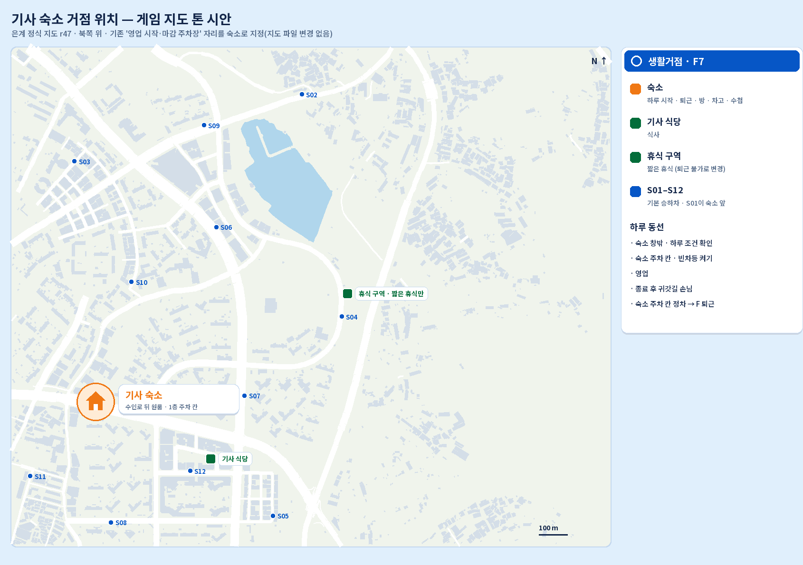
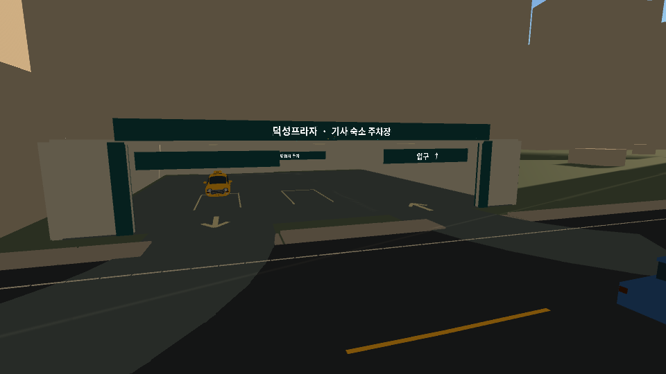
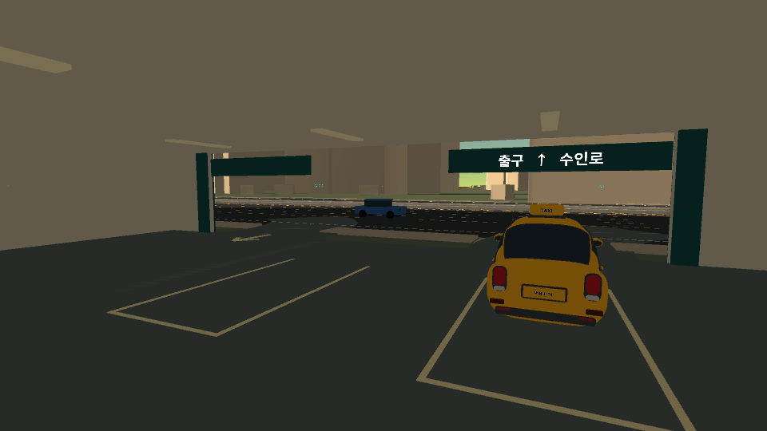
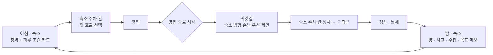

# 숙소·방·차량 구매

**통합 문서 · 2026-11-23 정리.** 덕성프라자 숙소 거점, 작은 방과 첫 구매, 차종 특성과 차고 구매·PvP 외형을 담당한다. 아래 각 장의 "구 NN"은 합치기 전 문서 번호이며, 본문 속 "기획 NN" 표기도 이 번호를 가리킨다. 날짜가 있는 결정과 검증 기록은 그 시점의 기록으로 읽는다. [기획 목록](README.md)

| 장 | 합친 문서 | 다루는 내용 |
|---|---|---|
| [1. 기사 숙소 거점](#s34) | 구 34 | 덕성프라자 숙소 출퇴근·월세·차고 |
| [2. 3일 프로토타입: 작은 방과 첫 구매](#s13) | 구 13 | 작은 방·조명·러그 첫 구매 |
| [3. 성장 방향 재검토와 첫 차량 구매·PvP 연동](#s22) | 구 22 | 차종 특성·차고 구매·PvP 외형 |

## 1. 기사 숙소 거점 (구 34)

**은계 r50 배포 기준.** 덕성프라자에서 출퇴근하고 월세를 정산한다. 3일 도입 뒤에도 같은 방·차고·차량으로 계속 영업할 수 있다. 같은 건물 안에서 넓은 호실로 옮기는 것은 후속 기획이다. [숙소 구현](../work-history/2026-11-19-home-base-p1.md) · [r50 출차와 정산](../work-history/2026-11-20-plaza-feed-facility-input.md) · [연속 경력](06-day-and-career.md#s28)

첫날 출차 준비가 끝나면 빈차등이 자동으로 켜진다. M 지도에서 첫 번째 호출을 수락한다. 첫 수락 전에는 숙소에서 도로로 가장 가까운 이용 가능 승차지를 첫 번째로 보여 주고 여유 기한을 적용한다. [첫 운송 검증](../work-history/2026-11-19-first-fare-and-settlement.md).

### 1. 목표

> 하루는 **숙소에서 시작해 숙소로 돌아온다.** 방·차고·수첩·목표가 한곳에 모인다.

### 2. 위치

기존 시안은 주변 도로의 위치 참고용이다. 차고와 진입로는 r47 건물 윤곽에 맞춘 게임용 설계다.

| 항목 | 값 |
|---|---|
| 위치 | 덕성프라자 건물 윤곽(`37612022:B0010000:7014`) 안쪽 1층 주차 칸. [은계 시설 위치](04-life-vehicle-economy.md#sfac) |
| 주변 | 수인로 인근 도로에서 건물 남쪽 차량 출입구로 연결 |
| 설정 | 실직 후 옮겨 온 **수인로 뒤 작은 월세 원룸**, 1층 전용 주차 칸 1개 |
| 선택 이유 | 숙소에 도착했을 때 도로에서 건물 안으로 들어오는 동작이 보이고, 하루를 마친 장소와 다음 날 출발지가 이어짐 |
| 거점 수 | **1곳 고정.** 다른 동네 이사 없음. 넓은 호실은 같은 건물 안 |

#### 배포 후보 Player에서 본 차고

### 3. 은계 싱글에서 숙소를 이용하는 법

| 상황 | 배포 동작 |
|---|---|
| 첫 출차 | 준비에서 숙소 벽 메모 선택 → 준비로 돌아와 영업 시작 → 인트로 → 덕성프라자 실내 주차 칸. M에서 첫 호출을 고르고 직접 출차한다. |
| 귀가 | F7 생활거점의 첫 항목에서 숙소 안내를 받는다. 빈차로 주차 칸에 정차한 뒤 F를 누르면 휴식·퇴근·정산한다. 동부 휴식 구역은 영업 도중 쉴 수 있는 곳이다. |
| 방과 차고 | 정산 후 방에서 조명·러그를 꾸미고 차고에서 차종을 비교한다. 3일차 뒤 같은 슬롯으로 계속 영업할 수 있다. |
| 생계 비용 | 정산 때 주차비와 월세 일할분을 확인한다. 다음 날 준비에서도 비용을 볼 수 있다. |

### 4. 하루 동선

목표를 고를 때 방 벽의 메모 세 장과 오른쪽 목록 모두 같은 선택을 저장한다. 벽에서는 메모 한 장 전체가 터치 영역이다. 운행 알림은 1인칭과 외부 시점 모두 왼쪽에 표시한다. 1인칭에서는 왼쪽 사이드미러 위까지 사용한다.

은계 싱글의 첫 출차와 다음 날 출차 위치는 M 지도에 **덕성프라자 숙소**로 표시되는 실내 주차 칸이다. 퇴근할 때도 같은 칸에 정차하고 F를 누른다. 주유소·기사식당·공업사·동부 휴식 구역에서는 지정 칸에 정차하고 F로 해당 시설을 연다.

운전 중에는 왼쪽 **운행 알림**에 새 메시지가 아래로 들어오고 앞선 메시지는 위로 올라간다. 운전 TIP은 운행 시간 20초마다 들어온다. 연료가 15%, 10%, 5% 이하 구간에 처음 진입하면 현재 잔량과 **주유소 안내** 버튼을 12초간 표시한다. 승객을 태우기 전이나 하차 후에 버튼을 누르면 도로로 연결된 주유소까지 안내한다.

| 상황 | 처리 |
|---|---|
| 종료 시각에 멀리 있음 | 초과 영업으로 귀가. "귀갓길 손님"(목적지가 숙소 방향) 우선 제안, 할증 없음 |
| 졸음 강제 종료 | 현재처럼 숙소 주차 칸으로 이동(`BusinessProgress` 졸음 종료 처리 재사용) |
| 사고·견인 | 현재 정비 처리 유지 후 숙소 |
| PvP | 영향 없음(PvP는 기존 시설 규칙) |

### 5. 숙소 안

| 영역 | 내용 | 비고 |
|---|---|---|
| 방 | 조명·러그 구매와 배치 | `PersonalRoomHUD` |
| 벽 | 선택한 목표 메모 1장 | [28](06-day-and-career.md#s28), [33](00-game-overview.md#s33) |
| 책상 | 기사 수첩(아버지 탭 포함) | [30](00-game-overview.md#s30) |
| 창밖 | 아침/밤, 하루 조건(비 등) 반영 | [29](06-day-and-career.md#s29), [31](06-day-and-career.md#s31) |
| 차고 탭 | 정산 후 미납 없이 차값 전액을 내고 새 택시 한 대를 산다. 아버지 차는 숙소에 보관하고 다음 날 운행할 차를 고른다. | [차종과 꾸미기](#s22) · [아버지 차 보관](00-game-overview.md#s33) |

공업사의 부품 구매·장착은 현재 현장 기능이다. [현재 공업사](04-life-vehicle-economy.md#s36)

#### 숙소 확장 제안 (같은 건물)

| 단계 | 조건 | 변화 |
|---|---|---|
| 원룸 | 현재 시작 공간 | 작은 창, 기본 가구, 조명·러그 구매 |
| 원룸 꾸밈 | 후속 제안, 소품 3개 이상 | 방 분위기 변화 |
| 위층 넓은 호실 | 후속 제안, 목표 "이 집을 내 집답게" 저축(15~20R) | 창밖 전망·소품 자리 확장, 월세 소폭 인상 |

### 6. 생계 비용 (월세)

| 항목 | 초안 | 원칙 |
|---|---|---|
| 원룸 월세 일할분 | 하루 순수익 R의 약 15% | 정산에 "숙소 월세" 한 줄. 연체·퇴거 없음 |
| 넓은 호실 | R의 약 22% | 이득(전망·소품 칸)과 함께 |
| 영업 안 한 날 | 없음(게임은 영업일만 진행) | |

원룸의 시험 기본값은 `home.rent.daily` 1,500원이다. 기획22의 임시 R 10,000원을 기준으로 계산했다. 남은 현금 범위에서만 내며 월세 미납은 없다. **생활 → 숙소**에서 월세와 `home.returnTrip.weight` 기본 3배를 편집할 수 있다. 사람 플레이의 수익 중앙값과 밸런스는 미검증이다.

### 7. 구현 근거

| 영역 | 작업 | 파일(현재) |
|---|---|---|
| 지도 | 프로젝트 지도의 숙소 건물 윤곽과 차고 칸을 사용하며 싱글 지도·생활거점에 덕성프라자 숙소로 표기 | `HomeGarage.cs`, `HomeBasePresentation.cs`, `ServiceStops.cs` |
| 거점 | `ParkingStop` 의미·이름, 퇴근 허용을 숙소로 한정 | `ServiceStops.cs`, `BusinessProgress.cs`(`AtEndDayHub` 호출부) |
| 귀갓길 | 종료 후 숙소 방향 호출 가중 | `PassengerJobs.cs` |
| 지도 UI | 집 아이콘·"숙소" 라벨·F7 첫 항목 | `FullMapOverlay.cs`, `MapDestinationUI.cs` |
| 3D | 원룸 건물 표지판 "기사 숙소" | `ProjectMapScene.cs` 시설 라벨 |
| 정산 | 월세 일할분과 남은 현금 | `CampaignAccount.cs`, `DayPreparationPresentation.cs` |
| 저장 | 기존 저장 이관(주차장=숙소) | 캠페인 저장 |

### 8. 검증

| 질문 | 통과 기준 |
|---|---|
| 정상 퇴근 위치 | 숙소 칸의 F는 퇴근·정산, 동부 휴식 구역의 F는 현장 시설을 연다. [r50 위치 제어 검사](../work-history/2026-11-20-plaza-feed-facility-input.md) |
| 귀가가 지루하지 않은가 | 종료 후 귀가 시간 중앙값 ≤ 3분(사람 플레이) |
| 기존 저장 | r14~ 저장 이관·이어하기 통과 |
| 지도 입력 | 작업 시점의 Strict와 경로 도달성을 따로 기록한다. [r47 숙소 검증](../work-history/2026-11-19-home-base-p1.md) · [r50 지도 경로 검증](../work-history/2026-11-20-gyesu-navigation-and-signals.md) |

## 2. 3일 프로토타입: 작은 방과 첫 구매 (구 13)

아래는 첫 3일용 작은 방의 구매·배치 규칙과 당시의 검증 기록이다. 현재 경력은 3일 뒤 같은 방·차를 이어갈 수 있다. 숙소 차고의 차량 구매는 [현재 숙소](#s34)에서 확인한다.

**현재 상태: 최소 기능 구현·자동 검증, 사람3일 동기/가격 수용은 미검증.** [구현 이력](../work-history/2026-11-06-personal-room-implementation.md)과 [배포 이력](../work-history/2026-11-06-personal-room-main-release.md)을 따른다. 아래에서 현재 구현과 다음 항목을 구분하며 파일/기획 작성만으로 후속을 완료하지 않는다.

| 현재 구현 | 남은 항목/후속 |
|---|---|
| 정산→선택적 내 공간, 방1개·조명/러그 각2스타일 | 처음 방과 완료 방의 직접 비교·다음 날 상품 카드 |
| 미리보기·찜·구매 확인·보관/배치·조명 켜기 | 상품별 이미지·추가 카드 숨김 |
| 개인 지출/영업 순수익 분리·저장 실패 롤백·날짜 이월 | 전체 과거 방 탐색(현재는 최신 이전 회차 방 열람) |
| 회차 마무리·완료 방 읽기 전용·새 캠페인 초기화 | 사람3일·구매 동기·가격 수용 |

생활 공통 원칙은 [11](archive/11-personal-life-and-growth.md), 차량/이사 장기 제안은 [12](archive/12-career-growth-stages.md)를 따른다. 이 문서가 현재 최소 방 범위의 담당 문서다.

### 검증할 질문과 범위 선택

검증할 것은 세 가지다. 구매를 지시하지 않아도 갖고 싶은 물건을 고르는가, 자신의 돈으로 바뀐 공간에 애착이 생기는가, 그 선택이 다음 영업을 기대하는 이유가 되는가. 이 결과만으로 차량 구매·장기 이사 동기까지 검증했다고 판단하지 않는다.

방용/차량용5종을 모두 만드는 기존11안은 두 소비 공간을 비교할 수 있지만 운전석 자산·호환·시점 검증이 추가된다. 방에 한 물건만 두면 가장 작게 만들 수 있으나 취향 선택과 선택적 소비를 구분하기 어렵다. **현재 최소 범위는 방1개·방용2종×2스타일**이다. 조명과 러그만 만들고 화분·차량 장식/색·3컷 인트로는 후속으로 남긴다. 이 최소 범위는 이후 사용자 승인으로 구현됐으며, 최초 검증 범위에서는 이 문서가11안의5종/3컷 제안을 대체한다.

현재3일×예정20분 영업·요청·수요·운임·교통·시설·피로·마감 조건은 유지한다. 신규 날짜별 수요3구성, 차/집 구매, 시승, 자유 보행/배치, 반복 인물, 청소/요리, 매일 월세는 이번 검증에 포함하지 않는다.

### 작은 방과 물건

방은 **고정 시점의2D 배경과 물건 레이어**로 표현한다. 침대·작은 탁자·기본 수납·창문·작동하는 천장 조명이 이미 있다. 어둡고 기능이 없는 방을 만들어 구매를 강요하지 않는다. 방을 걸어 다니거나 카메라를 돌리지 않으며, 실제 지도에 새 집/귀가 경로를 만들지 않는다.

| 상품 | 보이는 변화 | 취향 선택과 조작 | 최초 시험 가격 |
|---|---|---|---:|
| 탁상 조명 | 탁자에 조명이 생기고 주변의 밝은 영역이 달라짐 | 둥근 갓/직선 갓2스타일. 켜기/끄기·보관 | 5,000원 |
| 작은 러그 | 침대 앞 바닥의 넓은 면적이 달라짐 | 차분한 단색/기하 무늬2스타일. 배치/보관 | 8,000원 |

가격은 현재 구현에 사용하는 시험값이며 현실 시세나 사람 플레이로 확정한 밸런스가 아니다. 현재 시작 현금10,000원만으로 두 상품 합계13,000원을 모두 살 수 없도록 잡은 임시값이며, 실제 영업 후 구매 가능성을 보장하지 않는다. 본 플레이테스트 전 기존 버전의 정상 영업 수입/운영비·미납 분포를 확인한다. 한 번의 영업 후 선택 가능한 가격인지, 하위 수익 집단도3일 중 고려할 여지가 있는지 보고 조정한다. 12안의0.15~0.35R는 참고 가설이며 이 표와 함께 만족한다고 가정하지 않는다. 충돌하면 측정 후 한 고정 가격표로 정리한다.

종류별 한 번 구매하면2스타일 모두 무료 전환한다. 중복 구매·판매·환불은 첫 범위에 없으며 결제 전에 표시한다. 탁자1칸·바닥1칸의 고정 위치에 놓고 자유 배치 좌표를 저장하지 않는다. 두 물건을 동시에 쓸 수 있고 보관/재배치 비용은 없다. 조명은 실제 조명 시뮬레이션 대신 켜짐/꺼짐 이미지와 밝기 레이어로 표현한다. 시각 변화 외 피로·수익·회복·운전점수 보너스가 없다.

방 배경1장, 조명2스타일의 켜짐/꺼짐 표현, 러그2스타일, 공통 상품 아이콘/선택 강조가 필요한 자산이다. 미리보기/찜/소유/완료 기록은 같은 자산과 같은 렌더러를 재사용한다. 새 아파트 그림·차량 모델은 제작하지 않는다.

### 날짜별 경험

아래는 의도하는 경험이며 날짜마다 반드시 수행할 임무가 아니다. 상품2종은 첫 정산부터 항상 같은 목록/가격으로 보이고, 둘째 날 신상품이나 셋째 날 할인은 없다.

| 시점 | 화면과 행동 | 의도하는 감정/판단 | 다른 선택도 정상 처리 |
|---|---|---|---|
| 첫날 출발 전 | 기존 시작 화면의 한 문장과 작은 방 기본 이미지. 영업 시작은 기존 한 번 | '이곳에서 다시 시작한다'는 맥락 | 별도 인트로 확인/주거 튜토리얼 없음 |
| 첫날 영업 | 기존 영업 그대로 | 첫 수입과 운영 비용을 경험 | 사고·적자·조기 마감도 진행 가능 |
| 첫날 정산 후 | 기존 정산 옆 `내 공간` 진입. 물건을 실제 방에 미리 놓아보고 구매/찜/닫기 | 내 돈을 이곳에 쓰고 싶다는 첫 선택 | 방을 안 보고 다음 날로 가도 됨. 구매 없이 찜만 해도 됨 |
| 둘째 날 출발 전(후속 UI) | 준비 화면의 찜/마지막 구매 이미지 카드는 미구현 제안 | '오늘 일하고 저걸 사고 싶다' 또는 '어제 내가 골랐다' | 둘 다 없으면 카드 없음. 필수 목표/남은 운송 횟수 없음 |
| 둘째 날 영업 | 동일 영업. 개인 구매는 운행 중 불가 | 수입과 실제 비용을 고려하며 자신의 선택을 이어감 | 구매를 위해 초과 영업하도록 유도하지 않음 |
| 둘째 날 정산 후 | 어제 배치/조명 상태가 유지된 방. 구매·스타일 변경·아무것도 안 하기 | 공간이 내 선택을 기억한다는 느낌 | 첫 구매가 오늘이어도 정상. 첫날 둘 다 샀으면 새 상품 없이 사용/변경 |
| 셋째 날 영업 | 기존 마지막 영업, 준비 상품 카드는 후속 | 구매 전후에도 운전이 즐거운지 확인 | 소유품 추가에 따른 성능/요청 변화 없음 |
| 셋째 날 정산 후 | 마지막 구매/배치 가능. 처음 방 비교는 후속. `이번 회차 마무리` | 실제로 바뀐 공간을 남김 | 구매0개·저축만 한 상태도 평가 없이 기록 |

첫날 문구 예: '일자리를 잃고 준비를 거쳐 시작한 첫 택시 영업. 작은 방에서 새로운 하루를 시작한다.' 수익이 없는 플레이에 '첫 월급으로 산 물건' 같은 문구를 만들지 않는다. 시작 자금과 영업 수입은 같은 현금을 쓰며 물건 구입액 전부가 영업으로 번 돈이라고 단정하지 않는다.

후속 둘째/셋째 날 카드안의 우선순위는 명시적으로 찜한 상품1개, 없으면 마지막 구입품, 둘 다 없으면 생략이다. 산 상품의 찜은 해제한다. `조명 · 찜한 물건` 또는 `어제 고른 조명`처럼 사실만 표시한다. 출발 클릭을 추가하지 않고 운전 중 HUD에는 노출하지 않는다. 이 카드의 새 UI는 구현 제안이며 기존 준비창에 이미 있다고 가정하지 않는다.

### 화면 흐름과 조작

`기존 정상 마감/정산 → 다음 날 또는 내 공간 → (미리보기/구매/배치) → 정산으로 돌아가기 → 기존 다음 날`

`내 공간`은 정산에서 여는 선택 화면이다. 다음 날 버튼은 기존 정산에 그대로 남기며 홈 방문을 필수 중간 화면으로 만들지 않는다. 방 화면에는 같은 `다음 날` 바로가기도 두어 구매 후 정산을 다시 여는 조작을 줄인다. 셋째 날에는 두 위치 모두 `이번 회차 마무리`로 연결한다. 두 버튼은 같은 저장/전환 함수를 사용한다.

- 방의 한쪽에2개 상품 카드를 둔다. 별도 상점 지도·NPC·방문/배송 대기는 없다.
- 카드 선택 시 미리보기라는 표시와 함께 실제 위치에 임시 적용한다. 다른 상품 선택/닫기 시 원래 소유 배치로 돌아간다.
- 구매 확인에는 상품·가격·현재 현금·지출 후 현금·환불 없음만 보여준다. 부족금/미납이 있으면 이유와 금액을 명시하며 찜/미리보기는 가능하다.
- 구매 성공과 저장 성공을 확인한 뒤 선택한 스타일로 자동 배치한다. 별도 배치 튜토리얼은 없다. 이후 숨기기/스타일 변경을 선택할 수 있다.
- 미납이 있으면 먼저 상환해야 구매 가능하다. 기존 상환을 이용하고 방에서 임의 면제/자동 대출/자동 상환을 하지 않는다. 정산에서 상환한 뒤 방으로 돌아와 재확인한다.
- 다음 날 운영비를 강제로 잠가두지는 않는다. 지출 후 잔액과 현재 상태/기존 비용 안내를 볼 수 있게 하며 주유·사고 복구 등 미래 비용을 보장하지 않는다.
- 방/미리보기/상품 읽기에는 영업시간·컨디션이 흐르지 않으며 추가 수면·회복도 없다. 닫기만으로 날짜/차량 위치가 바뀌지 않는다.

집과 두 물건의 목록은 항상 동일하고 일일 보상·마감 한정 구매·품절·반짝이는 미완료 과제 표시는 없다. 상품과 찜은 스스로 고를 수 있다. 다음 날 카드 숨김은 미구현 UI 제안이며, 도입 시 찜/소유를 삭제하지 않는 표시 설정으로 구분한다.

### 현재 구현 연결과 후속 경계

| 영역 | 연결한 기존 구현 | 현재 구현/경계 |
|---|---|---|
| 마감과 진입 | `BusinessProgress.RequestEndDay`, 기존 휴식/주차/정산 조건 | 유효 정산 뒤에만 방 열기. 사고/고장/승객 복구를 우회하지 않음 |
| 화면 | `BusinessHUD`에서 실제 싱글에 연결되는 `OneDayHUD`, 준비/정산 화면 | 방 패널1개·상품2개·구매 확인/완료 방 열기. 다음 날 선택 카드는 후속 |
| 돈 | `CampaignAccount`의 현금·미납·고유 거래ID | 개인 구매 종류와 별도 지출 합계, 현금/미납 검사. 개인 소비를 영업 비용에서 제외 |
| 정산 | `EconomyLedger`의 일별 기록·누적·복원 | 영업 순수익/개인 지출/남은 현금 분리, 구매 후·재로딩에도 영업 결과 보존 |
| 저장/다음 날 | `CampaignCheckpoint`, `WriteCheckpoint`, `NextDay`의 저장 선행 | 소유/배치/찜·생활 단계 저장. 카드 숨김은 후속, 구매와 차감의 일괄 저장 |
| 완료 기록 | 현재 `CompletedDay`/캠페인 기록 | 최종 생활 상태 확정과 읽기 전용 방 재구성, 새 회차 초기화 안내 |

별도 인벤토리 격자·가구 관리 메뉴를 만들지 않는다.2개 카드 자체가 미소유/소유/배치 상태를 보여준다. 새 물리 시스템·도로/집 위치·운송 종류·수요 프로필·출석 과제도 필요 없다. 반면 돈/저장 변경은 구매가 실제 의미를 가지는 데 필수이므로 화면만 추가하고 생략할 수 없다.

### 돈과 저장의 최소 계약

개인 구매는 현금을 실제 차감하되 영업 지출에서 제외한다. 누적 영업 순수익/현금·미납 산식은 [03의 회계 기준](04-life-vehicle-economy.md#현금미납순수익)을 따른다. 일별/누적 개인 지출을 따로 표시한다. 주유/식사/사고·수리와 미납 상환의 기존 비중복 처리는 유지한다. 이 식은 환불/재판매/차량 거래가 없는 현재2종 구매 범위이며 미래 거래로 무조건 확장하지 않는다.

저장할 최소 상태는 구매한 종류/실제 가격/구매일/거래ID, 각 슬롯의 배치 여부와 스타일, 조명 켜짐, 찜ID, 개인 지출, 생활 단계와 최종 확정 여부다. 화면 캡처 파일 대신 고정 방 자산과 상태로 완료 방을 재구성한다. 중복 상품·거래/잔액 불일치는 읽을 때 검증하고 기존 원본/복구 정책을 따른다.

구매는 후보 상태에 차감/소유/배치를 적용하여 기존 체크포인트와 한 번 저장한 뒤 성공 화면으로 전환한다. 저장 실패 시 실제 현금/소유는 구매 전 상태로 유지하고 재시도한다. 배치/찜 변경도 저장 성공 상태와 실패 표시를 구분한다. 빠른 연속 클릭·종료/재개·다음 날 이동으로 이중 구매되거나 무료 소유가 생기지 않아야 한다.

구 저장에 새 필드가 없으면 기본 방/소유없음/찜없음으로 시작하며 돈이나 물건을 지급하지 않는다. 이미 완료된 구 회차의 정산은 과거 기록으로 유지하고 새 쇼핑 단계를 소급해 열지 않는다. 진행 중 구 회차는 다음 유효 정산부터 새 방을 사용할 수 있다. 기존 PVP·연습·지도 편집에서는 이 소비/방 상태를 쓰지 않는다.

### 셋째 날 마무리와 새 회차

현재 코드는 영업 완료 체크포인트를 쓸 때 완료 요약을 보관한다. 새 생활 단계는 이 영업 완료와 별도로 최종 개인 상태를 확정해야 한다. 셋째 날 정산 직후의 기존 영업 기록을 지우거나 기다리게 하지 않고, 그 회차ID에 연결한 생활 기록은 마무리 전까지 수정 가능하게 둔다.

`이번 회차 마무리`는 최종 현금/소유/배치/개인 지출·읽기 전용 완료 방을 함께 저장한다. 이미 기록된 영업 순수익은 변하지 않는다. 마무리 전 앱 종료는 마지막 생활 단계로, 마무리 후에는 읽기 전용 결과로 복원한다. 기록 추가가 아니라 같은 회차의 최종 개인 상태를 확정하므로 중복 완료 카드가 생기지 않는다.

후속 최종 비교안은 기본 방과 실제 완료 방을 같은 화면에서 전환하는 것이다. 현재 직접 비교는 미구현이다. 점수/별/꾸미기 완성도는 없다. 구매하지 않았으면 그대로 둔 방과 남긴 현금을 보여주고 실패로 표시하지 않는다. 현재는 최신 이전 회차 방을 읽기 전용으로 열며 구매/배치는 불가하다. 모든 과거 회차 카드에서 방을 탐색하는 기능은 후속이다.

새3일은 기존 초기화 확인에 소유/배치/찜·개인 현금도 초기화되며 완료 방 기록은 남는다는 내용을 포함한다. 최종 생활 단계에서 새 캠페인을 선택하면 기존 회차 저장 성공 후에만 초기화한다. 이번은 회차 안의3일 경험이며 장기 소유 이월을 약속하지 않는다. 첫 방 진입의 도움말에도 이 범위를 명확히 알리되 마지막 날 '돈을 다 쓰라'고 유도하지 않는다.

### 플레이 검증과 다음 판단

첫 소규모 관찰은 초보/기존 경험자를 포함한4~6명 정도로 시작한다. 통계적 성공률을 결론내릴 표본이 아니라 문제와 동기 사례를 찾는 단계다. 테스트 전에는 '평소처럼3일을 플레이해 주세요'라고만 안내하고 구매/찜/방 방문을 지시하지 않는다. 초기 가격 점검을 위한 기존 영업 표본과 새 콘텐츠 관찰은 구분한다.

| 관찰 | 성공의 단서 | 실패 원인 구분 |
|---|---|---|
| 첫 정산 | 자발적으로 방/미리보기를 열고 취향 이유를 말함 | 입구를 못 찾음, 물건이 매력 없음, 다른 일에 관심을 따로 구분 |
| 첫날/둘째 날 선택 | 구매 또는 찜 후 다음 영업을 기대함 | 가격/운영비 때문에 못 삼, 원치 않아서 안 삼을 구분 |
| 구매 후 다음 귀가 | 산 물건을 다시 보거나 조명/스타일을 자발적으로 사용 | 구매 버튼 누르기만 재미있고 사용 의미가 없는지 확인 |
| 영업 중 | 기존 운전 판단이 유지되고 개인 목표가 부가 동기가 됨 | 방 때문에 운전을 참고 같은 경로만 반복하거나 무리하게 연장하는지 확인 |
| 마지막 날 | 실제 선택의 결과를 인정하고 기록을 다시 보고 싶어 함 | 초기화 전에 돈 소진만 한 구매는 영업 동기 근거로 세지 않음 |
| 방 건너뛰기 | 기존 조작 수로 다음 영업 가능 | 방/구매/배치가 필수 절차로 느껴지면 UI 축소 |

구매일과 다음 영업 여부를 함께 기록한다. 셋째 날 최초 구매는 공간의 매력을 확인하는 자료로 쓸 수 있으나 이후 영업이 없으므로 '구매가 다음 영업을 이끌었다'는 증거가 아니다. 기존 시작 현금으로 산 경우에도 자발적 소비는 확인할 수 있지만 수입이 구매를 만들었다는 인과는 별도로 확인한다. 카드 유무/가격 변경은 다음 비교 실험으로 나누고 여러 조건을 한꺼번에 바꾸지 않는다.

별도 온라인 분석 시스템 없이 관찰표와 기존 거래/회차 상태로 확인한다. 단순 클릭 수보다 플레이어의 선택 이유·영업을 계속하고 싶은 이유·구매 후 사용을 본다. 구매가 적다고 바로 운임 버프/무료 선물/필수 퀘스트를 붙이지 않는다. 접근성·가격·자산 매력·운전 피로 중 원인을 먼저 구분한다.

필수 기능 검증은 개인 지출 후 일별/누적 순수익 유지와 재로딩, 미납/잔액 부족, 중복 클릭/저장 실패,3일 경계/구 저장/완료 방/새 시작, 방에서 시간·회복·위치 불변, PVP/연습 비적용이다. 이 자동 검증은 사람이 느끼는 동기를 대신하지 않는다. 다음 확장은 첫 구매와 다음 영업의 연결이 관찰된 뒤 차량 소품 또는 생활 소품 중 한 방향씩 판단한다.

근거: [현재 생활/비용](04-life-vehicle-economy.md#s03), [정산/3일](06-day-and-career.md#s04), [준비/화면](05-interface-and-navigation.md#s05), [현금 계정](../../unity/EungyeTaxi/Assets/Scripts/CampaignAccount.cs), [영업 장부](../../unity/EungyeTaxi/Assets/Scripts/EconomyLedger.cs), [저장/하루 전환](../../unity/EungyeTaxi/Assets/Scripts/BusinessProgress.cs), [실제 싱글 HUD 분기](../../unity/EungyeTaxi/Assets/Scripts/BusinessHUD.cs).

### 2026-11-10 차고 탭 (기획22)

내 공간 화면에 **방 / 차고** 탭을 추가했다(같은 1200×720 고정 화면·버튼 규칙 재사용). 정산 화면 버튼 이름은 "내 공간 · 방/차고". 차고는 후보 비교(외형·특성 표·견적)와 구매 확인, 색 2종·대시보드 화분을 제공한다. 방 소품과 같은 개인 지출 장부·현금을 나눠 쓰므로 "차를 먼저 살지, 방을 꾸밀지"가 3일 안의 선택이 된다. 완료 방(마무리) 이후에는 차고도 읽기 전용이고, 새 회차는 시작 차로 돌아간다. 이전 회차 방 보기에서는 차고 탭을 표시하지 않는다. 상세 규칙은 [기획22](#s22) §11.

## 3. 성장 방향 재검토와 첫 차량 구매·PvP 연동 (구 22)

**현재 은계 r50.** 숙소 경력에서는 정산 뒤 차고에서 한 대를 전액 현금으로 추가 구매한다. 아버지 차는 숙소에 남고 다음 영업에 탈 차를 고른다. 현재 기본가는 넓은 LPG 22,000원, 하이브리드 26,000원이다. 3일 도입 후에도 경력과 차가 이어진다. 기사 평점은 보류, 면허 경로는 제외다. [아버지 차 보관](00-game-overview.md#s33) · [계속 영업](06-day-and-career.md#s28) · [면허 결정](05-interface-and-navigation.md#s32)

아래 §1~11은 2026-11-10 도입 당시의 차종 특성·구매·PvP 외형 설계와 구현 기록이다. 보상 판매액과 12,000원·16,000원 차액은 당시 규칙이다.

### 1. 요청과 결론

| 사용자 요청(2026-11-10) | 결론 |
|---|---|
| 택시를 계속 운영할 목표점이 부족하다 | 맞다. 현재는 3일과 소품 2종에서 끝나고, 장기안(12)도 "외형만 다른 차·집"이라 동기가 아트 품질에만 기댄다 |
| 차 1대 구매만이라도 작게 구현해 제안서 주장을 뒷받침 | **현재 3일 캠페인 안에서 택시 교체 1회**(2일차 정산 후 구매 → 3일차 새 차 운행) |
| 싱글에서 구매·꾸민 차량을 PvP에서 활용 | **외형·꾸미기만 PvP에 가져간다.** 성능은 PvP 표준으로 통일(§6) |

### 2. 현재안 검토

#### 잘 된 점 (유지)

- 강제 과제·출석·랜덤 상자 없이 플레이어가 고르는 목표(11·12).
- 영업 장부와 개인 지출의 분리, 저장·중복 거래 방지 계약(11·13). 차량 거래에 그대로 재사용한다.
- 가격을 사람 플레이 수익 중앙값 `R` 배수로 잡는 방식(12).

#### 부족한 점

| 문제 | 근거 | 영향 |
|---|---|---|
| 동기가 소유 만족 한 가지 | 11: 차종별 성능·트렁크·연료 차이 초기 제외 | 장르 이용자는 "새 차로 할 수 있는 일이 달라짐"을 기대한다 |
| 운전 점수·만족도가 장기적으로 쌓이지 않음 | 운전 점수는 3일 안, 만족도는 운송 단위 | 잘해도 장기 보상이 없다 |
| 종착점이 유한 | 12: 첫 이사를 첫 성장 구간의 끝으로 제시 | 본편 플레이 시간 근거가 약하다 |
| 싱글과 PvP가 분리 | 11: PvP에는 돈·소유가 이월되지 않음 | 두 모드가 서로 동기를 주지 않는다 |

### 3. 목표를 세 층으로

| 층 | 기간 | 목표 | 상태 |
|---|---|---|---|
| 단기 | 하루 | 기사 평점 유지·상승 | **기획만, 구현 보류**(§3-1) |
| 중기 | 3일 캠페인 | **내 택시 교체·꾸미기** | **확정**(§3-2, §5) |
| 장기 | 본편 | 내 집(이사) / 개인택시 면허 경로 | 이사는 12의 제안 유지, 면허는 [23](archive/23-license-career-path.md) 보류 |

#### 3-1. 기사 평점 (기획 보류)

나중에 다시 꺼낼 때를 위해 기획만 남긴다. 이번 구현 범위에 넣지 않는다.

- 최근 20회 운송의 승객 만족도와 운전 점수를 합쳐 별 1~5개로 보여준다(계산식은 시험값).
- 평점이 높으면 받을 수 있는 호출의 **종류**가 넓어진다(예: 4.5 이상 장거리 호출). 운임 배율은 올리지 않는다.
- 평점이 떨어져도 기본 호출은 항상 받을 수 있다.
- 예약 호출과의 연결은 기존 "단골·예약 제외" 결정을 유지하며 다루지 않는다.
- 재개 조건: 사람 플레이에서 "운전을 잘해도 남는 게 없다"는 반응이 확인될 때.

#### 3-2. 차종별 특성 (확정)

마인드맵 `차량 구매 > 다양한 차종`(연비·트렁크·승차감)의 기존 아이디어를 구체화한다. 성능 상위호환이 아니라 **장단점이 다른 차**다.

| 차량 | 장점 | 단점 | 바뀌는 판단 |
|---|---|---|---|
| 기본 중고 택시(시작) | 이미 보유 | 연비 보통, 승차감 보통, 내구도 감소 빠름 | — |
| 후보 A: 하이브리드 세단 | 연료비 낮음 | 가격 높음, 트렁크 작음 | 큰 짐 승객을 못 태움 → 호출 선택 |
| 후보 B: 넓은 LPG 택시 | 트렁크 큼, 승차감 좋음 | 연료비 보통, 회전 반경 큼 | 짐 승객·"부드럽게" 요청에 유리 |

- 운임 배율·최고 속도 상승은 넣지 않는다.
- 바뀌는 값은 **연료 소모율, 트렁크 수용, 승차감 계수, 내구도 감소율, 회전 반경**뿐이다. 모두 기존 시스템(연료·짐/적재·부드러움 요청·내구도·조향)에 있는 값을 차종별로 나눈다.
- 이 결정으로 [11](archive/11-personal-life-and-growth.md)의 "차종별 트렁크·성능 차이 초기 제외" 원칙은 **이 3개 특성에 한해 변경**한다. 전기 충전·승객 등급 잠금·새 물리 엔진은 계속 제외한다.

### 4. 현재안 vs 이번 결정

| 질문 | 현재안(11·12) | 이번 결정(22) |
|---|---|---|
| 차를 바꾸면? | 외형·실내만 다름(장기 제안) | 3일 안에 교체 가능, 연료·짐·승차감 판단이 달라짐 |
| PvP와의 관계 | 없음 | 내 차 외형을 PvP에서 사용 |
| 오늘 영업을 잘하면? | 그날 순수익 | 같음(평점은 보류) |
| 개발량 | 차/집 아트 중심 | 차량 2종 외형 + 차종 계수 + 차고 화면 + LAN 필드 |

### 5. 구현 범위 (3일 캠페인 유지)

| 항목 | 범위 | 제외 |
|---|---|---|
| 캠페인 | **기존 3일 유지**(하루 예정 20분) | 7일·연속 경력 |
| 차량 구매 | 후보 2대(§3-2), 교체 1회, 시작 차 보상 판매 | 신차/중고 시장, 할부·대출, 다중 차고 |
| 구매 시점 | 1·2일차 정산 후 "내 공간 → 차고". 현실적 목표는 **2일차 정산 후 구매 → 3일차 새 차 운행** | 3일차 정산 후 구매는 소유만 기록(운행 없음) |
| 꾸미기 | 차량별 색상 2종 + 대시보드 장식 슬롯 1개 | 자유 배치, 부품 튜닝 |
| PvP 연동 | 내 차 외형·색·장식 표시(§6) | 성능·경제 이월 |
| 평점·이사·면허 | 없음 | §3 참조 |

#### 가격(시험 가설)

`R` = 사람 플레이의 정상 20분 영업 순수익 중앙값(12 정의).

- 3일 안에 구매해 하루라도 타 보려면 **2일 영업으로 모을 수 있는 금액**이어야 한다.
- 차량 교체 차액: **약 1.2~1.6R**(보상 판매 반영 후 실제 지출). 정상 플레이로 2일차 정산 때 "살 수 있거나 조금 모자란" 수준.
- 차량 꾸미기: 각 0.1~0.2R.
- 기존 작은 방 소품(조명 5,000원·러그 8,000원)과 같은 개인 지출 예산을 나눠 쓴다. **"차를 먼저 살지, 방을 꾸밀지"가 3일 안의 선택**이 된다.
- R 실측 전에는 콘텐츠 관리창에서 조정 가능한 값으로 둔다.

#### 화면 흐름

`하루 정산 → [내 공간] → 차고 탭 → 후보 2대 비교(외관 회전·운전석 미리보기·특성 표·견적) → 구매 확인 → 다음 날 새 차로 출발`

- 견적: 새 차 가격, 기존 차 보상 판매액(내구도 반영), 최종 지출, 남는 현금.
- 정산 후에만 구매 가능, 현금 부족 시 불가(할부 없음).
- 구매·현금 차감·소유권 변경을 한 번에 저장. 재시작·재클릭으로 중복 반영하지 않는다(11의 저장 계약).
- 새 캠페인을 시작하면 차량은 시작 차로 돌아간다(13의 3일 초기화 원칙). 단, **PvP용 외형 목록은 계정 단위로 남긴다**(§6).

### 6. 싱글 차량의 PvP 활용

| 규칙 | 내용 | 이유 |
|---|---|---|
| 가져가는 것 | 차종 외형, 색상, 대시보드 장식 | 소유 만족을 보여줄 장소 |
| 가져가지 않는 것 | 연비·트렁크·승차감 등 특성, 돈, 내구도 | PvP 공정성. 모두 PvP 표준 성능 |
| 해금 | 싱글에서 **한 번이라도 구매한** 외형·색·장식은 PvP 외형 목록에 영구 추가 | 3일 캠페인을 다시 시작해도 PvP 보상은 남음 |
| 선택 | PvP 입장 전 "내 차"에서 고름. 미보유 시 기본 택시 | 싱글 없이도 PvP 참가 가능 |
| 봇 | 미리 정한 외형 중 무작위 | 시각적 다양성 |
| 네트워크 | 입장 시 외형 ID·색상·장식 ID만 호스트에 전달, 호스트가 배포 | **LAN v16→v17**, 양쪽 실행본 동시 갱신 |
| 저장 | 해금 목록은 캠페인 저장과 별도 파일, PvP는 읽기만 | PvP가 싱글 진행을 바꾸지 않음 |

### 7. 검증 지표와 중단 기준

| 확인할 것 | 방법 | 다시 설계할 신호 |
|---|---|---|
| 차가 3일 안의 목표가 되는가 | 4~6명 3일 플레이, 구매 강요 없이 관찰 | 절반 이상이 차고를 열어보지 않음 |
| 차종 차이를 느끼는가 | 구매 후 "무엇이 달라졌나" 질문 | 외형 외 차이를 아무도 언급하지 않음 |
| 차 vs 방 선택이 고민되는가 | 구매 순서·이유 인터뷰 | 모두 같은 선택만 함 |
| PvP 연동이 동기가 되는가 | PvP 후 싱글 재진입 의향 | 자기 차 선택 화면을 건너뜀 |
| 경제 | R 대비 구매일 분포 | 아무도 2일차에 못 사거나 1일차에 모두 삼 |

### 8. 결정 기록 (2026-11-10)

| # | 항목 | 결정 | 영향 문서 |
|---|---|---|---|
| 1 | 차종별 특성 | **채택**(연료·트렁크·승차감·내구도·회전 반경) | 11의 성능 차이 제외 원칙 일부 변경 |
| 2 | 기사 평점 | **기획만, 구현 보류** | 이 문서 §3-1 |
| 3 | 캠페인 길이 | **3일 유지**, 3일 안에서 차량 교체 가능하도록 가격 조정 | 13·04 변경 없음 |
| 4 | 개인택시 면허 경로 | **본편 단계로 보류**, 기획·설정·마인드맵 할거리 추가 | [23](archive/23-license-career-path.md), 마인드맵 |

### 9. 마인드맵 반영 (2026-11-10)

[마인드맵 원본](택시%20시뮬레이션.mmst)에 아래를 반영했다. 기존 노드 ID·메모·접힘·순서·링크는 보존했고 변경 전 원본은 `docs/design-history/content-design/2026-11-10-mindmap-before-growth.mmst`에 있다.

| 노드 | 변경 |
|---|---|
| 차량 구매 > 다양한 차종 > 연비(연료 타입)·트렁크·승차감 | 0% → **25% 기획 완료**, 기획22 링크 |
| 차량 구매 > 구매 방식 | 하위에 "보상 판매 교체 1회·현금 구매(3일 안)" 25% 추가. 신차/중고·할부는 0% 유지 |
| 개인 생활 확장 | 하위에 "3일 안 택시 교체 1회·꾸미기" 25%, "싱글 차량 외형 PvP 사용" 25% 추가 |
| 기존 아이디어 | "기사 평점(기획22 §3-1, 구현 보류)" 0% 추가 |
| 기존 아이디어 | "개인택시 면허 경로(기획23, 본편 보류)"와 할거리 하위 노드 추가 |
| 게임의 목표 > 기획 메모 | "목표 구조: 내 택시(3일)·내 집·면허(본편)" 설명 노드 추가 |

### 10. 구현 시 영향 범위(참고)

실제 구현은 Claude Code에서 진행한다. 기존 문서·코드 이름 기준의 예상이며 코드를 확인한 결과가 아니다.

- 저장: `BusinessProgress`, `CampaignAccount`에 차량 소유 상태 추가, 구 저장 이관. PvP 외형 해금은 별도 파일
- 차종 계수: 연료 소모, 적재, 승차감, 내구도, 조향 설정을 차종별 데이터로 분리
- 화면: 내 공간에 차고 탭(13의 방 화면 구조 재사용)
- PvP: `PvpNativeLan` 입장 메시지에 외형 필드, LAN v17
- 콘텐츠 관리창: 차량 가격·계수 조정 항목
- 아트: 후보 2대는 기존 둥근 택시 모델 변형(차체 비율·색)으로 시작

### 10-1. 차마다 다른 손맛 (2026-11-24, 은계 싱글, [08 5장](08-fun-improvements.md), 사람 검증 전)

기존 다섯 특성(연료·트렁크·승차감·내구도·회전 반경)에 손맛 네 값을 더했다. PvP는 쓰지 않고 항상 표준 차량이다.

| 차 | 핸들 반응 | 차체 기울기(연출) | 제동 쏠림(연출) | 브레이크 드는 시간 |
|---|---:|---:|---:|---:|
| 표준(PvP·연습) | 1 | 1 | 1 | 0초 |
| 아버지의 택시 | 1 | 1.25 | 1.2 | 0초 |
| 하이브리드 세단 | 1.25 | 0.8 | 0.8 | 0초 |
| 넓은 LPG 택시 | 0.85 | 1.1 | 1.1 | 0.2초 |

- 핸들 반응은 사람 입력을 핸들이 따라가는 빠르기다. 최대 조향각과 타이어 물리는 그대로다.
- 기울기와 쏠림은 연출만 바꾸며, 설정 → 감각 탭의 막대에 곱해진다.
- 브레이크 드는 시간은 일반 제동에만 적용한다. 스페이스 급제동과 페달을 떼는 동작은 즉시다.
- 아버지의 택시는 물리를 표준 그대로 두고 연출만 느슨하게 했다. 시작 차의 물리를 바꾸면 첫날 체감과 조향 측정 기준이 달라지기 때문이다.
- 승객 승차감 판정(종방향 가속 기준)에는 LPG의 브레이크 드는 시간만 영향을 준다: 짧게 밟는 제동이 판정을 피하기 쉬워지고, 정지 거리가 시속 50km에서 계산상 약 1.4m 늘어난다. [영향 표와 검증](../work-history/2026-11-24-know-road-evening-drive-vehicle-feel.md)
- 설정 툴 "차량 손맛": `feel.vehicle.<starter|hybrid|lpg>.<steerResponse|lean|dip|brakeRamp>`.
- 08이 함께 제안한 공업사 타이어·브레이크 부품은 넣지 않았다.

### 11. 구현 결과 (2026-11-10, 사람 검증 전)

[작업 이력](../work-history/2026-11-10-vehicle-purchase-3day.md)에 검증 명령·결과·미검증 범위가 있다. 아래는 실제 구현 규칙이다.

| 항목 | 구현 |
|---|---|
| 차종 데이터 | `VehicleCatalog`(시작 중고 택시·하이브리드 세단·넓은 LPG). 차종별 값은 연료 소모·트렁크(짐 승객 수락)·승차감·내구도 감소·회전 반경 다섯 가지뿐. 운임·최고 속도·가속 동일 |
| 시작 차 회귀 | 모든 계수 1.0 = 기존 연료 공식·급가감속 기준·충돌 단계·조향각과 동일(자동 검사로 확인) |
| 계수 값 | 연료 1.0/0.65/0.95, 트렁크 가능/불가/가능, 승차감 1.0/1.0/1.08, 내구도 1.0/0.75/0.8, 회전 1.0/1.0/0.86 ([03](04-life-vehicle-economy.md#s03) 표) |
| 적용 위치 | 연료=계정 연료 소모, 트렁크=짐·흙 묻은 짐 승객 유형 후보 제외, 승차감=급가감속 판정(부드럽게 요청 포함), 내구도=충돌 강도 단계, 회전=최대 바퀴 조향각 |
| 차고 화면 | 정산 → "내 공간 · 방/차고" → 차고 탭. 후보 3대 카드(측면 외형·특성 5줄·가격), 견적(새 차 가격·내구도 반영 보상 판매·최종 지출·남는 현금), 구매 확인 창 |
| 구매 규칙 | 정산 후(요약/완료 상태)만, 미납 없음, 현금 ≥ 최종 지출, 회차당 교체 1회, 마무리(완료 방) 후 읽기 전용. 새 차는 내구도 100·청결 100. 3일차 정산 후 구매는 소유만 기록 |
| 꾸미기 | 차량별 색 2종(두 번째 색 구매), 대시보드 화분 1슬롯(구매·올려두기/보관, 차를 바꿔도 옮김) |
| 장부 | 차량·색·장식 모두 `personal-purchase`(방 소품과 같은 개인 지출). 영업 순수익·3일 목표와 분리 |
| 가격(시험값) | 관리창 `vehicle.*` 5항목: 하이브리드 26,000 · LPG 22,000 · 보상 판매 기준 10,000(내구도 0이면 절반) · 색 1,500 · 장식 2,000원. 최종 지출 LPG 12,000(1.2R)·하이브리드 16,000(1.6R), R≈10,000원(3일 목표 30,000원÷3) 가정. 이 가정이면 2일 정산 후 현금 약 29,000원(시작 10,000 + 2R − 주차)으로 차 한 대는 살 수 있고, 방 소품까지 함께 사거나 영업이 R보다 낮으면 모자란다. 자동 검사 고정값(1일 4,000원)에서는 1일차 하이브리드 구매가 현금 부족으로 거부된다. **R 실측 전 시험값** |
| 저장 | 계정 저장에 `Vehicle` 추가. 구매·현금 차감·소유권을 사본에 반영 후 한 번 저장, 실패 시 이전 장부 유지(재시도·재클릭 중복 없음). 구 저장(Vehicle 없음)은 시작 차로 이관, 장부 금액과 소유가 다르면 거부. 새 3일 회차는 시작 차 |
| PvP 외형 | 저장 폴더의 `pvp-vehicle-unlocks.json`에 산 외형·색·장식을 합집합으로 영구 기록(캠페인과 분리, PvP는 읽기만). PvP 입장 화면 "내 차"에서 선택(미보유 시 기본 택시, 선택은 PlayerPrefs). 봇은 카탈로그에서 무작위. 성능·경제는 모두 표준 |
| LAN | `native-city-lan-v17`. hello에 `look{model,color,ornament}`, room에 4자리 `looks`. 호스트가 잘못된 값을 기본 택시로 바꾸고 봇 외형을 정해 배포, 시작 후 고정. v16 이하와는 기존 버전 불일치로 거부 |
| 아트 | 기존 둥근 택시 모델의 차체 비율·도색만 바꾸는 시각 변형(충돌체·바퀴·물리 불변). 새 고품질 모델은 없음. 지붕 TAXI 표시등도 도색을 따르는 한계 있음 |

하지 않은 것: 기사 평점, 7일 캠페인, 이사, 면허 경로, 할부·대출, 다중 차고, 음악·에어컨·창문, 외관 회전·운전석 미리보기(측면 외형 그림으로 대체).
