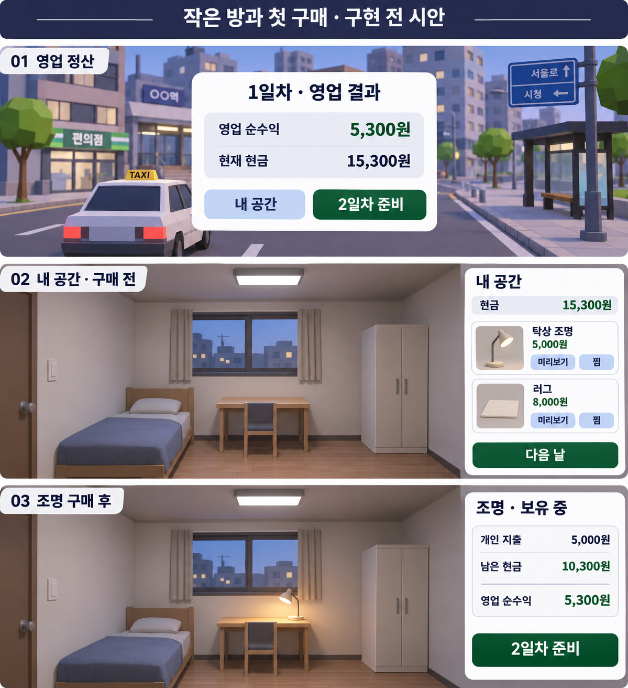

# 개인 생활 프로토타입 기획 안내

## 읽는 순서

1. [이야기: 실직 이후 재출발](10-restarting-driver-synopsis.md)
2. [생활·소유·거래 공통 원칙](11-personal-life-and-growth.md)
3. [택시 구매와 이사까지의 성장](12-career-growth-stages.md)
4. [먼저 검증할3일: 작은 방과 첫 구매](13-three-day-room-and-first-purchase.md)

현재 제작 우선안은13이다. 방1개와 조명/러그2종, 각2스타일만 검증한다.09의 반복 인물/사진 방향은 대체된 이전 기록이다. 작은 방·조명/러그 구매·소유/배치 저장은 구현됐으며, 상세 현재/남은 항목은13의 상태표를 따른다. 차량 구매/이사·장기 경력은 미구현 제안이다.

## 화면에서 보이는 방식

정산에는 기존 다음 날 버튼과 함께 `내 공간`을 둔다. 내 공간을 누르면 고정 시점의 작은 방과 오른쪽 상품2개가 보인다. 미리보기는 같은 방에 임시 적용되고 구매하면 그 자리에 남는다. 방을 건너뛰면 기존대로 영업한다.

조명 구매 예시: 현금15,300원 → 조명5,000원 결제 → 현금10,300원. 영업 순수익5,300원은 그대로이고 개인 지출5,000원을 따로 표시한다. 이 수치는 화면 설명용 예시이며 평균 수입이나 가격 검증 결과가 아니다.

첫날은 원하는 것을 고르고, 둘째 날은 선택이 유지된 방을 다시 보고, 셋째 날은 처음 방과 달라진 공간을 기록한다. 구매/방 방문은 필수가 아니다. 최종 방은 기록으로 열람하며 새 회차로 자동 이월하지 않는다.

화면 이미지는 생성 목업으로 설명하며 실제 게임 실행 캡처나 구현 완료 증거가 아니다. 현재 게임 정산 캡처의 흰 패널/남색 글씨/초록 버튼을 참고한다. 방은 고정2D 레이어로 제작할 수 있고 실내 보행·지도 확장은 필요 없다.

## 현재 최소 범위와 후속

구현: 방/상품 화면, 미리보기·찜·소유/배치, 개인 지출 분리, 원자적 구매 저장, 최종 방 기록. 후속: 처음 방 비교·전체 과거 방 탐색·상품 이미지/카드 숨김. 현재 운전/승객/수요/시설/3일 규칙은 유지한다. 실제 수익 표본으로 가격을 조정하고 구매를 지시하지 않은 사람 관찰로 동기를 확인한다.

## 설명용 생성 목업

도시 배경과 방은 생성 이미지이며 현재 게임 그래픽을 그대로 캡처한 것이 아니다. 구매 확인·조명 끄기·보관 버튼은 설명을 위해 생략했으며13의 기능 계약이 기준이다.
