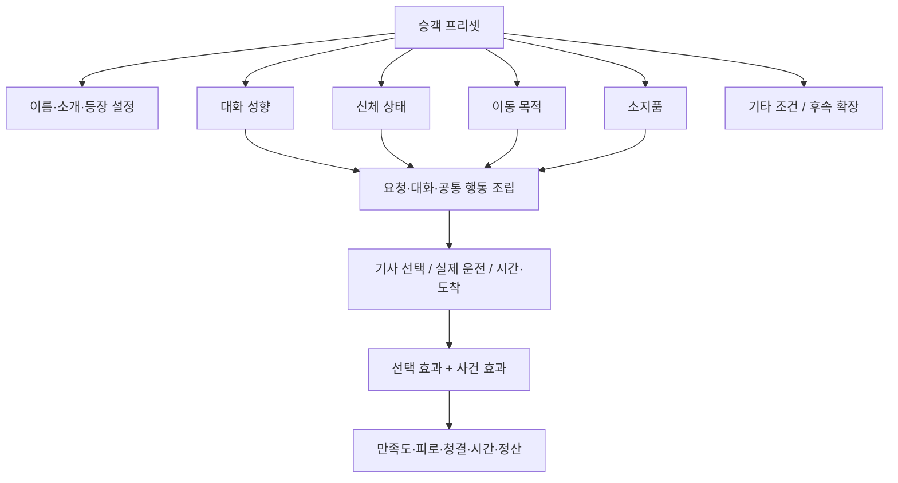
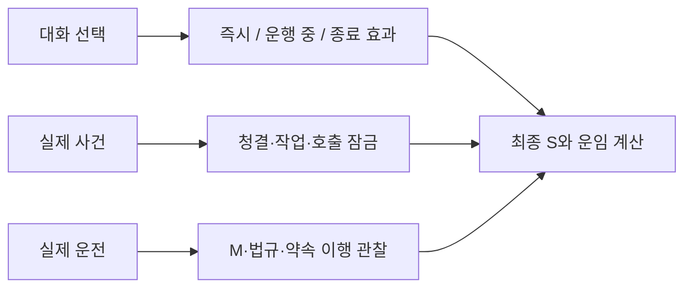

# 승객 프리셋·특성 조합과 제작 도구

작성: 2026-11-06. 사용자가 선택한 **프리셋 + 특성 조합**의 상세 기획. 기존 동작 분석은 [구조 검토](../future-design/2026-11-06-passenger-composition-review.md), 실제 적용/검증은 [작업 이력](../work-history/2026-11-06-passenger-composition-implementation.md)을 따른다. 이 문서는 확장 아이디어와 이번 구현 범위를 분리한다. 수치 담당은 [밸런스](../passenger-balance-v1.md), 대사/선택 효과는 기존 관리창 설정을 재사용한다.

## 1. 기획자가 만드는 것은 ‘새 유형 코드’가 아니라 ‘새 승객 프리셋’

승객 한 명은 정체성(이름·소개), 성향/상태/목적/소지품의 조합, 실제 운송 중 상태로 나눈다. ‘취객’은 최상위 카테고리가 아니라 음주 특성이 있는 프리셋 이름이다. 같은 음주 특성에 조용함·짐·경유를 달리 연결할 수 있다.



네 용어를 구분한다.

| 용어 | 유지 기간 | 예 |
|---|---|---|
| 프리셋 | 제작한 콘텐츠 | ‘조용히 귀가하는 여행객’ |
| 특성 | 해당 승객의 조건/성향 | 조용함, 음주, 짐, 경유 목적 |
| 상태 | 운송 중 변화 | 답변 완료, 준비8초 남음, 잠듦, 구토 경고 중 |
| 사건 | 상태 변화가 일어난 순간 | 구토 발생, 적재 완료, 첫 유효 도착 |

‘조용함’을 고르는 것은 일반 수다를 줄이는 조건이며 만족도 자동 가산이 아니다. ‘음주’를 붙였다고 오염이 즉시 생기는 것도 아니다. **실제 선택·사건이 일어났을 때 해당 효과를 적용**한다.

## 2. 기존 승객을 어떻게 나누는가

기본12프리셋(일반1+특수11)은 기존 행동을 유지한다. 기존34개 특수 변주는 행동 모듈의 대사/진행 변주로 재사용하며 이번에는 별도 변주 제작기까지 추가하지 않는다.

| 기존 유형 → 기본 프리셋 | 옮기는 특성 | 재사용 행동/요청 | 자동으로 추가하지 않는 것 |
|---|---|---|---|
| 일반 | 없음 | 일반 요청0~2개 | 특별 오염·준비 작업 |
| 취객 | 신체: 음주 | 취중 반응·구토·기상 지연 | 공격성·불법 요구 |
| 잠자는 승객 | 신체: 졸림 | 수면·깨우기·흔들림 반응 | 음주·구토 |
| 승차감 민감 | 신체: 승차감 민감 | DR01 부드러운 운전 요청 | 구토·질병 |
| 재촉·불만 | 목적: 시간 확인 | ETA 또는 DR02 | 기한 임의 축소·난폭운전 보상 |
| 경로 확인 | 목적: 경로 확인 | 큰길/짧은 길/경로 추천 | 별도 경로 비용 |
| 용무·경유 | 목적: 경유 | EV02 및 안전 경유·20초 용무 | 무조건 경유 생성 |
| 짐 많은 승객 | 소지품: 큰 짐 | 적재·하역10초씩 | 파손·내구도 손실 |
| 흙 묻은 짐 | 소지품: 오염 가능 짐 | 보호10초/그대로 적재/보류 | 자동 수리비 |
| 음식·음료 | 소지품: 음식 | 밀봉/허용/정리·섭취·흘림 | 무응답 시 자동 허용 |
| 정밀 승하차 | 목적: 안전 하차 위치 | 검증된 DR05 후보 | 임의 도로 위 하차점 생성 |
| 대화·반복 질문 | 성향: 대화 선호 | 소개·후속·응답 기억 | 반복 대화마다 자동 점수 |

**등장 그룹과 특성은 다르다.** 이번에는 기존 등장 정책과 취객 하루 한도, 특수 승객 다음 일반 운송 규칙을 보존하기 위해 ‘배정 그룹’을 남긴다. 일반 특수 그룹은 현재 후보에서 선택될 프리셋의 실제 요청 가용성을 먼저 검사하고, 후보가 없거나 요청이 불가능한 그룹을 추첨에서 제외한다. 남은 그룹 안에서 기존 그룹 가중치, 그룹 내부에서는 프리셋 상대 가중치를 사용한다. 따라서 일부 그룹을 비우면 다른 가용 그룹의 상대 비중이 높아진다. 취객은 기존 별도 추첨/한도 정책을 따르며 후보 없음이면 일반으로 폴백한다. 행동은 그룹 이름이 아니라 특성으로 조립한다. 가중치2는 전체 승객의2%가 아니다.

일반 그룹은 특성 없음 또는 조용함만 허용해 쉬는 운송을 보존한다. 음주 특성은 취객 그룹에서만 사용한다. 최종 선택 단계에 후보가 없으면 아무 특성 없는 일반 승객으로 폴백하며 취객 한도를 소모하지 않는다. 향후 시간대/지역별 프리셋 직접 수요 표는 별도 확장이다.

## 3. 요소별 현재 제공 범위와 확장 후보

‘이번 조합’은 기존 행동 연결 범위이고, ‘후속’은 문구만 바꿔 실제 기능을 켤 수 없는 신규 기획이다. 후속 수치는 사람 플레이 이후 정한다.

### 대화 성향

| 요소 | 상태 | 대화/행동 | 효과 방향 |
|---|---|---|---|
| 표준 | 이번 조합 | 기존 소개·응답 | 기존 선택 효과 |
| 조용함 | 이번 조합 | 일반 후속 수다 억제 | 직접 S/피로 보상 없음; 필수 경고·작업 안내 유지 |
| 대화 선호 | 이번 조합 | 기존 고민/지역/반복 질문 변주 | 기존 대화 응대·피로 설정 공유 |
| 공감 선호 | 후속 | 고민 대화 후보를 자주 선택 | 듣기/짧은 공감/조용한 배려별 S·피로, 보상 반복 제한 |
| 정보 확인 선호 | 후속 | 경로·요금·ETA를 구체적으로 확인 | 정보 일치/확인 완료; 반복 클릭 보상 없음 |
| 짧고 명확한 안내 선호 | 후속 | 짧은 답변·다음 행동 안내 | 대사 길이 자체 점수화하지 않고 요청 이행으로 평가 |
| 불안 완화 필요 | 후속 | 급조작 뒤 설명·안정 안내 | 실제 안정 주행/설명 중복 보상 방지 |
| 농담 선호 | 후속 | 선택형 가벼운 대화 | 안전/긴급 경고 중 발화 금지, 적은 단발 응대 효과 |

성향은 선악이나 진상 분류가 아니다. ‘말 많음’이 ‘음주’와 자동 결합되지 않으며 음주한 손님도 조용하고 협조적일 수 있다.

### 신체 상태

| 요소 | 상태 | 대화/행동 | 효과 방향 |
|---|---|---|---|
| 음주 | 이번 조합 | 구토 예정25%·도착 기상 지연30% 기본 | 구토 시 호출 잠금·하차 청결10이하; 별도 구토 M감점 없음 |
| 졸림 | 이번 조합 | 운행 중 수면·깨우기 | 새 질문 보류, 첫 도착 기한 유지; 오염 없음 |
| 승차감 민감 | 이번 조합 | 부드러운 운전 대표 요청 | 기존 급가감속/요청 평가; 구토 없음 |
| 메스꺼움 | 후속 | 강도 상승·경고·안전 대응 | 실제 운전/정차/선택에 따른 위험 변화; 음주/멀미가 같은 사건을 중복 발동하지 않음 |
| 온도 민감 | 후속 | 덥다/춥다·조절 요청 | 장치 조작 구현 후 효과 연결. 현재 에어컨/창문 텍스트만으로 만족도 자동 보상하지 않음 |
| 휴식 필요 | 후속 | 조용한 이동·잠깐 안전 정차 요청 | 시간 비용·수락 약속, 졸림과 별개 상태 |
| 승하차 지원 필요 | 후속 | 충분한 정차·준비 시간 안내 | 준비 시간·안전 절차; 지원 필요 자체를 감점 특성으로 쓰지 않음 |

취객의 기존 ‘잠듦 확률’은 도착 기상 지연이며, 졸림 모듈의 운행 중 수면과 다르다. 이번에는 두 모듈 동시 선택을 막아 기상 대기가 중복되지 않게 한다.

### 이동 목적

| 요소 | 상태 | 요청 | 효과 방향 |
|---|---|---|---|
| 시간 확인 | 이번 조합 | ETA/정시 도착 | 안내만으로 기한/속도 변경 없음, 실제 약속 평가 |
| 경로 확인 | 이번 조합 | 큰길/짧은 길/추천 | 가용 경로·관찰 부족 중립 |
| 중간 용무 | 이번 조합 | 안전 경유·무료20초 용무 | 같은 운송 유지, 영업시간·연료 경과 |
| 안전한 하차 위치 | 이번 조합 | 작성된 안전 후보 안내 | 실제 목적지 확인/변경·하차 평가 |
| 출근/면접/약속 | 후속 프리셋 후보 | 기존 시간 확인·면접 응원 조합부터 | 직업/면접 결과 보상 없이 운송과 응대 평가 |
| 관광/지역 탐색 | 후속 프리셋 후보 | 지역 대화·경로 안내 | 새 관광 경유는 별도 장소 콘텐츠 필요 |
| 환승/막차 | 후속 | 실제 환승 시간 기준 | 외부 시간표 연동 없이 게임 내 시간 계약부터 |
| 예약/단골 | 후속 | 사전 요청·이전 응답 기억 | 재방문/예약 저장·수요/보상 별도 설계 |
| 목적지 미정 | 후속 | 안전 정차 후 후보 확인 | 임의 순회 강제/무한 운임 방지 |

목적은 요청 후보를 연결하는 것이지 그 요청을 이미 수락했다는 뜻이 아니다. 기존 요청0~2개와 가용 목적지/경로 조건을 유지한다.

### 소지품

| 요소 | 상태 | 선택/사건 | 효과 방향 |
|---|---|---|---|
| 큰 짐 | 이번 조합 | 적재/보류·하역 | 적재10초·하역10초, 안전 정차 필요 |
| 오염 가능 짐 | 이번 조합 | 보호/그대로/보류 | 보호10초, 미보호 하차 또는 중도 종료 청결-5 |
| 음식·음료 | 이번 조합 | 밀봉/섭취 허용/정리 | 허용 S+3, 실제 섭취-2, 흘림25%·추가-6, 정리10초 |
| 젖은 우산 | 후속 | 접기/커버/발판 확인 | 물기 오염·짧은 준비, 비 기상과 연결 |
| 깨지기 쉬운 물건 | 후속 | 고정·부드러운 운전 | 흔들림 관찰·재고정, 실제 파손/배상은 별도 승인 |
| 냄새 나는 포장 | 후속 | 밀봉·환기 요청 | 냄새 상태와 수치 청결 구분, 장치 미구현 주의 |
| 반려동물 이동장 | 후속 | 이동장 고정·안내 | 준비·안정·오염 사건을 별도 설계, 탈출 등 새 행동은 개발 필요 |
| 유모차/접이식 장비 | 후속 | 적재 가능 확인·접기 | 공간/적재 지원 추가; 승객 자체 불이익으로 취급하지 않음 |

### 기타·환경·관계

| 요소 | 상태 | 역할 | 효과 원칙 |
|---|---|---|---|
| 이름·짧은 소개 | 이번 편집 | 같은 행동의 다양한 인물 표현 | 직접 수치 효과 없음 |
| 사용 여부·가중치·배정 그룹 | 이번 편집 | 등장 후보/비중 | 운송 자체 보상과 분리 |
| 초상 선택·외형 | 후속 편집 | 프리셋 정체성 표현 | 외형만으로 음주/성격·위험 확률 결정 금지 |
| 시간대·지역·날씨 조건 | 후속 | 프리셋 후보 필터 | 비/밤이라는 이유만으로 새 감점 중복 없음 |
| 일행 수·공간 요구 | 후속 | 탑승 가능/좌석·짐 공간 | 실제 차량 수용량 기능 필요 |
| 예산/결제 사정 | 후속 | 기존 요금 안내에서 확장 | 대사만으로 할인/부채 자동 생성 금지 |
| 언어/안내 방식 | 후속 | 텍스트/간단 안내 접근성 | 이해 가능 안내를 제공, 언어 자체 감점 없음 |
| 관계·이전 응답 기억 | 후속 | 단골의 선호/이전 약속 | 장기 저장·호환 설계 후 적용 |

## 4. 이번 조합의 제약

기획자가 선택한 특성이 실행되지 않는 상태로 저장되지 않게 한다.

| 조합 | 처리 |
|---|---|
| 음주 + 조용함 + 큰 짐 + 경유 목적 | 허용 대상. 구토/기상, 수다 억제, 짐 작업, 경유 요청을 각각 연결 |
| 승차감 민감 + 음식 | 허용 대상. 음식 선택과 DR01 요청 분리 |
| 오염 짐 + 경유 목적 | 허용 대상. 보호 작업과 EV02 분리 |
| 조용함 + 대화 선호 | 배타. 성향 둘 중 하나 |
| 큰 짐 + 오염 짐 + 음식 중 둘 이상 | 이번에는 소지품 행동 하나만 허용 |
| 졸림 + 음식/짐/대화 선호 | 이번 실행기의 독립 행동 슬롯 충돌로 차단. 후속 모듈 진행기 확장 대상 |
| 대화 선호 + 음식/짐 | 이번에는 별도 지속 행동 동시 실행을 차단 |
| 음주 + 졸림 | 공통 기상 중복 방지로 차단; 음주 자체의 기상 확률 사용 |
| 승차감 민감 + 이동 목적 | 대표 요청 모듈 하나 제한으로 차단 |
| 이동 목적 둘 이상 | 대표 요청 모듈 하나 제한으로 차단 |

위 표는 이번 구현의 지원 조합이며 실제 시험 범위는 작업 이력의 검증을 따른다. 제한을 없애려면 선택창만 늘리는 것이 아니라 각 모듈의 상태·동시 요청 예산·효과 중복·저장을 함께 확장해야 한다.

## 5. 효과는 세 층으로 관리한다



| 연결 행동 | 언제 | 대상/기본 효과 | 중복 방지·주의 |
|---|---|---|---|
| 고민 듣기 | 답변 즉시 | S+3 / 기사 피로+1 | 단발 선택1회 |
| 조용한 배려 | 답변 즉시 | S+2 / 피로0 | 조용함 특성 자체와 구분 |
| 조용한 운행 약속 | 운송 종료 | S+3 | 현재 위반 관찰 없음; 특성 선택만으로 지급 안 함 |
| ETA 안내 | 답변 즉시 | S+1 | 빠름/보통/여유 독립 선택; 기한 변경 없음 |
| 부드러운 운전 | 운행 중 / 종료 | 불필요 급가감속 M 추가-1 / 성공 S+6, 실패-4 | 필요한 제동 제외; S/M 단순 중복 합산 금지 |
| 정시 도착 | 종료 | 성공 S+6 / 실패-3 | 법규·기한 실제 판정 |
| 큰길/짧은 길 | 종료 | 성공 S+5 / 판정 불가0 | 가용 경로·관찰 부족 보호 |
| 경로 추천 | 종료 | 성공 S+4 | 기존 경로 판정 |
| 안전 하차/목적지 변경 | 종료 | 성공 S+4 / 실패-4 | 실패의 실제 도달 조건은 기존 판정표 |
| 경유 | 종료 | 성공 S+5 / 실패-4 | 무료 용무20초는 시간 경과, 추가 보상 아님 |
| 음식 허용 | 선택 / 실제 섭취·흘림 | S+3 / 청결-2 / 흘림 추가-6 | 허용만으로 청결 감소 안 함 |
| 오염 짐 | 보호 / 하차·중도 종료 | 보호10초 / 미보호 청결-5 | 효과ID로1회 |
| 큰 짐 | 승차 전 / 도착 후 | 적재10초 / 하역10초 | 안전 정차 중만 진행 |
| 구토 | 실제 발생 / 하차 | 신규 호출 잠금 / 청결 min(현재,10) | 현재 승객 유지, 구토 자체 별도 벌금 없음 |
| 수면·기상 | 운행 / 첫 도착 후 | 미제시 응답 보류 / 깨우기 대기 | 첫 도착 시각 유지, 기상 지연 재정산 없음 |
| 짐 흔들림 응대 | 실제 흔들림·선택 | 안전 정차 재고정5초 | 기존 필요 제동 안전 판정 유지 |

공통 추가 효과는71개 답변의 기존 설정을 쓴다. 새 프리셋이 음식 특성을 사용하면 기존 음식 선택 효과를 공유한다. 프리셋마다 임의로 복제된 효과값을 만들지 않는다. **공유값 편집은 연결된 모든 승객에 영향을 준다.** 프리셋별 효과 덮어쓰기는 후속 확장으로 남기며 지금 UI에서 지원하는 것처럼 표시하지 않는다.

요청 종료 S만 기본±10 상한, 최종 S·피로0~100. 취소/중단에는 종료 효과 없음. 명시적 보류와 미응답을 구분한다. 현재 기본 운행 중 S·피로 점/분과 비율은0이지만 관리창에서 독립 조정할 수 있다.

## 6. 관리창 화면 도식

아래는 실제 편집 개념의 도식이다. 실제 구현 화면은 이력의 캡처로 확인한다.

실제 화면: [특성 선택](../ui/2026-11-06-passenger-composition/editor-1280.png) · [연결 효과](../ui/2026-11-06-passenger-composition/effects-1280.png) · [좁은 창](../ui/2026-11-06-passenger-composition/editor-800.png).

```text
┌ 콘텐츠 설정 관리 ──────────────────────────────┐
│ 프로필: passenger-work   변경 내용 있음           │
├ 분류 ──────┬ 승객 목록 ──────┬ 선택한 승객 ──────┤
│ 승객 프리셋 │ 검색            │ 조용한 귀가 손님    │
│ 승객 요청   │ [새 승객]       │ ID / 이름 / 사용    │
│ 대화 선택지 │ 일반            │ 배정 그룹 / 가중치  │
│ 효과       │ 취객            │ [복제] [삭제]       │
│ 법규       │ 잠자는 승객      ├ 특성 선택 ────────┤
│ 공통 영향   │ …               │ 대화: ☑ 조용함     │
│            │ 조용한 귀가 손님 │ 신체: ☑ 음주       │
│            │                 │ 목적: ☑ 경유       │
│            │                 │ 소지품: ☑ 큰 짐    │
│            │                 ├ 소개·동작·효과 ────┤
│            │                 │ 소개 대사 입력      │
│            │                 │ 적재10초 / 하역10초 │
│            │                 │ 구토·기상 / 경유요청│
│            │                 │ 공유 효과 편집 연결 │
├───────────────────────────────────────────────┤
│ [검증] [저장] [내보내기] [게임에 적용]            │
└───────────────────────────────────────────────┘
```

화면에서 ‘새 프로필’은 게임 전체 설정 묶음이고 ‘새 승객’은 그 안의 프리셋 하나다. 두 생성 작업을 혼동하지 않게 한다. 삭제는 현재 편집 프로필에서만 삭제하며 기존 운송에 소급하지 않는다. 저장 전 변경 알림과 기존 동시 저장 충돌 검사는 유지한다.

## 7. 새 승객을 추가하는 세 가지 예

완성 예제3개를 포함한 [가져오기용 프로필](../../config/content/presets/passenger-composition-examples.json)을 제공한다. 관리창 **가져오기**에서 선택하면 기본12개+예제3개를 새 프로필 ID로 보관할 수 있다. 출하 기본값이나 기존 활성 설정에 자동 적용하지 않는다. 이 작업에서 UI로 저장한 `passenger-composition-example`에는 예A가 들어 있으며 예제 전체는 위 파일을 사용한다.

### 예 A. 말없이 귀가하며 큰 가방을 든 손님

1. 설정 관리 → 새 프로필 `passenger-lab`을 만들거나 별도 작업 프로필을 연다.
2. 승객 프리셋에서 취객을 복제한다. ID `quiet-night-luggage`, 이름 ‘조용한 귀가 손님’.
3. 배정 그룹 취객, 가중치1, 대화 조용함·신체 음주·목적 경유·소지품 큰 짐 선택.
4. 소개: ‘오늘은 조금 취했네요. 가방을 싣고 조용히 집까지 부탁드려요.’
5. 결과 확인: 짐 선택→안전 적재→가용한 경유 요청 응대→일반 수다 억제→구토/기상 예정에 따른 사건→하역→정산.
6. 검증·저장 후 분리 테스트. 구토는25% 예정이므로 한 번 타서 반드시 발생하지 않는다. 사건 검사는 별도 테스트 프로필의 기존 구토 확률을 조정해서 확인한다.

이 이름은 코드에 새 유형을 추가하지 않아도 된다. 효과를 바꾸지 않으면 기존 짐/음주 효과를 공유한다.

### 예 B. 간식을 들고 편안한 운전을 부탁하는 손님

음식 프리셋 복제 → `snack-comfort` → 소지품 음식 + 신체 승차감 민감. 소개는 ‘간식을 가져왔는데 차가 흔들리면 힘들어요.’ 음식 허용 선택과 부드러운 운전 요청은 서로 다른 선택이다. 허용하면 S+3, 실제 섭취/흘림 오염; DR01을 수락하면 승차감 평가. ‘민감’ 특성이 있다고 구토를 자동 추가하지 않는다.

### 예 C. 화분을 들고 잠깐 들를 곳이 있는 손님

오염 짐 프리셋 복제 → `plant-errand` → 소지품 오염 가능 짐 + 목적 경유. 보호10초/그대로 선택과 경유 수락은 독립이다. 가용 경유지가 없거나 요청 슬롯이 없으면 경유를 강제하지 않는다. 실제 적용된 목표와 약속만 평가하며, 보호 없이 실은 경우 하차/중도 종료 때 추가 청결-5.

## 8. 확장 순서와 검증

1. 이번: 기존 행동 프리셋화, 조합·명시적 충돌 검사, 기존 도구 저장/적용, 실제 운송/저장 연동.
2. 다음: 프리셋별 초상·변주·요청 가중치, 지역/시간대 수요, 독립 행동 다중 진행기. 수면+짐 등을 열기 전에 준비/수면/깨우기/하역의 순서를 검증한다.
3. 이후: 메스꺼움 상태와 운전/선택 개입, 젖은 우산·장치·관계 기억 등 새 행동.

확률은 생성 시 한 번 정하고 저장한다. 취소/불러오기/순서 변경으로 재추첨하지 않는다. 기존 저장은 당시 행동/설정으로 진행한다. LAN 참가자는 호스트 설정과 결과를 사용하며 이번 실행본을 함께 갱신해야 한다. 신규 프리셋·설정 구조를 모르는 구 실행본으로 적용하지 않는다.

자동 검사는 데이터 검증·동작·저장·통합 검사, 사람 검사는 반복 대화 피로·실제 운전 중 읽기·운송 수익/세차 빈도를 확인한다. 둘을 구분해 기록한다.
