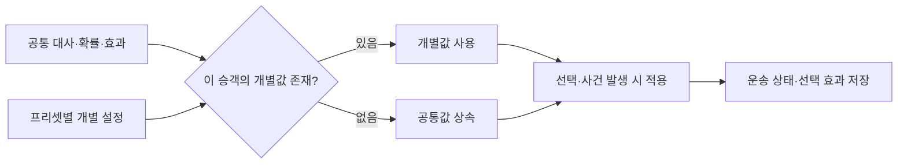

# 승객별 대사·확률·효과 설정

작성 2026-11-07. [승객 프리셋·특성 조합](15-passenger-presets-and-traits.md)의 개별화 확장이다. 같은 특성을 가진 승객도 필요한 항목만 서로 다른 값으로 제작한다.

## 1. 공통값은 기본, 개별값은 교체



- 개별값은 공통값에 더하거나 곱하지 않고 **교체**한다. 공통 구토25%·개별10%라면 최종10%다.
- 0도 유효한 값이다. 구토0%는 구토 없음, 추가 만족도0은 추가 가산 없음. 상속하려면 **공통값으로 복원**을 누른다.
- 공통값과 같은 숫자를 명시해도 개별값이다. 이후 공통값을 수정해도 그 프리셋의 명시값은 유지한다.
- 대사를 빈 문자열로 저장하지 않는다. 개별 대사를 지우고 기존 대사로 돌아가려면 복원한다.
- 수정은 다음 새 싱글/새 PVP방에 적용한다. 이어하기는 저장 당시 콘텐츠와 해당 승객의 개별 설정을 사용한다. 진행 중 운송을 다시 추첨하지 않는다.

## 2. 무엇을 개별화할 수 있나

| 분류 | 개별 편집 범위 | 적용 시점 / 주의 |
|---|---|---|
| 소개 | 프리셋 소개 대사 | 기존 소개 기능, 작업·안전 안내를 덮지 않음 |
| 행동 대사 | 실제 주 행동의 승차 변주·선택지·후속 변주 | 해당 변주/선택/상태에서 표시. 변주 수·대화 흐름 자체 추가 기능은 아님 |
| 요청 대사 | 요청 문구·기사 답변 | 실제로 배정된 요청에서만 표시. 문구 편집으로 경유·목적지가 생기지 않음 |
| 상황 응답 | 신호 대기·흔들림·필요한 제동 답변 | 사건이 발생하고 답변할 때 표시 |
| 음주 확률 | 구토 예정·도착 기상 지연 확률, 각각0~100% | 배정 때 독립 결정, 저장/복원으로 재추첨하지 않음 |
| 음식 확률·진행 | 흘림0~100%, 섭취 시간·진행률·흘림 지연 | 음식 허용과 실제 섭취 조건을 만족해야 사건 발생 |
| 물리 효과 | 음식 섭취/흘림 오염, 흙 묻은 짐 오염 | 실제 사건 발생 시 적용, 동일 사건 중복 적용 방지 |
| 작업 시간 | 적재·하역·보호·재고정·음식 정리·수면 진정·경유 용무 | 안전 정차 등 기존 진행 조건 유지. 표시·진행·저장 검증이 같은 시간을 사용 |
| 선택 즉시 효과 | 만족도·피로의 점/현재값 비율 | 해당 답변 실행 시 적용 |
| 선택 운행 중 효과 | 분당 만족도·피로, 기준값 비율, 자연 피로 증가율, 급가감속 감점 변화 | 활성 선택의 진행 시간에 따라 적용 |
| 선택 종료 효과 | 성공·실패·판정 없음의 만족도/피로 | 그 선택이 지원하는 실제 종료 판정만 제공 |
| 미응답 | 원래 편집 가능한 요청의 미응답 효과 | 조용함은 운전 점수 M 감소, 공감·면접·지역 대화는 하차 S 효과. 원래 중립인 참조 항목은 편집 불가 |

선택한 특성과 실제 주 행동에 맞는 항목만 추가 목록에 나온다. 음주+큰 짐이라면 큰 짐 승차/선택 대사와 음주 확률을 편집한다. 이 조합에서 실행되지 않는 취객 전용 주 행동 선택지는 제공하지 않는다. 요청과 상황은 일반 운송에서도 발생하므로 공통 후보를 개별화할 수 있지만, 발생 자격·요청 수·슬롯은 기존 정책을 따른다.

**공통으로 유지하는 정책:** 등장 그룹 비중·사용 여부·취객 하루 한도/강제 등장, 요청 생성 일정·가중치, 법규·차량·경제·만족도 상한. 승객별 등장 비중은 기존 프리셋 가중치로 조정한다. 구토 후 청결10이하·호출 잠금, 안전 정차 조건, 기본 운임 정책은 고정 규칙이다. 기획자가 새 사건 종류나 임의 수식·조건 스크립트를 추가하는 기능은 아니다.

## 3. 같은 특성, 다른 손님 예시

[가져오기용 예제 프로필](../../config/content/presets/passenger-overrides-examples.json): 기본12프리셋+아래4프리셋. 예제 수치는 제작 방법 설명용이며 기본 밸런스를 바꾸지 않는다.

| 항목 | 조심스러운 귀가 손님 | 피곤한 귀가 손님 |
|---|---|---|
| 동일 특성 | 음주 + 큰 짐 | 음주 + 큰 짐 |
| 승차 대사 | 가방에 깨지기 쉬운 물건이 있어요. 천천히 실어 주세요. | 오늘 피곤하네요. 가방만 싣고 출발할게요. |
| 구토 예정 확률 | 10% | 60% |
| 적재·준비 시간 | 17초 | 3초 |
| 적재 수락 즉시 만족도 | +7 | +1 |
| 나머지 | 공통값 상속 | 공통값 상속 |

| 항목 | 조심히 먹는 손님 | 쏟기 쉬운 음료 손님 |
|---|---|---|
| 동일 특성 | 음식 + 승차감 민감 | 음식 + 승차감 민감 |
| 흘림 확률 | 0% | 100% |
| 흘림 추가 청결 감소 | -2 (흘림0%이므로 미발생) | -9 |
| 음식 허용 즉시 만족도 | +1 | +7 |
| 승차감 요청 대사 | 음료가 흔들리지 않게 부드럽게 부탁드려요. | 동일하게 지정, 각각 편집 가능 |

100% 흘림이어도 음식 보관/정리를 선택하거나 섭취 전에 운송이 끝나면 흘리지 않을 수 있다. 구토 예정100%도 경고 후 도착 전에 발생 시간이 지나야 실제 구토한다. 확률은 조건이 충족됐을 때의 예정 확률이며 무조건 즉시 효과가 아니다.

## 4. 제작 순서와 화면

1. `설정 관리.cmd` 실행 → 작업용 프로필 생성 또는 기존 프로필 불러오기.
2. 승객 프리셋에서 복제/새 승객 → 이름·특성 설정.
3. **이 승객만의 설정**에서 대사 / 발생 확률 / 효과·시간을 고르고 검색.
4. 항목을 선택해 **개별 설정 추가** → 공통값을 확인하고 개별값 입력 → 최종 적용값 확인.
5. 잘못 추가한 항목은 **공통값으로 복원**. 특성을 제거해 사용할 수 없어진 값은 오류로 표시되므로 특성을 되돌리거나 해당 값을 복원한다. 자동 삭제하지 않는다.
6. 검증 → 저장 → 게임에 적용. 다음 새 세션에서 확인한다. 저장만으로 활성 프로필이 바뀌지 않는다.

```text
이 승객만의 설정          개별 설정 3 / 128개
[발생 확률 ▼] [구토 검색                 ]
[취객 · 구토 예정 확률 ▼] [개별 설정 추가]
┌ 취객 · 구토 예정 확률 ─────────────────┐
│ 공통값: 25%                            │
│ 개별값: [10]                           │
│ 최종 적용: 10%        [공통값으로 복원] │
└────────────────────────────────────────┘
[검증] [저장] [게임에 적용]
```

실제 UI: [개별값](../ui/2026-11-07-passenger-overrides/individual-values.jpg) · [대사·작업 시간](../ui/2026-11-07-passenger-overrides/individual-dialogue.jpg) · [800px](../ui/2026-11-07-passenger-overrides/individual-800.jpg). 별도 `passenger-local-example` 프로필로 대사·구토10%·적재17초를 저장/재로드하고 충돌·복원을 확인했다. 실제 활성 설정은 변경하지 않았다.

오염/감점 입력은 공통 편집창과 동일하게 음수 변화량으로 표시한다. 예: 청결-9, 조용한 요청 미응답 M-6. 저장 데이터가 감소량 크기를 사용하더라도 기획자가 부호를 뒤집어 해석하지 않게 한다. 기존 음수/양수 의미를 가진 S 효과는 그대로다.

## 5. 데이터와 호환성

내부 프리셋 version1은 그대로 읽고 유지한다. 처음 개별 항목을 추가할 때 version2로 바뀌며 프리셋마다 `overrides:[{id,value}]`를 가진다. 기존 전체 프로필 schema1은 편집기로 불러오면 기존 이관 절차를 통해 schema2가 된다. 구형 schema1에 새 선택 효과를 몰래 끼운 입력은 거부한다.

최대32프리셋·승객당128개 개별 항목·프리셋 JSON32000자·전체240KiB. ID 중복/알 수 없는 값/범위 밖/필요 특성 없음/빈 대사는 검증 오류다. 복제는 개별 설정도 독립 복사한다. 공통값과 같은 값이더라도 명시 항목은 유지한다.

각 운송은 선택된 프리셋의 개별값을 저장한다. 실제 선택 효과는 해결된 수치를 장부에 저장하고 복원 시 같은 승객 설정으로 검증한다. 다른 승객이나 참가자의 전역 공통 설정을 바꾸지 않는다. LANv13이므로 함께 플레이하는 실행본을 모두 갱신한다.

[구현·검증·남은 항목](../work-history/2026-11-07-passenger-overrides.md). 수동 장시간 운전/전체 캠페인·다른 PC LAN 수용은 자동 모델·위치 제어·같은 PC LAN 검사와 별도다.
