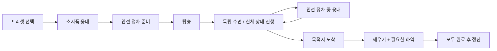

# 19. 승객 독립 행동·요청 위반·새 특성

아래는 구현된 1차 기획이다. 실제 검증 범위와 배포 결과는 작업 이력에 기록한다. 승객 이름이 행동 코드를 결정하지 않고 프리셋의 특성과 선택 결과가 운송 상태를 결정한다.

## 1. 구성 요소와 책임

| 요소 | 역할 | 이번 확장 |
|---|---|---|
| 프리셋 | 이름·소개·등장 그룹·특성 목록 | 기존24종 보존, 신규 조합/특성 예제 추가 |
| 대화 성향 | 조용함·대화 선호 | 운전자가 먼저 말을 거는 행동과 승객 요청을 구분 |
| 신체 상태 | 음주·졸림·승차감·메스꺼움·온도 민감 | 졸림은 소지품과 독립, 메스꺼움/온도 상태 저장 |
| 목적 | 급함·경유·안전 하차 등 | 기존 요청 가용성·대표요청 정책 유지 |
| 소지품 | 짐·오염짐·음식·젖은 우산 | 수면과 조합; 우산 보호/오염 처리 |
| 공통 설정 | 대사·확률·시간·효과의 기본값 | 새 특성 설정을 카탈로그에 추가 |
| 승객별 설정 | 필요한 항목만 공통값 덮어쓰기 | 같은 메스꺼움/우산도 승객마다 수치·대사 변경 |
| 운송 상태 | 실제 선택·진행·사건·결과 | 저장/복원, 취소, 중복 효과 방지 |

## 2. 복수 행동 흐름

잠든 동안 음식 섭취·음식 흘림 진행과 일반 대화 응대를 제한한다. 이미 발생한 오염은 잠든다고 취소되지 않는다. 짐을 거절한 경우 적재/하역이 생기지 않는다. 수면과 하역 중 어느 하나만 끝내고 중복/조기 정산하지 않는다. 음주의 잠듦·구토는 기존 음주 모듈의 의미를 유지한다.

## 3. 새 특성의 실제 행동

| 특성 | 관찰/진행 | 플레이어 개입 | 결과 |
|---|---|---|---|
| 메스꺼움 | 이동·거친 조작에 따라 누적 | 안전 정차 휴식 또는 봉투 안내 | 완화·구토 오염 예방; 실제 사건은 한 번 |
| 온도 민감 | 선호 온도와 실제 설정의 일치 시간 | 따뜻하게/시원하게/현재 유지 | 일치·불편 지속과 수정 결과를 만족도에 반영 |
| 젖은 우산 | 탑승 전 소지품 상태 | 우산을 감싸기 또는 그대로 두기 | 보호 준비 시간 또는 청결 손실 |

온도는 승객 쾌적 상태 모델이며 실제 에어컨 물리·기상 시뮬레이션과 구분한다. 젖은 우산은 비 날씨 생성에 종속되지 않는 소지품이다. 외부 날씨에 따른 등장 조건은 별도 정책이다. 메스꺼움과 음주의 구토는 같은 사건으로 중복 적용되지 않도록 조합 범위와 상태를 검사한다.

## 4. 요청 실패 감지

| 약속 | 성공/실패를 결정하는 근거 | 제외되는 경우 |
|---|---|---|
| 조용한 운행 | 수락 후 운전자가 먼저 하는 선택적 잡담 | 안전·경유·기상·하차·작업 안내 |
| 편안한 운행 | 기존 가감속·불필요 제동 관찰 | 필요 제동 구분 유지 |
| 정시 도착 | 남은 시간·확정 운전 위반 | 합법적 지연을 판별할 정보 부족은 판정불가 |
| 경유·안전 하차 | 실제 정차/용무 완료·지정 하차 | 대사만 응답한 것을 완료로 처리하지 않음 |

조용한 요청에 답하지 않은 경우와 수락 후 약속 위반은 별개다. 위반 횟수/근거를 저장하며 재로드하거나 반복 입력해 종료 효과를 여러 번 받지 않는다. 경적 기능이 없는 현재 실행본에서 경적 위반 감지를 구현했다고 표시하지 않는다.

## 5. 기획자 관리 순서

1. 관리 툴에서 새 프로필 또는 기존 프로필을 연다.
2. 승객 프리셋을 복제하고 신체 상태·소지품을 조합한다.
3. 승객별 대사/효과에서 필요한 항목만 개별 설정한다. 명시적0도 설정으로 유지한다.
4. 공통값/개별값과 최종 적용값을 확인한다. 같은 특성의 다른 승객에 영향이 없어야 한다.
5. 검증→저장→내보내기/적용 후 새 운송에서 확인한다. 진행 중 운송은 저장 당시 상태와 선택을 유지한다.

## 6. 검증·밸런스

새 사건의 선택·정차 작업·수면·오염·만족도·취소·재로드·원격 명령을 검사한다. 1차 값은 기획 가설이며 실제 주행/장기 수익·세차 빈도·대화 피로를 후속 확인한다. 자동 모델/위치 제어/같은PC LAN과 사람 운전·전체3일·다른PC 검사는 구분한다.

## 7. 추가 승객 6명과 1차 개별값

기존24종+신규6종=30종, 경로확인1종 비활성으로29종이 등장 후보다. 상대 가중치는 전체 등장 확률이 아니다. [현재 승객 원본](../../config/content/passenger-roster-v2.json).

| 승객 | 특성 | 그룹/가중치 | 소개 |
|---|---|---|---|
| 간식을 들고 졸고 있는 손님 | body.sleepy + item.food | Food / 1 | 야근을 마쳐서 졸리네요. 간식은 어떻게 둘까요? |
| 여행 가방과 함께 쉬는 손님 | body.sleepy + item.luggage | Luggage / 1 | 가방을 싣고 잠깐 눈을 붙이고 싶어요. |
| 화분을 들고 쉬는 손님 | body.sleepy + item.muddy | MuddyLuggage / 1 | 정원 일을 마쳐 피곤하네요. 화분에 흙이 묻어 있어요. |
| 멀미가 걱정되는 손님 | body.nausea + body.sensitive | Comfort / 1 | 차를 타면 속이 불편할 때가 있어요. 부드럽게 부탁드려요. |
| 차내 온도에 민감한 손님 | body.temperatureSensitive | Comfort / 1 | 차 안 온도가 맞으면 한결 편하게 갈 수 있어요. |
| 젖은 우산을 든 손님 | item.wetUmbrella | Luggage / 1 | 우산에 물기가 남아 있어요. 자리를 적시지 않게 두고 싶어요. |

| 승객 | 개별 설정 | 값 |
|---|---|---|
| 간식을 들고 졸고 있는 손님 | 음식 · 승차 대사 1 | 간식을 가져왔는데 잠이 쏟아지네요. |
| 간식을 들고 졸고 있는 손님 | 음식 · 기사 선택지 1 (빈 값: 기존 문구) | 간식은 밀봉해서 두시고 편히 쉬세요 |
| 간식을 들고 졸고 있는 손님 | 음식 · 기사 선택지 2 (빈 값: 기존 문구) | 깨어 계실 때 드셔도 괜찮아요 |
| 간식을 들고 졸고 있는 손님 | 음식 흘림 확률 | 15 |
| 간식을 들고 졸고 있는 손님 | 섭취 청결 감소 | 1 |
| 간식을 들고 졸고 있는 손님 | 흔들림 후 안정 시간 | 8 |
| 여행 가방과 함께 쉬는 손님 | 큰 짐 · 승차 대사 1 | 가방을 실은 뒤 쉬어도 될까요? |
| 여행 가방과 함께 쉬는 손님 | 큰 짐 · 기사 선택지 1 (빈 값: 기존 문구) | 가방을 안전하게 싣고 도착하면 깨워 드릴게요 |
| 여행 가방과 함께 쉬는 손님 | 큰 짐 · 기사 선택지 2 (빈 값: 기존 문구) | 이번에는 가방을 싣기 어려워요 |
| 여행 가방과 함께 쉬는 손님 | 적재·준비 시간 | 7 |
| 여행 가방과 함께 쉬는 손님 | 하역 시간 | 6 |
| 여행 가방과 함께 쉬는 손님 | 흔들림 후 안정 시간 | 10 |
| 화분을 들고 쉬는 손님 | 오염 짐 · 승차 대사 1 | 화분을 보호해서 싣고 잠깐 쉬고 싶어요. |
| 화분을 들고 쉬는 손님 | 오염 짐 · 기사 선택지 1 (빈 값: 기존 문구) | 깔개를 준비하고 도착하면 깨워 드릴게요 |
| 화분을 들고 쉬는 손님 | 오염 짐 · 기사 선택지 3 (빈 값: 기존 문구) | 이번에는 화분을 싣기 어려워요 |
| 화분을 들고 쉬는 손님 | 적재·준비 시간 | 7 |
| 화분을 들고 쉬는 손님 | 오염 짐 청결 감소 | 4 |
| 화분을 들고 쉬는 손님 | 흔들림 후 안정 시간 | 9 |
| 멀미가 걱정되는 손님 | nausea.prompt · 대사 | 속이 울렁거려요. 안전한 곳에서 쉬거나 봉투를 받을 수 있을까요? |
| 멀미가 걱정되는 손님 | nausea.choice.0 · 대사 | 안전하게 정차한 뒤 잠시 쉬겠습니다 |
| 멀미가 걱정되는 손님 | nausea.choice.1 · 대사 | 봉투를 준비해 드릴게요. 불편하면 알려 주세요 |
| 멀미가 걱정되는 손님 | 메스꺼움 사건 예정 확률 | 65 |
| 멀미가 걱정되는 손님 | 주행 중 불편 누적 | 0.4 |
| 멀미가 걱정되는 손님 | 안전 정차 휴식 | 7 |
| 멀미가 걱정되는 손님 | 휴식 완화량 | 40 |
| 멀미가 걱정되는 손님 | 봉투 없는 사건 청결 손실 | 6 |
| 차내 온도에 민감한 손님 | temperature.prompt · 대사 | 차 안 온도를 조절해 주실 수 있을까요? |
| 차내 온도에 민감한 손님 | temperature.choice.0 · 대사 | 따뜻하게 맞추고 상태를 살펴볼게요 |
| 차내 온도에 민감한 손님 | temperature.choice.1 · 대사 | 시원하게 맞추고 상태를 살펴볼게요 |
| 차내 온도에 민감한 손님 | temperature.correction · 대사 | 아직 불편하네요. 다른 온도로 바꿔 주실 수 있나요? |
| 차내 온도에 민감한 손님 | 쾌적 유지 시간 | 12 |
| 차내 온도에 민감한 손님 | 불편 지속 시간 | 18 |
| 차내 온도에 민감한 손님 | 쾌적 유지 만족도 | 4 |
| 차내 온도에 민감한 손님 | 불편 지속 만족도 | -2 |
| 젖은 우산을 든 손님 | umbrella.prompt · 대사 | 젖은 우산을 감싸 주실 수 있나요? |
| 젖은 우산을 든 손님 | umbrella.choice.0 · 대사 | 정차한 동안 우산을 감싸 드릴게요 |
| 젖은 우산을 든 손님 | umbrella.choice.1 · 대사 | 그대로 두셔도 괜찮아요 |
| 젖은 우산을 든 손님 | 우산 감싸기 준비 | 5 |
| 젖은 우산을 든 손님 | 보호 없는 우산 청결 손실 | 2 |

## 8. 공통값과 판정 상세

| 항목 | 공통 1차 값 | 실제 반영 시점 |
|---|---|---|
| 메스꺼움 예정 | 100% | 승객 생성 시 고정, 개별 예제65% |
| 불편 누적 | 이동 중 초당0.35 / 거친 조작12 | 필요한 안전 제동은 거친 조작에서 제외 |
| 안내/사건 | 누적20 / 70 | 안내 후 휴식 또는 봉투, 사건1회 |
| 휴식 | 안전 정차8초 / 불편35 완화 | 시간 완료 시; 중간 출발은 작업 중지 |
| 구토 오염 | 청결-8 | 봉투 미준비 사건 시1회; 과거 오염 취소 없음 |
| 온도 쾌적 | 선호 설정15초 / S+3 | 불편 결과와 중복 가산하지 않음 |
| 온도 불편 | 불일치20초 / S-2 | 수정 후 쾌적 달성하면 +3으로 교체 |
| 우산 보호 | 정차6초 | 탑승 전 완료 |
| 우산 그대로 | 청결-3 | 실제 탑승 시1회 |
| Quiet 약속 위반 | 종료 S-5 | 수락 후 자발적 잡담을 실제 관찰했을 때 |

메스꺼움 휴식/봉투는 안내 사건의 두 대안이며 휴식이 이후 모든 불편을 영구 제거하지 않는다. 온도 선호는 배정 시 고정하고 대사에 표시한다. 최초 설정이 맞지 않으면 한 번 다시 조정할 수 있다. 현재 유지 선택은 중립 온도로 처리한다. 잠든 동안 음식 소비·흘림은 멈추고, 운행 중 메스꺼움/온도 상태 자체는 진행할 수 있다. 필수 사건/작업 응대를 일반 수다로 취급하지 않는다.

## 9. 조합·호환 경계

- 일반 짐은 기존 적재·하역 시간을 유지한다. 오염짐은 기존 보호 준비·하차 오염 정책이며 별도 하역 시간은 없다. 수면 결합이 이 물리 정책을 자동으로 바꾸지 않는다.
- 음주+졸림, 음주+메스꺼움, 수다+졸림은 충돌로 거부한다. 소지품 주 행동(음식/짐/오염짐)은 하나이며 젖은 우산 보조 행동을 함께 둘 수 있다. 대표 목적 요청은 기존 최대1개 정책을 유지한다.
- 신규 설정 묶음이 전부 없는 과거 프로필은 읽을 수 있지만 중간 항목만 빠진 손상 프로필은 거부한다. 편집기 이관은 새 항목을 채우고 기존 승객 목록을 보존한다. C#/Node 이관 결과가 같아야 한다.
- 과거의 Quiet 효과는 저장 당시 프로필을 존중한다. 새 기본값의 실패S-5는 새 프로필 정책이며 기존 저장의 점수를 소급 변경하지 않는다.
- 공통 새 특성 설정의 손실 값은 양수 크기이며 실행에서는 청결 감소로 적용한다. 온도 만족도는 부호 있는 변화량이다.

## 2026-11-09 잡담 표시 보완

선택지가 없는 명시적 잡담 답변은 큰 중앙 팝업 대신 왼쪽 아래 승객 카드에서 승객 발언으로 표시한다. 같은 표시 문구는 한 운송에서 한 번만 사용하며, 저장/이어하기와 LAN snapshot에도 사용 이력을 유지한다. 다른 문구는 기존 12초 간격·6초 표시를 유지한다. 1인칭에서는 잡담 표시 동안 기존 승객 카드를 왼쪽 아래로 옮기고 운전 점수창은 오른쪽에 두어 겹침을 피한다. ‘말 걸기’는 카드 안의 작은 선택적 버튼이다. 자동 잡담을 새로 발생시키지 않는다.

기존 편집 가능한 `request.LocalChat.reply.SmallTalk` 대사와 새 `Assets/Resources/Content/passenger-chat-lines.json`의 7개 발언을 합해 기본 8개다. 같은 문구를 다른 키로 설정해도 반복하지 않는다. 구저장은 마지막 답변을 사용 이력으로 이관한다. Quiet 약속 위반 반응은 별도 1개이며 원래 위반 판정/감점은 보존한다. 실제 요청·행동 선택지는 유지한다.

## 2026-11-09 후속: 말 걸기 숨김·승객 표시 정리

사용자가 선택적 말 걸기 기능을 확인한 뒤 우선 숨김을 요청했다. 위 ‘말 걸기’ 버튼과 잡담 카드 표시 지침은 이번 후속으로 대체한다. 내부 잡담 데이터/구저장 호환/Quiet 관찰 API는 남기지만 일반 플레이 화면에는 진입 버튼과 답변을 표시하지 않는다. 실제 승객 요청/행동 선택은 그대로다.

승객 카드에는 offer/trip 식별자로 정한 임의 한국어 이름을 표시한다. 같은 승객은 저장·탑승·LAN에서 같은 이름을 유지하며 배정 난수 상태를 소비하지 않는다. 발언 앞의 ‘손님:’·‘손님 “…”’·‘승객:’ 화자 표기를 표시 단계에서 제거하고 상태 설명/원문 콘텐츠는 보존한다. M지도 상단 보조 범례와 우측 호출의 예상 피로 등 예측 카드는 숨기며 운임/승하차/수락·차단 사유는 남긴다. 호출 반복 보완과 실제 최종 검증은 후속 작업 이력을 따른다.
