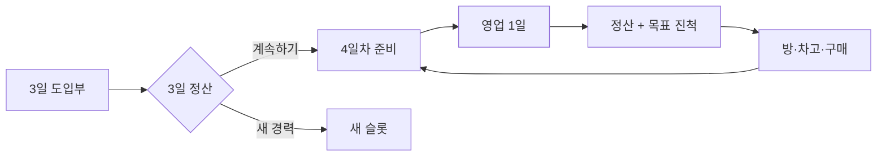
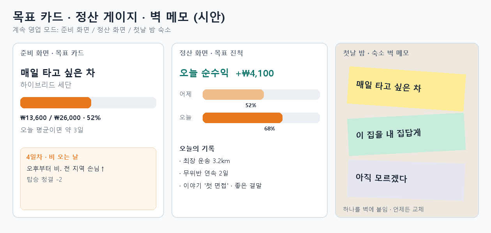
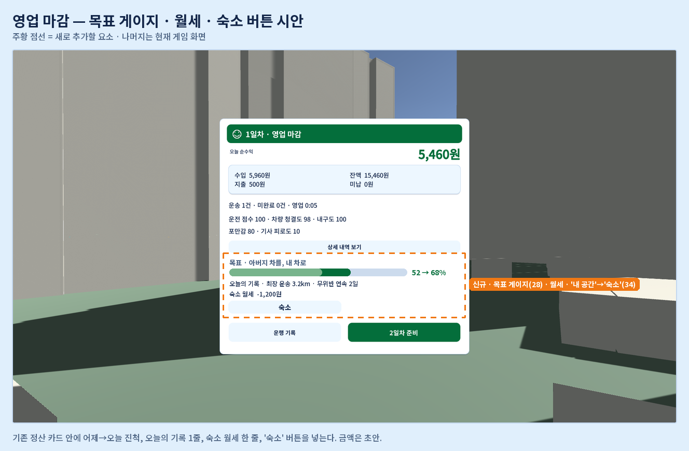
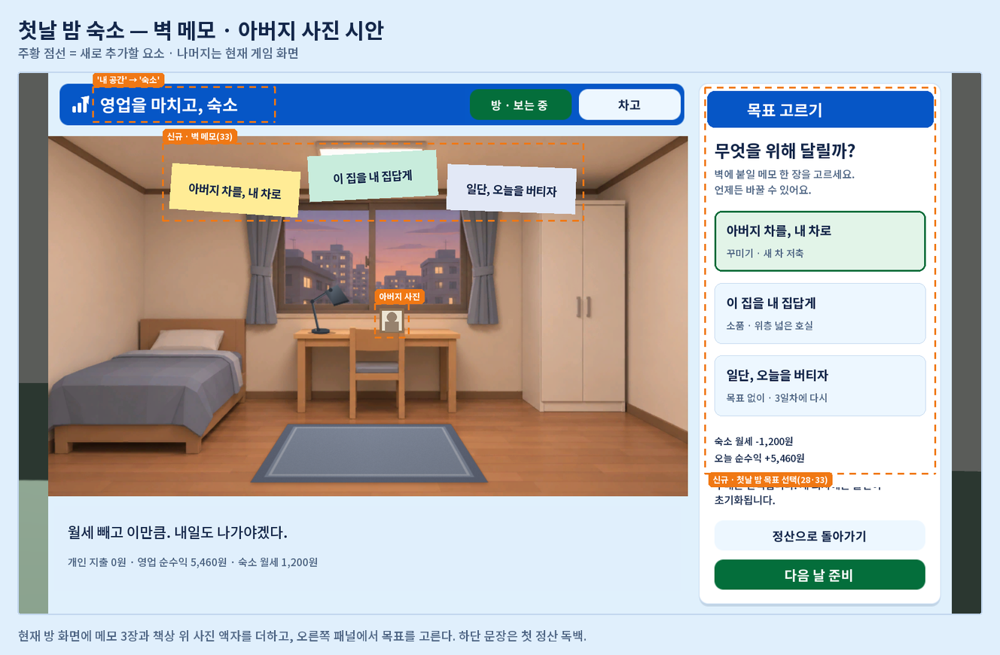

# 28 계속 영업 모드와 장기 목표

**상태: P2 구현·자동 검증(2026-11-19).** 3일 완료 후 같은 저장으로 계속 영업, 새 경력과 슬롯 선택, 준비 목표 카드·정산 진척을 적용했다. 벽 메모와 실제 호실 이전·달성 연출은 후속이다. [검증과 재현](../work-history/2026-11-19-continuous-career-p2.md).

## 1. 목표

> 3일이 끝나도 **내 돈·차·방이 남고**, "하루만 더" 할 이유가 화면에 보인다.

## 2. 현재 vs 변경

| 항목 | 현재 | 변경 |
|---|---|---|
| 회차 | 3일 완료 → 새 회차는 차·방·소유 초기화 | 3일 = **도입부**, 완료 후 같은 저장으로 **4일차~ 무한 진행** |
| 소유 | 회차마다 리셋 | 현금·차량·색/장식·방 소품 유지 |
| 목표 | 3일 순이익 | 장기 목표 1개 선택 + 다음 구매 게이지 |
| 새로 시작 | 메뉴 재시작 | "새 경력" 별도 슬롯(기존 저장 보존) |
| 3일 체험 | 기본 | 그대로 유지(첫 플레이·비교 기준) |

## 3. 흐름

## 4. 장기 목표 (하나 선택, 언제든 변경)

| 목표 | 도달 조건 | 달성 연출 | 비고 |
|---|---|---|---|
| 아버지 차를, 내 차로 | 아버지 차 꾸미기, 원하면 새 차 구매 | 새 운전석 첫 출근 컷 | 아버지 차는 **판매 없이 숙소 주차장 보관**(보상 판매 없음 → 새 차 전액). 차종 추가는 후속 |
| 이 집을 내 집답게 | 숙소 꾸미기 + 같은 건물 넓은 호실로 옮기기 | 소품 옮기기 + 창밖 전망 변화 | 거점은 하나로 고정([34](34-home-base.md)), 다른 동네 이사 없음 |

개인택시 면허 목표는 제외(2026-11-19 사용자 결정, [32](32-deferred-systems-review.md)). 처음부터 개인택시로 영업한다. 첫날 밤 고른 "무엇을 위해"([33](33-backstory-presentation.md))가 기본 목표가 된다.

하나만 달성해도 "재출발 성취"로 인정한다(기획10 원칙 유지). 달성 후에도 영업은 계속된다.

## 5. 화면에 보일 것

| 위치 | 표시 | 예 |
|---|---|---|
| 준비 화면 | 목표 카드 1장 | `하이브리드 세단까지 ₩12,400 · 오늘 평균이면 약 3일` |
| 정산 화면 | 목표 게이지 변화 | `+₩4,100 → 52% → 68%` |
| 정산 화면 | 오늘의 기록 1줄 | 최장 운송, 무위반 연속일 등 ([30](30-passenger-stories-and-logbook.md) 수첩과 연동) |
| 방 | 지금까지 산 것 | 소품·차 사진이 늘어나는 벽 |

"며칠" 예상은 최근 3일 순이익 중앙값으로 계산하고, 확정 약속처럼 표기하지 않는다(`약`).

## 6. 경제 원칙

| 원칙 | 내용 |
|---|---|
| 기준 단위 | `R` = 하루 순수익 중앙값(기획12) |
| 다음 구매 간격 | 1.5~3R마다 무언가 살 수 있게 배치 |
| 큰 목표 | 차 교체 8~12R, 넓은 호실 15~20R |
| 금지 | 가격만 올려 반복 시간 늘리기, 일일 고정비로 강제 영업 |
| 기존 값 | 하이브리드 ₩26,000 · LPG ₩22,000 · 색 ₩1,500 · 장식 ₩2,000 · 조명 ₩5,000 · 러그 ₩8,000 (모두 `ContentTuning`) |

## 7. 구현 범위

| 영역 | 작업 | 파일(현재) |
|---|---|---|
| 저장 | `settings.days` 고정값 대신 무기한 일차, 새 경력 슬롯 | `BusinessProgress.cs`, `CampaignSaveLocation.cs` |
| 완료 처리 | 3일 완료 = 도입 종료 표시, 잠금(`finalized`) 해제 | `BusinessProgress.ResetCampaign`, `RoomAvailable` |
| 장부 | 일차 무제한 누적, 최근 N일 요약 | `EconomyLedger.cs` |
| UI | 목표 카드·게이지 | `OneDayHUD.cs`, `DayPreparationPresentation.cs` |
| 이관 | 기존 3일 저장 → 4일차 이어가기 가능 | 저장 버전 4 |

## 8. 검증

| 질문 | 통과 기준 |
|---|---|
| 3일 후 계속할 이유를 말하는가 | 사람 플레이 3명 중 2명 이상 "목표/다음 구매" 언급 |
| 산 물건을 다음 날 쓰는가 | 구매 다음 영업에서 사용·확인 |
| 기존 저장 보존 | r14~ 저장 이관 검사 통과, 3일 체험 저장 별도 유지 |
