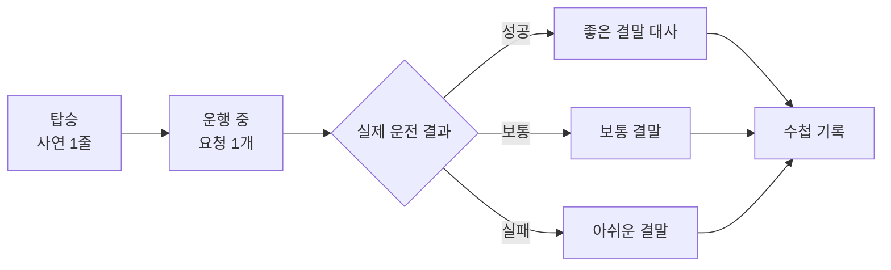
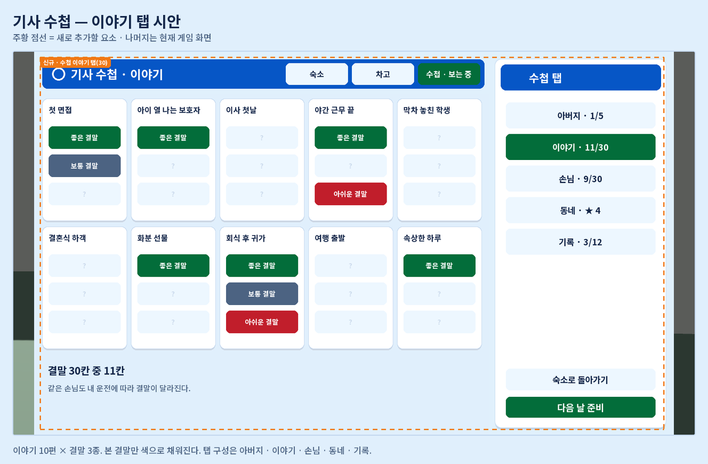

# 30 완결형 손님 이야기와 기사 수첩

**상태: P6 손님 이야기 10편 및 기사 수첩 5탭 구현(2026-11-19).** [검증과 재현](../work-history/2026-11-19-passenger-stories-p6.md). 동기 보강 3순위. 반복 인물 제외 원칙 유지([10](10-restarting-driver-synopsis.md)).

## 1. 목표

> 한 운송 = **짧은 이야기 한 편.** 결말은 내 운전이 정한다. 본 이야기는 수첩에 남는다.

## 2. 이야기 구조

판정은 기존 요청 판정(OnTime·Comfort·SafeStop 등)을 그대로 쓴다. **새 시스템 없이 기존 프리셋+요청 재조합**으로 만든다.

## 3. 1차 이야기 10편

| # | 이야기 | 기반 프리셋 | 요청·판정 | 좋은 결말 | 아쉬운 결말 |
|---|---|---|---|---|---|
| 1 | 첫 면접 | 면접을 앞둔 손님 | OnTime | "잘 될 것 같아요" | 말없이 뛰어감 |
| 2 | 아이 열 나는 보호자 | 급함+승차감 | Comfort+OnTime | 병원 앞 감사 인사 | "조금만 조심하시지…" |
| 3 | 이사 첫날 | 짐+수다 | 짐 적재·LargeRoad | 동네 질문에 답해줘서 고마움 | 짐 거절 시 다른 택시 |
| 4 | 야간 근무 끝 | 야간근무 손님 | Quiet | 깨어나며 "푹 잤네요" | 흔들림에 깸 |
| 5 | 막차 놓친 학생 | 급함 | Eta·요금 부족 선택(**신규 선택지**) | 다음에 꼭 갚겠다는 쪽지 | — |
| 6 | 결혼식 가는 하객 | 음식(축하 떡)+급함 | OnTime | 떡 한 조각 | 옷 구김 걱정 |
| 7 | 화분 선물 | 화분 경유 손님 | ViaStop+보호 | 꽃집 들러 완성된 선물 | 흙 쏟아짐 |
| 8 | 회식 후 귀가 | 모임 마친 수다 손님 | 수다 듣기·안전 운행 | 집 앞에서 꾸벅 인사 | 구토 사건 |
| 9 | 여행 출발 | 여행 가방 손님 | 짐+OnTime | "다녀오겠습니다!" | 가방 거절 |
| 10 | 속상한 하루 | Empathy 요청 | 듣기/조용한 배려 | "얘기하니 낫네요" | — |

- 등장 빈도: 하루 2~3편, 나머지는 기존 일반 승객.
- 조건 카드([29](29-daily-conditions.md))와 연결: 회식은 금요일, 이사·짐은 상가 행사 카드에서 비중↑. 결혼식·여행은 2차 주말 카드 추가 시 연결.

## 4. 기사 수첩

첫 운송 후 수첩을 발견하면 은계 싱글 운전 화면에 **기사 수첩** 버튼이 열린다. 1인칭과 3인칭 모두 운전 점수는 카드 첫 줄에 세 자리까지 표시하고, 수첩 버튼은 아래 줄의 점수 게이지 오른쪽에 둔다. 열람 중 영업과 물리는 일시정지하며 닫기 또는 Esc로 주행을 재개한다. 숙소와 준비 메뉴에서도 열람할 수 있다.

| 탭 | 내용 | 수집 단위 |
|---|---|---|
| 이야기 | 10편 × 결말 3종 | 결말별 칸 (30칸) |
| 손님 | 프리셋 30종 | 처음 태우면 열림 |
| 동네 | 12개 영업 지점 | 운송 횟수 → 숙련도 별 1~3 |
| 기록 | 첫 비 오는 날 운송, 무위반 하루, 최장 운송 등 | 업적 12개 |

### 동네 숙련도 (평점·레벨 아님)

| 별 | 조건(해당 지점 출발·도착 합) | 열리는 것 |
|---|---|---|
| ★ | 3회 | 지점 이름·사진 |
| ★★ | 10회 | 주변 대기 명당 표시 |
| ★★★ | 25회 | 시간대별 수요 힌트 1줄 |

첫 탭은 아버지의 운행 수첩([33](33-backstory-presentation.md)).

## 5. 표현 원칙

| 할 것 | 하지 않을 것 |
|---|---|
| 대사 2~4줄, 결말 1줄 | 긴 대화 트리 |
| 결말이 운전 결과로 갈림 | 선택지만으로 결말 결정 |
| 같은 이야기도 다른 결말을 다시 볼 이유 | 같은 인물 재등장·호감도 |

## 6. 구현 범위

| 영역 | 작업 | 파일(현재) |
|---|---|---|
| 데이터 | 이야기 정의(프리셋·요청·결말 대사) | 콘텐츠 프로필 `story.*` |
| 배정 | 하루 2~3편 배정, 조건 카드 가중 | `PassengerJobs.cs` |
| 결말 | 요청 판정 결과 → 하차 대사 | `PassengerBehavior.cs`, `PassengerRequest.cs` |
| 수첩 | 저장·UI | 신규 `LogbookHUD.cs`, 캠페인 저장 |

## 7. 검증

| 질문 | 통과 기준 |
|---|---|
| 기억에 남는 손님을 말하는가 | 플레이 후 "어떤 손님 기억나요?"에 이야기 손님 언급 |
| 결말이 운전으로 갈리는가 | 이야기별 성공/실패 결말 자동 회귀 |
| 수첩을 다시 여는가 | 영업 3일 중 수첩 열람 2회 이상 |
