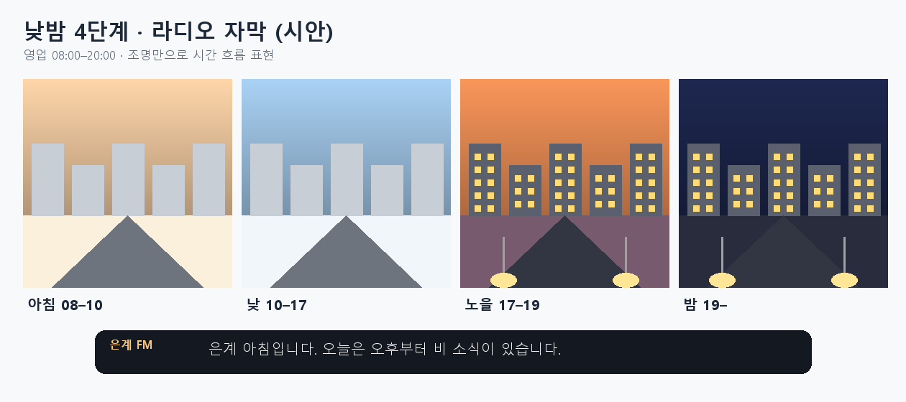

# 31 낮밤 조명과 라디오 자막

**상태: 기획 초안(2026-11-19) · 미구현.** 동기 보강 4순위. 전체 아트 교체 없이 **조명과 글자**로 세계관을 전달한다.

## 1. 목표

> 출근길과 퇴근길이 **다른 동네처럼 보이고**, 라디오가 오늘의 은계를 들려준다.

## 2. 낮밤 단계

영업 하루 = 화면 시각 08:00~20:00(현재 `PassengerDemandPolicy`), 초과 영업은 20:00 이후.

| 단계 | 화면 시각 | 태양·하늘 | 도시 조명 | 수요 단계 |
|---|---|---|---|---|
| 아침 | 08~10 | 낮은 각도·따뜻한 색 | 꺼짐 | 아침(주거→업무) |
| 낮 | 10~17 | 높은 각도·흰색 | 꺼짐 | 낮(업무→상업) |
| 노을 | 17~19 | 주황·긴 그림자 | 가로등 켜짐 시작 | 저녁(상업→주거) |
| 밤 | 19~ | 남색 하늘·환경광↓ | 가로등·상가 창·차량 전조등 | 저녁/초과 |

```mermaid
gantt
  dateFormat HH:mm
  axisFormat %H
  section 조명
  아침 :08:00, 2h
  낮   :10:00, 7h
  노을 :17:00, 2h
  밤   :19:00, 3h
```

| 요소 | 구현 방법 | 비용 |
|---|---|---|
| 하늘·태양 | Directional Light 각도·색, 환경광 그라데이션 | 소 |
| 가로등 | 도로 시설 위치에 점광원 대신 발광 머티리얼 + 바닥 조명 텍스처 | 소~중 |
| 건물 창 | 회색 상자 건물에 발광 창 텍스처 무작위 | 소 |
| 전조등 | 플레이어·교통 차량 스포트라이트(성능 상한 근처 차량만) | 중 |
| 비 연동 | 비 오는 날([29](29-daily-conditions.md)) 환경광↓·젖은 노면 반사 | 소 |

성능 기준: PvP 호스트 frame p95 22ms를 넘기지 않는다. 밤 조명은 PvP에서 끌 수 있게 설정 분리.

## 3. 라디오 자막

| 종류 | 시점 | 예시 | 연결 |
|---|---|---|---|
| 아침 인사 | 영업 시작 | "은계 아침입니다. 오늘은 오후부터 비 소식." | 조건 카드 상기 |
| 교통 정보 | 하루 1~2회 | "○○로 공사로 정체가 이어집니다." | 공사 카드 |
| 동네 소식 | 하루 1회 | "은계 상가 저녁 행사, 9시까지." | 상가 카드 |
| 사연 | 무작위 | 청취자 사연 1줄 | 세계관 |
| 마감 | 영업 종료 | "오늘도 수고하셨습니다." | 정산 전환 |

- 표시: 화면 하단 자막 1줄, 6초. 음성·음악은 후속.
- 승객 대화 중에는 표시하지 않는다.
- 문구는 콘텐츠 프로필 `radio.*`로 편집.
- 설정에서 끄기 가능.

## 4. 방의 낮밤

| 상황 | 방 표현 |
|---|---|
| 정산 후 귀가 | 밤 배경, 조명 소품 켬/끔이 의미를 가짐(기존 `lampOn`) |
| 다음 날 준비 | 아침 배경 |

## 5. 구현 범위

| 영역 | 작업 | 파일(현재) |
|---|---|---|
| 시각 | 영업 경과 → 조명 단계 | 신규 `DayLightController.cs`, `DriveSession.cs` |
| 시설 | 가로등·창 발광 | 도로 시설 생성(`RoadMapFacilities.cs`) |
| 라디오 | 자막 큐·우선순위 | 신규 `RadioTicker.cs`, `DriveNotifications.cs` |
| 방 | 낮/밤 배경 2종 | `PersonalRoomHUD.cs` |

## 6. 검증

| 질문 | 통과 기준 |
|---|---|
| 시간 흐름을 느끼는가 | 플레이 후 "지금 몇 시쯤?"에 단계 맞힘 |
| 밤에 신호·차로 판독 | 신호·표지 Player 검사 밤 조건 통과 |
| 성능 | 은계 싱글·PvP 호스트 p95 기준 유지 |
