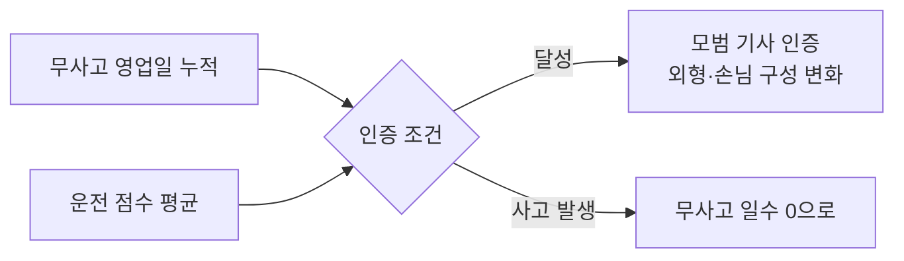

# 32 보류 시스템 재검토 — 개인택시 면허 · 차내 장치 조작

**은계 싱글 차내 조작 · 2026-11-20 개정.** [변경과 검증](../work-history/2026-11-20-cabin-logbook-steering.md).

| 항목 | 결정 |
|---|---|
| 개인택시 면허 경로(기획23·축소안 모두) | **제외.** 시작부터 개인택시로 바로 영업(기획10 유지). 아래 §2는 기록용 |
| 차내 장치 조작 | 미터기·운전석 창문·희망 온도를 조작한다. 지붕 표시등은 영업 상태를 따른다. |
| 배경 이야기 표현 | [33 배경 이야기 보여주기](33-backstory-presentation.md) |

## 1. 한눈에

| 항목 | 현재 | 왜 다시 보나 | 권장 |
|---|---|---|---|
| 개인택시 면허 경로 | [기획23](23-license-career-path.md) 보류 | 운전 점수·무사고가 장기 목표와 직접 연결되는 유일한 안. 한국 택시만의 특징 | **28 계속 영업에 "세 번째 목표"로 축소 도입** 검토 |
| 차내 장치 조작 | 운임·창문·온도 조작 | 온도 요청을 받은 뒤 기사가 직접 설정한다 | §3 적용 |

## 2. 개인택시 면허 — 축소안

기획23 전체(법인택시 시작·사납금)는 시작 설정을 바꾸므로 보류 유지. 대신 **현재 시놉시스(중고 개인택시로 시작)를 유지**하고, 장기 목표로 "면허 등급"만 얹는다.

| 비교 | 기획23 원안 | 축소안 |
|---|---|---|
| 시작 | 법인택시 회사 취업 | 그대로 중고 개인택시 |
| 정산 | 사납금 추가 | 변경 없음 |
| 목표 | 면허 양수 | **모범 기사 인증**(무사고·무위반 기록) |
| 보상 | 내 택시 | 모범 택시 외형·장거리 손님 비중↑ |
| 영향 범위 | 저장·경제·시작 서사 전부 | 28 목표 카드 1종 추가 |

| 조건(초안) | 값 |
|---|---|
| 무사고 연속 영업일 | 10일 |
| 최근 10일 운전 점수 평균 | 기준 이상(콘텐츠 툴 편집) |
| 실패 시 | 무사고 일수만 초기화, 돈·소유 유지 |

## 3. 은계 싱글 차량 조작

| 장치 | 운전 화면 | 동작 |
|---|---|---|
| 미터기 | J | 첫 3일은 자동 보조를 선택할 수 있다. 수동일 때 승하차에 맞춰 켜고 끈다. |
| 운전석 창문 | K 또는 창문 버튼 | 내림과 올림. 열면 환기되어 실내 온도가 바깥 기온의 영향을 받는다. |
| 온도 | [ 낮춤 · ] 높임, 화면의 − / + | 18~28°C에서 1°C씩 조정한다. 기본은 22°C. 현재 실내 온도와 설정 온도의 차이에 따라 난방·냉방·유지를 표시한다. |
| 빈차등 | 자동 | 첫날 출차 때 자동으로 호출을 받는다. 지붕 표시등 앞뒤에는 항상 TAXI를 표시한다. |

차내 온도에 민감한 손님은 응대 이후 실제 실내 온도가 따뜻한지 시원한지와 유지 시간에 따라 만족도가 달라진다. 창문은 독립 조작이다. 현 버전은 외기를 22°C로 근사한다.

## 4. 결정 기록

| 질문 | 선택지 | 결정(2026-11-19) |
|---|---|---|
| 면허 경로 | A 보류 유지 · B 축소안 · C 기획23 원안 | **제외** |
| 차내 조작 | A 보류 유지 · B 3종 1차안 · C 음악 포함 4종 | **B 3종 추가** |
| 시점 | 28~31 사람 플레이 후 / 28과 동시 | 미정 |

## 5. 검증(채택 시)

| 질문 | 통과 기준 |
|---|---|
| 인증이 안전 운전 동기가 되는가 | 인증 목표 선택자의 위반 수 감소 |
| 조작이 귀찮지 않은가 | 미터기 누락률, "귀찮다" 응답 |
