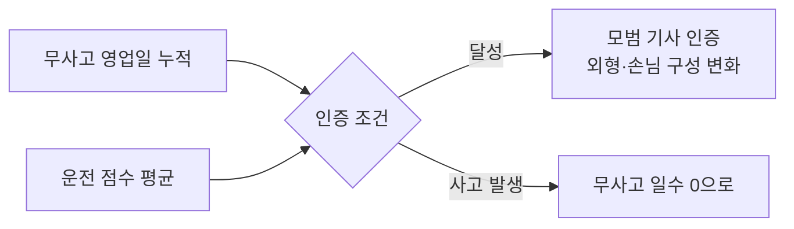
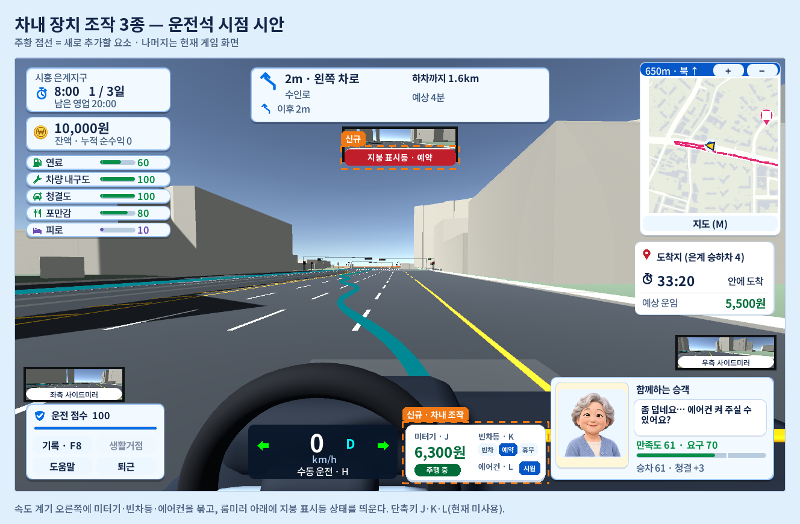

# 32 보류 시스템 재검토 — 개인택시 면허 · 차내 장치 조작

**상태: P3 차내 장치 조작 3종 구현(2026-11-19).** [검증과 재현](../work-history/2026-11-19-cabin-controls-p3.md).

| 항목 | 결정 |
|---|---|
| 개인택시 면허 경로(기획23·축소안 모두) | **제외.** 시작부터 개인택시로 바로 영업(기획10 유지). 아래 §2는 기록용 |
| 차내 장치 조작 | **추가.** §3의 미터기·빈차등·에어컨 3종 1차안 채택, 음악·창문은 2차 |
| 배경 이야기 표현 | [33 배경 이야기 보여주기](33-backstory-presentation.md) |

## 1. 한눈에

| 항목 | 현재 | 왜 다시 보나 | 권장 |
|---|---|---|---|
| 개인택시 면허 경로 | [기획23](23-license-career-path.md) 보류 | 운전 점수·무사고가 장기 목표와 직접 연결되는 유일한 안. 한국 택시만의 특징 | **28 계속 영업에 "세 번째 목표"로 축소 도입** 검토 |
| 차내 장치 조작 | 보류. 음악 요청은 응대만 반영 | 응대와 실제 조작 사이 간격 → 시뮬 손맛 부족 | **미터기·빈차등·에어컨 3종만** 1차 검토 |

## 2. 개인택시 면허 — 축소안

기획23 전체(법인택시 시작·사납금)는 시작 설정을 바꾸므로 보류 유지. 대신 **현재 시놉시스(중고 개인택시로 시작)를 유지**하고, 장기 목표로 "면허 등급"만 얹는다.

| 비교 | 기획23 원안 | 축소안 |
|---|---|---|
| 시작 | 법인택시 회사 취업 | 그대로 중고 개인택시 |
| 정산 | 사납금 추가 | 변경 없음 |
| 목표 | 면허 양수 | **모범 기사 인증**(무사고·무위반 기록) |
| 보상 | 내 택시 | 모범 택시 외형·장거리 손님 비중↑ |
| 영향 범위 | 저장·경제·시작 서사 전부 | 28 목표 카드 1종 추가 |

| 조건(초안) | 값 |
|---|---|
| 무사고 연속 영업일 | 10일 |
| 최근 10일 운전 점수 평균 | 기준 이상(콘텐츠 툴 편집) |
| 실패 시 | 무사고 일수만 초기화, 돈·소유 유지 |

## 3. 차내 장치 조작 — 3종 1차안 (채택)

단축키 J·K·L은 현재 코드에서 쓰지 않는 키(M=지도, N 사용 중).

| 장치 | 조작 | 연결되는 것 | 안 하면 |
|---|---|---|---|
| 미터기 | 탑승 후 켜기, 하차 시 끄기 | 운임 정산 | 미터기를 켜지 않으면 양의 운임을 기본 50% 지급하고 승객 반응 표시 |
| 빈차등 | 빈차/예약/휴무 | 휴무 시 콜 안 받음(휴식·시설 이동) | — |
| 에어컨 | 따뜻/끔/시원 | 기존 온도 민감 특성 판정 | 요청을 맞추지 않으면 해당 승객의 불만 판정 |

- 음악·창문은 2차. 버튼 수를 늘리지 않는다(단축키 3개).
- 실패해도 큰 벌칙 대신 승객 반응 1줄.
- 처음 3일은 미터기 자동 보조를 기본으로 켠다(운전 설정에서 해제). 에어컨 온도는 처음부터 실제 조작으로 판정한다.

## 4. 결정 기록

| 질문 | 선택지 | 결정(2026-11-19) |
|---|---|---|
| 면허 경로 | A 보류 유지 · B 축소안 · C 기획23 원안 | **제외** |
| 차내 조작 | A 보류 유지 · B 3종 1차안 · C 음악 포함 4종 | **B 3종 추가** |
| 시점 | 28~31 사람 플레이 후 / 28과 동시 | 미정 |

## 5. 검증(채택 시)

| 질문 | 통과 기준 |
|---|---|
| 인증이 안전 운전 동기가 되는가 | 인증 목표 선택자의 위반 수 감소 |
| 조작이 귀찮지 않은가 | 미터기 누락률, "귀찮다" 응답 |
