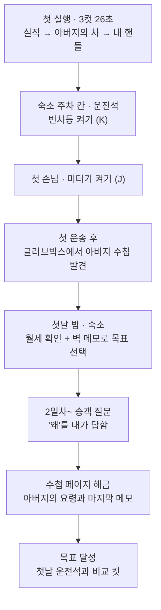
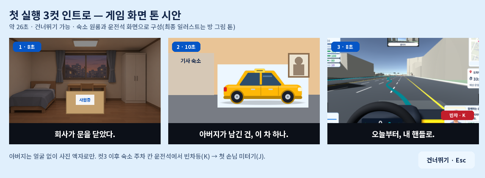
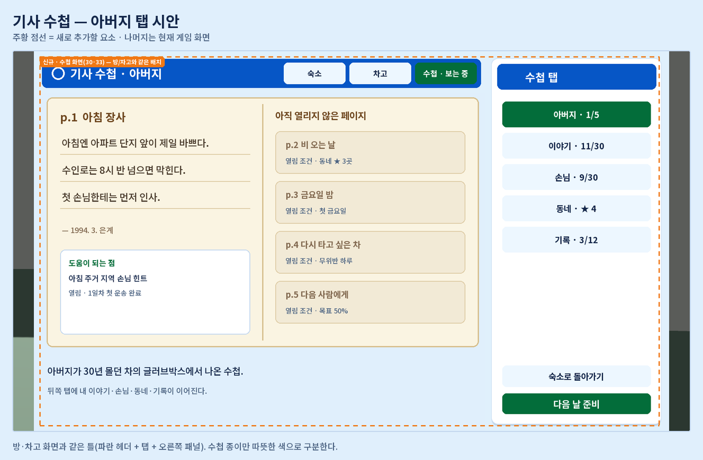

# 33 배경 이야기 보여주기 — 어떻게·왜·무엇을 위해

**상태: P4 인트로·아버지 수첩·벽 메모·차량 보관 구현(2026-11-19).** 동네 별과 금요일 조건은 P5·P6에서 연결한다. [검증과 재현](../work-history/2026-11-19-father-story-p4.md). 사용자 설정: **실직 후 남은 것은 돌아가신 아버지가 남긴 개인택시 하나, 그 차로 생계를 이어간다.** 면허 경로 제외·차내 조작 추가([32](32-deferred-systems-review.md)), 숙소 거점 하나([34](34-home-base.md)). 원 시놉시스 [10](10-restarting-driver-synopsis.md)의 "중고 택시 구입"은 이 문서의 아버지 설정으로 대체한다.

## 1. 세 질문의 답

| 질문 | 답 (설정) | 플레이어가 아는 방법 |
|---|---|---|
| **어떻게** 개인택시를 몰게 됐나 | 회사 경영 악화로 실직. 남은 건 **돌아가신 아버지의 개인택시** 하나 | 3컷 인트로 + 글러브박스의 **아버지 운행 수첩** + 운전석의 아버지 사진 |
| **왜** 이 일을 하나 | 당장의 **생계**. 그리고 아버지가 30년 달린 길을 내가 이어 달려 보기 | 생계는 정산(월세·연료)으로 체감, 마음은 승객 질문에 **내가 답하며** 드러남 |
| **무엇을 위해** 하나 | 생계를 넘어 내가 고르는 것: **아버지 차를 내 차로**, 또는 **숙소를 내 집으로** | 첫날 밤 숙소 벽 메모 → [28](28-continuous-career-mode.md) 목표 카드 |

- 현실의 개인택시 면허 상속·양수 자격과 절차는 생략한다. 게임 안에서 절차를 안내하지 않는다.
- 아버지는 **사진·수첩으로만** 존재한다. 회상 장면·대화 없음(반복 인물 제외 원칙 유지).

## 2. 원칙

| 할 것 | 하지 않을 것 |
|---|---|
| 플레이 중 조각으로 드러냄 | 30초 넘는 강제 인트로, 설명문 페이지 |
| 물건(차·사진·수첩)으로 보여줌 | 슬픔을 강요하는 연출·매일 회상 |
| "왜"는 플레이어가 답함 | 정답 동기·효도 평가 |
| 생계 압박은 정산 숫자로 담담하게 | 빚 독촉·퇴거 위협으로 영업 강요 |

## 3. 드러나는 순서

## 4. 첫 실행 3컷

| 컷 | 화면 | 자막 | 길이 |
|---|---|---|---|
| 1 | 빈 회사 책상, 사원증을 상자에 넣는 손 | "회사가 문을 닫았다." | 8초 |
| 2 | 숙소 앞 주차 칸의 노란 개인택시, 대시보드 위 아버지 사진 액자 | "아버지가 남긴 건, 이 차 하나." | 10초 |
| 3 | 운전석 시점, 아침 은계 도로, 빈차등 | "오늘부터, 내 핸들로." | 8초 |

- 컷3이 끝나면 숙소 주차 칸 운전석. 첫 조작 = **빈차등 켜기 → 첫 손님 탑승 후 미터기 켜기**([32 §3](32-deferred-systems-review.md)).
- 건너뛰기 가능, 메뉴 "처음 이야기 다시 보기".
- 아트: 방 일러스트와 같은 톤의 한 장 그림 3장.

## 5. 아버지의 운행 수첩

[30 기사 수첩](30-passenger-stories-and-logbook.md)의 **첫 탭.** 아버지 메모 뒤에 내 기록이 이어진다.

| 페이지 | 해금 | 내용(예) | 게임 효과 |
|---|---|---|---|
| 1 아침 장사 | 1일차 첫 운송 후 | "아침엔 아파트 단지 앞이 제일 바쁘다." | 아침 주거 지역 힌트 |
| 2 비 오는 날 | 동네 ★ 3곳 | "비 오는 날엔 우산 싸맬 봉투를 챙겨." | 우산 승객 팁 |
| 3 금요일 밤 | 첫 금요일 카드 | "금요일 밤 손님은 말이 많다. 들어주면 된다." | 음주·수다 승객 팁 |
| 4 다시 타고 싶은 차 | 무위반 하루 | "빨리 가는 것보다 다시 타고 싶은 차." | 독백 연결 |
| 5 다음 사람에게 | 목표 50% | "이 차 오래 탔다. 누가 몰든 자기 길을 찾길." | 이야기 마무리 |

메모 날짜는 아버지의 운행 기간(예: 1994~2024)으로 표시. 마지막 페이지만 플레이어를 향한 말처럼 읽히되 직접 부르지 않는다.

## 6. 왜 — 승객이 묻고 내가 답한다

수다 유형 승객이 하루 최대 1회 묻는다. 효과 공통(S+1), **정답 없음.** 답은 저장되어 독백 톤에 반영된다.

| 승객 질문 | A | B | C |
|---|---|---|---|
| "원래 이 일 하셨어요?" | "회사 다니다 얼마 전에 시작했어요." | "아버지가 하시던 일이에요." | (웃으며 넘김) |
| "힘들지 않으세요?" | "먹고살아야죠." | "아직 서툴러요." | "손님 덕에 버텨요." |
| "차가 오래됐네요?" | "아버지 차예요. 아직 잘 달려요." | "곧 바꾸려고요." | "정들었어요." |

## 7. 무엇을 위해 — 첫날 밤 숙소

1일차 정산 후 숙소. 정산에 **월세 일할분**이 보인다([34](34-home-base.md) 생계 비용). 그다음 메모 1장을 벽에 붙인다(언제든 교체).

| 메모 | 연결 목표([28](28-continuous-career-mode.md)) | 이후 표현 |
|---|---|---|
| "아버지 차를, 내 차로" | 아버지 차 꾸미기 → 원하면 새 차로 교체 | 차고에 후보·꾸미기 |
| "이 집을 내 집답게" | 숙소 꾸미기 → 같은 건물 넓은 호실 | 방 소품·창밖 전망 |
| "일단, 오늘을 버티자" | 목표 없음(생계 유지) | 3일차에 다시 묻기, 불이익 없음 |

**아버지 차 교체 시 (사용자 결정 2026-11-19): 판매하지 않고 숙소 주차장에 보관한다.**

| 항목 | 처리 |
|---|---|
| 보상 판매 | 아버지 차에는 적용하지 않음 → 새 차 가격 전액 지불 |
| 보관 위치 | 숙소 주차장(34)에 상시 주차된 모습으로 보임 |
| 다시 타기 | 차고에서 고르면 다음 날부터 그 차로 영업(추가 비용 없음) |
| 보관 비용 | 없음 |
| 연출 | 교체 직후 수첩 독백 1줄: "아버지 차는 집 앞에 세워 두었다." |

### 독백 (핵심 순간 1줄)

| 순간 | 예 |
|---|---|
| 첫 정산 | "월세 빼고 이만큼. 내일도 나가야겠다." |
| 첫 구매 | "아버지 차에 처음으로 내 것을 달았다." |
| 목표 50% | "이 길이 조금 익숙해졌다." |
| 목표 달성 | 1일차 컷3과 오늘 운전석을 나란히. "오늘부터, 다시 내 핸들로." |

## 8. 구현 범위

| 영역 | 작업 | 파일(현재) |
|---|---|---|
| 인트로 | 3컷·건너뛰기·다시 보기 | `CasualMenuUI.cs`, 신규 `IntroCutscene.cs` |
| 첫 조작 | 빈차등·미터기 안내 | 차내 조작과 함께 `CockpitUI.cs` |
| 사진 | 대시보드 액자 오브젝트 | `CockpitPresentation.cs` |
| 수첩 | 아버지 페이지 해금 | 30의 신규 `LogbookHUD.cs` |
| 질문 대화 | 질문 풀·답 저장 | `PassengerBehavior.cs`, 콘텐츠 프로필 `backstory.*` |
| 목표 메모 | 숙소 벽 메모 선택 | `PersonalRoomHUD.cs`, 28 목표 상태 |
| 아버지 차 보관 | 시작 차 보상 판매 제외, 보유 차 목록·운행 차 선택, 숙소 주차장 배치 | `VehicleCatalog.Quote`, `VehicleGarageHUD.cs`, 캠페인 저장 |
| 문구 | 시작 차 이름 "중고 택시" → "아버지의 택시" | `VehicleCatalog.cs` Starter |

## 9. 검증

| 질문 | 통과 기준 |
|---|---|
| 주인공을 설명할 수 있는가 | 1일차 후 "왜 택시를 해요?"에 실직·아버지 차·생계 중 하나 언급 |
| 인트로가 지루하지 않은가 | 첫 운송까지 시간 증가 ≤30초 |
| 목표를 기억하는가 | 3일차에 자기 목표를 말함 |
