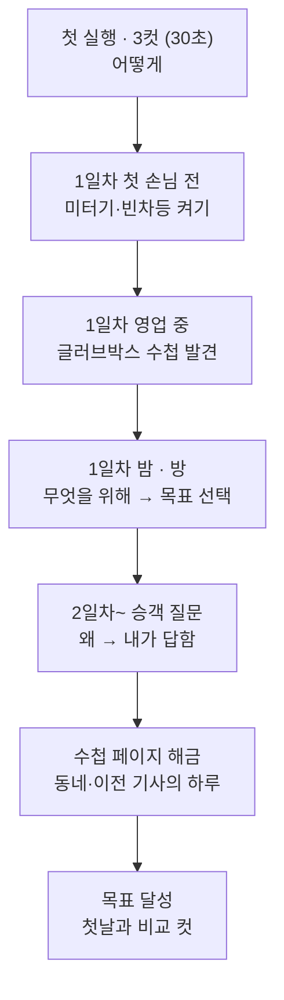

# 33 배경 이야기 보여주기 — 어떻게·왜·무엇을 위해

**상태: 기획 초안(2026-11-19) · 미구현.** 결정 전제: 면허 경로 제외, 처음부터 개인택시, 차내 장치 조작 추가([32](32-deferred-systems-review.md)). 설정 원본은 [10 시놉시스](10-restarting-driver-synopsis.md).

## 1. 세 질문의 답

| 질문 | 답 (설정) | 플레이어가 아는 방법 |
|---|---|---|
| **어떻게** 개인택시를 몰게 됐나 | 회사 경영 악화로 실직 → 퇴직금으로 **은퇴하는 기사의 중고 개인택시를 인수** | 첫 3컷 + 차 안에 남은 **이전 기사의 수첩** |
| **왜** 이 일을 하나 | 남이 정한 하루 대신, **내 핸들로 내 하루를 정하고 싶어서** | 승객의 질문에 플레이어가 답하며 스스로 말함 |
| **무엇을 위해** 하나 | 내가 고른 차, 돌아오고 싶은 집 — **플레이어가 고름** | 첫날 밤 방에서 목표 선택 → [28](28-continuous-career-mode.md) 목표 카드 |

현실의 면허 양수 자격·절차는 생략한다(기획10과 같음). 게임 안에서 절차를 안내하지 않는다.

## 2. 원칙

| 할 것 | 하지 않을 것 |
|---|---|
| 조각으로 나눠 **플레이 중에** 드러냄 | 긴 강제 인트로(최대 30초, 건너뛰기 가능) |
| 물건·장소·짧은 대사로 보여줌 | 설명문 페이지 |
| "왜"는 플레이어가 답하게 | 정답 동기·도덕적 평가 |
| 이전 기사는 **글로만** 존재 | 이전 기사 재등장·관계(반복 인물 제외 유지) |
| 실직은 배경 | 매일 회상·독촉·퇴거 위협 |

## 3. 드러나는 순서

## 4. 첫 실행 3컷

| 컷 | 화면 | 자막(1줄) | 길이 |
|---|---|---|---|
| 1 | 빈 회사 책상, 사원증을 상자에 넣는 손 | "회사가 문을 닫았다." | 8초 |
| 2 | 낡은 노란 택시 옆, 열쇠를 건네는 은퇴 기사의 손(얼굴 없음) | "오래 달린 차예요. 잘 부탁해요." | 10초 |
| 3 | 운전석 시점, 아침 은계 도로 | "오늘부터, 내 핸들로." | 8초 |

컷3이 끝나면 바로 운전석. **첫 조작 = 빈차등 켜기 → 첫 손님 탑승 후 미터기 켜기**([32 §3](32-deferred-systems-review.md) 차내 조작 1차안). 이야기와 조작 안내를 하나로 묶는다.

아트: 한 장 일러스트 3장(기존 방 일러스트와 같은 톤). 재실행 시 메뉴 "처음 이야기 다시 보기".

## 5. 이전 기사의 수첩

글러브박스에서 발견. [30 기사 수첩](30-passenger-stories-and-logbook.md)의 **첫 장**이 된다. 이전 기사의 메모 뒤에 내 기록이 이어 붙는 구조.

| 페이지 | 해금 | 내용(예) | 게임 효과 |
|---|---|---|---|
| 1 | 1일차 첫 운송 후 | "아침엔 아파트 단지 앞이 제일 바쁘다." | 아침 주거 지역 힌트 |
| 2 | 동네 ★ 3곳 | "비 오는 날엔 우산 싸맬 봉투를 챙겨." | 우산 승객 대처 팁 |
| 3 | 첫 금요일 카드 | "금요일 밤 손님은 말이 많다. 들어주면 된다." | 음주·수다 승객 팁 |
| 4 | 무위반 하루 | "빨리 가는 것보다 다시 타고 싶은 차." | 독백 연결 |
| 5 | 목표 50% | "이 차로 30년. 다음 사람은 자기 길을 찾길." | 이야기 마무리 |

- 모두 짧은 손글씨 1~2줄. 이전 기사의 사연은 이 정도로만 비친다.
- 이후 페이지부터 플레이어 기록(이야기 결말·업적)이 쌓인다.

## 6. "왜" — 승객이 묻고 내가 답한다

수다 유형 승객이 낮은 확률(하루 최대 1회)로 묻는다. 효과는 공통(S+1), **정답 없음**. 고른 답은 저장되어 독백 톤에 반영된다.

| 승객 질문 | 선택지 A | 선택지 B | 선택지 C |
|---|---|---|---|
| "원래 이 일 하셨어요?" | "회사 다니다 얼마 전에 시작했어요." | "이것저것 하다가 왔죠." | (웃으며 넘김) |
| "힘들지 않으세요?" | "내 시간 내가 정하니 괜찮아요." | "솔직히 아직 서툴러요." | "손님 덕에 버텨요." |
| "이 차 오래됐네요?" | "은퇴하신 기사님께 넘겨받았어요. 아직 잘 달려요." | "곧 바꾸려고요." | "정들었어요." |

자주 고른 답의 성향에 따라 §7 독백 문구가 조금 달라진다. 성격 수치·평점은 두지 않는다.

## 7. 무엇을 위해 — 첫날 밤 목표 선택

1일차 정산 후 방. 메모지 3장 중 하나를 벽에 붙인다(언제든 교체).

| 메모 | 연결 목표 | 이후 표현 |
|---|---|---|
| "매일 타고 싶은 차" | 차 교체·꾸미기 | 차고에 후보 사진 |
| "돌아오고 싶은 집" | 이사 | 방 창밖 다른 동네 사진 |
| "아직 모르겠다" | 목표 없음 | 3일차에 다시 묻기, 불이익 없음 |

### 독백 (핵심 순간에만 1줄)

| 순간 | 예 |
|---|---|
| 첫 정산 | "생각보다 남았다. 아니, 생각보다 덜 남았나." |
| 첫 구매 | "처음으로 내 것을 골랐다." |
| 목표 50% | "이 길이 조금 익숙해졌다." |
| 목표 달성 | 1일차 3컷의 컷3과 오늘 운전석을 나란히 보여주고 "오늘부터, 다시 내 핸들로." |

## 8. 구현 범위

| 영역 | 작업 | 파일(현재) |
|---|---|---|
| 인트로 | 3컷·건너뛰기·다시 보기 | `CasualMenuUI.cs`, 신규 `IntroCutscene.cs` |
| 조작 안내 | 빈차등·미터기 첫 조작 | 차내 조작 구현과 함께 `CockpitUI.cs` |
| 수첩 | 이전 기사 페이지 해금 | 30의 `LogbookHUD.cs` |
| 질문 대화 | 수다 승객 질문 풀·답 저장 | `PassengerBehavior.cs`, 콘텐츠 프로필 `backstory.*` |
| 목표 메모 | 방 벽 메모 선택 | `PersonalRoomHUD.cs`, 28 목표 상태 |
| 아트 | 컷 일러스트 3장·메모·창밖 사진 | `tools/generate_room_items.py` 톤 |

## 9. 검증

| 질문 | 통과 기준 |
|---|---|
| 주인공이 누구인지 말하는가 | 1일차 후 "왜 택시를 해요?"에 실직·재출발·자기 하루 중 하나 언급 |
| 인트로가 지루하지 않은가 | 건너뛰기율, 첫 운송까지 시간 증가 ≤30초 |
| 목표를 기억하는가 | 3일차에 자기 목표를 말함 |
