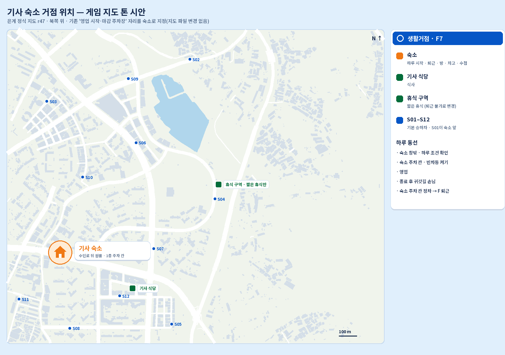
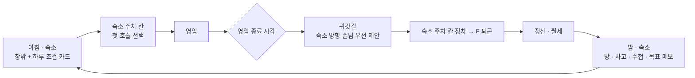

# 34 기사 숙소 거점

**상태: P1 구현·자동 검증(2026-11-19).** 은계 싱글 지정 숙소, 퇴근 제한, 귀갓길 호출, 월세와 숙소 명칭을 적용했다. 계속 영업과 방 확장은 후속이다. [구현 및 검증](../work-history/2026-11-19-home-base-p1.md) · [배경33](33-backstory-presentation.md).

첫날 출차 준비가 끝나면 빈차등이 자동으로 켜진다. M 지도에서 첫 번째 호출을 수락한다. 첫 수락 전에는 숙소에서 도로로 가장 가까운 이용 가능 승차지를 첫 번째로 보여 주고 여유 기한을 적용한다. [첫 운송 검증](../work-history/2026-11-19-first-fare-and-settlement.md).

## 1. 목표

> 하루는 **숙소에서 시작해 숙소로 돌아온다.** 방·차고·수첩·목표가 한곳에 모인다.

## 2. 위치

기존 시안은 주변 도로의 위치 참고용이다. 차고와 진입로는 r47 건물 윤곽에 맞춘 게임용 설계다.

| 항목 | 값 |
|---|---|
| 위치 | 은계 r47의 덕성프라자 건물 윤곽(`37612022:B0010000:7014`) 안쪽 1층 주차 칸 |
| 주변 | 수인로 인근 도로에서 건물 남쪽 차량 출입구로 연결 |
| 설정 | 실직 후 옮겨 온 **수인로 뒤 작은 월세 원룸**, 1층 전용 주차 칸 1개 |
| 선택 이유 | 숙소에 도착했을 때 도로에서 건물 안으로 들어오는 동작이 보이고, 하루를 마친 장소와 다음 날 출발지가 이어짐 |
| 거점 수 | **1곳 고정.** 다른 동네 이사 없음. 넓은 호실은 같은 건물 안 |

### 배포 후보 Player에서 본 차고

## 3. 현재 vs 변경

| 항목 | 현재 | 변경 |
|---|---|---|
| 시작 | `ServiceStops.ParkingStop`(영업 시작·마감 주차장) | 덕성프라자 외벽 안쪽 **기사 숙소 주차장**. 첫 호출 선택 후 차고 출구를 따라 도로에 합류 |
| 퇴근 | 주차장 **또는** 동부 휴식 주차구역(`AtEndDayHub`) | **숙소만.** 휴식 구역은 짧은 휴식 전용 |
| 방 | 정산 후 HUD(조명·러그), 3일 회차에만 | 숙소의 방. 계속 영업에서도 매일 |
| 지도 | 시설 표시에 "주차장" | 집 아이콘 "숙소", F7 생활거점 안내 첫 항목 |
| 생계 비용 | 연료·식사·주차 등 | **월세 일할분** 추가(정산 표기) |

## 4. 하루 동선

| 상황 | 처리 |
|---|---|
| 종료 시각에 멀리 있음 | 초과 영업으로 귀가. "귀갓길 손님"(목적지가 숙소 방향) 우선 제안, 할증 없음 |
| 졸음 강제 종료 | 현재처럼 숙소 주차 칸으로 이동(`BusinessProgress` 졸음 종료 처리 재사용) |
| 사고·견인 | 현재 정비 처리 유지 후 숙소 |
| PvP | 영향 없음(PvP는 기존 시설 규칙) |

## 5. 숙소 안 (방 HUD 확장)

| 영역 | 내용 | 비고 |
|---|---|---|
| 방 | 기존 조명·러그 + 추가 소품 | `PersonalRoomHUD` |
| 벽 | 목표 메모 1장, 산 물건 사진 | [28](28-continuous-career-mode.md), [33](33-backstory-presentation.md) |
| 책상 | 기사 수첩(아버지 탭 포함) | [30](30-passenger-stories-and-logbook.md) |
| 창밖 | 아침/밤, 하루 조건(비 등) 반영 | [29](29-daily-conditions.md), [31](31-day-night-and-radio.md) |
| 차고 탭 | 아버지 택시 관리·꾸미기·교체. 교체해도 아버지 차는 숙소 주차장에 보관([33](33-backstory-presentation.md)) | 기존 `VehicleGarageHUD` |

### 숙소 단계 (같은 건물)

| 단계 | 조건 | 변화 |
|---|---|---|
| 원룸 | 시작 | 작은 창, 기본 가구 |
| 원룸 꾸밈 | 소품 3개 이상 | 방 분위기 변화 |
| 위층 넓은 호실 | 목표 "이 집을 내 집답게" 저축(15~20R) | 창밖 전망·소품 자리 확장, 월세↑ 소폭 |

## 6. 생계 비용 (월세)

| 항목 | 초안 | 원칙 |
|---|---|---|
| 원룸 월세 일할분 | 하루 순수익 R의 약 15% | 정산에 "숙소 월세" 한 줄. 연체·퇴거 없음 |
| 넓은 호실 | R의 약 22% | 이득(전망·소품 칸)과 함께 |
| 영업 안 한 날 | 없음(게임은 영업일만 진행) | |

원룸의 시험 기본값은 `home.rent.daily` 1,500원이다. 기획22의 임시 R 10,000원을 기준으로 계산했다. 남은 현금 범위에서만 내며 월세 미납은 없다. **생활 → 숙소**에서 월세와 `home.returnTrip.weight` 기본 3배를 편집할 수 있다. 사람 플레이의 수익 중앙값과 밸런스는 미검증이다.

## 7. 구현 범위

| 영역 | 작업 | 파일(현재) |
|---|---|---|
| 지도 | **지도 파일은 건드리지 않고** 코드에서 표시 이름만 "기사 숙소 주차장"으로 교체(필수 입력 해시 유지) | `ProjectMapScene.cs`, `ServiceStops.cs` |
| 거점 | `ParkingStop` 의미·이름, 퇴근 허용을 숙소로 한정 | `ServiceStops.cs`, `BusinessProgress.cs`(`AtEndDayHub` 호출부) |
| 귀갓길 | 종료 후 숙소 방향 호출 가중 | `PassengerJobs.cs` |
| 지도 UI | 집 아이콘·"숙소" 라벨·F7 첫 항목 | `FullMapOverlay.cs`, `MapDestinationUI.cs` |
| 3D | 원룸 건물 표지판 "기사 숙소" | `ProjectMapScene.cs` 시설 라벨 |
| 장부 | 월세 일할분 | `EconomyLedger.cs`, `DayPreparationPresentation.cs` |
| 저장 | 기존 저장 이관(주차장=숙소) | 캠페인 저장 |

## 8. 검증

| 질문 | 통과 기준 |
|---|---|
| 숙소 외 퇴근 불가 | 위치 제어 검사: 휴식 구역 F → 거부 문구, 숙소 F → 정산 |
| 귀가가 지루하지 않은가 | 종료 후 귀가 시간 중앙값 ≤ 3분(사람 플레이) |
| 기존 저장 | r14~ 저장 이관·이어하기 통과 |
| 지도 입력 | Strict 문제 0, 승하차 39곳/1,482경로 유지 |
