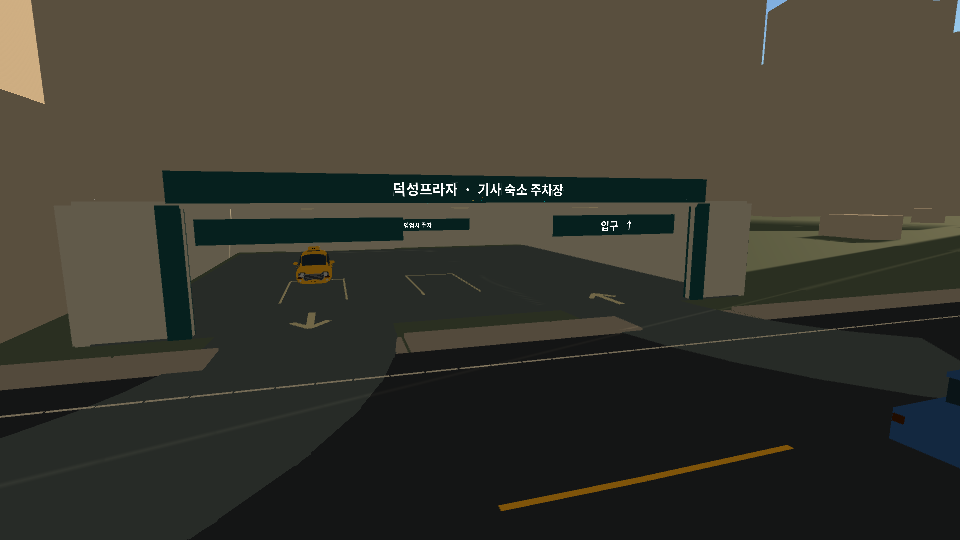
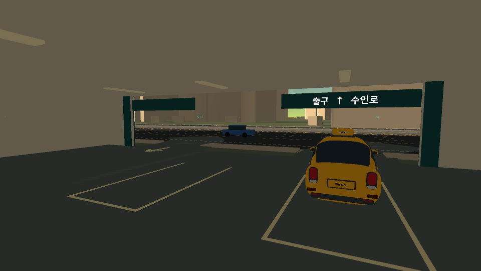
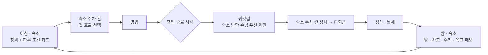

# 34 기사 숙소 거점

**은계 r50 배포 기준.** 덕성프라자에서 출퇴근하고 월세를 정산한다. 3일 도입 뒤에도 같은 방·차고·차량으로 계속 영업할 수 있다. 같은 건물 안에서 넓은 호실로 옮기는 것은 후속 기획이다. [숙소 구현](../work-history/2026-11-19-home-base-p1.md) · [r50 출차와 정산](../work-history/2026-11-20-plaza-feed-facility-input.md) · [연속 경력](28-continuous-career-mode.md)

첫날 출차 준비가 끝나면 빈차등이 자동으로 켜진다. M 지도에서 첫 번째 호출을 수락한다. 첫 수락 전에는 숙소에서 도로로 가장 가까운 이용 가능 승차지를 첫 번째로 보여 주고 여유 기한을 적용한다. [첫 운송 검증](../work-history/2026-11-19-first-fare-and-settlement.md).

## 1. 목표

> 하루는 **숙소에서 시작해 숙소로 돌아온다.** 방·차고·수첩·목표가 한곳에 모인다.

## 2. 위치

기존 시안은 주변 도로의 위치 참고용이다. 차고와 진입로는 r47 건물 윤곽에 맞춘 게임용 설계다.

| 항목 | 값 |
|---|---|
| 위치 | 덕성프라자 건물 윤곽(`37612022:B0010000:7014`) 안쪽 1층 주차 칸. [은계 시설 위치](eungye-facility-locations.md) |
| 주변 | 수인로 인근 도로에서 건물 남쪽 차량 출입구로 연결 |
| 설정 | 실직 후 옮겨 온 **수인로 뒤 작은 월세 원룸**, 1층 전용 주차 칸 1개 |
| 선택 이유 | 숙소에 도착했을 때 도로에서 건물 안으로 들어오는 동작이 보이고, 하루를 마친 장소와 다음 날 출발지가 이어짐 |
| 거점 수 | **1곳 고정.** 다른 동네 이사 없음. 넓은 호실은 같은 건물 안 |

### 배포 후보 Player에서 본 차고

## 3. 은계 싱글에서 숙소를 이용하는 법

| 상황 | 배포 동작 |
|---|---|
| 첫 출차 | 준비에서 숙소 벽 메모 선택 → 준비로 돌아와 영업 시작 → 인트로 → 덕성프라자 실내 주차 칸. M에서 첫 호출을 고르고 직접 출차한다. |
| 귀가 | F7 생활거점의 첫 항목에서 숙소 안내를 받는다. 빈차로 주차 칸에 정차한 뒤 F를 누르면 휴식·퇴근·정산한다. 동부 휴식 구역은 영업 도중 쉴 수 있는 곳이다. |
| 방과 차고 | 정산 후 방에서 조명·러그를 꾸미고 차고에서 차종을 비교한다. 3일차 뒤 같은 슬롯으로 계속 영업할 수 있다. |
| 생계 비용 | 정산 때 주차비와 월세 일할분을 확인한다. 다음 날 준비에서도 비용을 볼 수 있다. |

## 4. 하루 동선

목표를 고를 때 방 벽의 메모 세 장과 오른쪽 목록 모두 같은 선택을 저장한다. 벽에서는 메모 한 장 전체가 터치 영역이다. 운행 알림은 1인칭과 외부 시점 모두 왼쪽에 표시한다. 1인칭에서는 왼쪽 사이드미러 위까지 사용한다.

은계 싱글의 첫 출차와 다음 날 출차 위치는 M 지도에 **덕성프라자 숙소**로 표시되는 실내 주차 칸이다. 퇴근할 때도 같은 칸에 정차하고 F를 누른다. 주유소·기사식당·공업사·동부 휴식 구역에서는 지정 칸에 정차하고 F로 해당 시설을 연다.

운전 중에는 왼쪽 **운행 알림**에 새 메시지가 아래로 들어오고 앞선 메시지는 위로 올라간다. 운전 TIP은 운행 시간 20초마다 들어온다. 연료가 15%, 10%, 5% 이하 구간에 처음 진입하면 현재 잔량과 **주유소 안내** 버튼을 12초간 표시한다. 승객을 태우기 전이나 하차 후에 버튼을 누르면 도로로 연결된 주유소까지 안내한다.

| 상황 | 처리 |
|---|---|
| 종료 시각에 멀리 있음 | 초과 영업으로 귀가. "귀갓길 손님"(목적지가 숙소 방향) 우선 제안, 할증 없음 |
| 졸음 강제 종료 | 현재처럼 숙소 주차 칸으로 이동(`BusinessProgress` 졸음 종료 처리 재사용) |
| 사고·견인 | 현재 정비 처리 유지 후 숙소 |
| PvP | 영향 없음(PvP는 기존 시설 규칙) |

## 5. 숙소 안

| 영역 | 내용 | 비고 |
|---|---|---|
| 방 | 조명·러그 구매와 배치 | `PersonalRoomHUD` |
| 벽 | 선택한 목표 메모 1장 | [28](28-continuous-career-mode.md), [33](33-backstory-presentation.md) |
| 책상 | 기사 수첩(아버지 탭 포함) | [30](30-passenger-stories-and-logbook.md) |
| 창밖 | 아침/밤, 하루 조건(비 등) 반영 | [29](29-daily-conditions.md), [31](31-day-night-and-radio.md) |
| 차고 탭 | 정산 후 미납 없이 차값 전액을 내고 새 택시 한 대를 산다. 아버지 차는 숙소에 보관하고 다음 날 운행할 차를 고른다. | [차종과 꾸미기](22-growth-direction-and-vehicle-purchase.md) · [아버지 차 보관](33-backstory-presentation.md) |

공업사의 부품 구매·장착은 현재 현장 기능이다. 차량 매매를 지도상의 판매점으로 옮기고 차고를 보관·출차 중심으로 쓰는 방안은 다음 기획에서 검토한다. [현재 공업사](36-neighbourhood-shops-and-taxi-parts.md) · [후속 기획](37-driver-life-and-business.md)

### 숙소 확장 제안 (같은 건물)

| 단계 | 조건 | 변화 |
|---|---|---|
| 원룸 | 현재 시작 공간 | 작은 창, 기본 가구, 조명·러그 구매 |
| 원룸 꾸밈 | 후속 제안, 소품 3개 이상 | 방 분위기 변화 |
| 위층 넓은 호실 | 후속 제안, 목표 "이 집을 내 집답게" 저축(15~20R) | 창밖 전망·소품 자리 확장, 월세 소폭 인상 |

## 6. 생계 비용 (월세)

| 항목 | 초안 | 원칙 |
|---|---|---|
| 원룸 월세 일할분 | 하루 순수익 R의 약 15% | 정산에 "숙소 월세" 한 줄. 연체·퇴거 없음 |
| 넓은 호실 | R의 약 22% | 이득(전망·소품 칸)과 함께 |
| 영업 안 한 날 | 없음(게임은 영업일만 진행) | |

원룸의 시험 기본값은 `home.rent.daily` 1,500원이다. 기획22의 임시 R 10,000원을 기준으로 계산했다. 남은 현금 범위에서만 내며 월세 미납은 없다. **생활 → 숙소**에서 월세와 `home.returnTrip.weight` 기본 3배를 편집할 수 있다. 사람 플레이의 수익 중앙값과 밸런스는 미검증이다.

## 7. 구현 근거

| 영역 | 작업 | 파일(현재) |
|---|---|---|
| 지도 | 프로젝트 지도의 숙소 건물 윤곽과 차고 칸을 사용하며 싱글 지도·생활거점에 덕성프라자 숙소로 표기 | `HomeGarage.cs`, `HomeBasePresentation.cs`, `ServiceStops.cs` |
| 거점 | `ParkingStop` 의미·이름, 퇴근 허용을 숙소로 한정 | `ServiceStops.cs`, `BusinessProgress.cs`(`AtEndDayHub` 호출부) |
| 귀갓길 | 종료 후 숙소 방향 호출 가중 | `PassengerJobs.cs` |
| 지도 UI | 집 아이콘·"숙소" 라벨·F7 첫 항목 | `FullMapOverlay.cs`, `MapDestinationUI.cs` |
| 3D | 원룸 건물 표지판 "기사 숙소" | `ProjectMapScene.cs` 시설 라벨 |
| 정산 | 월세 일할분과 남은 현금 | `CampaignAccount.cs`, `DayPreparationPresentation.cs` |
| 저장 | 기존 저장 이관(주차장=숙소) | 캠페인 저장 |

## 8. 검증

| 질문 | 통과 기준 |
|---|---|
| 정상 퇴근 위치 | 숙소 칸의 F는 퇴근·정산, 동부 휴식 구역의 F는 현장 시설을 연다. [r50 위치 제어 검사](../work-history/2026-11-20-plaza-feed-facility-input.md) |
| 귀가가 지루하지 않은가 | 종료 후 귀가 시간 중앙값 ≤ 3분(사람 플레이) |
| 기존 저장 | r14~ 저장 이관·이어하기 통과 |
| 지도 입력 | 작업 시점의 Strict와 경로 도달성을 따로 기록한다. [r47 숙소 검증](../work-history/2026-11-19-home-base-p1.md) · [r50 지도 경로 검증](../work-history/2026-11-20-gyesu-navigation-and-signals.md) |
