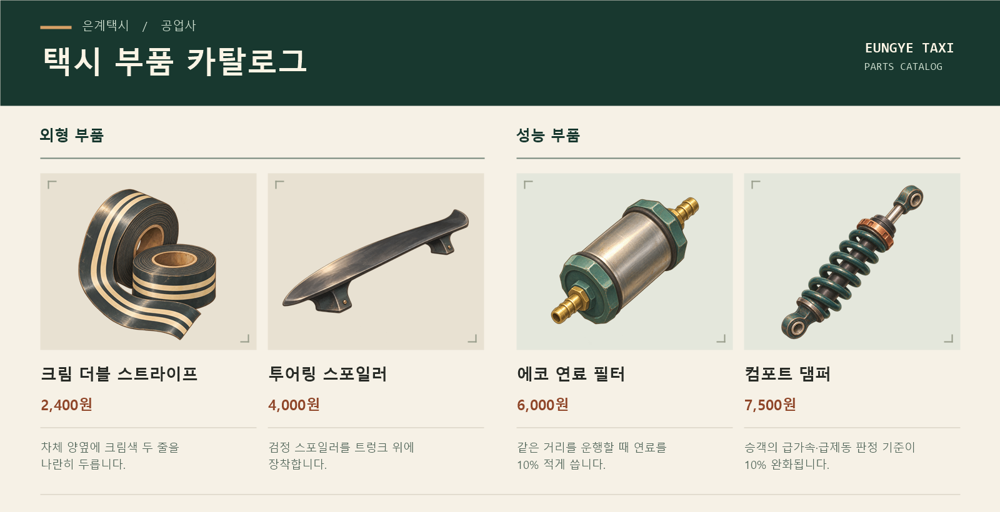

# 은계 생활시설과 택시 부품점

**플레이 목표**는 다음 운행을 준비하는 기사에게 두 가지 지출 시점을 주는 것이다. 허기와 피로는 길가에서 바로 관리하고, 반복 운행으로 번 돈은 공업사에서 오래 쓸 부품에 투자한다. 아래 지점과 가격은 은계 싱글 게임 안의 설정이다.

## 영업 중 짧게 들르는 두 곳

| 가게 | 정차 위치 | 메뉴 | 비용·소요 시간 | 즉시 효과 |
|---|---|---|---|---|
| 은계김밥 | EG-GAME-03 정차 포켓 | 야채김밥 한 줄 | 1,500원 · 20초 | 포만 +35 |
| 동네 카페 | EG-GAME-06 정차 포켓 | 아메리카노 한 잔 | 1,200원 · 15초 | 피로 −12 |

M 지도에서 **생활시설 비교 → 간식·커피**를 열고 원하는 가게로 길 안내를 받는다. 빈차로 지정 칸에 정차한 뒤 F로 주문한다. 승객이 기다리는 칸에서는 F가 승차를 우선하므로 F7로 가게를 연다. 주문 화면에서 가격·소요 시간·효과를 함께 확인한다.

## 공업사 부품 판매대

공업사까지 운전해 정차하고 부품을 고른다. 구매는 보유권을 얻는 거래이고, 장착은 어느 차량에 효과를 적용할지 정하는 행동이다. 각 상품을 한 번 사면 같은 경력에서 다시 사용할 수 있다. 여러 대를 운영할 때는 같은 부품을 한 대에만 장착한다.

| 부품 | 가격 | 장착 효과 | 디자인에서 읽혀야 하는 특징 |
|---|---:|---|---|
| 크림 더블 스트라이프 | 2,400원 | 차체의 평행한 두 줄로 내 택시를 구분한다. | 크림색 도색 두 줄과 그 사이 차체색 |
| 투어링 스포일러 | 4,000원 | 뒤쪽에 날개와 받침이 달려 후방 주행 화면에서 실루엣이 달라진다. | 낮은 날개, 양쪽 받침, 트렁크와의 간격 |
| 에코 연료 필터 | 6,000원 | 주행거리에 비례하는 연료 소모 ×0.90 | 필터 본체와 주름진 여과재 |
| 컴포트 댐퍼 | 7,500원 | 급가속·급감속에 대한 승객의 허용 범위 ×1.10 | 코일 스프링과 그 안의 댐퍼 |

필터를 장착하고 같은 차로 같은 거리를 달리면 거리 때문에 10단위 소모하던 연료가 9단위로 줄어든다. 댐퍼는 승객이 느끼는 급격한 속도 변화에 적용한다. 예컨대 기존 한계가 5인 항목은 5.5까지 허용한다. 법규 감점, 충돌 피해, 차량 최고속도는 이 계산에 포함되지 않는다. 두 외관 상품에는 성능 보너스를 붙이지 않아 외형 취향과 주행 성향을 따로 고를 수 있다.

## 저장과 검수 기준

- 잔액이 가격에 못 미치면 돈과 보유 상태를 유지한다. 이미 산 부품의 장착·해제로 구매 금액을 다시 청구하지 않는다.
- 다른 차량으로 바꾸고 저장을 다시 열었을 때 각 차량의 장착 상태를 복원한다. 부품 데이터가 없는 기존 경력은 빈 보관함으로 시작한다.
- 전후 비교는 같은 차종·거리·운전 입력을 사용한다. 외관은 장착·해제 때 실제 차량에서 확인한다. PvP 성능은 공통 차량 규칙을 따른다.
