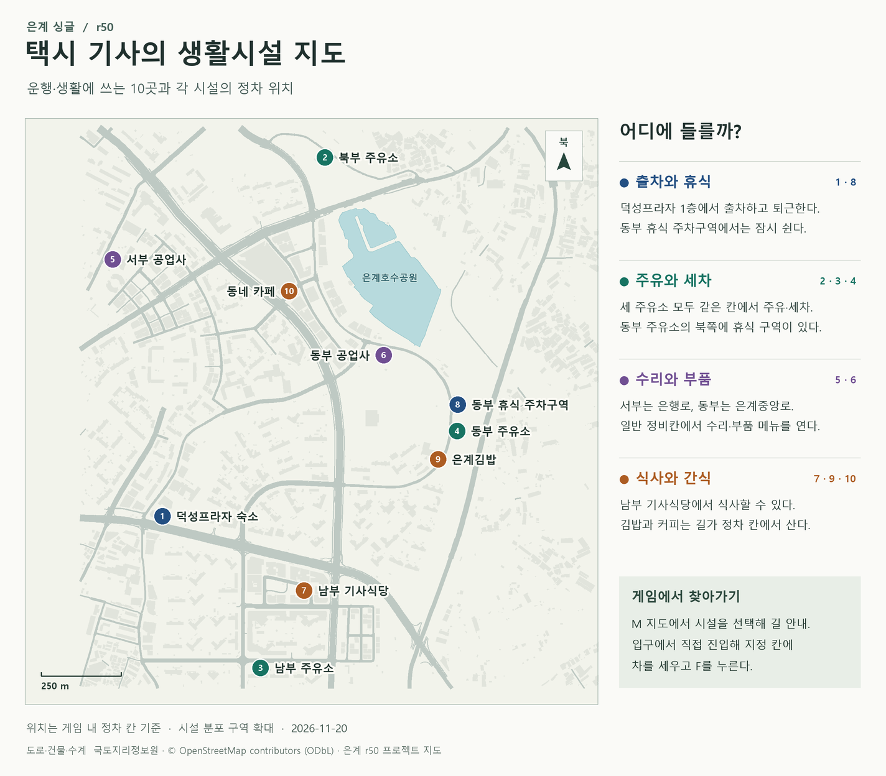
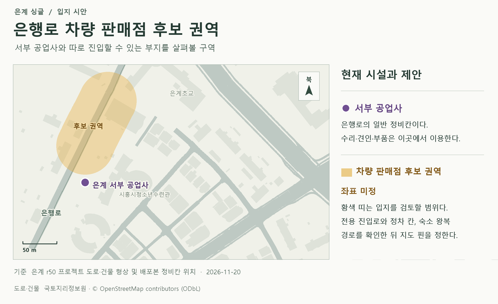

# 은계 싱글 생활시설 위치

2026-11-20 배포본인 은계 r50에서 새 싱글 경력으로 영업하면 **M 지도에 생활시설 10곳**이 표시된다. 서부·동부 공업사는 차량을 수리하고 부품을 사는 곳이다. 현재 차량 구매는 숙소의 차고 메뉴에서 처리하며 차량 판매점 핀은 없다.

## M 지도에서 찾아가기

빈차일 때 **M → 주요 시설**을 켜고 핀을 선택한 뒤 **시설 길안내 시작**을 누른다. 여러 곳을 비교하려면 지도 옆의 **생활시설 · 이동·대기·견적 비교**에서 주유·식사·수면·세차·수리·부품·간식·커피를 고른다. 내비가 입구로 안내하면 지정 칸에 직접 진입해 방향을 맞추고 정차한 뒤 **F**를 누른다. 승객을 태운 동안에는 시설을 조회할 수 있고 하차 후 길 안내를 시작한다.

| 그림 | 지도에 표시되는 시설 | 어디에서 찾나 | 정차 칸 (x, z) m | 여기서 하는 일 |
|---:|---|---|---:|---|
| 1 | 덕성프라자 숙소 | 남서쪽 수인로 인근, 덕성프라자 남측 출입구 안 1층 | (257, 538) | 첫날·다음 날 출차, 귀가·퇴근. 수면도 가능 |
| 2 | 은계북부 주유소 | 지도 북단, 호수 북쪽 은계중앙1길 | (764, 1657) | 주유·세차 |
| 3 | 은계남부 주유소 | 지도 남단, 한양수자인더클래스아파트 인근 은계남로 | (562, 65) | 주유·세차 |
| 4 | 은계동부 주유소 | 은계중앙로, 동부 휴식 주차구역 바로 남쪽 | (1176, 804) | 주유·세차 |
| 5 | 은계 서부 공업사 | 북서쪽 은행로, 시흥시청소년수련관 인근 | (101, 1339) | 일반 정비칸에서 수리·부품 구매와 장착. 견인칸·대기칸 별도 |
| 6 | 은계 동부 공업사 | 은계호수공원 남쪽의 은계중앙로 | (947, 1041) | 서부 공업사와 같은 서비스 |
| 7 | 은계 남부 식당 입구 | 남쪽 은계번영길, 시티파크 인근 | (699, 306) | 식당 앞 칸에 세우고 3종 식사 중 하나 선택 |
| 8 | 은계 동부 휴식 주차구역 | 은계중앙로, 동부 주유소에서 북쪽으로 지도상 약 83m | (1178, 887) | 운행 중 수면. 영업을 마치려면 숙소로 귀가 |
| 9 | 은계김밥 | 은계중앙로, 공립단설은계유치원 인근의 EG-GAME-03 포켓 | (1117, 715) | 야채김밥 한 줄, 1,500원·20초·포만 +35 |
| 10 | 동네 카페 | 호수 서쪽 우평라비엔 인근, EG-GAME-06 포켓 | (652, 1240) | 아메리카노, 1,200원·15초·피로 −12 |

좌표는 차량을 세우는 칸의 게임 평면 위치를 1m로 반올림한 값이다. 지도 위쪽으로 z, 오른쪽으로 x가 증가한다. 건물명은 게임 지도에서 주변을 알아보는 참고점이다. 승하차 지점과 호수공원 같은 지명은 별도로 표시될 수 있다.

**현장에서 헷갈리기 쉬운 곳.** 세차는 주유소 세 곳 모두에서 가능하다. 공업사 한 곳당 일반 정비 1칸·견인 전용 2칸·대기 1칸이 있다. 동부 휴식 구역과 덕성프라자는 역할이 다르다. 퇴근 판정은 덕성프라자 실내 지정 칸이다. 김밥과 커피는 수락한 호출이 없는 빈차로 해당 방향 포켓에서 주문한다. 길가 승객의 승차 입력과 겹치면 **F7**로 가게를 연다. [숙소 출입](34-home-base.md) · [식사·부품 메뉴와 가격](36-neighbourhood-shops-and-taxi-parts.md)

## 차량 판매점 입지 제안

첫 후보는 **5번 서부 공업사가 있는 은행로 주변**이다. 지도에서 차량을 비교해 본 뒤 별도 판매점으로 가서 계약하고, 보유차 선택과 출차는 숙소에서 한다. 은행로에 정비·차량 구매를 위해 한 번에 들를 이유가 생긴다. 판매점의 별도 진입로와 정차 칸이 공업사·견인 대기·승하차 포켓에 겹치지 않고, 차고에서 왕복할 수 있는지 검사한 뒤 핀 좌표를 정한다. 위 그림은 현재 배포 위치만 담았다. [첫 출차·판매·정비·장부·성장 통합 기획](37-driver-life-and-business.md)

## 위치 근거와 재확인

- 정식 r50 입력의 바이트 전체가 배포 실행 폴더의 `EungyeTaxi_Data/resources.assets`에 포함됨을 대조했다. 위치도는 이 입력의 활성 도로·건물·수계 형상과 정차 칸을 같은 축척으로 그렸다. [정식 프로젝트 지도](../../config/maps/project/eungye.project.json)
- 숙소는 건물 `37612022:B0010000:7014`의 실내 영업차 칸이다. 지도 원본의 예전 `service:parking` 위치를 숙소 핀으로 쓰면 건물 밖을 가리킨다. 북·남·동 주유소는 `north / south / east` 주유 칸, 식당은 `service:restaurant`, 휴식 구역은 `service:rest-east`의 서비스 지점이다. [M 지도 핀 구성](../../unity/EungyeTaxi/Assets/Scripts/MapDestinationUI.cs) · [숙소 주차 칸 계산](../../unity/EungyeTaxi/Assets/Scripts/HomeGarage.cs) · [주유 칸 계산](../../unity/EungyeTaxi/Assets/Scripts/FuelStationLayout.cs)
- 공업사는 실행할 때 도로 형상에서 정비칸을 생성한다. r50 배포 실행 로그에서 서부 `workshop:eungye:0` 은행로 120m 지점, 동부 `workshop:eungye:1` 은계중앙로 50m 지점의 정비칸 좌표를 읽었다. 김밥·카페는 지정 승하차 포켓의 오른쪽 정차 칸 중심을 썼다. [공업사 배치](../../unity/EungyeTaxi/Assets/Scripts/WorkshopLayout.cs) · [간식·커피 정차 규칙](../../unity/EungyeTaxi/Assets/Scripts/RefreshmentShops.cs) · [포켓 원본](../../config/maps/eungye-passenger-stops.json)
- 현재 배포본을 `-batchmode -nographics -facilityArtCheck -refreshmentCheck`로 실행해 임시 경력에서 간식·커피 안내, 현장 주문·결제와 저장 복원을 포함한 위치 제어 검사 36건을 통과했다. 로그의 완료 표시는 `REFRESHMENT_PLAYER_OK checks=36`이며 종료 코드는 0이다. 10곳을 모두 방문하는 수동 주행과 판매점 후보 진출입은 미검증이다.
