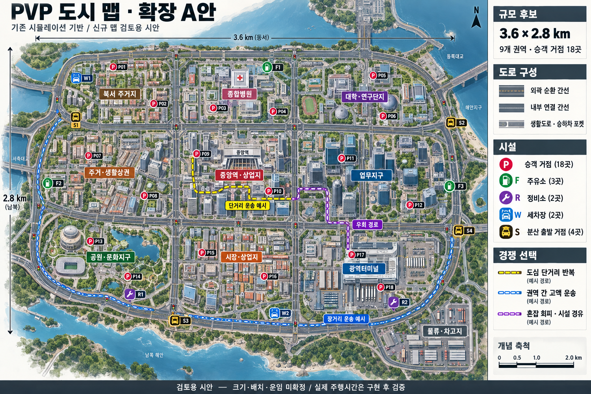

# 기존 시뮬레이션 기반 봇 경기와 확장 A

사용자 승인: 2026-10-30. 기존 시뮬레이션의 실제 화면/차량/승객/내구도 구현을 사용한다. 이전 독립 평면 모터 프로토타입을 제품 기준으로 확장하지 않는다.

## 지도

시안은 배치 방향이며 실제 게임의 그래픽 품질/건물 모양/해안 지형을 보장하는 스크린샷이 아니다. 첫 구현은 기존 WorldBuilder로 그리는 가상 도심이다.

| 항목 | 실제 구현 방향 |
|---|---|
| 크기 | 3,600 × 2,800m |
| 권역 | 서남 공원/남부 시장/동남 터미널/서부 주거/중앙역 상업/동부 업무/서북 주거/북부 병원/동북 대학 |
| 도로 | 외곽 연결과 내부 7×7 격자, 현 단계 왕복2차로, 방향별 연결/회전 차로 |
| 승객 | 18개 거점, 본선과 분리된 진입/정차/합류 포켓 |
| 시설 | 주유3, 정비2, 세차2, 출발/휴식 주차장4 |
| 기존 체계 | MapData/HdRoadGraph/WorldBuilder/TrafficSystem/DrivingLaw 사용 |
| 미포함 | 시안 배경 해안/교량의 재현, 다차로 간선 확장, 미술 완성도·장기 밸런스 확정 |

## 경기 요소

| 요소 | 적용 |
|---|---|
| 화면 | 기존 DriveHUD/CockpitUI/운전석/거울/지도 유지, 기존 상단 셀에 경기 시간과 상대 순수익 표시 |
| 조작 | TaxiController Rigidbody/WheelCollider, 기존 WASD/제동/조향 보조/깜빡이/승하차 키 유지 |
| 승객 | PassengerJobs/기존 유형·행동·만족도·운임, 동일 승차 거점 선점 중복 방지 |
| 내구도 | VehicleDamageController/원래 충돌 손상·유료 견인·수리 |
| 상대 | 같은 물리 택시로 운송하는 오프라인 봇. 원격 실제 유저 네트워크 전환은 후속 검증 |
| 결과 | 완료된 실제 운임에서 실제 시설 지출을 뺀 순수익 비교, 운전 평가는 기존 운임 계산에 반영. 종료 후 추가 정산 금지 |
| 시설 시간 | 원래 비용/상태 변화, 이용한 차량만 해당 시간 조작 잠금. 상대 경기 시간은 건너뛰지 않음 |
| 저장 | 경기 상태는 메모리 전용. 캠페인 저장/운전 기록/지도 편집/설정 덮어쓰기 차단 |
| 시간 | 시작 시30~7200초 입력. 제품 경기 시간을10분으로 확정하지 않음 |

## 실행

`builds/PvpPrototype/PvpPrototype.exe`에서 경기 시간을 입력하고 `은계 맵` 또는 `확장 A · 신규 도시`를 선택한 뒤 `봇과 경기 시작`을 누른다. F 승하차, M 전체지도, F7 시설, C 시점은 기존 시뮬레이션과 같다. Esc에서 일시정지/설정 복귀가 가능하다. 오프라인 메뉴 일시정지는 봇과 시간도 함께 멈춘다.

개발용 이전 시험장/IP 메뉴는 구 평면 모터 실험이다. 기존 차량 물리의 유저 간 대전이 검증되었다는 뜻이 아니다.

## 검증

실제 결과 및 제한은 [작업 이력](../../work-history/2026-10-30-pvp-simulation-integration.md)에 기록한다. 기존 모델 검사/Editor 연결 검사/실제 입력 주행/상태 fixture/실제 화면/사람 조작을 구분한다.

### 자동 검사 구분
- `pwsh -File tools/test_pvp_simulation.ps1 -PaidFixture`: 은계 원래 호출9→15/8→2를 지정하고 실제 주행·해당 운송 양수 운임·정산·충돌·다른 맵 재시작 확인.
- `pwsh -File tools/test_pvp_simulation.ps1 -Regression`: 혼잡 경로9→7/21→7의 실제 목적지 도착·원래 정산 확인. 시간 초과0원은 따로 표시하며 양수 운임 검사로 대체하지 않음.
- `pwsh -File tools/test_pvp_simulation.ps1 -Expanded`: 확장 A의 기본 호출 실제 양수 운임 검사.
- `pwsh -File tools/test_pvp_simulation.ps1 -Services`: 연료24 시작 fixture 뒤 실제 주유소 이동·자비 주유·차량별 대기·출차 검사.
- 옵션 없는 은계 기본 호출 검사는 혼잡·호출 조합에 따라 시간 초과0원으로 실패할 수 있다. 실제 실패 기록을 남기며 기본 호출 수익·봇 전략·장기 난도는 미완료 항목이다.

자동 운송은 원래 기본 위치에서 페달·조향 입력으로 수행한다. 일반 승객 선택/고정 호출/후속 충돌 벽/피로·시설 시간 검사 준비를 명시적으로 구분한다. 사람이 조작해 완주한 검사와 같지 않다.
