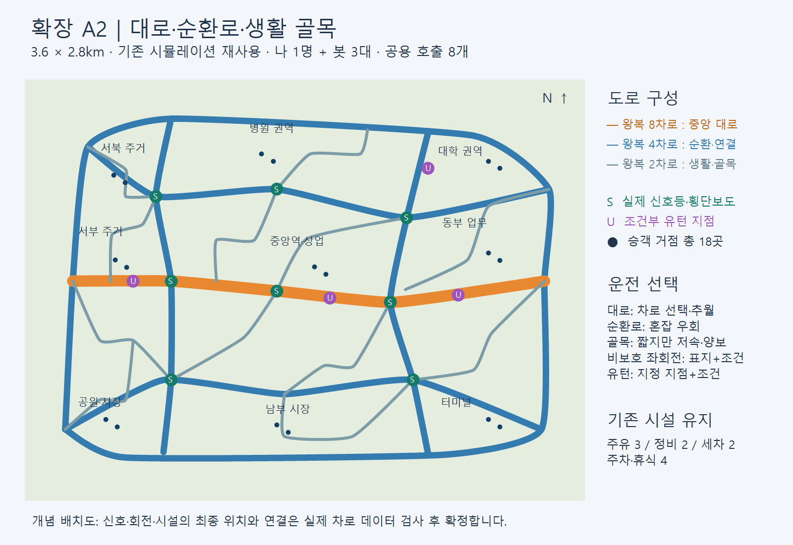

# A2 — 다차로·생활 골목·4인 봇 경쟁

사용자 요청(2026-10-30): 기존 시뮬레이션 재사용은 유지. 조작 안내 수정, 왕복4/8차로 포함, 실제 신호등, 비보호 좌회전/유턴, 블록 내부 골목과 단조롭지 않은 길, 봇 정지 문제, 호출6~8개. 추가 답변으로 나1+봇3 승인.

## 추천 시안
3.6×2.8km와9권역/18거점/주유3·정비2·세차2·주차4를 유지한다. 중앙 왕복8차로 대로, 왕복4차로 외곽 순환/권역 연결, 왕복2차로 생활도로와 블록 내부 T/ㄷ자 골목을 조합한다. 굽은 구간/엇갈린 교차로/부분 대각 연결로 사각형 순환을 줄인다. 간선은 추월·차로 선택, 골목은 짧은 이동과 저속/교차로 판단이라는 선택을 제공한다.

단순 격자 확폭은 단조로움이 남고 전체 엔진 교체는 기존 시뮬레이션 재사용 요구에 맞지 않으므로, 기존 MapData/HdRoadGraph를 확장하는 방식을 선택한다. 그림은 개념 배치이며 차로/회전 연결·신호·시설 여유 공간은 실제 생성 데이터와 검사 결과가 기준이다.

| 요소 | 구현/수용 기준 |
|---|---|
| 차로 | 실제2/4/8차로 geometry·방향 lane graph·차로 도색, 차로간 이동 연결. 그림만 넓히지 않음 |
| 도로 형태 | 비정형 연결과 블록 내부 통행 가능한 골목. 단순 사각7×7 반복을 벗어남 |
| 신호 | 실제 보이는 신호등과 stopline/crosswalk, 표시와 법규/봇의 동일 신호 상태 |
| 좌회전/유턴 | 가상 PVP 지도에 명시적 비보호 접근·유턴 지점/표지/조건. 은계의 실증 표지 정책 변경 없음 |
| 4인 | 인간1+물리 택시 봇3, 실제 출발·승차·목적지·정산, 개별 상태/시설 비용/점수/승패 |
| 호출 | 공용8개, 다른 사람이 수락하면 제외/보충, 중복 승객 선점 금지, 짧은/긴 운송 선택 |
| 안내 | 실제 입력 코드 기준 키별 목적, 봇 상태·위치 확인 가능. 개발 설명은 별도 개발 메뉴 |
| 보존 | 캠페인 기본3호출·저장·입력·실행 폴더, 다른 체크아웃 작업 유지 |
| 검증 | 모델/Editor/실제 물리4차량/주유/재시작/실제화면 구분. 사람·다른 PC·원격 유저 네트워크 미검증 별도 |

## 구현 상세와 검증 구분

| 항목 | 현재 구현 | 확인 방법 / 남은 수용 |
|---|---|---|
| 도로 | 중앙 왕복8차로, 왕복4차로 순환·연결, 왕복2차로 생활도로·9개 내부 골목 | 실제 차로/회전/변경 그래프2,446개. 단일 그림 도색이 아님 |
| 차로 선택 | 변경 연결384개. 8차로 한 구간 내 바깥4→3→2→안쪽1 이동 | 다음 교차로 이전 연결24검사 통과. 실제 사람 추월 체감은 별도 |
| 교차로 | 신호 교차로19곳, 비보호2곳, 조건부 유턴4경로 | 같은 native 신호 상태·표지·정지선·법규 사용. 은계 실증 정책 유지 |
| 지형 | 곡선·엇갈린 교차로·T/ㄷ자 생활 골목,18승하차 거점 | 306방향 거점쌍 연결 검사. 해안/교량 미술 완성은 아님 |
| 경쟁 | 나1+봇3, 각자 실제 차량·승객·운전점수·내구도·비용·정산 | 화면에4인 점수/상태/속도, 미니맵·전체지도에봇1~3 |
| 호출 | 하나의8칸 목록을4대가 공유, 수락한 호출 제외/보충 | 동일 승객 중복 선점 방지, 수락 직전 갱신된 호출 재선택 안내 |
| 지도 | PVP M지도는 실시간. 내 차만 제동하고 운영시간·피로 반영 | 캠페인 지도 정지 유지, Esc 일시정지와 경기 종료 보존 |
| 시설 | 주유3·정비2·세차2·주차4, 실제 접근·서비스·출차 | 출입은 기존 물리 조작. 위치 이동으로 시설 완료하지 않음 |
| NPC 합류 | 다차로 변경·승하차 출구138구역의 진입 순서/출구 확인 | 기존 충돌 감지 유지. 주차 중 통과·미진입 취소·진입 후 보호 Editor 회귀 통과; 장시간 혼잡 체감은 별도 |

실제 실행·배포 결과는 [작업 이력](../../work-history/2026-10-30-pvp-city-a2.md)을 따른다. 모델/Editor 연결 검사와 물리 주행, 화면 확인, 사람 조작, 다른 PC 검증을 서로 대체하지 않는다. 경기 시간은 직접 입력하며10분으로 확정하지 않는다. 원격4유저 연결은 이 오프라인 봇 구현의 완료 범위가 아니다.
