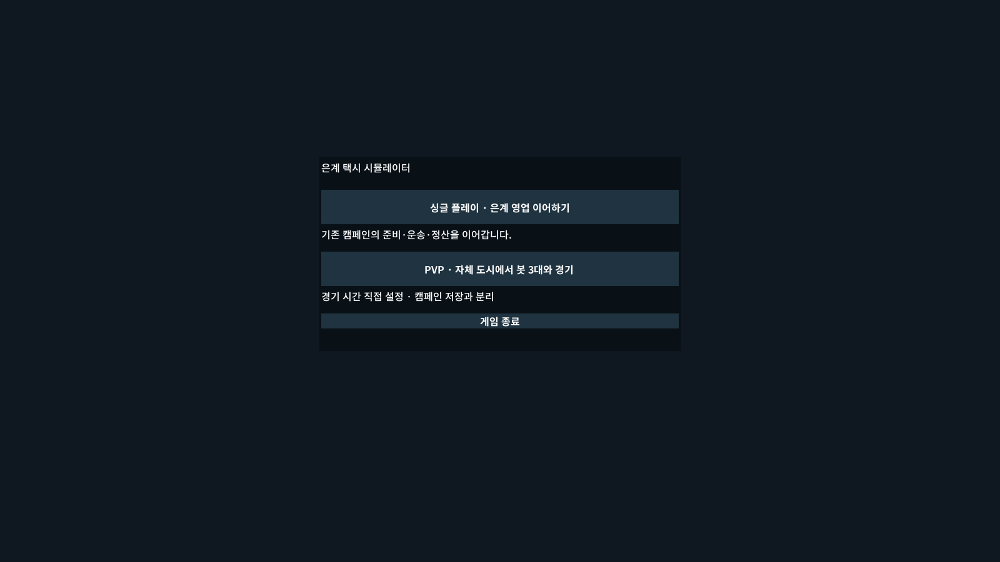
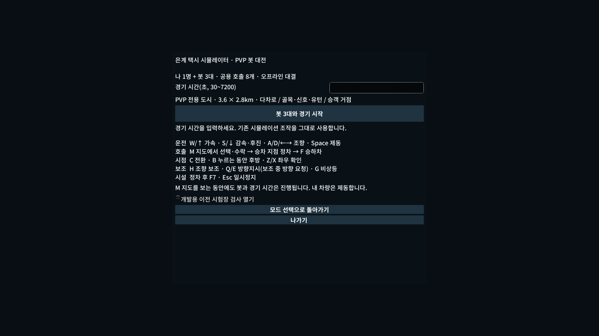
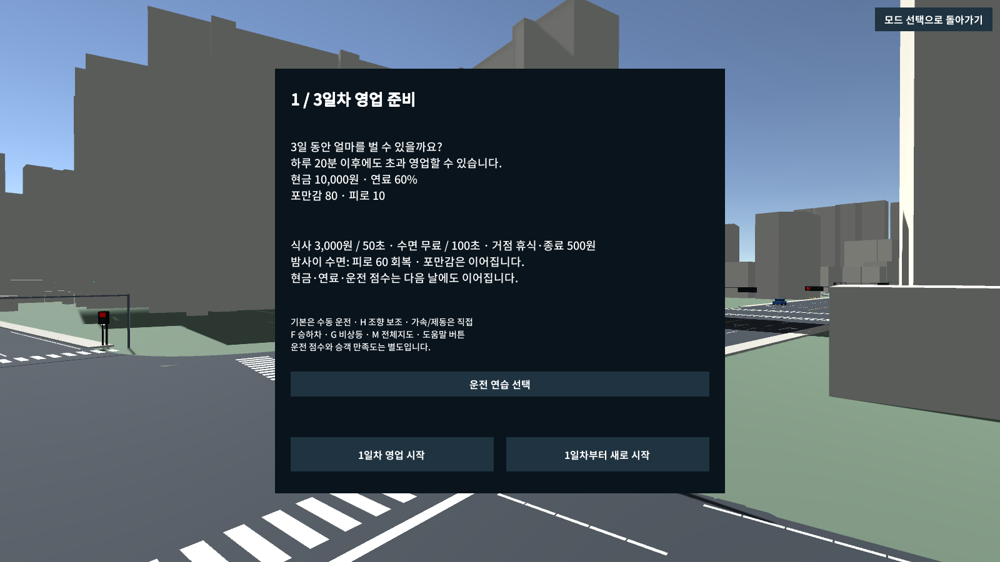
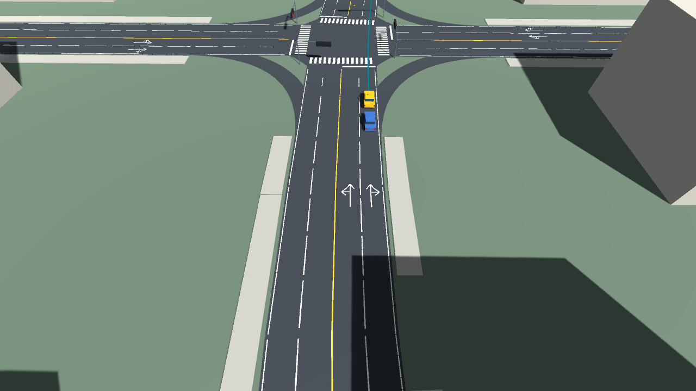
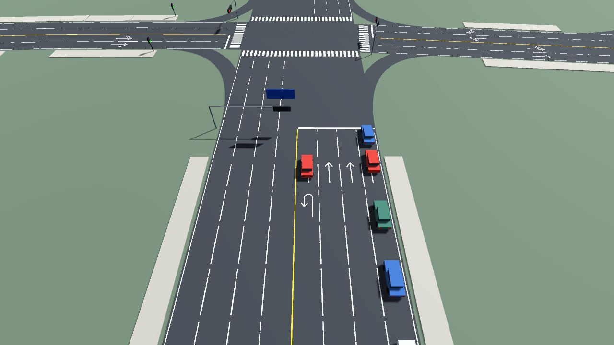
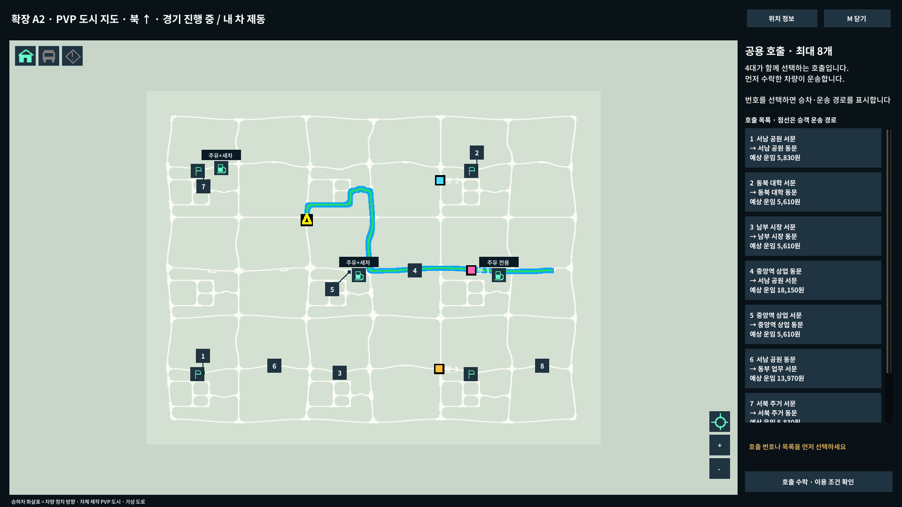

# PVP 교통 흐름·도로 안내·통합 실행 개선

## 사용자 확정 범위 (2026-10-30)
- 경로가 충돌하지 않는 차로는 동시 진행, 실제 겹치는 이동만 양보. 기존 충돌·교차로 안전 규칙 유지.
- A2 전역 유사 합류/진입 도로를 확인하고 봇/일반차의 반복 정지·진행을 검증.
- (1271.5697,1777.091), 북향358.478821도, city-junction:2:4의 끊김을 조사/측정. 비스듬한 빨간 NPC 사진은 원인 확정 없이 동일 유형 경로/자세 검사 대상으로 둔다.
- 실제 허용 연결과 일치하는 좌/우/직좌/직우/유턴 노면 화살표. 사용자 답변: 편도3개씩 왕복6차로 추가. 내부 골목 추가.
- 기존 은계 실행 파일 안에 싱글/PVP 선택. PVP는 자체 도시만. 기존 캠페인 저장·설정 보존, 다른 체크아웃 미변경.
- 피로/포만감은20분 가정의 기획 개선안을 작성. 경기시간20분 확정 또는 캠페인 수치 변경은 아님.
- 사용자 지시: 단계별 검토/검사를 반복하지 않고 구현 후 마지막 필수 검사만 통합 수행.

## 구현 선택
| 영역 | 구현 방침 | 최종 수용 |
|---|---|---|
| 합류 | 주행 경로의 차량 폭을 포함한 겹침으로 경쟁 이동을 구분. 병렬 차로의 동시 진행과 실제 충돌 양보를 함께 유지 | 전체 생성 합류 연결 검사·대표 실제 NPC/봇 물리 주행·정지시간/진행 지표 |
| 성능/자세 | 반복 경로 관측·물리 검색·불필요 할당을 조사, 지정 지점에서 측정 | 같은 조건의 프레임 지표와 차량 경로 이탈/회전 방향 확인 |
| 도로 | 기존2/4/8에6차로 연결축, 골목 분기 추가. native graph와 노면 표시의 단일 근거 | 차로/회전 연결·표시 일치·거점/시설 접근 |
| 실행 | 기존 EungyeTaxi.exe를 통합 진입점으로, 모드별 세션/저장 정책 분리 | 싱글 준비·기존 저장·PVP4대·메뉴 왕복/재시작·배포 해시 |
| 생활 기획 | 짧은 경기에서 선택 가치가 있는 식사/휴식 비용·효과를 후보 표로 제안 | 기존 실제 소모량과20분 사례에 근거, 확정/후보 구분 |

## PVP 피로·포만감 기획의 관리 위치

피로·포만감 개선안은 기존 [03 생활·차량 상태·경제의 PVP 모드 전용 항목](../03-life-and-economy.md#pvp-driver-condition)으로 옮겼다. 캠페인 현행 규칙과 구분한 해당 항목을 단일 기준으로 관리한다. PVP 컨디션 개선 수치는 이 기록 당시 제안/미적용이었으며 현재는 [실제 적용 이력](../../work-history/2026-11-02-pvp-condition-implementation.md)을 따른다. 2026-11-02 후속 수정으로 운임 감액·승차 준비 지연 후보를 제외하고 기존 졸음/공복 피로 가속 기반으로 변경했다.

## 실제 작성 지도와 교통 범위
최종 Editor에서201도로/2874차로 링크/420차로변경/4유턴,6차로9구간,606개 노면 방향 표시를 확인했다.18승객 거점의306개 방향쌍 및 기존 주유3·세차2·수리2·출발주차4 접근을 유지한다. 추가 골목45도로/27접점은9구역 내부의 두 번째 연결 고리다. 새 길의 통행 여유를 확보하면서 가로변 건물이 줄었으며 각 구역은60~87개다. 실제 실행/성능 수치는 [이번 이력](../../work-history/2026-10-30-pvp-flow-unified.md)에 구분해 기록한다.

빨간 차는 `TrafficCar.Initialize`의 일반 NPC 색상4종 중 하나다. 특별 이벤트/방해 차량을 나타내는 색이 아니다. 사진 속 특정 차량의 당시 이동 목적은 식별할 수 없으며, 짧은 연결부의 과도한 S자 형상과 경로 이탈은 별도 검사한다.

## 통합 실행 화면
최종 소스61c9e98 / BuildHybrid2 / 실제 Player mode3의1600×900 캡처다. 프로그램의 진단 경로로 전환했고 PC 입력을 조작하지 않았다.

## 실제 방향 표시와 확장 골목
아래는 소스61c9e98의 실제 Player 렌더다. 상세 표시는 성능 측정 후 카메라를 이동해 확인했다. 도로 법규/허용 방향은 같은 native graph에서 생성한다.

최종 자동 물리 주행·저장 보존·성능 및 사람/다른PC의 남은 수용은 [11월2일 이력](../../work-history/2026-11-02-pvp-flow-release.md)을 따른다. 현재 단일 실행 메뉴에서 싱글/PVP를 선택한다.

## 2026-11-02 좌·우회전 후속
같은 구조 교차로의 좌회전/우회전 경로와 봇 정지를 전역 검토했다.656회전의 최소반경14.96m는 차량최소2.89m보다 충분하며, 맞은편 좌우회전210조합 중 다차로분리72쌍은 차체공간이 겹치지 않는다. 편도1차로출구138쌍은 실제 공유이므로 양보한다. 따라서 생성 경로를 임의 재배정하지 않았다.

| 요소 | 확인/수정 | 실제 검사 범위 |
|---|---|---|
| 봇 회전 | 실제 경로 밖 차량에도 멈추던 정면35m 오탐을 경로별 실제차체 검사로 수정 | 실제A2 좌/우fixture의 구센서2.949m→clear, 실제 장애물은거리1로 검출 |
| NPC 양보 | 가상 공통곡선 대신 선택된 경로가 분리된 회전 구분 | offset경로 native진행·겹침0, 실제점유/진출차단 유지 |
| 시설/끝점 | 별도 시설 조작·완료/취소 후 연석 경로를 신뢰하지 않고 정면 보호 유지 | 좌/우취소연석/짧은끝점 보호 회귀 |
| 피로 | PVP 증가1.25배·15초 식사·45초 휴식 실제 적용 | 모델·실시간 서비스 검사, 장기 밸런스 별도. 단일기준은 [생활기획](../03-life-and-economy.md#pvp-driver-condition) |

[최종 실제 검사·배포](../../work-history/2026-11-02-pvp-junction-followup.md). 특정 사용자 사진은 전달되지 않았으므로 해당 순간을 재현한 것으로 기록하지 않는다.

## P1~P2 운영·승객 확장

시간대/경기 상대 구간의 수요·교통 방향, 차분/보통/성급 일반차, 실제 상황 반응과 용무 대기, 시설 공유 진입 대기/취소·대안 비교, 도착 상태 예측을 통합한다. 수락된 호출과 선점 규칙은 유지하며, 봇은 실제 시설로 이동해 플레이어와 같은 비용·시간·완료/중단 정책을 적용한다. PVP 피로1.25배·식사1,000원/15초·휴식무료/45초의 이미 승인된 프로필을 캠페인 규칙으로 덮어쓰지 않는다. 시설 대기 중에는 결제/회복을 주지 않고, 한 방문에 계획한 작업 하나를 수행한 뒤 남은 긴급 필요를 다시 판단한다.

게임용 대체 승하차 한 쌍은 은계 캠페인 작성 대상이며 PVP 공유 호출의 원래 장소/선점을 임의 변경하지 않는다. 음악·에어컨·창문 실제 조작은 계속 보류한다. 상세 조건은 콘텐츠01/02/03/05와 [이번 통합 기록](../../work-history/2026-11-02-simulation-p1-p2.md)을 따른다.
