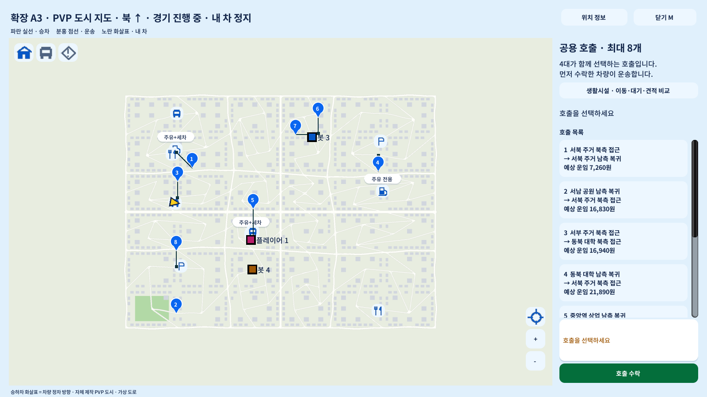
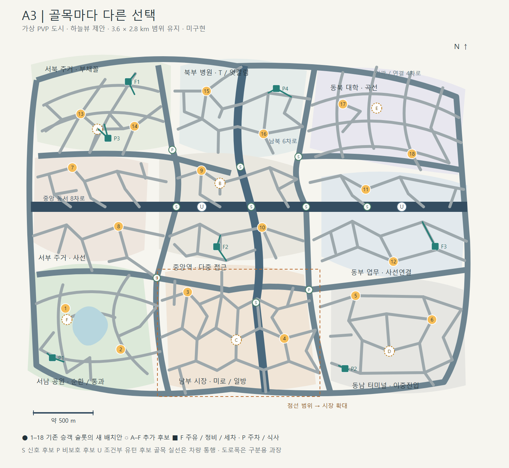
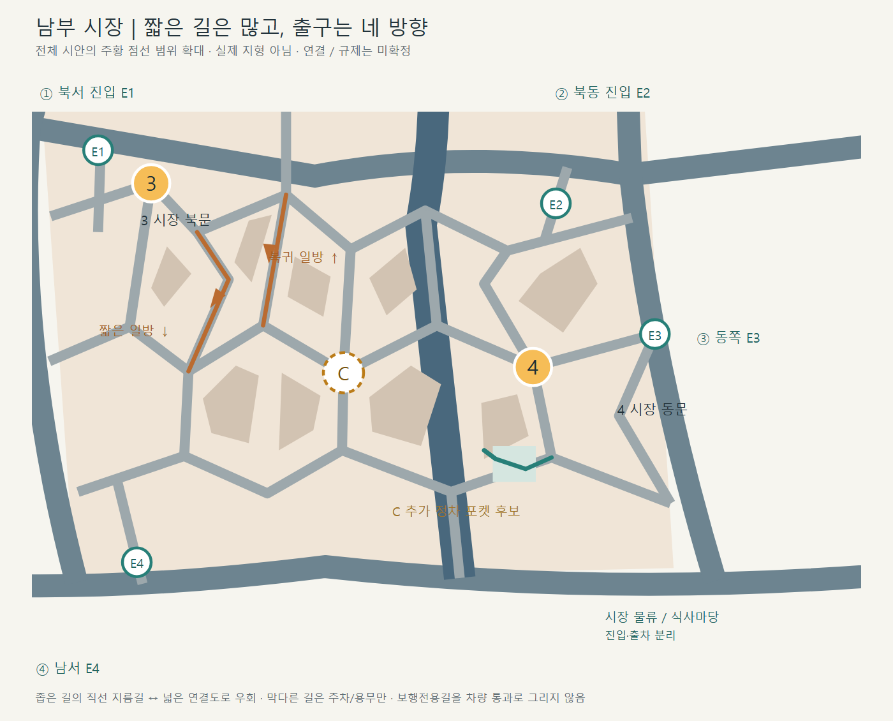

# A3 — 비정형 골목 도시 (2026-11-03 적용 승인)
2026-11-03 사용자의 ‘개선 맵 적용’ 지시로 기존 MapData/HD 차로 그래프에 구현한다. 실제 생성 지도는3.6×2.8km와8·6·4·2차로를 유지하고,236개 도로/672개 방향 표시·시장8개 짧은 일방 구간을 제공한다. 중앙역4개 부분, 시장/병원/서부/동부2개 부분은 각기 다른 T자·개방형·사선·부채꼴 연결을 사용하며 같은 내부 루프를 반복하지 않는다. 기존18승하차 슬롯·8공용호출·시설 개수/규칙은 유지한다.

원안 그림을 픽셀 단위 복제한 지도가 아니다. 실제 회전 접선·충분한 도로 길이·합법 진출입에 맞춰 접점을 조정했다. 실제 구현/검사/배포와 미수용 항목은 [11월3일 이력](../../work-history/2026-11-03-pvp-a3-motion.md)을 따른다. 아래 ‘미승인/미구현’ 문구와 검증 계획은11월2일 제안 당시의 기록이다.

## 실제 게임 지도 (2026-11-03)

1600×900 LAN 참가자 실행본의 M 지도 캡처다. 도로는 실제 native 그래프/맵에서 그린 것이며 아래 시안 이미지와 구분한다.

## 2026-11-02 시안 원문 (보존)

2026-11-02 요청에 따른 **가상 PVP 도시의 하늘뷰 제안**이다. 실제 은계 지형·OSM·거리뷰를 복원한 지도가 아니다. 현재 실행본은 A2이며 이 문서는 게임 지도나 차로 그래프를 바꾸지 않는다. 수치와 배치는 구현 승인이 필요한 후보다.

## 현재 구조와 바꾸려는 점

`PvpCityMap.Create()`는 3.6×2.8km, 9개 생활권, 18승하차 거점과 주유3·정비2·세차2·주차4·식사2를 제공한다. `PvpCityRoadBuilder`는 7×7 기본 교차로와 각 생활권에 같은 형태의 두 번째 골목 고리를 만든다. 현행 201도로·6차로9구간·606개 방향 표시는 [27](27-flow-unified-mode.md), 승객/수요 규칙은 [28](28-passenger-parity.md)이 기준이다. A2에도 굽은 연결과 T자가 있지만, 전체 배치는 격자와 같은 내부 루프의 반복이 강하다.

A3는 중앙 동서8차로·남북6차로·외곽4차로라는 읽기 쉬운 대축을 유지하면서, 내부 도로의 방향·접점 수·출구 위치를 생활권마다 다르게 구성한다. 골목의 단순 증설보다 **다른 방식으로 우회하고 진입하는 구조**가 목적이다. 4차로 연결부는 경계를 따라 굽고 비스듬히 이어져 9개의 사각 구획으로 분리되지 않는다. 2차로 생활도로와 더 짧은 골목은 굵기로 구별하며, 도로폭은 실제 폭보다 과장했다.

## 비교한 방향과 제안

| 방향 | 장점 | 한계 / 판단 |
|---|---|---|
| A2 유지 + 동일 골목 추가 | 기존 그래프 변경이 적음 | 반복되는 모양과 비슷한 우회 선택이 남음 |
| 대축 유지 + 생활권별 별도 골목망 | 대로의 방향 감각을 유지하면서 지역을 길 모양으로 기억함 | 교차로 접선·곡률·차로 연결을 새로 작성해야 함. **이번 시안의 제안** |
| 전면 자유형 도로로 교체 | 전체 실루엣이 크게 달라짐 | 대축까지 사라져 길 찾기와 기존 플레이 비교가 어려움 |

선택 확정이나 구현 승인을 받은 상태가 아니다. 사용자에게 전체도와 시장 확대를 먼저 보여주고 방향을 확인한다.

## 생활권별 골목의 차이

| 생활권 | 고유 구조 | 운전 선택 / 피할 문제 |
|---|---|---|
| 서북 주거 | 부채꼴 방사 골목 + 두 개 곡선 연결 | 사선 합류와 여러 출구. 모든 길을 한 중심점에 모으지 않음 |
| 북부 병원 | T자·엇갈린 접점·짧은 연결 | 병원 접근을 두 방향에서 선택. 응급/승하차 앞 관통 정체를 피함 |
| 동북 대학 | 지형을 두르는 곡선 + 사선 통과 | 외곽 우회와 안쪽 저속 길. 곡선의 실제 반경은 후속 검사 |
| 서부 주거 | 서로 비껴난 사선 줄기 + 짧은 T | 직진 반복을 줄이고 블록 사이 이동 가능. 짧은 막다른 길은 용무/주차용 |
| 중앙역 | 남북·동서 대축 + 비대칭 접근 고리 | 역 앞 혼잡 시 뒤편 진입. 대로에 직접 정차하지 않음 |
| 동부 업무 | 사선 지름길 + 엇갈린 평행 생활도로 | 빠른 통과와 신호가 적은 우회 비교. 5거리 다중 충돌 접점은 분리 |
| 서남 공원 | 호수 바깥 순환 + 통과형 연결 | 경치 순환과 직통 생활도로를 구분. 호수 안/보행길 통행 없음 |
| 남부 시장 | 짧은 비정형 미로 + 일방 쌍 + 4방향 출입 | 가까운 길의 저속·회전 비용과 넓은 우회 비교. 승객 대기는 포켓으로 분리 |
| 동남 터미널 | 다른 위치의 진입·출구 + 내부 순환 | 터미널 대기차를 통과차와 분리하고 다른 출구로 복귀 |

전체도 회색 실선은 차량 통행 후보다. 미술상 겹치는 선만 남기지 않고, 구현 때 같은 높이 교차는 실제 노드와 연결로 작성한다. 불필요한 끝점은 제거하거나 용무/회차 공간을 부여한다. 전체 도로 분할 수는 아직 세지 않았으며 현재 201도로보다 많다는 구현 주장을 하지 않는다.

## 승객과 시설 접근

숫자1–18은 기존 18개 슬롯을 유지한 **새 위치 제안**이다. 기존 서문/동문 좌표를 그대로 보존한 것이 아니다. 지역 수요 분류·공용8호출·길가최대3·선점/점유 규칙은 [28](28-passenger-parity.md)을 재사용한다. A–F는 추가 정차 후보이며 동시 승객 수를 늘리는 승인이 아니다.

| 슬롯 | 생활권 | 새 배치 |
|---|---|---|
| 1–2 | 서남 공원 | 북쪽 생활도로 / 남쪽 순환 진출부 |
| 3–4 | 남부 시장 | 북문 진입 / 동쪽 생활도로 |
| 5–6 | 동남 터미널 | 북쪽 접근 / 내부 순환 |
| 7–8 | 서부 주거 | 북쪽 사선 / 남쪽 생활도로 |
| 9–10 | 중앙역 | 북측 접근 / 남측 복귀 고리 |
| 11–12 | 동부 업무 | 북쪽 업무도로 / 남쪽 사선 |
| 13–14 | 서북 주거 | 부채꼴 안쪽 / 동쪽 연결 |
| 15–16 | 북부 병원 | 북서 접근 / 남동 접근 |
| 17–18 | 동북 대학 | 북서 곡선 / 남동 생활도로 |

A 주거 안쪽·B 역 뒤편·C 시장 중간·D 터미널 후면·E 대학 안쪽·F 공원 안쪽은 분산 후보다. 특히 C/F는 그림의 접점 중심이 아닌 **교차로를 벗어난 안전 포켓**으로 옮겨 실제 승객·정차차·통과차가 겹치지 않는지 확인해야 한다. 거점 표시는 개념 위치이며 실물 포켓 폭/길이를 뜻하지 않는다.

F1 북서·F2 중앙·F3 동부는 주유3을 유지한다. F1/F2에 기존 정비2·세차2를 함께 배치하고 진입/출차를 다른 접점으로 잇는다. P1 공원·P2 터미널·P3 서북·P4 병원은 주차4, 식사는 P2/P4에 배치하는 후보다. 현행 식사 주차장 위치를 확정 이전하지 않는다. 초록 접근선으로 도로와 시설마당을 분리했다. 시설 경로는 대로에 걸친 순간이동이나 보도 관통 없이 native 진입→서비스→출차로 작성해야 한다.

## 시장 확대와 규제

E1 북서·E2 북동·E3 동쪽·E4 남서 출입구를 다른 위치에 둔다. 시안 최종 열람에서 E4 남서 진입의 내부 도로 연결점이 약9그림단위 어긋나 있던 것을 실제 선분 위로 옮겼다. E2 북동 진입도 내부 줄기까지 연장하고, E1/E3의 외곽 접점을 맞춰 네 입구가 내부 골목망과 외곽 연결도로 모두에 시각적으로 이어지도록 수정했다. 이는 SVG 선 연결 확인이며 native 게임 그래프의 통과 검증은 아니다. 짧은 남향 일방과 바로 옆 북향 복귀길을 쌍으로 만들고, 다른 출입구까지 통과할 수 있게 한다. 시장마당도 진입·출차가 따로 있다. 일방 후보 구간은 약60–130m를 목표로 하지만 시안의 그림 치수로 확정하지 않는다. 역주행해야만 접근 가능한 승객이나 시설을 만들지 않는다.

S 원은 주요 대축 접점의 **신호 후보**, P 원은 북서 연결과 시장 동쪽의 **비보호 후보**, U 원은 동서대로의 **조건부 유턴 후보**다. U는 양방향 접근의 조건부 연결을 고려하는 위치표시이며 허용4경로를 검증했다는 뜻이 아니다. 작은 사선/T자에는 양보·정지와 제한속도 후보를 쓰고, 시야가 나쁜 시장 접점에 무조건 비보호 좌회전을 늘리지 않는다. 비보호·유턴은 접근 방향/차로·신호조건·표지·노면화살표를 하나의 데이터로 연결해야 한다. 가상 PVP의 창작 규칙이며 은계 실증 규제 정책은 변경하지 않는다.

## 승인 뒤 필요한 검증 (이번에는 수행하지 않음)

- 모든 동시 통행 가능한 교차를 명시적 노드로 만들고, 비스듬한 차로 오프셋·접선·회전반경을 검사한다. 기존 `Centre()`의 직교 전제와 85m 길이 제한에 임의의 짧은 골목을 바로 넣지 않는다.
- 18거점의306방향쌍, 후보 추가 시 전체 방향쌍, 시설 진입/출차와 4대 출발 위치에서의 경로를 검사한다. 일방쌍 진입·복귀와 모든 필수 시설의 접근을 포함한다.
- 위치 제어 검사와 별도로 실제 물리4대·일반차의 신호/양보/좌우회전/일방/유턴·승하차·시설 출차를 확인한다. 짧은 연결의 S자/회전 직후 정지 문제도 관찰한다.
- 최종 필수 검사를 한 번의 통합 수용으로 묶는다. 사람 주행·장시간 전도로 교통·수익 균형·다른PC는 각각 별도로 판정한다.

## 산출물과 이번 확인

`images/a3-proposal/a3-city-overview.svg`, `a3-market-detail.svg`가 편집 가능한 원본이며 같은 이름의 PNG는 headless Edge로 렌더했다. `draw_proposal.py`는 외부 패키지 없이 SVG를 재생성한다. 실행: `python docs/content-design/pvp/images/a3-proposal/draw_proposal.py`.

이번 확인은 SVG XML 파싱, 거점1–18 표기·추가후보A–F·시설 표기 확인, 실제 PNG 열람이다. 첫 시장 렌더에서 제목을 가리던 경계 밖 대로를 지도 영역 클립으로 수정하고 재렌더한다. 게임 실행·PC 화면/키보드/마우스 제어·Unity 코드·지도 JSON·배포 폴더/manifest·캠페인 저장은 건드리지 않는다. 게임 적용·성능·주행/경제 균형은 미검증이다.
