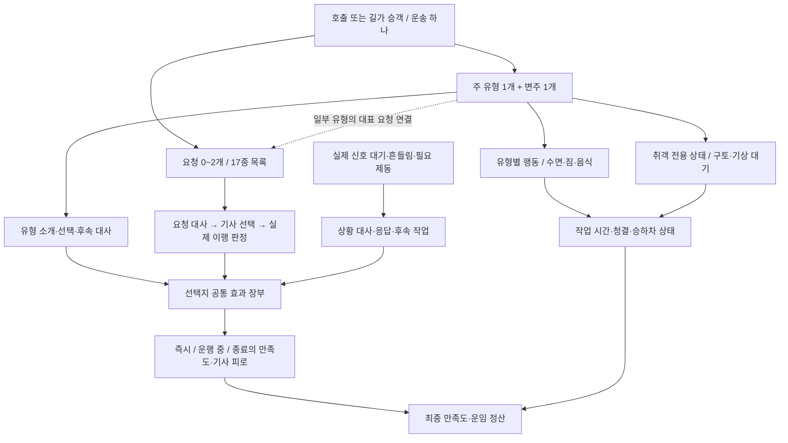
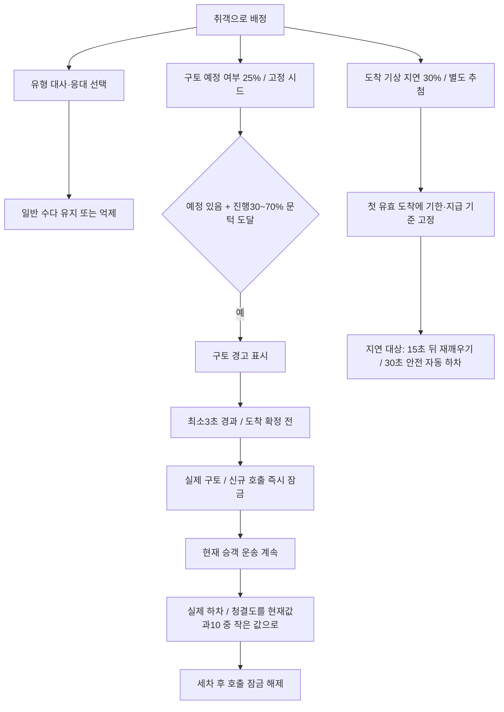
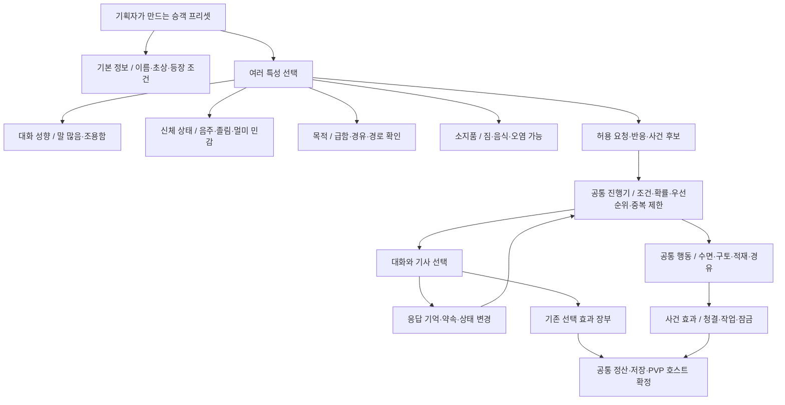

# 승객 구조 지도와 특성 조합 제안

2026-11-06 코드 기준 검토. **현재 구조 설명과 미구현 제안을 구분한다.** 게임 변경·밸런스 변경·관리 도구 구현 지시로 취급하지 않는다. 현재 수치의 담당은 [밸런스 v1](../passenger-balance-v1.md), 행동의 담당은 [승객 기획](../content-design/02-passengers-and-fares.md)이다. 저장 중 운송은 당시 설정을 유지하므로 아래 기본값과 다를 수 있다.

## 1. 핵심 판단

현재도 하나의 운송에 승객 유형·요청·상황·효과를 연결한다. 다만 승객 유형은 일반 또는 특수11종 중 **하나만** 가질 수 있고, 유형별 행동은 코드 분기에 묶여 있다. 따라서 ‘취객이면서 짐이 많고 말수가 적은 손님’을 데이터만으로 만들 수 없다.

사용자가 제안한 특성 조합 방향을 추천한다. 취객은 상위 분류가 아니라 **음주 상태를 포함한 승객 프리셋**으로 바꾸고, 대화·수면·구토·짐·요청을 재사용 가능한 구성요소로 분리한다. 기존 선택지 효과 장부는 재사용한다.

## 2. 현재 구조 도식

17종에는 하차 후 분실물 사건이 포함되며, 분실물은 운행 중 요청0~2건에 포함되지 않는다. 대표 요청은 기존 슬롯이 있고 후보 조건을 충족할 때 연결하며, 유형이 있다는 이유만으로 별도 요청을 무조건 추가하지 않는다.

## 3. 기획자가 구분해야 할 현재 데이터

| 구분 | 현재 의미 | 예시 | 확장 제약 |
|---|---|---|---|
| 주 유형 | 한 승객의 전용 행동 묶음 | 취객, 음식, 수면 | 한 개만 선택 가능 |
| 변주 | 같은 유형의 대사·일부 진행 차이 | 취객: 말 많은 밤/미안한 손님/조용한 귀가 | 특성을 자유 조합한 결과가 아님 |
| 요청 | 기사에게 하는 구체적인 부탁 | 조용히, 부드럽게, 경유 | 정해진 요청 종류·판정기 재사용 |
| 대화 | 소개·질문·선택·반응·경고를 표시 | “속이 울렁거려요” | 문구 변경만으로 새 행동을 실행하지 않음 |
| 사건 | 실제 상태 전환 | 구토, 수면, 음식 흘림 | 유형별 코드에 연결 |
| 선택 효과 | 답변별 S·기사 피로 등 | 즉시 +3, 종료 성공 +6 | 71개 답변에 공통 단계 효과 지원 |
| 물리/운영 효과 | 사건·작업으로 발생 | 청결 감소, 적재10초, 호출 잠금 | 위 선택 효과와 별도 책임 |

일반 + 특수11종: 취객 / 잠자는 승객 / 승차감 민감 / 재촉·불만 / 경로 확인 / 용무·경유 / 짐 많음 / 흙 묻은 짐 / 음식·음료 / 정밀 하차 / 대화·반복 질문. 특수 변주는 총34개(수면4, 나머지 각3)다.

요청17종: 조용한 운행, ETA, 차멀미·부드러운 운전, 정시 도착, 큰길, 짧은 길, 안전 하차, 고민 공감, 경로 추천, 면접 응원, 음악, 요금 부족, 지역 대화, 목적지 변경, 경유, 분실물, 불법 요구 안전 거절.

요청 기본 배정은0/1/2건=20/60/20%. 경로형 요청은 상호 충돌을 막고, 조용한 운행과 일부 수다 요청도 함께 뽑지 않는다. 새 운행 중 요청은 진행25~65% 문턱과 실제 이동20초·안전 정차 기회를 이용하며 진행85% 이후/도착 확정 뒤에는 미제시 요청을 닫는다. 이미 표시한 대화에는 운행 중 답변할 수 있지만 실제 준비·재고정 작업은 안전 정차가 필요하다.

## 4. 취객은 지금 정확히 어떻게 동작하는가

- 일반 영업 배정 기본: 취객30% 판정, 하루 최대2명, 미등장3회 뒤 다음 배정 가능 순번 보완, 특수 승객 다음에는 일반 승객 휴식 구간. 따라서 전체 승객의 관측 비율이 항상30%인 것은 아니다. 현재 관리창에서 관련6항목을 조정할 수 있다.
- 구토25%와 기상 지연30%는 **취객으로 배정된 뒤의 조건부 기본 확률**이다. 계속 확률을 재추첨하지 않으며 저장·재개로 재추첨하지 않는다.
- 일반 취중 수다는12~20초 간격. 조용한 선택으로 줄여도 구토 경고 같은 중요 안내는 남는다.
- **“천천히 가겠습니다”를 선택한다고 현재 구토 확률이 감소하지 않는다.** 구토는 현재 급제동 누적/메스꺼움 수치 기반도 아니다. 경고 표시가 원인이 되어 구토하는 것이 아니라, 구토 사건의 진행 상태가 경고를 표시한다.
- 구토 직후는 오염 상태/호출 잠금, 급격한 청결 수치 반영은 실제 하차 때다. 별도 구토 사고비나 구토 자체 M감점은 없다.
- 수면 승객도 취객 기상 절차를 일부 재사용하지만 취객+수면 유형을 동시 배정하는 구조는 아니다. 승차감 민감형에 현재 구토 기능은 없다.
- 짧은 운송은 사건 전 도착할 수 있다. 대사를 모두 보여주려고 운송을 강제로 늘리지 않는다.

## 5. 선택 → 효과의 현재 예시

아래는 schema2 출하 기본값 예시이며 실제 저장 프로필이 우선한다. S는 승객 만족도, M은 운송의 주행 평가, 피로는 기사 피로다.

| 상황과 선택 | 즉시 | 운행/사건 | 종료 |
|---|---|---|---|
| 고민을 들어주기 | S+3, 피로+1 | 대화 응대 | 추가0 |
| 조용히 배려하기 | S+2, 피로0 | 응대 반응 | 추가0 |
| 부드러운 운전 수락 | 추가0 | 불필요한 급가감속 M 추가-1 | 실제 성공 S+6 / 실패-4 |
| 조용한 운행 수락 | 추가0 | 일반 후속 수다 억제 | S+3, 현재 약속 위반 실패 관찰 없음 |
| 음식 허용 | S+3 | 실제 섭취 청결-2, 흘림 기본25%·발생 시 추가-6 | 일반 청결/정산 규칙 별도 |
| 오염 짐 보호 | 추가0 | 안전 정차 준비10초 | 미보호 추가-5를 피함 |
| 취객 조용히 모시기 | 추가0 | 수다 억제, 구토·기상 추첨 유지 | 실제 사건이 있을 때 해당 처리 |
| 음악 요청 응대 | 추가0 | 실제 음악 조작 미구현 | 추가0 |

선택 효과는 즉시/운행 중/정상 운송 종료의3단계. S·피로 점수와 비율, 자연 피로 추가율, 급가감속 M 추가값 등을 지원한다. 현재 기본 운행 중 S·피로 점/분과 비율은0이다. 요청 종료 S 합계는 기본±10 상한이며 즉시 효과와 유형/상황 종료 효과까지 모두±10으로 묶는 것은 아니다. 취소에는 종료 보상을 주지 않는다. 미응답·명시적 보류·판정 불가는 구분한다.

## 6. 추천 구조 — 승객 프리셋과 재사용 특성

‘유형’을 완전히 삭제할 필요는 없다. 기획자 화면에서 ‘조용한 취객’, ‘퇴근 후 잠드는 손님’, ‘화분을 든 손님’처럼 알아보기 쉬운 프리셋 이름을 사용하되, 엔진은 이름을 보고 분기하지 않고 구성된 특성/행동을 읽는다.

**구분 원칙:** 특성은 비교적 지속적인 성향·조건, 상태는 운송 중 변하는 값, 사건은 상태 전환, 대화는 그 상황을 전달하는 표현, 효과는 실제 수치/목표 변화다. 예: ‘음주’ 특성 → ‘구토 예정’ 상태 → ‘구토 발생’ 사건 → 사과 대사 + 오염/호출 잠금 효과. 대사 문구를 바꿔도 효과는 바뀌지 않아야 한다.

| 프리셋 예시 — 모두 제안 | 특성 조합 | 연결하는 행동 |
|---|---|---|
| 조용한 취객 | 음주 + 조용함 + 졸림 가능 | 경고/구토 + 수면/기상, 일반 수다 최소화 |
| 수다스러운 취객 | 음주 + 말 많음 | 공감 대화 + 경고/구토 |
| 피곤한 직장인 | 졸림 가능 + 조용함 | 수면/기상, 음주 대사·구토 없음 |
| 멀미에 약한 관광객 | 멀미 민감 + 지역 관심 | 부드러운 운전 요청 + 지역 대화 |
| 화분을 든 손님 | 짐 + 오염 가능 | 적재/하역 + 보호 여부에 따른 오염 |

멀미 민감 승객에 구토를 붙이는 것은 향후 별도 기획 선택이다. 재사용 가능하게 만든다는 이유만으로 모든 멀미 승객에게 구토를 활성화하지 않는다.

## 7. 관리 도구에서 편집할 단위

| 편집 단위 | 기획자 입력 | 예시 |
|---|---|---|
| 승객 프리셋 | ID, 이름, 초상, 등장 조건/가중치, 특성 목록 | quiet_drunk + 음주/조용함 |
| 특성 정의 | 파라미터, 요구/배제 특성, 요청·사건 참조 | 음주: 구토율·수면율 |
| 요청 정의 | 발생 조건, 대사, 답변, 이행 판정기 | Comfort + 기존 승차감 판정 |
| 사건 정의 | 시작 조건, 추첨 시점, 진행 단계, 횟수/쿨다운 | 구토: 운송당1회, 경고 후 지연 |
| 대화 묶음 | 화자, 발화 조건, 문구, 선택 ID, 다음 단계 | 소개→응답→반응, 경고 별도 |
| 선택/사건 효과 | 대상, 적용 시점, 효과 연산, 수치, 중복 방지 키 | 즉시 S+3 / 하차 청결 상한10 |
| 조합 규칙 | 배타 그룹, 동시 요청 수, 우선순위, 합산 상한 | 경로 약속1개, 대화창1개 |

추천 편집 흐름: **프리셋 복제 → 특성 체크 → 대사 편집 → 요청/사건 연결 → 효과 확인 → 고정 시드 미리보기 → 검증 → 새 게임용 적용**. 프리셋 안에서 공유 특성을 편집할 때는 ‘전체 참조 승객 변경’과 ‘이 프리셋의 값만 변경’을 구분한다.

지금 도구는 기존 항목의 문구·수치 편집기다. 제안 도구는 ‘이미 구현된 행동을 조립하는 제작기’로 확장한다. 기존 구토/수면/적재를 조합한 새 승객은 데이터만으로 추가하고, ‘반려동물이 도망간다’처럼 새 행동은 개발자가 새 실행 기능을 추가해야 한다. 처음부터 임의 스크립트 제작기를 만드는 것은 권하지 않는다.

## 8. 반드시 함께 필요한 조합 규칙

1. **특성 개수와 사건 부담을 별도로 제한:** 초기는 주요 행동을 가진 특성1~2개 조합부터 검증하고 대화/소지품을 단계적으로 확대한다. 단순히 체크 개수를 늘리는 것이 목표가 아니다.
2. **대화 창 한 개:** 구토 경고·안전 안내를 일반 수다보다 우선하고 낮은 우선순위 대화는 대기/만료시킨다. 조용한 약속은 일반 수다만 억제한다.
3. **상충 요청 차단:** 큰길/짧은 길 등 경로 약속 배타 규칙과 잠든 상태의 질문 보류를 유지한다. 도착 전 미제시 요청은 벌점 없이 종료한다.
4. **효과 중복 방지:** 음주와 멀미가 동일 구토 행동을 참조해도 운송당 구토 사건1회. 승객·운송·사건·단계 ID로 정확히 한 번 기록한다. 음식/구토 등 서로 다른 오염 효과의 합산·상한 순서도 명시한다.
5. **확률의 의미 명시:** 매 프레임25%가 아니라 승객 생성 시1회25%처럼 추첨 시점을 표시한다. 여러 특성이 같은 확률을 바꿀 때 합산/최댓값/우선값 중 하나를 정한다. 초기에는 프리셋 최종값 하나를 권장한다.
6. **결정 상태 저장:** 특성 목록, 선택, 예정 사건, 추첨 결과, 남은 시간, 적용 효과, 설정 버전을 저장한다. LAN은 호스트가 확정하고 참가자는 표시하며 봇도 같은 규칙을 사용한다.
7. **기한·하차 계약 보존:** 첫 도착 기록·깨우기 대기·준비 작업·중도 취소·정상 종료를 구분한다. 기존 저장은 진행 도중 새 구조로 재추첨하지 않는다.

## 9. 대안과 도입 순서에 대한 의견

| 방안 | 장점 | 한계 | 판단 |
|---|---|---|---|
| 지금 유형을 계속 추가 | 단기 수정 작음 | 조합마다 유형/코드 증가 | 한두 유형 추가에는 가능, 장기 도구화에는 부적합 |
| 공통 행동 + 특성 조합 + 프리셋 | 기존 효과/판정 재사용, 기획자 조립 가능 | 조합 충돌·저장 이관 설계 필요 | **추천** |
| 임의 스크립트/전체 노드 편집기 | 표현 범위 큼 | 디버깅·검증·도구 개발 부담 큼 | 현 단계 과함 |

추천 순서: (1) 기존11유형을 동등한 프리셋으로 표현해 기존 결과 보존 → (2) 수면/구토/짐·오염 등 행동 모듈 분리 → (3) 제한된 특성 조합과 툴 추가 → (4) 실제 플레이로 대화 빈도·비용 검증. 초기 구조 전환에서는 구토율/청결/기한/보상 숫자를 함께 바꾸지 않는다.

별도 후속 기획으로 ‘메스꺼움 게이지 + 운전/선택에 따른 구토 위험 변화’를 검토할 수 있다. 이는 현재 구토를 모듈로 옮기는 작업과 다른 게임 규칙 변경이다. 먼저 같은 동작을 재사용하게 만든 다음 플레이 개입을 확장하는 편이 원인과 결과를 확인하기 쉽다.

## 10. 대조한 구현 근거

- `unity/EungyeTaxi/Assets/Scripts/PassengerBehavior.cs`: PassengerType 단일 enum, 상태의 Type/Variant, 유형별 선택·준비·후속·음식 행동.
- `unity/EungyeTaxi/Assets/Scripts/PassengerRequest.cs`: RequestKind17종, 답변·결과·정산.
- `unity/EungyeTaxi/Assets/Scripts/PassengerRequestSchedule.cs`: 요청 수·호환·대표 요청·발생/종료 문턱.
- `unity/EungyeTaxi/Assets/Scripts/VehicleCare.cs`: ReservePassenger/CommitPassenger 배정, DrunkRideState 추첨/경고/기상, MarkVomit/Finish 청결 반영.
- `unity/EungyeTaxi/Assets/Scripts/PassengerJobs.cs`: 운송·유형·취객·청결·하차의 실제 연결.
- `unity/EungyeTaxi/Assets/Scripts/PassengerSituations.cs`: 신호 대기/흔들림/필요 제동 반응, 짐 재고정·수면/음식 반응.
- `unity/EungyeTaxi/Assets/Scripts/ChoiceEffects.cs`, `ContentTuning.cs`: 단계 효과 및 알려진 설정 키 검증·프로필/저장 경계.
- `docs/content-design/02-passengers-and-fares.md`, `07-passenger-dialogue.md`, `docs/content-tuning-tool-guide.md`, `docs/passenger-balance-v1.md`, 범위/개발 체크리스트.

검증 범위는 소스·문서 대조다. 새 런타임 검사, 직접 플레이, 빌드, 특성 조합 구현은 수행하지 않았다. 문서의 과거 기본값(+5/-2 등)과 현행 schema2 밸런스가 다를 때는 현행 밸런스 및 저장 프로필을 우선한다.
