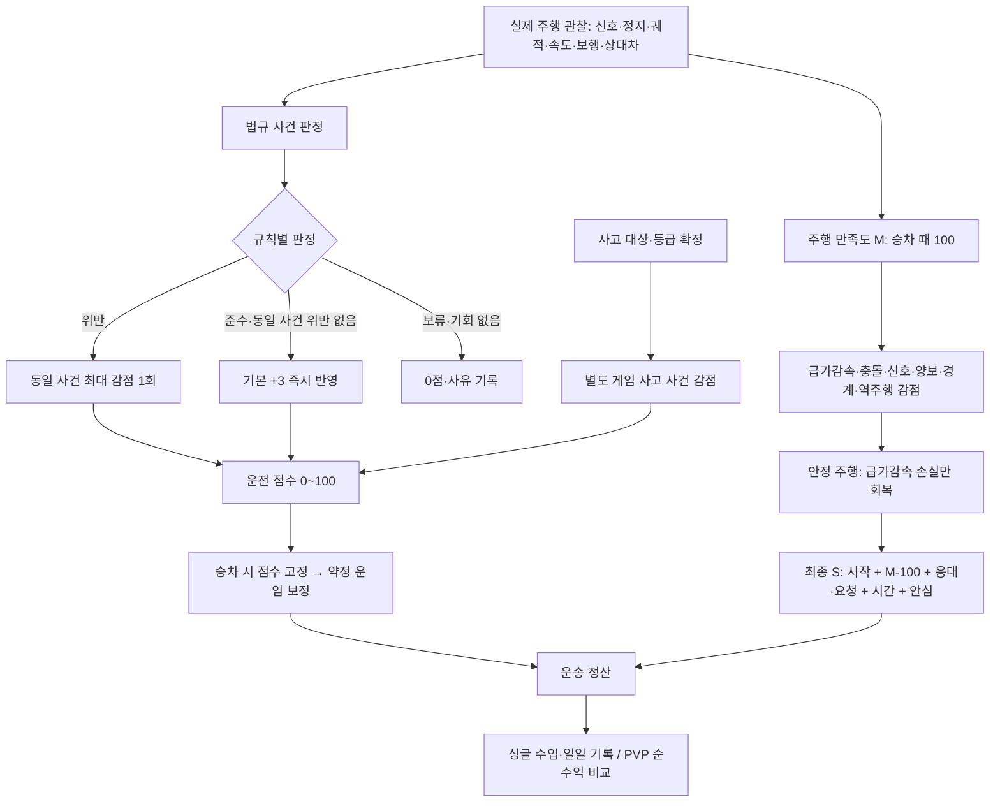

# 교통법규·운전 점수 구조와 웹 GPT 배점안 적용 검토

검토일: 2026-11-07. 대상: 현재 저장소 소스·출하 기본 프로필·기획 문서. **구현 상태 조사이며 첨부 배점안의 채택·게임 적용은 하지 않았다.** 법령의 현행성·실제 법정 처분 수치를 새로 감수한 작업도 아니다.

## 1. 결론

현재 게임은 관찰 가능한 일부 법규 사건을 운전 점수로, 승객이 느끼는 주행을 M으로 따로 평가한다. 첨부안의 전제인 분리·사건 중복 방지·필요한 제동 면제는 이미 있다. 하지만 **법적 무게에 따른 전면 재배점, 판단 난이도별 +1~4, 과속 단계화, 안전배려 B, 운송/일일 획득 상한·중대 위반 시 획득 취소는 미적용**이다. 같은 값이 있는 항목도 기존 구현과 일치할 뿐, 첨부안을 적용했다는 이력 증거는 아니다.

첨부 원문은 [검토 입력 보존본](2026-11-07-driving-score-web-gpt-source.txt)에 보존했다. 원문 자체도 ‘아직 게임 코드나 기존 문서에 적용하지 않았습니다’라고 명시한다. 현재 법규 카탈로그 F62+X6+TX8=76개는 관리 목록이며 76개 자동 판정 완료를 뜻하지 않는다.

## 2. 현재 실행 구조

- 운전 점수: 새 캠페인 100, 0~100. 날짜 변경/저장 복원 때 이어간다. 빈차도 관찰 대상이며 PVP는 별도 경기 상태다.
- 점수는 사건 순서대로 즉시 반영한다. 위반 규칙 여러 개의 **최대 감점**을 사용하며, 같은 ID 재지급을 막고 정지선 침범→큰 위반은 같은 사건을 갱신한다.
- 준수는 현재 공통 `law.recovery.points=3`. 준수 규칙 여러 개가 있어도 사건당 한 번이다. 구형 저장의 +1 정책은 보존한다. 같은 장소에 다른 ID의 새 사건이 생기는 것까지 막는 전역 반복 장소 제한이나 운송/일일 획득 예산은 없다.
- 같은 사건의 위반은 준수 획득을 막지만, **같은 운송의 다른 준수 사건까지 취소하지 않는다.**
- 운전 점수와 M은 별도 관찰 경로다. 따라서 운전 -20이 자동으로 M -20으로 복사되는 구조가 아니다. 법규 장부의 사건 최대 감점 정책을 M 전체나 별도 사고 사건까지 포괄하는 전역 중복 방지로 해석하지 않는다.
- 운전 점수는 승차 때 고정해 운임을 보정한다. 현재 0/70/100점의 배율은 90/100/110%. 주행 중 변경은 다음 승객부터다. PVP는 초기 독립 점수 합산안이 아니라 현재 공통 운임과 영업비를 통한 **순수익** 경쟁이다.

## 3. 실제 점수 요소: 현재와 첨부안

아래 현재 값은 `config/content/default-profile.json` 기준이다. 관리 도구의 사용자 설정·이어하기의 저장 설정·LAN 호스트 설정으로 달라질 수 있다. Resources 기본 프로필과 법규/M/안심 관련 30개 값이 일치함을 확인했다. 통합 실행 폴더의 `content/active-profile.json`은 없었다. 실행 중 프로세스나 개인 저장 설정은 이번에 읽지 않았다.

| 항목 | 현재 운전 점수 / M | 첨부안 운전 / 만족도 | 적용 판단 |
|---|---|---|---|
| 실제 준수 사건 | +3 / 자동 가산 없음 | 난이도 +1~4 / 0~+3 | 난이도별 보상 미적용 |
| 적색 직진·해당 좌회전 신호 위반 | -20 / -12 | -20 / -12 | 기존 값 일치. 녹색 통과 준수는 첨부의 ‘정지 후 출발’보다 넓은 조건 |
| 전방 적색 우회전 단순 정지 누락 | -5 / -4 | -20 / -6 | 미적용·큰 차이 |
| 우회전 전용 적색 | -20 / -12 | -20 / -12 | 기존 값 일치 |
| 횡단 중·의도 보행자 보호 | -25 / 양보 위반 -8 | 기본 -15 / -10, 위험 시 추가 | 부분 관찰만 구현. 기본/위험 분리 미적용 |
| 금지 대기열 끼어들기 | -15 / 전용 고정 M 없음 | -10 / -6 | 배점 다름. M은 실제 다른 주행 관찰로 별도 처리 |
| 정상 통행 방해 진로변경 | -15 / 상황별 별도 M | -15 / -10 | 운전 값 일치, 전역 합류·양보 보상 아님 |
| 적색 정지선 침범 후 교차로 진입 전 정차 | -1 / 0 | 침범만으로 자동 감점하지 않음 | 정책 다름. 현재는 신호·정차·위치를 확인해 독립 -1 |
| 방향 차로 역주행 | -10 / -10 | 일방/진입금지 -20 / -15, 중앙선 -30 / -18 | 법적 유형 분류·배점 미적용 |
| 게임 지정 제한속도 초과 | -5 / 전용 직접 감점 없음 | 초과량별 -5~-80 / -3~-45 | 과속 단계·M 연동 미적용 |
| 지정 장소 게임 우회전 서행 | -5 / 전용 직접 감점 없음 | 전국 공통 숫자로 일괄 판정하지 않는 조건별 규칙 | 게임 기준만 구현. 첨부안의 신규 법적 판정은 아님 |
| 적색 점멸 F02 | 해당 상황 코드 -15 / 전용 M 없음 | -20 / -8 | 제한된 장면 구현, 배점 다름 |
| 황색 점멸 F03 | 주의 판정 보류, 0 | 위험 진입 -15 / -8, 준수 +2 / +1 | 시선·교차 교통 위험 평가 미적용 |
| 비보호 좌회전 F05 | 해당 상황 코드 적색/양보 위반을 -15로 묶음. 일반 신호 경로는 -20, 회전 양보 M -8 경로 있음 | 적색 -20/-12, 양보 -15/-10으로 분리 | 상황·관찰 경로에 따라 차이. 보상 난이도 분리 없음 |
| 출구 막힘 F06 | 해당 상황 코드 -15 / 전용 M 없음 | -10 / -6 | 제한된 장면 구현, 배점 다름. 출구 여유 장면은 기회 없음 |
| 불필요한 급가속·급제동 | 운전 직접 변화 없음 / 기본 각 -2 | 별도 유지·필요 제동 중립 | 기존 기능. 승객 선택 효과가 추가값을 바꿀 수 있음 |
| 인도·도로 경계 지속 침범 | 전용 운전 감점 없음 / -5 | 보도 부정 주행 -15 / -15 등 | M 관찰만으로 F28 법적 유형 구현이라 볼 수 없음 |
| 차량·시설 사고 | 등급별 -3/-8/-15 / 충돌 M -10 경로 | 이 표와 별도 사고 처리 | 현재 별도 게임 사고 감점 포함 필요 |
| 보행자·대기 승객 사고 | 등급별 -10/-25/-40 / 충돌 M 관찰 별도 | 법규 의무와 결과 위험을 구분 | 실제 사고 등급표 구현. 법규 위험 가중과 다름 |

법규 -25와 사고 -40은 각각 별도 사건이 될 수 있다. 사고가 발생했다고 이미 관찰된 법규 위반을 지우는 구조도, 모든 관련 결과를 전역 최대 하나로 합치는 구조도 아니다. M 충돌 -10은 실제 속도·접촉 방향·억제 시간 조건이 있어 모든 접촉에 무조건 발생한다고 단정하지 않는다.

### 게임 관측 조건

- 속도: 편집 지도 제한속도에 +3km/h 여유를 두고 초과 2초 관찰. 연속 위반은 latch로 한 번 기록하지만 속도를 낮췄다 재초과하면 새 사건이 될 수 있다. 법정 허용 오차를 뜻하지 않는다.
- 역주행: 방향 차로 안에서 반대 방향 전진 2초·8m, 속도 2m/s 이상. 회전 연결/교차로/주차/후진/모호한 차로는 제외. 중앙선 침범·일방통행 표지 위반을 나눠 채점하지 않는다.
- 게임 우회전 서행: 은계 J7841_867/J8066_6364, 자체 PVP의 `city-junction:` 교차로. 안내 10km/h+여유2km/h 초과가 0.75초 지속되면 -5. 필요한 회피는 보류, 관찰 부족은 기회 없음. 법정 L08은 계속 보류하며 **별도 ‘게임 우회전 서행’ finding**을 추가한다.
- 기본 은계의 창작 PS05~07 비보호 상황은 제거돼 있다. `ConfusionPracticeState`의 F05 구현 존재를 현재 은계 영업 전역의 비보호 장면 활성화로 세지 않는다. 별도 연습 및 장면 설정과 일반 신호 경로를 구분한다.

## 4. 전체 규칙 목록의 적용 경계

| 첨부안 영역 | 현재 연결 | 아직 없는 것 |
|---|---|---|
| 신호·교차로 X01~03/F01~06/F15 | 방향별 신호·우회전·일부 유턴·적/황 점멸·출구 막힘·일부 비보호 관찰 | 황색 신규 진입 확정 평가, 전역 F05·F06, 일반 회전방법의 완전한 법적 분류 |
| 무신호 F07~10, 표지·진행방향 F13~14 | 지도 경로·회전 허용 데이터 일부 | 해당 의무/예외별 범용 사건 판정·점수. 경로 안내가 존재하는 것과 실제 위반 감시는 다름 |
| 차로·속도 F18~35/X04~05 | 게임 속도, 역주행, 제한된 대기열 변경/통행방해 | 초과속도 단계, 보호구역, 사전 감속/정속 보상, 중앙선/실선/지정·전용차로/안전거리/추월·일반 합류 평가 |
| 방향지시 F33 | 조작·실제 회전 후 자동 해제·AI/수요 제어 연결 | 미점등/반대 점등 -5, 올바른 사용 +1의 점수 판정 |
| 보행 F36~43/F46 | 우회전 보행 의도·횡단 보호, 필요한 제동 감지, 사고 결과 | 보호구역 무신호 정지, 생활도로 근접 통과, 시설 진입 보도 횡단, 특별 보호 상태, 긴급차 양보별 점수 |
| 주정차 F47~54/TX08 | 정차·승하차·대체 지점·시설 점유/대기·안전하차 요청 | 법정 거리·금지선·시간별 불법 정차, 문 열기/자전거 위험, 경사지 조치의 전용 법규 평가 |
| 기본 조작 F55~59 | 일부 조작·UI가 있어도 첨부 배점 적용 근거 없음 | 야간/등화/상향등/반복 경적/벨트/운전 중 장치 사용 전용 판정·보상 |
| 추가 시스템 F11~12/F16~17/F44~45/F27·35 특수도로 | 관리 카탈로그·후속 설계 | 회전교차로·철길·수신호·통학버스·고속도로 전용 관찰 시스템 |
| 서비스 TX01~07 | 호출 수락·요청 응대·운송·정산의 기존 콘텐츠 | 첨부 서비스 감점, 영업 평판·신고·처분, 고의 결제거부·부당요금 판정 |
| 상태/사고 후 F60~62/X06 | 피로·차량 내구도·사고/수리 게임 시스템 | 피로=법적 과로, 내구도=정비불량, 접촉=도주로 확정하는 법적 판정 |

F18~20의 속도·환경 구분은 게임 지정속도 한 종류만 관찰하는 현재 상태보다 넓다. F21 최저속도도 별도 미구현이다. 위 ‘현재 연결’은 관련 기반/제한 구현을 뜻하며 해당 행 전체 완료가 아니다.

## 5. 만족도 획득·악용 방지 비교

현재 최종 S는 `clamp(시작 만족도 + (M-100) + 응대·요청 효과 + 시간 가산 + 안심 회복, 0, 100)`이다. 시작 만족도에는 청결 보정이 이미 포함되므로 다시 더하지 않는다. 별도 안전배려 B나 서비스 감점 장부는 없다.

| 정책 | 현재 | 첨부안과의 차이 |
|---|---|---|
| 안정 주행 기회 | 새 공간 350m 또는 이동 45초 | 현재는 운전 점수 +1 지급 조건이 아니라 M/안심 회복 조건 |
| M 안정 회복 | +2씩, 급가감속 손실만, 운송 최대 +6 | 신호·충돌·양보 손실은 이 방식으로 지우지 않음 |
| 안심 회복 | 같은 기회에 M 회복이 없고 S<R일 때 +2, 운송 최대 +4·R까지 | 첨부의 최대 +6 안전배려 B와 다름. 기존 안심이 이미 M 밖에서 S를 올림 |
| M 회복/안심 중복 | 같은 기회 동시 지급 없음 | 이 부분은 기존 구현과 방향 일치 |
| 동일 법규 사건 | 최대 감점 한 번, 준수 보상도 한 번 | 난이도별 가장 높은 획득 선택은 없음. 모두 공통 +3 |
| 위반 사건 획득 | 0 | 기존 구현과 방향 일치 |
| 중대 위반 운송 획득 취소 | 없음 | -20 이상이면 그 운송의 획득/B 전체 0은 미구현 |
| 운전 획득 상한 | 총점 100만 제한 | 운송 +6/영업일 +12·빈차 합산 예산 없음 |
| 확정 시점 | 법규 사건마다 즉시 | 운송 중 예정값→종료 시 확정 아님 |
| 반복/자기유발 방지 | 사건 ID 중복 차단, M/안심은 새 공간 적립·정차/왕복/복구 억제 | 전 법규 보상의 반복 장소·자기 유발 인과관계 차단까지 구현된 것은 아님 |
| 관측 불명확 | 보류·기회 없음으로 0 | 해당 finding만 0. 같은 사건의 다른 확정 준수는 현재 +3을 만들 수 있음 |
| 필요한 급제동 | 승객 급제동 감점 면제 | 기존 구현. 모든 법규 판단을 면제한다는 뜻 아님 |

예를 들어 운전 80점에서 신호 위반 -20 후 서로 다른 준수 사건 2건이면 현재 기본값은 **66점**이다. 첨부안처럼 중대 위반 운송의 획득을 취소하면 **60점**이다. 동일 운송 여부가 현재 법규 회복 산식에는 들어가지 않는다.

## 6. 검토 판단·남은 결정

1. 첨부안은 기존 정책의 설명만 바꾼 문서가 아니라 **점수 정책·관측기·정산/저장 구조를 바꾸는 신규 제안**이다. 수치 수정만으로 전체 적용했다고 표시할 수 없다.
2. 숫자 조정과 신규 관측을 나눠야 한다. 우회전/보행자/끼어들기 감점 변경은 기존 관리값으로 표현 가능하지만, 난이도별 획득·과속 구간·보호구역/시간·위험 인과관계·B·상한·취소는 별도 코드가 필요하다.
3. F/X/TX와 L은 번호 체계가 다르다. 특히 L01은 직진·좌회전·일부 유턴에서 공용으로 쓰인다. 단순 ID 치환보다 행동/신호/장면을 함께 연결해야 한다.
4. 첨부의 ‘감점 -20 이상’은 기존 사고 -25/-40까지 포함할지 불명확하다. 운송 취소/마감/빈차 때 획득 확정, 감점 0 설정, 기존 저장 정책도 결정해야 한다.
5. 적용 우선순위를 정한다면 기존 판정의 재배점 범위 → 획득·B·상한 정책 → 신규 관측기 순으로 각각 별도 수용이 필요하다. 이번에는 어느 값도 채택하지 않았다.

## 7. 근거·검증 범위

- 현재 규칙: [주행 기획](../content-design/01-driving-and-traffic.md), [사고 등급표](../content-design/08-accident-and-workshop-proposal.md), [PVP 현재 기준](../content-design/pvp/README.md).
- 관리 목록·기획만 존재하는 경계: [법규 카탈로그](../traffic-law/README.md), [당시 코드 연결](../traffic-law/08-game-rule-mapping.md). 11/02 당시 문서보다 후속 게임 서행·사고 구현이 우선한다. [기술 참조](../technical-reference/driving-evaluation-reference.md)의 구형 사고 ‘후속’ 설명 역시 현재 사고 기획/코드로 대체해 읽는다.
- 핵심 코드: `PrototypeState.cs`의 `LawEvent`, `LawLedger`, `LawEvaluator`; `DrivingLaw.cs`, `DrivingLawSlowTurns.cs`, `ConfusionPracticeState.cs`, `ConfusionPractice.cs`, `ServiceLawZones.cs`, `DrivingManners.cs`, `MannerLedger.cs`, `PassengerRequest.cs`의 `PassengerScoreView`, `PassengerJobs.cs`, `AccidentScore.cs`. 경로 접두사는 `unity/EungyeTaxi/Assets/Scripts/`다.
- `pwsh -NoProfile -File tools/test_prototype.ps1`: **exit 1**. 앞선 법규·혼동 상황·요청 검사 통과 후 `ManualHandlingTests`의 일반 S 제동 기대 3.5~6, 실제 8.823529로 중단. 현재 `DriveMath.Resolve` 계수 .30과 테스트의 토크 환산 기대 구간이 불일치한다. 이 산술 실패만으로 실제 PhysX 제동·승차감 실패라고 확대하지 않는다. 이번 코드 변경/수정 없음.
- 관련 5종을 같은 소스 의존성으로 별도 컴파일·실행: `PrototypeStateTests`, `ConfusionPracticeTests`, `PassengerRequestTests`, `MannerTests`, `TrafficRulesTests` **모두 exit 0**. 임시 첫 호출은 상대 경로의 CSC 인자 해석으로 CS1504/exit1이었고, 절대 경로로 교정 후 5종 통과. 재현은 [작업 이력](../work-history/2026-11-07-driving-score-application-review.md)의 명령을 따른다.
- `pwsh -NoProfile -File tools/test_slow_turn.ps1`: **exit 0, 21개 통과**.
- 이번 실행은 순수 모델·정적 문서 대조다. 새 Unity 빌드·위치 제어·자동 물리 주행·사람 수동 플레이·전체 3일 캠페인·다른PC/LAN 재검사 없음. 법정 처분·시험 원문 새 조사 없음.

현재 통합 기본은 은계/A2·LANv13, `PrototypeBuild.BuildHybrid`/`builds/EungyeTaxi/EungyeTaxi.exe`다. 이번 검토에서는 실행본·지도/ZIP·manifest·사용자 저장을 변경하지 않았다. 필수 지도 입력은 직전 이력의 Strict issues0를 인용했으며 이번 Strict 재검사는 하지 않았다. 검토 도중 별도 비 프로토타입의 설정/소스/테스트가 미커밋으로 추가되는 것을 확인했다. 이 문서는 안정된 점수 관련 30개 설정과 열람 당시 소스를 기준으로 하며 동시 작업의 완료·출하를 인증하지 않는다.
