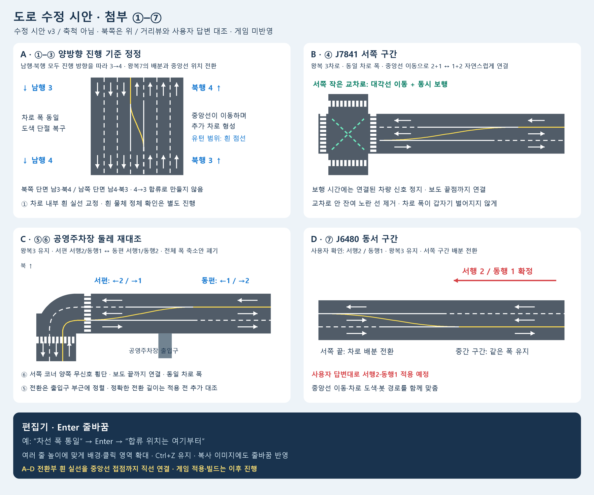

# 첨부 7장 도로 수정 시안 — 사용자 확인 대기

## 이관과 범위
- 사용자 명시 지시에 따라 다른 채팅에서 이관받았다. `artifacts/j7841-report/incoming/report-1.png`부터 `report-7.png`까지 7장을 모두 직접 열어 문구와 영역을 확인했다.
- 새 7장 도로는 시안을 먼저 보여주고 사용자 확인 후 구현한다. 현재 지도/게임 코드에 새 요구를 적용하지 않았다. 캡처 편집기 Enter 줄바꿈 요청도 미구현으로 남겨 함께 진행한다.
- 기존 첫 제보를 적용한 r46 작업과 구분한다. 해당 미커밋 소스/지도/빌드는 그대로 보존한다. r46 이어하기 로그 `LIVE_CAMPAIGN_RELOAD_OK checks=23`, 화면 검사 로그 `ROAD_SIGNAGE_PLAYER_OK checks=340` 확인. 배포 manifest가 아직 r45이므로 기존 r46 작업의 배포 마무리도 남아 있다. 이번에는 빌드/푸시 없음.

## 최초 시안 (아래 v2 정정으로 대체)

독립 기술 개념도이며 실제 게임 수정 화면·실측 축척이 아니다. 이미지 합성으로 원본을 수정하지 않았고 선/화살표/단면을 별도로 도식화했다.
- A/①–③: J7841 북쪽/J7876. 북행3, 동일 차로 폭, 누락 도색 복구와 완만한 4↔3 전환. 유턴 허용 범위 중앙선은 최신 요청인 흰 점선. 흰 물체는 정체 확인 전 삭제하지 않는다.
- B/④: J7841 서쪽 왕복3, 2+1↔1+2 중앙선 전환, 잔여 노란선 제거. 서쪽 교차로의 대각선 보행/동시 보행과 차량 정지 조합.
- C/⑤⑥: J6481 표시 지점까지2차로 후1차로 합류, 잘못된 흰 실선 제거, 코너 양쪽 연결에 신호 없는 횡단보도.
- D/⑦: J6480 동서 왕복3, 동일 폭과 서쪽 배분 전환. 빨간 화살표를 서행 주행 방향으로 읽은 가안이므로 확인 전 방향 확정 금지.
- 편집기: Enter 여러 줄, 글줄 수에 따른 배경·선택 높이, Ctrl+Z 및 이미지 줄바꿈 보존 예정.

## 최초 질문 (답변 완료, 재질문하지 않음)
1. ②③ 4→3 감소는 북행인지 남행인지. 도식의 4+3↔3+3은 미확정 단면이다.
2. ⑦ 빨간 화살표가 실제 서행을 뜻하는지 단순 구간 범위인지. 현재 도식은 서행2/동행1 가안이다.
3. 위 방향을 확정한 A–D 시안 승인 또는 수정 의견.

## 검증·보존
- 7장 직접 시각 확인, 개념도 PNG 생성 및 렌더 확인.
- 새 코드 테스트/물리 주행/캠페인/빌드/배포 검사는 하지 않았다. 사용자 Scene·PackageManagerSettings·content/·기획 문서 및 이관 r46 변경을 섞지 않는다.
- 시안 생성 스크립트는 `artifacts/j7841-report/proposal.py`, 검토 PNG는 `docs/content-design/images/eungye-seven-road-proposal.png`.

## 2026-11-17 v2 — A 진행 방향 정정, C 거리뷰 재대조

- 사용자 최신 정정: A는 남행·북행 각각 자신의 진행 방향으로 3→4차로가 된다. 왕복7의 배분이 바뀌는 것으로, 기존 4→3 합류 및 4+3↔3+3 도식을 폐기했다. D는 서행2/동행1 확정. B는 수정 요청 없음.
- C만 수정 필요라는 답변 뒤 A의 잘못된 방향도 참고하라는 요청을 받았다. 따라서 A/C를 다시 그렸으며 새 도로 구현 승인으로 확대하지 않았다.
- 내부 브라우저의 실제 네이버 거리뷰 탭을 다시 사용했다. 남행 [버스정류장 부근 2026-05](https://map.naver.com/p?c=16,0,0,0,adh&p=boK3lZCbQ6zUKwmeyGFBCw,-174,-20,80,Float)에서 남쪽 교차로 접근의 추가 차로를 대조했다. 북행 [2024-10, 해당 촬영점 최신](https://map.naver.com/p?c=16,0,0,0,adh&p=ImOq5oBQ9sEuKrA1og0n5g,6,-20,80,Float)에서 4차로를 확인했다. 두 촬영점 날짜가 다르며 확폭 시작점의 실측을 마쳤다는 뜻은 아니다.
- C의 [서편 서향 2026-05](https://map.naver.com/p?c=19,0,0,0,adh&p=tcf7rsX3k9gbe7-iOy9TyQ,285,-22,80,Float), [주차장 출입구 부근](https://map.naver.com/p?c=19,0,0,0,adh&p=RHKYG5qaPX6x-WSGz07_qw,275,-20,80,Float), [동편 동향](https://map.naver.com/p?c=19,0,0,0,adh&p=TRAthhhUgcTIuGnTLvRPLQ,95,-25,70,Float)을 실제 화면으로 대조했다. 서편은 서행2/동행1, 동편은 서행1/동행2로 읽힌다. 동편 사진의 두 차로에 좌/우 화살표가 보인다. 이를 연결하는 시안은 왕복3 유지·중앙선 이동이며, 이전의 도로 전체 3→2 축소 도식은 폐기한다.
- 서쪽으로 이동한 `Ma-oMxv62xEHVtITGmjdOg`에서 횡단보도를, `_fK0L9gpFb32-LWa5XqWAQ` 남향에서 남행2/북행1을 대조했다. 코너 두 횡단보도는 원본⑥ 요청대로 무신호로 제시했다. 단, 이 그림은 위치·전환 길이 실측 결과가 아닌 개념도다.
- C의 출입구 전후 중앙선 이동 범위와 원본⑤ 화살표 끝점의 정확한 대응은 구현 전에 추가 대조한다. 모호한 전환 길이를 임의로 확정하지 않았다.

### 실제 변경과 검증
- 독립 도식 PNG v2를 재생성하고 직접 열어 A 양방향3→4, C 왕복3 유지·코너·주차장 입구 구분, D 확정 문구를 확인했다.
- 변경: 시안 PNG, 이 기록, LATEST의 해당 시안 문단. 생성 스크립트는 동일 `artifacts/j7841-report/proposal.py`.
- 새 게임 코드·지도·빌드·테스트·push 없음. 기존 r46 및 사용자 변경은 보존했다. Enter 줄바꿈은 여전히 미구현이다.
- 다음: 사용자 시안 검토, C 전환 범위 세부 대조, 승인 범위 구현과 회귀/빌드. 기존 r46 배포 manifest 마무리는 별도 유지.

## v3 — J7973 네 모서리 섬·우회전 분리 및 도색 접점

- 사용자 새 첨부 3장을 기준으로 요구를 추가했다. J7973 남측 x792.6545/z339.640839와 북측 x801.9835/z477.33493의 왕복7, 일정 차로 폭과 도색 정렬, 긴 우회전 접근 연결을 기록했다.
- 교차로 네 모서리에 작은 신호등 섬, 인도와 섬 사이의 독립 우회전 통로를 갖는 별도 개념도 `docs/content-design/images/eungye-j7973-islands-proposal.png`를 작성했다. 실제 비스듬한 교차각·방향별 배분·분기 길이·섬 치수는 이 개념도로 확정하지 않는다.
- A/B/C/D의 흰 차선은 전환부에서 잘라 두지 않고 중앙선 곡선의 접점까지 직선 실선으로 연장했다. 기존 일반 구간의 점선과 유턴 허용 범위의 흰 점선은 별개다.
- 두 PNG를 재생성하여 직접 열어 확인했다. 새 게임 코드/지도 구현, 테스트/빌드/push는 아직 없음. 사용자 시안 우선 검토 범위를 유지하며 기존 r46 및 다른 사용자 변경을 보존했다.
