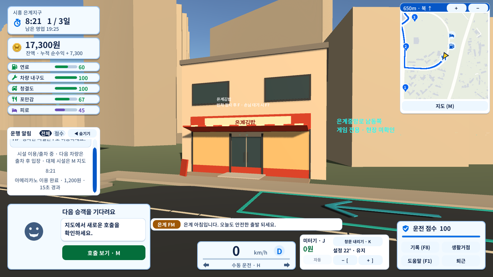
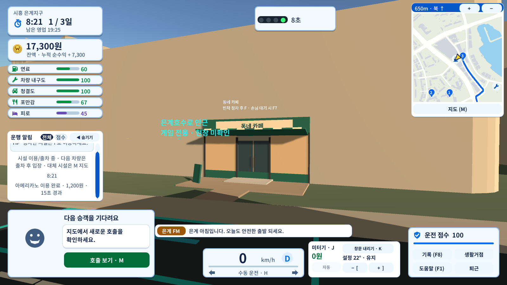

# 건물 점포로 옮긴 김밥·카페와 변속감 있는 주행음

2026-11-23 · 은계 r52 · 자체 도시 PvP A2 / LAN v24(LAN 프로토콜 변경 없음)

## 요구사항

1. 일부 시설이 가판대처럼 보이므로 건물 위치에 생활시설을 두고 들어가는 입구를 만든다.
2. 주행음 효과음이 이상하게 들리므로 고친다.
3. 동시에 진행 중인 작업과 충돌하는 부분을 알린다.

## 구현

### 은계김밥·동네 카페 점포 (`RefreshmentStorefronts.cs`, `RefreshmentShops.cs`)

- 기존 김밥·카페는 정차 포켓 옆 보도 위의 1.8m 포장 매대(박스·차양)였다. 이를 정차 포켓 뒤 건물의 1층 점포로 바꿨다.
- 배치 규칙: 포켓 대기 지점에서 도로 반대쪽으로 16m 안에 도로를 향한 일반 건물 벽(높이 3.5m 이상, 길이 7.5m 이상)이 있으면 그 벽에 점포 전면을 붙인다. 유치원·학교·교회·주민센터 같은 공공·교육 시설은 제외한다. 그런 벽이 없으면 보도·도로·건물과 겹치지 않는 빈 땅에 9×8×7m 2층 상가 건물을 세운다. 이때 도로를 따라 ±10m, 뒤로 6m까지 옮겨 보며 자리를 찾는다. 상가 건물에는 충돌체가 있다.
- 점포 전면: 하단 벽, 조명이 켜진 진열창 두 장, 유리 양문과 손잡이, 상호 간판, 줄무늬 차양, 출입 계단, 점포 앞 포장, 입간판. 대기 지점에서 점포 앞 포장까지 폭 1.6m 진입로를 깔았다. 주문 안내 문구는 점포 위에 둔다.
- 결과(실행본 로그): 은계김밥(EG-GAME-03)은 옆 건물이 공립단설은계유치원이라 **새 상가 건물**에 들어갔다. 출입문은 (1109.2, 713.0)이고, 대기 지점에서 출입문까지 6.6m다. 동네 카페(EG-GAME-06)는 **시흥센트럴돔그랑트리캐슬 저층부 벽**에 붙었다. 출입문은 (645.7, 1246.7)이고, 대기 지점에서 출입문까지 6.2m다.
- 정차 칸, F/F7 주문 조건, 가격, 지도 안내는 바꾸지 않았다. 점포를 놓지 못하는 지도에서는 기존 매대를 그리고 경고 로그를 남긴다.




### 주행음 (`VehicleAudio.cs`, `Engine.wav`, `Road.wav`)

원인으로 본 점(실청이 아니라 녹음 분석과 계산식으로 판단):

- 엔진 음높이가 차속에 비례해 0.76배에서 약 1.8배까지 계속 올라갔다. 변속 없이 사이렌처럼 상승하고, 고속에서는 녹음이 빨리 감긴 소리(칩멍크)가 됐다.
- 노면음 10초 루프 안에 −25 → −12 dBFS로 13.6dB 부푸는 구간이 있었다. 속도와 관계없이 10초마다 "쏴아" 하는 파도 소리가 반복됐다.
- 엔진 2.75초 루프도 5dB 정도 출렁였다. 페달을 떼면 음량과 음높이가 65ms 만에 뚝 떨어졌다.

수정:

- 6단 자동변속 모델을 넣었다. 저부하 변속점은 18/32/48/62/75km/h이고, 가속 페달을 밟을수록 최대 1.6배 늦게 변속한다. 변속점의 72%에서 저단으로 내려간다. 회전수는 단수별 km/h당 계수와 부하로 정하며, 출발할 때는 토크컨버터 미끄럼을 반영한다(공회전 800rpm). 음높이는 0.82~1.55 범위에 머물고, 단 안에서 오르다가 변속하면 내려간다.
- 부하와 회전수에 관성을 두었다(부하 0.12초, 회전 상승 0.22초·하강 0.16초). 그래서 페달을 떼거나 제동해도 소리가 뚝 끊기지 않는다.
- 혼합 비율: 엔진 0.20~0.69, 노면·바람 0.62·v²/(v²+90)이다. 시가지 속도를 넘으면 노면음이 엔진보다 커진다. 노면 음높이는 1로 고정했다.
- 원본 CC0 녹음 편집본의 레벨을 다듬었다. 엔진은 0.6초, 노면은 1초 창으로 완만하게 게인을 조절하고 루프 이음을 다시 크로스페이드했다. 노면음의 125ms 단위 레벨 폭은 13.6dB에서 6.1dB로, 엔진은 5.2dB에서 4.0dB로 줄었다. `licenses/vehicle-recordings.txt`에 편집 사실을 추가했다.
- 미리듣기(같은 계산식으로 렌더링, 0초 공회전 → 1~9.5초 급가속 약 56km/h → 정속 → 11.5초부터 제동 정지): [이전](../content-design/audio/taxi-drive-before-2026-11-23.wav) · [수정](../content-design/audio/taxi-drive-gearbox-2026-11-23.wav). 두 파일은 각각 최고 레벨로 정규화했다.

### 주행음 2차 조정: 경주차 같다는 피드백

1차 수정본을 듣고 "택시인데 경주용 차량 같다, 일반 차량 정도면 좋겠다"는 피드백을 받았다. 가속 장면 녹음의 거친 음색에 높은 회전수와 큰 엔진 음량이 겹친 것으로 보고 다음과 같이 낮췄다.

- 엔진 루프에 550Hz 2차 저역 통과를 적용해 실내에서 듣는 둔한 소리로 만들었다.
- 가속 시 변속 지연을 최대 1.6배에서 1.3배로, 출발 회전 상승을 +900rpm에서 +500rpm으로, 최고 회전을 4,200rpm에서 3,200rpm으로 줄였다.
- 음높이 범위를 0.82~1.55에서 0.88~1.28로 좁혔다. 엔진 음량은 0.20~0.69에서 0.12~0.38로 내렸다. 노면음은 그대로 두어 주행 중에는 노면음이 주로 들린다.
- 검사 기준도 조용한 엔진에 맞췄다. 편집기 정속 RMS 기준은 0.10에서 0.05로, 실행본 하강 기준은 음높이 +0.08·음량 +0.025로 바꿨다.
- 재빌드 후 `CABIN_SOUND_CHECKS_OK`, 실행본 `CABIN_PLAYER_OK checks=35`. 실측값은 `fastPitch=1.032 fastLevel=0.165 restPitch=0.894 restLevel=0.124`, 노면 `cruise=0.376`이다. 가게 검사는 이번 변경과 무관해 다시 돌리지 않았다.
- 미리듣기: [일반 승용차 조정본](../content-design/audio/taxi-drive-sedan-2026-11-23.wav). 위 "수정" 파일은 1차 수정본이다. 실청 확인은 남았다.

### 검사 보강 (`ShiftDevEndProbe.cs`)

- `-refreshmentCheck` 검사가 이제 두 가게에서 다음을 확인한다. 점포 오브젝트가 있는지, 포장 매대가 없는지, 출입문이 포켓 쪽을 향하는지, 진입로가 1~20m인지. 확인 후 점포 정면을 캡처한다.
- `-taxiAudioCheck`가 45km/h에서 정지할 때의 엔진 음높이·음량을 로그로 남긴다(`TAXI_ENGINE_MIX`). 변속 모델에서는 음높이가 속도에 선형으로 오르지 않는다. 그래서 하강 기준을 음높이 +0.25에서 +0.15로, 음량 +0.08에서 +0.06으로 바꿨다. 실측값은 음높이 1.077 → 0.844, 음량 0.291 → 0.208이다.

## 변경 파일

- `unity/EungyeTaxi/Assets/Scripts/RefreshmentStorefronts.cs`(신규), `RefreshmentShops.cs`, `VehicleAudio.cs`, `ShiftDevEndProbe.cs`
- `unity/EungyeTaxi/Assets/Resources/Audio/Taxi/Engine.wav`, `Road.wav`, `licenses/vehicle-recordings.txt`
- `docs/content-design/04-life-vehicle-economy.md`(3장 가게 외형), 이미지 2장, 미리듣기 2개, 이 기록

## 검증 (작업 트리 `storefront-drive-audio`, Unity 2022.3.62f2)

- `CabinSoundChecks.VerifyAndBuild`: `CABIN_SOUND_CHECKS_OK places=39 clips=6`, `PROTOTYPE_BUILD_OK`, 종료 0.
- 실행본 `-cabinControlsCheck -taxiAudioCheck`: `CABIN_PLAYER_OK checks=35`, 종료 0. 측정값은 `TAXI_ENGINE_MIX fastPitch=1.077 fastLevel=0.291 restPitch=0.844 restLevel=0.208`, `TAXI_ROAD_MIX cruise=0.376 rest=0 pitch=1`.
- 실행본 `-facilityArtCheck -refreshmentCheck`: `REFRESHMENT_PLAYER_OK checks=40`(기존 36 + 점포 4), 종료 0.
- 최종 소스 재빌드 뒤 같은 검사를 3회 실행했다. 1회는 기존 항목 `saved shop payment and time`에서 실패했고(종료 2), 이어서 2회는 통과했다. 이 검사를 포함한 앞선 실행 5회 중 실패는 이 1회다. 실패 지점은 첫 가게 결제 직후 저장 파일을 다시 읽는 기존 검사다. 점포 검사보다 먼저 실행되고 이번 변경과 무관한 경로이므로 간헐 실패로 기록한다. 원인 조사는 남았다.
- 첫 실행에서는 카페 점포 배치가 실패했다(C# 벽 방향 부호 반전). 엔진 하강 검사도 이전 기준(+0.25)으로 실패했다. 둘 다 수정한 뒤 재빌드해 위 결과를 얻었다.
- 캡처는 숨김 창(`-WindowStyle Hidden`)에서는 흰 화면으로 저장됐다. 창을 보이게 해서 다시 캡처했다.
- 미검증: 스피커·헤드폰 실청, 키보드·패드 수동 주행에서의 변속감, 밤 조명 아래 점포 모습, 전체 캠페인. 배포 실행 폴더 `builds/EungyeTaxi/`와 배포 manifest는 갱신하지 않았다(아래 충돌 참고).

## 동시 작업과의 충돌

이 작업은 `main` 작업 폴더의 미커밋 작업(08장 2 좋은 운전 칭찬·팁·연속 기록)과 섞이지 않게 별도 작업 트리와 브랜치 `storefront-drive-audio`에서 했다.

- 소스 파일은 겹치지 않는다. 미커밋 작업은 `DriveNotifications`, `DrivingManners`, `PassengerJobs`, 콘텐츠 catalog 등을 고친다.
- `04-life-vehicle-economy.md`는 양쪽이 모두 고치지만 위치가 다르다(팁 문단 약 211행 / 3장 가게 약 466행).
- 충돌이 나는 곳: `builds/EungyeTaxi/` 실행 파일 전체, `distribution/EungyeTaxi-build-manifest.json`, `ThirdPartyNotices/vehicle-recordings.txt`, `LATEST.md`, `CURRENT-STATE.md`. 두 작업을 모두 합친 뒤 한 번만 `PrototypeBuild.BuildHybrid`로 다시 빌드하고 manifest를 다시 만들어야 한다.

## 재현

```
Unity.exe -batchmode -nographics -quit -projectPath unity/EungyeTaxi -executeMethod CabinSoundChecks.VerifyAndBuild -logFile artifacts/storefront-audio/build.log
builds/EungyeTaxi/EungyeTaxi.exe -facilityArtCheck -refreshmentCheck -shiftCaptureOutput <폴더> -logFile <로그>
builds/EungyeTaxi/EungyeTaxi.exe -cabinControlsCheck -taxiAudioCheck -shiftCaptureOutput <폴더> -logFile <로그>
```

게임에서는 M 지도 → 생활시설 비교 → 간식·커피로 길 안내를 받아 점포를 확인한다.
