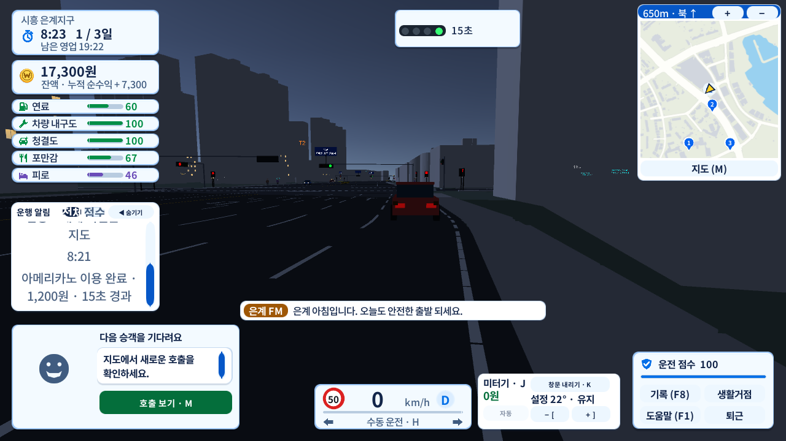
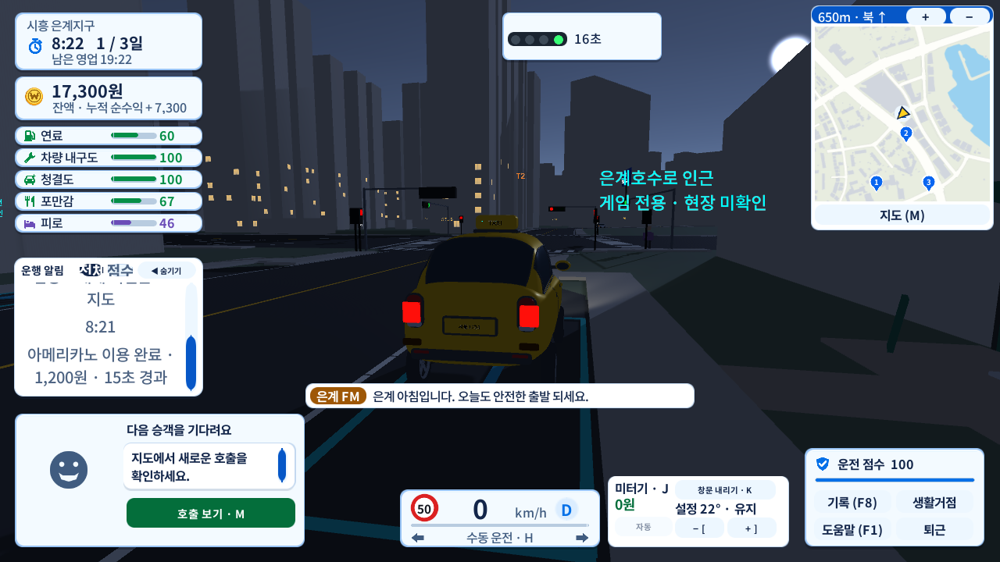
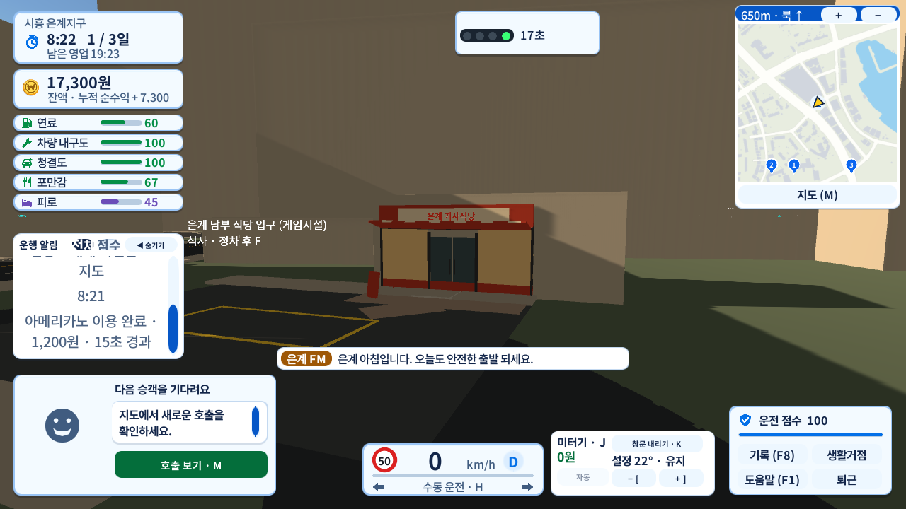

# 직접 플레이 피드백 2차: 야간 후미등·가게 전용 포켓·기사식당 점포·저장 슬롯 3개

2026-11-24 · 은계 싱글 r53 · 자체 도시 PvP A2 / LAN v25(PvP·지도 변경 없음)

## 요구사항 (사용자 2026-11-24)

1. 브레이크·스키드·바람 소리용 무료 음원 후보 찾기.
2. 밤에 차가 안 보이므로 차 후면에 야간등을 넣는다.
3. 게임 전반에 동작 설명 텍스트가 많다. 가이드·툴팁으로 빼고 가독성을 높인다. **수정 전에 시안을 보여주고 승인받는다.**
4. 생활 시설
   - 은계김밥·아메리카노(카페)에서 승객 승하차와 겹치지 않게 한다.
   - "아메리카노"는 "○○카페"로 이름을 바꾼다(이름은 작업자가 정함).
   - 다른 기사 식당도 은계김밥 같은 디자인으로 보이게 한다.
5. 저장 슬롯은 3개만 둔다.

## 구현

### 야간 후미등 (`DayLightCity.cs`, `DayLightController.cs`, `TrafficCar.cs`)

- 일반 차량: 뒤 램프는 해가 지면 어두운 빨강으로 켜지고 제동하면 밝은 빨강이 된다. 앞에는 아이보리 전조등 면을 새로 붙였다. 방향지시등도 밤에 밝게 보인다. 실제 조명(Light)을 늘리지 않고, 신호등에 쓰던 "밤에 스스로 빛나는 면" 방식(`RegisterNightReadable`)을 썼다.
- 택시(내 차와 PvP 상대 차): 야간 전조등 묶음에 빨간 후미등 면 두 개를 더했다.
- 켜지는 시점: 기존에는 19시(밤 단계)부터였다. 노을이 절반 이상 진행된 때(약 17시 50분, 조명 계수 0.5)부터 켜지게 당겼다. 신호등·노면 화살표의 야간 표시도 같은 시점에 켜진다.




### 가게 전용 포켓 (`PassengerJobs.cs`, `PassengerJobsChain.cs`, `PassengerJobsCallBoard.cs`)

- 은계김밥(EG-GAME-03)과 카페(EG-GAME-06) 포켓은 승객 정류장과 같은 칸이었다. 그래서 손님이 서 있으면 F가 승차로 먹고 가게는 F7로 열어야 했다.
- 두 포켓을 가게 전용으로 바꿨다(`PassengerJobs.ShopOnly`). 길가 승객이 서지 않고, 호출·첫 배차·연속 배차·목적지 변경/경유·정차 중 모아 보기의 승차지와 하차지에서 뺐다. 정류장 목록과 번호는 그대로라 기존 저장과 호환된다.
- 가게 안내 문구에서 "손님 대기 시 F7"을 지웠다.
- 은계 싱글 영업에만 적용된다(가게가 있는 조건과 같다). PvP와 연습은 바뀌지 않는다.

### 카페 이름과 지도 표지 (`DriverCondition.cs`, `MapDestinationUI.cs`)

- "동네 카페" → **호수카페**(은계호수공원 서쪽이라 붙인 이름). 지도 위 표지는 메뉴 이름(아메리카노·야채김밥 한 줄) 대신 가게 이름(호수카페·은계김밥)을 쓴다.

### 기사식당 점포 (`RefreshmentStorefronts.cs`, `ProjectMapScene.cs`)

- 은계 남부 기사식당은 주차 칸 선과 떠 있는 글자만 있었고, 옆의 "은계 밥집" 건물은 민무늬 상자였다.
- 그 건물의 주차 칸 쪽 벽에 은계김밥과 같은 점포 전면(진열창·유리 양문·간판 "은계 기사식당"·줄무늬 차양·계단·포장·입간판)을 붙이고, 주차 구역 가장자리에서 출입문까지 진입로를 깔았다. 실행 로그: `REFRESHMENT_STOREFRONT shop=은계 기사식당 mode=facade building=restaurant 은계 밥집 door=(693.6, 0.0, 300.8) path=7.4`.
- 지도에 식당 건물이 없는 경우에는 주차 구역과 진출입 차로를 피해 빈 땅에 상가 건물을 세우도록 했다(은계에서는 쓰이지 않는 경로).
- 은계의 기사식당은 이 한 곳이다.



### 저장 슬롯 3개 (`CampaignSaveLocation.cs`, `UnifiedModeBootstrap.cs`, `BusinessProgress.cs`, `DriveHUD.cs`, `OneDayHUD.cs`)

- 경력 저장은 새로 시작할 때마다 파일이 늘어나는 방식이었다. 목록을 최근 3개로 제한했다(`MaxCareers=3`). 표기는 "슬롯 n · 날짜"다.
- 시작 화면 "처음부터 하기": 슬롯이 3개 차 있으면 "덮어쓸 슬롯 선택" 화면이 나오고, 고른 뒤 "덮어쓰고 시작"을 눌러야 진행한다.
- 게임 안 "처음부터 다시하기": 슬롯이 3개 차 있으면 지금 경력의 슬롯을 대신한다. 확인 화면 문구가 이를 알려준다.
- 덮어쓴 경력은 지우지 않고 저장 폴더 안 `replaced-careers/<시각>/`으로 옮긴다. 실수로 덮어써도 손으로 되돌릴 수 있다.
- 이미 3개를 넘는 파일이 있는 PC에서는 최근 3개만 보이고 나머지는 디스크에 그대로 남는다. 이 PC의 저장은 정확히 3개다.
- 게임에 수동 "저장하기"는 없고 자동 저장이다. 그래서 슬롯 수 제한은 불러오기 목록과 새 경력 시작에 적용했다.

### 검사 보강 (`ShiftDevEndProbe.cs`)

`-refreshmentCheck`에 가게 포켓에 승객이 없는지, 호출이 가게 포켓을 쓰지 않는지, 가게 전용 포켓이 정확히 2개인지, 기사식당 점포가 있는지와 출입문 거리 검사를 넣었다. 점포 정면과 택시·일반 차량의 앞뒤 모습을 캡처한다(`-dayLightNightProbe`와 함께 쓰면 밤 모습).

## 텍스트 줄이기 시안 (승인 대기, 게임 화면은 바꾸지 않음)

[시안 문서](../ui/2026-11-24-text-reduction/proposal.html). 네 화면(주행 알림·호출 대기, 지도 시설 비교, 길 위 표지·장소 설명, 하루 마감)의 지금/제안을 나란히 그렸다. 원칙은 네 가지다: 화면에는 지금 필요한 것만, 조작은 키 배지, 규칙 설명은 F1 가이드 탭, 궁금할 때만 ⓘ 툴팁. 승인되면 가이드·툴팁 부품 → 주행 화면 → 지도·시설 → 마감 화면 순으로 나눠 적용하고 단계마다 전후 캡처를 보인다.

## 음원 후보 (내려받지 않음, 승인 대기)

Freesound에서 CC0(저작자 표시 불필요) 조건으로 찾았다. 페이지의 라이선스 표기와 길이만 확인했고 소리는 듣지 못했다. 내려받기는 Freesound 로그인이 필요하다.

| 용도 | 후보 | 길이 | 설명(게시자 표기) |
|---|---|---|---|
| 브레이크 | [Car Brakes sqeak screech squeal stop](https://freesound.org/people/WavJunction.com/sounds/456764/) | 12초 | 엔진 소리 없이 브레이크 끽 소리만 |
| 브레이크 | [R04-12 Car Comes to a Stop](https://freesound.org/people/craigsmith/sounds/481706/) | 14초 | 가속 뒤 끽 소리를 내며 정지 |
| 브레이크 | [R04-08 Car with Squeaky Brakes](https://freesound.org/people/craigsmith/sounds/481702/) | 14초 | 지나가다 끽 소리를 내며 정지 |
| 스키드 | [Car peels off](https://freesound.org/people/therisingorder/sounds/271337/) | 3초 | 타이어 미끄러짐 |
| 스키드 | [Chrysler LHS tire squeal 02](https://freesound.org/people/audible-edge/sounds/71737/) | 11초 | 급코너 타이어 비명 |
| 스키드 | [R03-19 Old Auto Tire Skid](https://freesound.org/people/craigsmith/sounds/481668/) | 6초 | 짧고 긴 스키드 두 번 |
| 바람·실내 | [Highway drive interior](https://freesound.org/people/gecop/sounds/521766/) | 50초 | 고속도로 정속 실내음 |
| 바람·실내 | [Driving with the windows down](https://freesound.org/people/audible-edge/sounds/72830/) | 297초 | 창문 내린 주행 |
| 바람·실내 | [Interior of a car driving a highway](https://freesound.org/people/leonelmail/sounds/570461/) | 1253초 | 저속에서 고속까지 실내음 |

"끽" 하는 브레이크 소리는 정비 불량 차처럼 들릴 수 있다. 평소 제동에는 넣지 않고 급제동에만 짧게 쓰는 쪽을 권한다.

## 변경 파일

- `unity/EungyeTaxi/Assets/Scripts/`: `DayLightCity.cs`, `DayLightController.cs`, `TrafficCar.cs`, `PassengerJobs.cs`, `PassengerJobsChain.cs`, `PassengerJobsCallBoard.cs`, `DriverCondition.cs`, `MapDestinationUI.cs`, `RefreshmentShops.cs`, `RefreshmentStorefronts.cs`, `ProjectMapScene.cs`, `CampaignSaveLocation.cs`, `UnifiedModeBootstrap.cs`, `BusinessProgress.cs`, `DriveHUD.cs`, `OneDayHUD.cs`, `ShiftDevEndProbe.cs`
- `docs/content-design/04-life-vehicle-economy.md`, `docs/CURRENT-STATE.md`, `docs/work-history/LATEST.md`, 이 기록
- `docs/ui/2026-11-24-text-reduction/proposal.html`, `docs/ui/2026-11-24-test-feedback-2/`(캡처 5장)
- 배포: `builds/EungyeTaxi/`, `distribution/EungyeTaxi-build-manifest.json`
- 지도 문서와 필수 지도 입력은 바꾸지 않았다.

## 검증 (Unity 2022.3.62f2, 이 PC)

| 구분 | 명령 | 결과 |
|---|---|---|
| 빌드 | `PrototypeBuild.BuildHybrid` | `PROTOTYPE_BUILD_OK`, 종료 0 |
| 실행본(위치 제어) | `-facilityArtCheck -refreshmentCheck` | `REFRESHMENT_PLAYER_OK checks=47`(기존 40 + 가게 포켓 4 + 기사식당 2 + 차량 1) |
| 실행본(위치 제어, 밤) | 위 명령 + `-dayLightNightProbe` | `REFRESHMENT_PLAYER_OK checks=47`, 후미등·전조등 캡처 확인 |
| 실행본(위치 제어) | `-contentTest -callBoardCheck` | `CALL_BOARD_PLAYER_OK checks=115` |
| 실행본(위치 제어) | `-brightUiCheck` | `BRIGHT_UI_RESULT PASS checks=102` |
| 실행본(위치 제어) | `-careerCheck`, `-careerReload` | `CAREER_PLAYER_OK checks=16`, `CAREER_RELOAD_PLAYER_OK checks=5`(새 경력이 별도 슬롯으로 열리고 이전 경력 보존) |
| 실행본(위치 제어) | `-unifiedModeCheck` | `UNIFIED_MODE_RESULT PASS`(시작 화면에서 저장 열기·새 경력) |

검사 중 겪은 일:

- `-callBoardCheck`를 `-contentTest` 없이 돌리면 이 PC의 실제 저장을 읽어 "board 0 has calls"에서 실패한다. 가게 포켓 규칙을 끈 빌드에서도 똑같이 실패해 이번 변경과 무관함을 확인했다. 기록된 통과 명령은 `-contentTest -callBoardCheck`다.
- `-careerCheck`는 `artifacts/career-player/`에 남은 이전 검사 저장이 있으면 첫 항목에서 실패한다. 폴더를 지우고 다시 돌려 통과했다.
- 첫 시도에서 기사식당은 빈 땅을 찾지 못했다(주변이 도로·보도·건물). 지도에 이미 있는 "은계 밥집" 건물 벽에 붙이도록 바꿨다.
- 실행본 검사 전에 이 PC의 저장 폴더와 설정(레지스트리)을 백업했고 검사 뒤 되돌렸다.

미검증:

- 사람이 밤에 운전하며 본 후미등 체감(밝기·크기), 실제 영업에서 가게 포켓에 손님이 안 서는지의 장시간 확인.
- **슬롯이 3개 찬 상태의 덮어쓰기 흐름**(시작 화면의 슬롯 선택과 게임 안 다시하기, `replaced-careers/` 이동)은 컴파일과 코드 검토만 했고 실행본에서 눌러 보지 않았다. 자동 검사는 슬롯이 비어 있는 경로만 지난다.
- 기사식당 출구 주행(`-restaurantExitTest`)은 다시 돌리지 않았다. 점포 전면에는 충돌체가 없고 기존 건물 벽에 붙는다.
- 전체 캠페인, 수동 플레이.

## 재현

```
Unity.exe -batchmode -nographics -quit -projectPath unity/EungyeTaxi -executeMethod PrototypeBuild.BuildHybrid -logFile artifacts/probes/build.log
builds/EungyeTaxi/EungyeTaxi.exe -facilityArtCheck -refreshmentCheck -dayLightNightProbe -shiftCaptureOutput <폴더> -logFile <로그>
builds/EungyeTaxi/EungyeTaxi.exe -contentTest -callBoardCheck -callBoardOutput <폴더> -logFile <로그>
```

게임에서는 영업 후반(18시 이후)에 앞차 뒤를 보고, M 지도 → 생활시설에서 호수카페·은계김밥·기사 식당으로 길 안내를 받아 확인한다.
