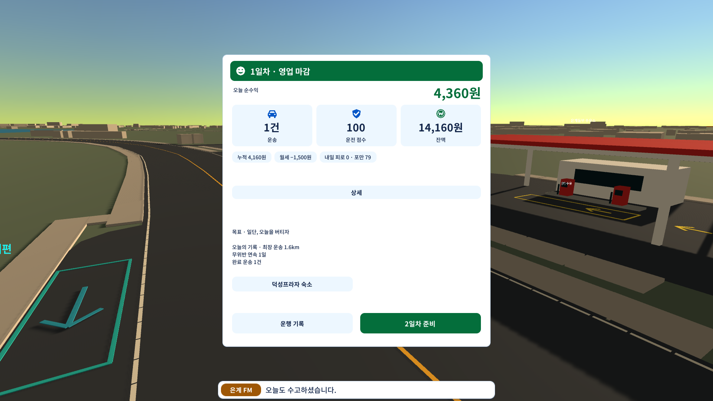
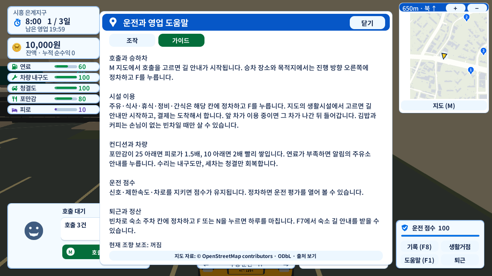
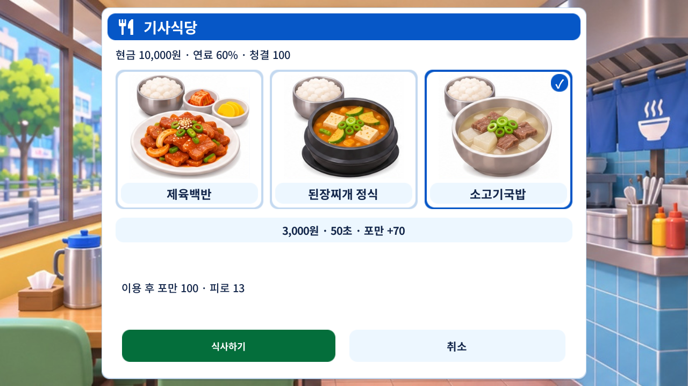
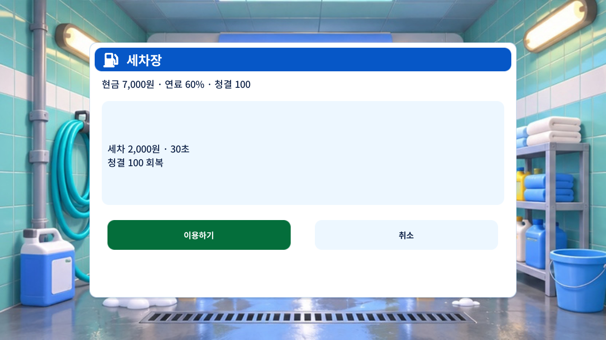

# 텍스트 줄이기 2차: 하루 마감 배치, 시설 팝업·견적, 주유소·공업사 표지

2026-11-24 · 은계 싱글 r53 · 자체 도시 PvP A2 / LAN v25(지도·LAN 프로토콜 변경 없음)

## 요구사항

[1차](2026-11-24-text-reduction.md)에서 남긴 화면을 이어서 줄인다(사용자 2026-11-24 "2차 진행").

## 구현

### 하루 마감 (`OneDayHUD.cs`)

- 숫자 타일 아래 빈 자리에 작은 칩 줄을 넣었다: "누적 4,160원", "월세 −1,500원", "내일 피로 0 · 포만 79". 미납·미완료 경고는 그 아래 줄이다.
- 같은 내용을 따로 적던 작은 글 두 곳(상세 버튼 아래의 누적 순수익·다음 날 줄, 숙소 버튼 위의 월세 줄)을 지웠다.
- 목표와 "오늘의 기록" 묶음은 그대로다.

### 시설 팝업과 견적 (`ServiceStops.cs`)

| 지금까지 | 바꾼 뒤 |
|---|---|
| 제목 "기사식당 · 일시정지" | "기사식당" |
| 현금 · 미납 0원 · 연료 60.0% · 청결 | 현금 · 연료 60% · 청결 (미납은 있을 때만) |
| 모든 메뉴 3,000원 · 50초 · 포만감 +70 (최대 100) | 3,000원 · 50초 · 포만 +70 |
| 부족분은 미납 · 포만감 100 · 피로 13 예상 / 미탑승 호출은 취소됩니다. 엔진 정지 · 점수 변화 없음 | 이용 후 포만 100 · 피로 13 (호출을 수락한 상태면 "수락한 호출이 취소돼요" 한 줄 추가, 현금이 모자랄 때만 "(부족분 미납)") |
| 세차·실내 청소 2,000원 · 30초 (부족분은 미납) / 청결도 100 회복 · 엔진 정지 / 취소 시 비용/시간/청결 변화 없음 | 세차 2,000원 · 30초 / 청결 100 회복 |
| 김밥·커피 견적의 "빈차 전용 · 현금 결제" | 삭제(가이드에 있음) |
| 확정 후 결제됩니다. 이용 시간만큼 승객 대기시간이 줄어듭니다. | 호출 유지 중 주유·세차·수리일 때만 "승객 대기시간이 그만큼 줄어요" |
| 이 견적으로 이용 / 다른 시설·견적 비교 / 차량 부품 · 구매 및 장착 | 이용하기 / 다른 시설 / 부품 구매·장착 |
| 목록 줄 "식당 · 은계 남부 식당 입구 (게임시설)", "자동차 공업사 · 전량 수리", "세차·실내 청소 / 청결 100 회복 / 30초" | "식사", "전량 수리", "세차 / 청결 100 · 30초" |
| 아래 안내 "이용 후 출구로 나가세요.", "다른 시설 찾기: M 지도" | 삭제 |

### 길 위 표지 (`FuelStationLayout.cs`, `WorkshopLayout.cs`)

- 주유소: 이름 아래 "입구 → 주유 구역 → 별도 출구"를 지우고, 정차 안내는 "[F] 주유", 입구·출구 표지는 "입구", "출구"로 줄였다.
- 휴식 구역: "[F] 휴식". 공업사: 이름만, 입구·출구는 한 단어.

### 검사 보강 (`BrightUIProbe.cs`, `DriveHUD.cs`)

`-brightUiCheck`가 F1 도움말의 가이드 탭과 조작 탭을 캡처한다(1차에서 화면으로 보지 못한 부분).






## 손대지 않은 것

- 영수증과 영업 준비 화면은 이미 문구가 짧아 그대로 뒀다.
- PvP 전용 문구(경기 중 식사·휴식 견적), 공업사 수리 견적 본문, 운행 알림의 법규·만족도 문구.
- 하루 마감의 목표·오늘의 기록 묶음.

## 변경 파일

- `unity/EungyeTaxi/Assets/Scripts/`: `OneDayHUD.cs`, `ServiceStops.cs`, `FuelStationLayout.cs`, `WorkshopLayout.cs`, `DriveHUD.cs`, `BrightUIProbe.cs`
- `docs/ui/2026-11-24-text-reduction/`(캡처 4장), `docs/work-history/LATEST.md`, `docs/CURRENT-STATE.md`, 이 기록
- 배포: `builds/EungyeTaxi/`, `distribution/EungyeTaxi-build-manifest.json`

## 검증 (Unity 2022.3.62f2, 이 PC)

| 구분 | 명령 | 결과 |
|---|---|---|
| 빌드 | `PrototypeBuild.BuildHybrid` | `PROTOTYPE_BUILD_OK`, 종료 0 |
| 실행본(위치 제어) | `-brightUiCheck` | `BRIGHT_UI_RESULT PASS checks=104`(기존 102 + 도움말 캡처 2). 가이드 탭·하루 마감 캡처를 눈으로 확인 |
| 실행본(위치 제어) | `-facilityArtCheck` | `FACILITY_ART_PLAYER_OK checks=28`. 식당·세차 팝업 캡처를 눈으로 확인 |
| 실행본(위치 제어) | `-facilityArtCheck -refreshmentCheck` | `REFRESHMENT_PLAYER_OK checks=47` |
| 실행본(위치 제어) | `-contentTest -callBoardCheck` | `CALL_BOARD_PLAYER_OK`(115~116건, 실행마다 호출 구성에 따라 1건 차이) |

검사 중 겪은 일: 첫 빌드의 캡처에서 삭제 편집 두 곳(월세 줄, "부족분은 미납" 접두)이 적용되지 않은 것을 발견해 고쳤다. 식당 목록 줄의 긴 이름도 캡처에서 발견해 줄였다.

미검증:

- ⓘ 툴팁이 뜨는 모습, 길 위 표지가 45m에서 나타나고 사라지는 모습, 주유소·공업사 표지의 실제 모습(멀리서 찍힌 캡처에 "[F] 주유"가 보이는 정도만 확인).
- 호출을 수락한 상태, 현금이 모자란 상태, 미납이 있는 상태의 문구 분기.
- PvP 화면, 사람 체감, 수동 플레이, 전체 캠페인.
- `-homeBaseCheck` 단독 실행의 기존 실패는 그대로다(원인 미조사).

실행본 검사 전후로 이 PC의 저장 폴더와 설정을 백업·복원했다.

## 재현

```
Unity.exe -batchmode -nographics -quit -projectPath unity/EungyeTaxi -executeMethod PrototypeBuild.BuildHybrid -logFile artifacts/probes/build.log
builds/EungyeTaxi/EungyeTaxi.exe -brightUiCheck -brightUiOutput <폴더> -logFile <로그>
builds/EungyeTaxi/EungyeTaxi.exe -facilityArtCheck -shiftCaptureOutput <폴더> -logFile <로그>
```
