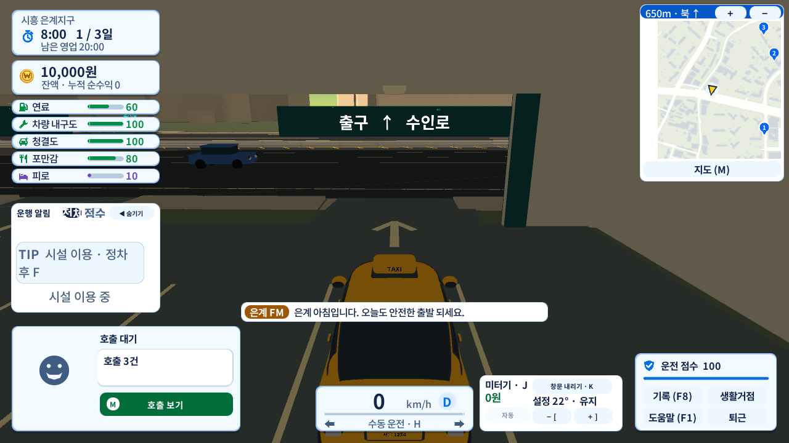
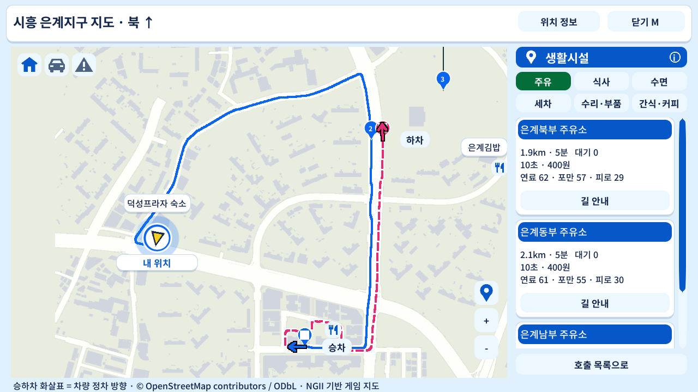
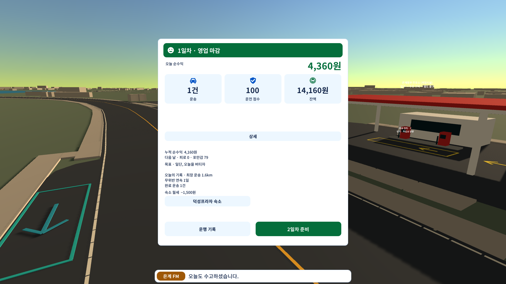

# 텍스트 줄이기 1차: 가이드 탭·툴팁, 주행 알림, 지도 시설, 하루 마감

2026-11-24 · 은계 싱글 r53 · 자체 도시 PvP A2 / LAN v25(지도·LAN 프로토콜 변경 없음)

## 요구사항

직접 플레이 피드백 "동작 설명 텍스트가 게임 전반에 많다. 가이드나 툴팁으로 빼고 가독성을 높인다. 수정 전에 시안을 보여주고 승인받는다."에 대해 [시안](../ui/2026-11-24-text-reduction/proposal.html)을 냈고, 사용자가 2026-11-24에 "시안대로 진행"으로 승인했다.

## 구현

### 1단계: 공용 부품 (`CasualUI.cs`, `DriveHUD.cs`)

- `CasualUI.Key`: 키 배지. "M을 눌러" 같은 문장 대신 쓴다.
- `CasualUI.Info` + `FlushTooltip`: ⓘ 표시에 마우스를 올리면 한두 줄 설명이 뜬다.
- `CasualUI.PlainName`: 화면에 보이는 시설 이름에서 "(게임시설)" 꼬리말을 뺀다. 지도 데이터의 이름은 그대로다.
- F1 도움말에 "조작 / 가이드" 탭을 뒀다. 가이드에는 화면에서 뺀 규칙을 다섯 주제(호출과 승하차, 시설 이용, 컨디션과 차량, 운전 점수, 퇴근과 정산)로 모았다.

### 2단계: 주행 화면 (`CockpitUI.cs`, `DriveNotifications.cs`, `ServiceLawZones.cs`, `ServiceStopsPlanning.cs`)

| 지금까지 | 바꾼 뒤 |
|---|---|
| 다음 승객을 기다려요 / 지도에서 새로운 호출을 확인하세요. / 호출 보기 · M | 호출 대기 / 호출 3건 / [M] 호출 보기 |
| 목적지까지 안전하게 모셔 주세요. | 목적지로 이동 |
| 안내된 승차 장소에서 정차하세요. | 승차 장소로 이동 |
| 시설 이용/출차 중 · 다음 차량은 출차 후 입장 · 대체 시설은 M 지도 | 시설 이용 중 |
| 시설 대기 n번째 · 입장 전 결제/서비스 시간 없음 · F7 대기 취소 · 대체 시설은 M 지도 | 시설 대기 n번째 · F7 대기 취소 |
| 정차 지점 점유 · 안전한 곳에서 대기하거나 대체 지점을 선택하세요. | 정차 지점 점유 중(버튼 두 개는 그대로) |
| 연료 부족 n% / 주유가 필요합니다. | 연료 부족 n%(주유소 안내 버튼은 그대로) |
| 포만감 25 이하 · 피로 1.5배 · 포만감이 25 아래면… 식사하세요. | 포만감 25 이하 · 피로 1.5배 |
| TIP 4종(문장) | 짧은 TIP 5종(마지막은 "자세한 규칙 · F1 가이드") |

### 3단계: 지도 시설과 길 위 표지 (`ServiceStopsPlannerUI.cs`, `MapDestinationUI.cs`, `ProjectMapScene.cs`, `RefreshmentStorefronts.cs`, `WorldBuilder.cs`)

- 생활시설 패널: 시설마다 다섯 줄이던 설명을 세 줄로 줄였다("1.9km · 5분   대기 0" / "10초 · 400원" / "연료 62 · 포만 57 · 피로 29"). 버튼은 "길 안내"다. 패널 위 안내문 두 줄은 머리말의 ⓘ 툴팁으로 옮겼다. 운송 중일 때만 한 줄이 남는다.
- 지도 장소 설명: 진입·정차 방법 문장을 빼고 가격·시간·효과만 남겼다.
- 길 위 표지: "은계 남부 식당 입구 (게임시설) / 식사 · 정차 후 F" → "[F] 식사", 가게는 "[F] 주문". 이름은 간판과 지도가 알려 준다. 이 표지들은 45m 안에서만 보인다.

### 4단계: 하루 마감 (`OneDayHUD.cs`)

- 수입·지출·잔액·미납 상자와 세 줄(운송·미완료·영업 시간, 운전 점수·청결·내구, 포만·피로)을 숫자 타일 세 개(운송, 운전 점수, 잔액)로 바꿨다. 미납이나 미완료가 있을 때만 경고 한 줄이 나온다.
- 뺀 수치는 "상세"의 맨 위 세 줄로 옮겼다.





## 남긴 것 (2차 후보)

- 하루 마감 아래쪽의 작은 글(누적 순수익·다음 날 컨디션, 목표, 오늘의 기록, 월세)은 그대로다. 타일 아래에 빈 자리가 생겼으므로 2차에서 배치를 다시 잡아야 한다.
- 시설 팝업(주유·식당·공업사 실내 화면), 영수증, 영업 준비 화면, 주유소·공업사·휴식 구역의 길 위 표지, PvP 전용 화면은 손대지 않았다.
- 운행 알림의 법규·만족도 문구는 그대로다.

## 변경 파일

- `unity/EungyeTaxi/Assets/Scripts/`: `CasualUI.cs`, `DriveHUD.cs`, `CockpitUI.cs`, `DriveNotifications.cs`, `ServiceLawZones.cs`, `ServiceStopsPlanning.cs`, `ServiceStopsPlannerUI.cs`, `MapDestinationUI.cs`, `ProjectMapScene.cs`, `RefreshmentStorefronts.cs`, `WorldBuilder.cs`, `OneDayHUD.cs`
- `docs/ui/2026-11-24-text-reduction/`(적용 후 캡처 3장), `docs/work-history/LATEST.md`, `docs/CURRENT-STATE.md`, 이 기록
- 배포: `builds/EungyeTaxi/`, `distribution/EungyeTaxi-build-manifest.json`

## 검증 (Unity 2022.3.62f2, 이 PC)

| 구분 | 명령 | 결과 |
|---|---|---|
| 빌드 | `PrototypeBuild.BuildHybrid` | `PROTOTYPE_BUILD_OK`, 종료 0 |
| 실행본(위치 제어) | `-brightUiCheck` | `BRIGHT_UI_RESULT PASS checks=102`. 주행 화면·생활시설 패널·하루 마감 캡처를 눈으로 확인 |
| 실행본(위치 제어) | `-facilityArtCheck -refreshmentCheck` | `REFRESHMENT_PLAYER_OK checks=47` |
| 실행본(위치 제어) | `-contentTest -callBoardCheck` | `CALL_BOARD_PLAYER_OK checks=115` |
| 실행본(위치 제어) | `-homeBaseCheck` | **실패**: "next shift also departs from Plaza". 이 작업 전 배포본(커밋 `1b4f6396`의 `builds/`)에서도 같은 항목이 실패해 기존 문제로 확인했다. 원인은 조사하지 않았다. 최근 기록들은 `-homeBaseCheck -chatNoticeCapture` 조합만 돌렸다 |

미검증:

- F1 "가이드" 탭 화면, ⓘ 툴팁이 뜨는 모습, 길 위 표지가 45m에서 나타나고 사라지는 모습은 캡처하지 않았다(컴파일과 코드 검토만).
- 상세 내역에 옮긴 수치의 표시, 미납·미완료 경고 줄.
- 사람이 읽기 편해졌는지의 체감, 수동 플레이, 전체 캠페인.

실행본 검사 전후로 이 PC의 저장 폴더와 설정을 백업·복원했다.

## 재현

```
Unity.exe -batchmode -nographics -quit -projectPath unity/EungyeTaxi -executeMethod PrototypeBuild.BuildHybrid -logFile artifacts/probes/build.log
builds/EungyeTaxi/EungyeTaxi.exe -brightUiCheck -brightUiOutput <폴더> -logFile <로그>
```

게임에서는 F1 → 가이드, M 지도 → 생활시설, 퇴근 후 마감 화면에서 확인한다.
